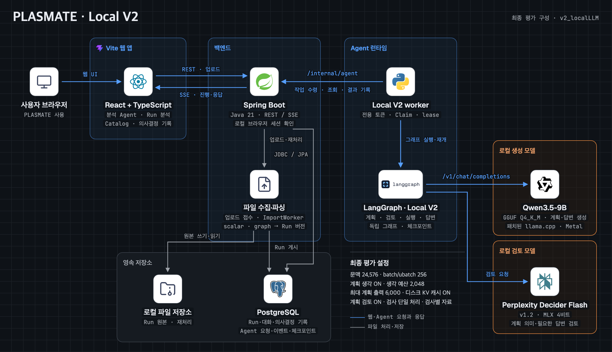
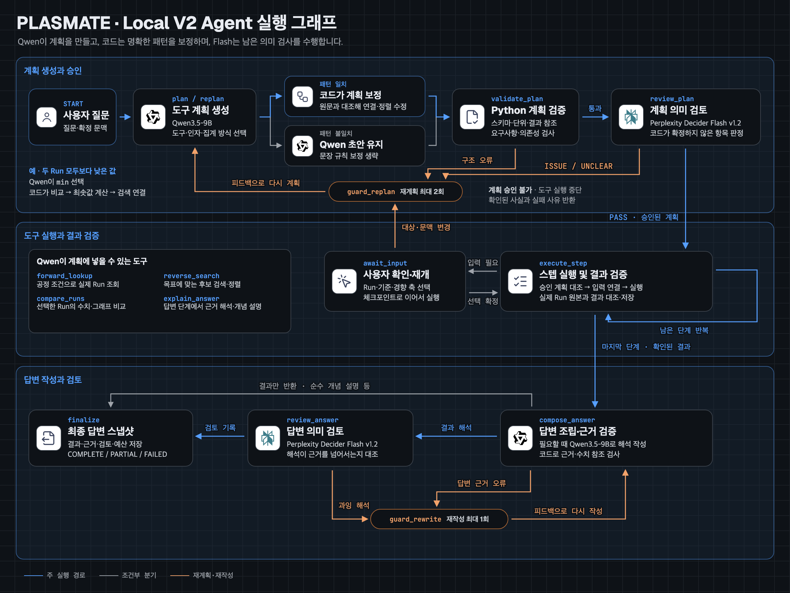
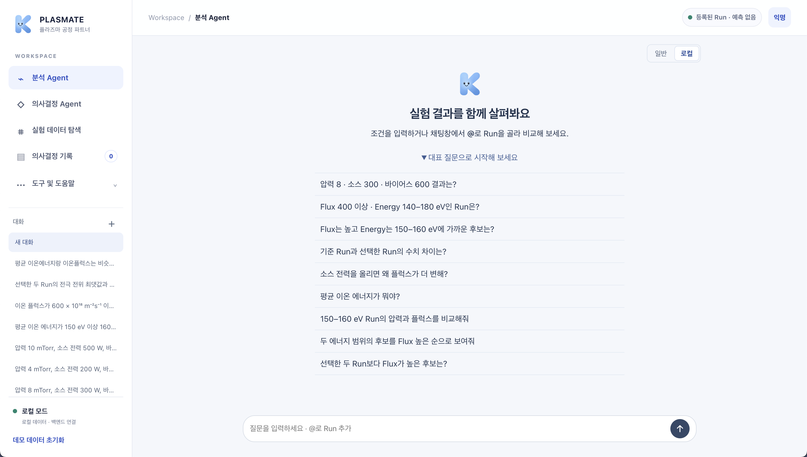
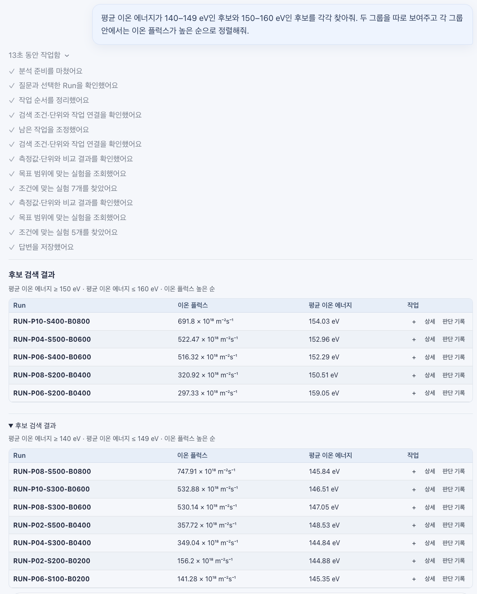
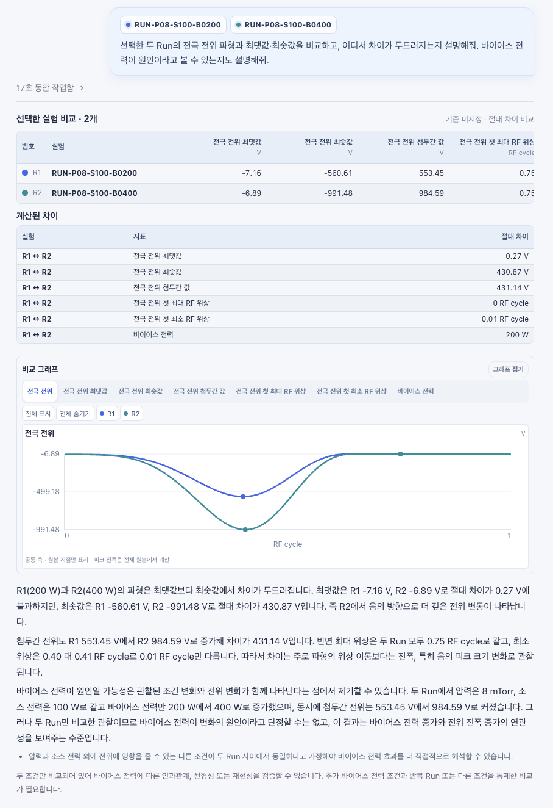
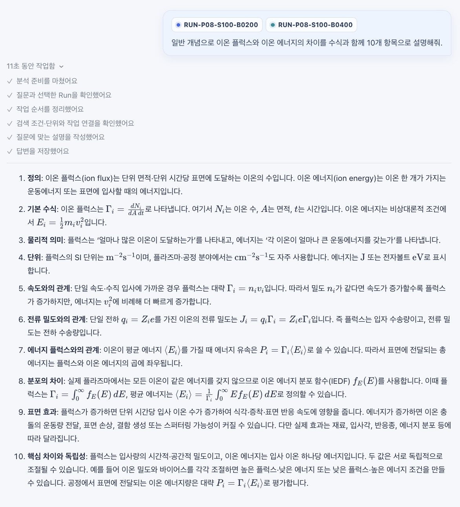

# PLASMATE


등록된 플라즈마 실험을 자연어로 조회·비교하고, 다음 실험 조건을 정할 근거를 찾는 분석 에이전트입니다.

## 기술 스택

| 영역 | 기술 |
| --- | --- |
| 웹 | TypeScript, React, Vite |
| 백엔드 | Java 21, Spring Boot, PostgreSQL, Docker Compose |
| 에이전트 | Python, LangGraph |
| 모델 실행 | OpenAI Responses·Decisions API, llama.cpp, MLX |

### 모델과 실행 그래프

| 모드 | 계획 생성·답변 작성 | 의미 검토 |
| --- | --- | --- |
| **일반 V2** | OpenAI `gpt-6-luna` | OpenAI Decisions · `gpt-6-luna` |
| **로컬 V2** | Qwen3.5-9B · GGUF 4비트, llama.cpp | Perplexity Decider Flash v1.2 · 4비트, MLX |

- **일반 V2** · 질문 → 계획 생성 → 코드로 구조·참조·단위 검증 → Decisions 의미 검토 → 도구 실행 → 결과·답변
- **로컬 V2** · 질문 → Qwen 계획 생성 → 코드로 검증하고 원문에서 확정 가능한 조건·단계 연결 보완 → Flash 의미 검토 → 도구 실행 → 결과·답변

두 모드는 웹·백엔드·DB를 공유하고 각자의 그래프에서 요청을 처리합니다. 계획이 반려되면 지적 사항을 전달해 다시 계획합니다. 로컬 모드의 모델 호출은 기기에서 처리합니다. [일반 V2 상세 그래프](docs/development/agent-v2-graph.md) · [로컬 V2 구조와 모델 설정](docs/development/agent-v2-local-llm.md)

## 시스템 아키텍처

로컬 V2 최종 평가에서 사용한 웹, 백엔드, 워커, 로컬 모델, 저장소 구성입니다.



그림의 브라우저 세션 확인은 평가 당시 구성입니다. 현재 로컬 웹은 연결 파일 없이 접속하며, 백엔드가 요청 출처를 확인합니다.

## 로컬 에이전트 구조



1. **계획 생성·검증** · Qwen이 도구와 입력을 고릅니다. 명확한 패턴에 일치하면 코드가 단계 연결과 정렬을 보정하고, 그 외에는 Qwen 초안을 유지합니다. 두 경로 모두 Python 구조·참조 검증을 거친 뒤 Flash가 남은 의미 항목을 검토합니다.
2. **도구 실행** · 승인된 계획을 순서대로 실행하고 결과를 실제 Run 원본과 대조합니다. Run이나 비교 기준을 사용자에게 확인해야 하면 선택을 기다렸다가 이어서 실행합니다.
3. **답변·복구** · 설명이 필요하면 Qwen이 작성하고, 결과 해석이 있으면 Flash가 근거를 넘어선 해석인지 검토합니다. 구조 오류나 검토 지적에는 최대 2회 재계획하고, 답변 근거 오류나 과잉 해석에는 최대 1회 재작성합니다.

## 설치 및 실행

Java 21, Node 22.23.3, npm 10.9.9, uv, Docker를 준비합니다.

```sh
git clone https://github.com/SJU-Capstone-2026/PLASMATE.git
cd PLASMATE
npm ci
uv sync --project agent/python --frozen
test -f .env || cp .env.example .env
```

`.env`에 DB 비밀번호를 설정합니다. 일반 V2에는 OpenAI API 키와 워커 키가 필요합니다. Docker를 시작한 뒤 백엔드·웹 터미널에서 `set -a`, `source .env`, `set +a` 순으로 환경을 읽습니다.

| 순서 | 터미널 | 실행 명령 |
| --- | --- | --- |
| 1 | DB·백엔드 | `docker compose up -d --wait postgres` 실행 후 `backend/gradlew -p backend bootRun` |
| 2 | 웹 | `npm run dev` |
| 3 | 일반 V2 워커 | `npm run dev:agent` |

[분석 화면](http://127.0.0.1:5173)을 엽니다. 로컬 V2는 Apple Silicon에서 Qwen·Flash를 준비한 뒤 같은 화면에서 사용합니다. 세부 환경 변수와 워커 실행 명령은 실행 가이드에서 확인할 수 있습니다. [공통 실행 가이드](docs/development.md) · [로컬 V2 실행 가이드](docs/development/agent-v2-local-llm.md#공통-backend와-화면)

### 실험 데이터

기업 실험 데이터 150개 Run의 원본 파일과 DB 백업은 [`.gitignore`](.gitignore)로 관리합니다. 아래 예시 화면에는 일부 측정 수치와 그래프가 표시됩니다. 실제 Run을 사용하려면 승인된 경로로 원본을 받아 등록합니다. [Run 등록 가이드](docs/development.md#실제-150-run-초기-적재와-재처리)

## 주요 기능 및 화면

### 분석 Agent

공정 조건으로 실험을 조회하거나, 목표에 맞는 후보를 찾고, 선택한 Run을 표와 그래프로 비교합니다. 비교에서 계산한 값을 다음 검색 조건에 연결할 수 있습니다.

| 계획 도구 | 역할 |
| --- | --- |
| `forward_lookup` | 압력·소스 전력·바이어스 전력에 해당하는 등록 Run 조회 |
| `reverse_search` | 조건을 만족하는 실제 Run 탐색 및 정렬 |
| `compare_runs` | 선택한 Run의 수치·차이·경향 비교 |
| `explain_answer` | 공정 개념 설명 또는 검증된 Run 결과 해석 |

계산 단계 `derive`는 **최댓값·최솟값·평균** 같은 파생값을 구합니다. `await_input`은 비교 대상이나 기준을 사용자에게 확인받고 실행을 이어갑니다. [계획·실행 API](docs/contracts/agent-v2.openapi.json)

### 의사결정 Agent와 Run 관리

- **의사결정 Agent** · 기준 Run과 개선 목표를 고르면 비교할 지표와 기준을 제시합니다. 사용자가 승인한 기준으로 후보를 찾고 장단점을 비교합니다.
- **Run 관리** · 폴더·ZIP으로 실험을 등록하고 원본, 버전별 수치, 그래프를 확인합니다.

### 분석 Agent 시작 화면

기본 설정에서 새 대화는 **일반 V2**로 시작합니다. **일반**·**로컬** 버튼으로 모드를 선택하고, **대표 질문으로 시작해 보세요**를 펼쳐 질문 9개를 확인할 수 있습니다. 진행하던 대화에서 모드를 바꾸면 새 대화가 열립니다.



### 분석 예시

<details>
<summary>두 에너지 범위의 후보를 따로 검색하고 플럭스순으로 정렬</summary>



</details>

<details>
<summary>선택한 두 Run의 전극 전위 파형과 극값 비교</summary>



</details>

<details>
<summary>이온 플럭스와 이온 에너지의 차이를 수식으로 설명</summary>



</details>

## 추후 개발사항

사용자 질문에 따라 일반 V2 또는 로컬 V2를 자동으로 선택해 요청을 처리하는 **멀티 모델 에이전트**를 개발할 계획입니다.
