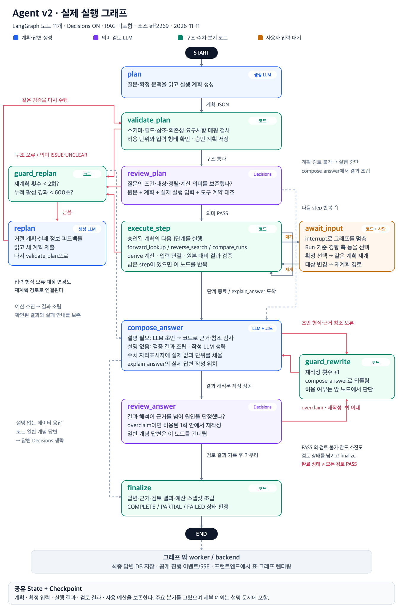
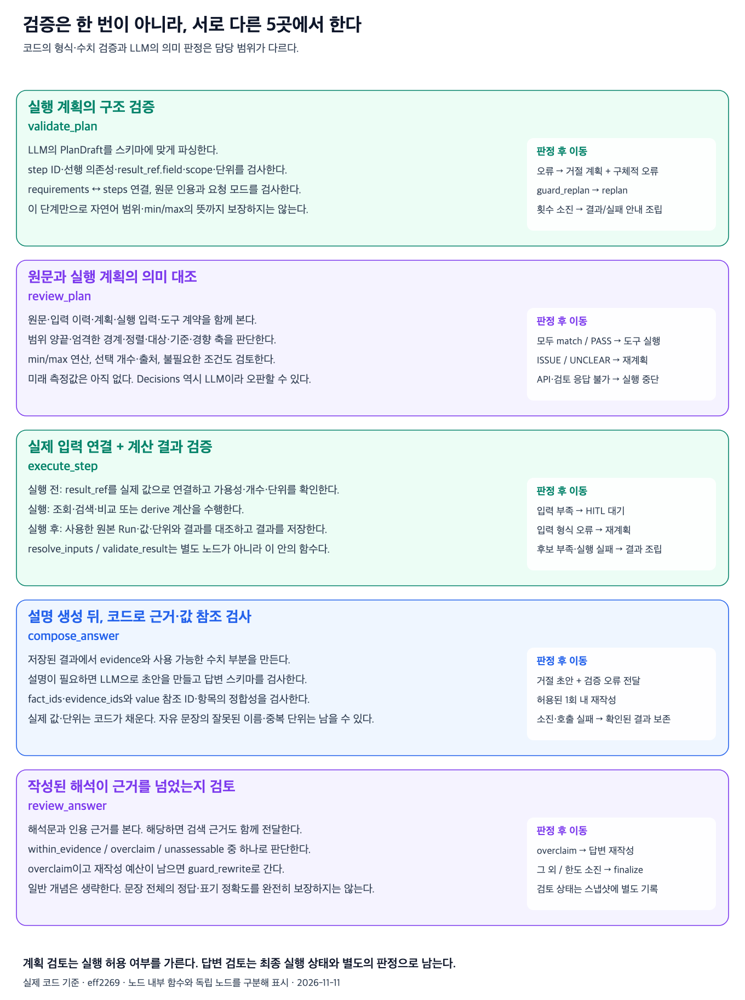

# Agent v2 실행 그래프와 검증 역할

계획 스키마 2와 `explain_answer`를 적용한 v2의 코드 구조다. 아래 두 이미지는
`eff2269`의 그래프를 기준으로 작성했으며 실제 Run, 대화, 평가 결과를 포함하지 않는다.
PR 통합 시 타입 표기와 선택 결과 참조의 직렬화를 정리했으며 노드와 분기는 같다.
모델 설정, 실행·평가 방법은 [v2 운영 문서](agent-v2.md)와
[수동 평가 안내](agent-v2-evaluations.md)를 따른다.

## 노드와 도구의 차이

`plan`, `validate_plan` 같은 이름은 LangGraph의 노드다. `forward_lookup`,
`reverse_search`, `compare_runs`, `explain_answer`는 모델이 계획에 넣는 도구다.
`derive`는 계산 단계, `await_input`은 사용자 확인 단계다. 도구 하나가 반드시
그래프 노드 하나에 대응하지는 않는다.

- `plan`·`replan`: 질문과 확정 문맥으로 계획을 생성한다. 재계획에는 거절 계획과 구체적인 오류·검토 피드백을 전달한다.
- `validate_plan`: 스키마, 요구사항 매핑, 의존성, 결과 참조의 생산자·필드·scope, 단위를 코드로 검사한다.
- `review_plan`: Decisions가 원문의 조건·대상·정렬·계산 의미와 실제 실행 입력을 대조한다. 판정 불가·통신 실패는 실행 승인으로 바꾸지 않는다.
- `execute_step`: 승인된 계획의 다음 단계에 입력을 연결하고 수치 도구나 계산을 실행·검증한다. 남은 단계가 있으면 반복한다.
- `await_input`: Run·기준·경향 축 선택을 기다린다. 확정 선택은 같은 요청을 재개하고 계획 밖 변경은 재계획으로 보낸다.
- `guard_replan`: 요청 전체 최대 2회와 활성 시간 예산을 확인한다. 구조 오류·의미 불일치·일부 입력 오류가 같은 한도를 공유한다.
- `compose_answer`: 검증 결과를 조립한다. 마지막 `explain_answer`가 있으면 답변 모델을 호출하고 근거·수치 참조를 검증한다. 설명 요청이 없으면 작성 모델을 호출하지 않는다.
- `guard_rewrite`: 허용된 재작성 횟수를 증가시켜 `compose_answer`로 되돌린다. 요청 전체 최대 1회다.
- `review_answer`: 작성된 결과 해석의 근거 초과 주장을 Decisions로 검토한다. 순수 개념 설명과 설명 없는 결과는 생략한다.
- `finalize`: 결과·근거·검토·예산을 스냅샷에 모으고 COMPLETE/PARTIAL/FAILED를 판정한다. 이후 worker와 backend가 저장·공개 이벤트 전송을 처리한다.

## 다섯 검증 지점

계획 Decisions는 실행 허용 여부를 결정한다. 답변 Decisions는 최종 실행 상태와 별도의
검토 판정으로 저장한다. 따라서 요청의 COMPLETE가 모든 검토의 PASS나 문장 전체의
정확성을 보장하지 않는다. 자연어 의미와 답변 품질은 독립 정답을 사용한 별도 평가가 필요하다.

정상 경로의 모델 호출은 데이터 요청 2회(계획·계획 검토), 개념 설명 3회(작성 추가),
결과 해석 4회(작성·해석 검토 추가)다. 복구가 발생하면 호출이 늘어나며 전체 상한은 유지한다.
이 그림의 v2 계획 도구에는 RAG나 `decision_records`가 포함되어 있지 않다.
