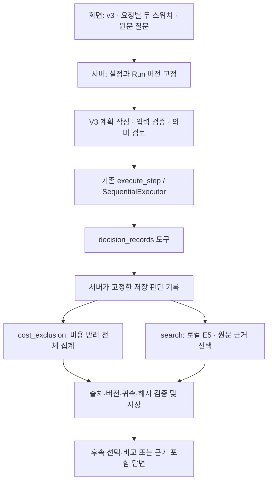

# V3 판단 기록 RAG 구현과 실행 방법

V3는 독립 복제된 에이전트에 판단 기록 도구를 연결한다. 공통 서버·worker dispatch·화면 부품에는 V3 활성화를 위한 추가 계약을 적용하고, V1/V2의 에이전트 업무 코드와 과거 저장 답변은 보존한다. 이 문서는 구현·설정·검증 명령을 설명한다. 성능 평가와 실패 원인 분석은 별도 문서 PR에서 다룬다.

## 처리 구조



위 그림은 데이터 처리 관계다. `decision_records`는 별도 LangGraph 노드가 아니라 기존 실행 노드에서 사용하는 계획 도구다. 기존 11개 노드와 연결 등록을 유지하고 상태·입력 검증·도구 실행·출력을 확장한다. 사용자 선택 대기, 최대 2회 재계획과 최대 1회 답변 재작성도 기존 경로를 사용한다.

수치 도구는 실제 등록 Run의 값과 후보·비교 결과를 제공한다. 판단 기록 도구는 저장된 채택·반려·보류 메모를 조회하며 물리 인과나 비용 실측을 대신하지 않는다. 기록 저장소와 임베딩 검색은 로컬이지만 계획·필요한 설명 작성에는 외부 모델을 사용한다. 외부 모델 입력에 질문·문맥·검색 근거가 포함될 수 있으므로 전체 오프라인 실행을 뜻하지 않는다.

## 요청별 기능과 계획 계약

새 요청은 `graphVersion: "v3"`, `v3Options: {rulesEnabled, ragEnabled}`를 전달한다. 서버는 두 boolean의 정규화 JSON으로 SHA256 `configDigest`를 계산해 저장한다. 재계획·사용자 선택 재개·재시작은 이미 시작한 요청의 설정을 바꾸지 않는다. 복구 fingerprint에는 소스·모델·검색 설정과 요청 모드를 포함한다.

| 설정 | 허용되는 기록 작업 |
| --- | --- |
| 규칙 OFF / RAG OFF | 기록 작업 없음. 기존 수치 도구는 사용 가능 |
| 규칙 ON / RAG OFF | `cost_exclusion`만 허용 |
| 규칙 OFF / RAG ON | `search`만 허용. 자동 비용 집계 없음 |
| 규칙 ON / RAG ON | 두 작업을 필요에 따라 별도 단계로 연결 |

OFF인 작업은 모델의 도구 스키마에서 제거하고 실행 전과 서버의 예약·읽기·저장에서도 차단한다. 필수 수치·버전·선택 검증과 계획 Decisions는 두 스위치의 영향을 받지 않는다.

`decision_records` 입력은 확인된 `runs` 바인딩, `action`, 원문 메시지 전체인 `query`, 원문 `source`, 선택적인 비용 `threshold`다. 모델이 질문을 요약하거나 다른 질문으로 바꾸지 못하도록 원문과 대조한다. 결과의 `candidates`는 후속 선택·비교 입력으로 연결할 수 있다.

## 이름만 입력한 Run 조회

V3에서는 등록된 `RUN-…` 이름을 질문에 그대로 쓸 수 있다. 예: `RUN-SYNTHETIC-A의 과거 판단 기록을 보여줘`는 해당 이름의 인공 Run이 실제 등록돼 있을 때 사용하는 예시다. 이름만으로 새 실험이나 기록을 생성하지 않는다.

서버는 이름을 불투명한 등록 ID로 취급하고 실제 DB와 정확히 대조한다. 이름에 포함된 숫자를 물리 조건으로 변환하지 않는다. 대소문자·한국어 조사·문장부호를 처리하고 다른 긴 ID의 일부를 일치한 것으로 보지 않는다.

- `namedRunReferences`는 서버가 고정한 Run·버전 참조 목록이다.
- `namedRunBindings`는 원문의 이름 구절과 고정 참조의 대응이다.
- Python은 이름별 `named:<canonical Run ID>`와 목록 `named_runs`를 계획 입력·의미 검토에 제공한다. 이름 목록은 조회 가능한 참조이며 모든 항목을 조회하라는 의미는 아니다.
- 기존 첨부·선택은 덮어쓰지 않는다. 같은 이름에 과거 버전을 명시적으로 첨부하면 그 버전을 유지한다. 이전의 다른 active/candidate Run으로 명시한 이름을 대신하지 않는다.
- 이름이나 버전을 확정하지 못하면 모델·도구 호출 전에 이름 확인·Run 첨부 안내를 표시한다. 의미상 실제 조회 대상과 제외 대상의 구분은 계획 검증과 Decisions에서 대조한다.

## 검색·규칙과 근거 저장

검색은 범위·Run/버전·귀속·명시 근거 조건과 E5 dense/lexical 회수를 결합한다. 임베딩은 로컬 `intfloat/multilingual-e5-small`이며 revision과 모델 파일 SHA256을 코드로 고정한다. 최소 유사도 `0.78`, 상대 차이 `0.08`, 한 검색의 최종 인용 상한 `5`를 사용한다. 상한은 항상 채워야 할 개수가 아니며 유사도는 정답 확률이 아니다. 재정렬 모델과 실험용 facets는 기본 OFF다.

`search`는 관련 메모를 반환하되 후보 Run을 유사도로 확정 제외하지 않는다. `cost_exclusion`만 원문에 명시된 비용 반려 건수 기준으로 후보를 제외한다. 신규 V3 비용 정책은 `cost-regex-2`이고 고유 판단 기록 ID를 전체 이력에서 집계한다. 검색 top-k, 문구 반복과 회의 횟수를 별도 반려 건수로 사용하지 않는다. Python 집계와 서버의 독립 재계산을 맞추며 과거 `cost-regex-1` 저장 결과는 해당 정책으로 읽는다.

각 실행은 기록 원문·기록 ID·당시 Run 버전·귀속 역할·원문/기록 해시를 불변 근거 snapshot으로 저장한다. 서버는 실제 고정 기록과 허용된 Run 범위에 대응하는지 검증한다. 공동 메모와 비교 참조를 개별 Run의 반려 사유로 옮기지 않는다. 최종 `decisionEvidence`는 저장된 실행 결과와 일치해야 한다.

`NO_EVIDENCE`는 지정 범위와 검색 조건에서 지지 메모를 찾지 못했다는 뜻이다. 전체 DB에 기록이 없다는 증명이나 해당 Run 데이터가 없다는 뜻으로 바꾸지 않는다. 모의 기록 환경은 `AGENT_V3_RAG_SYNTHETIC=true`로 표시한다.

## 전용 clone에서 준비하기

공통 Java·Node·PostgreSQL·backend·frontend 준비는 [팀 로컬 실행](../development.md)을 따른다. 아래는 V3에 추가되는 단계다. 기존 V1/V2 작업 폴더와 Python 환경을 덮어쓰지 않도록 V3 전용 clone에서 실행한다.

의존성 입력 `requirements-v3-rag.in`은 `requirements-rag-v3.in`을 포함한다. 설치에는 버전과 해시를 고정한 `requirements-v3-rag.lock`을 사용한다. 세 파일을 함께 관리하며 기존 core `uv.lock`을 V3 임베딩 설치용으로 재작성하지 않는다.

저장소 루트에서 Linux/macOS:

```sh
npm ci
uv venv agent/python/.venv --python 3.12.15
uv pip sync --python agent/python/.venv/bin/python --require-hashes agent/python/requirements-v3-rag.lock
PYTHONPATH=agent/python/src agent/python/.venv/bin/python -c "from pathlib import Path; from kplasma_agent.v3.decision_rag.embedding import download; download(Path('.local/models/multilingual-e5-small'))"
```

Windows PowerShell에서는 위 Python 경로를 `agent/python/.venv/Scripts/python.exe`로 바꾸고 모델을 다음과 같이 준비한다.

```powershell
$env:PYTHONPATH='agent/python/src'
& agent/python/.venv/Scripts/python.exe -c "from pathlib import Path; from kplasma_agent.v3.decision_rag.embedding import download; download(Path('.local/models/multilingual-e5-small'))"
```

다운로드 함수는 명시적으로 실행했을 때 공개 모델 파일만 내려받고 해시를 검증한다. 프로젝트 기록은 다운로드 요청에 넣지 않는다. 검색 시 파일이 없거나 해시가 다르면 오류를 표시하며 기록을 외부 서비스로 보내 대신 검색하지 않는다.

기존 `.env`를 덮지 말고 `.env.example`을 참고하여 다음 설정을 자기 환경에 추가한다. 실제 키와 worker 토큰은 기존 공통 설정처럼 비공개로 보관한다.

```dotenv
AGENT_V3_PLAN_MODEL=gpt-6-luna
AGENT_V3_PLAN_REASONING_EFFORT=low
AGENT_V3_ANSWER_MODEL=gpt-6-luna
AGENT_V3_ANSWER_REASONING_EFFORT=low
AGENT_V3_DECISIONS_MODEL=gpt-6-luna
AGENT_V3_PLAN_REVIEW_ENABLED=true
AGENT_V3_RAG_MODEL_DIR=./.local/models/multilingual-e5-small
AGENT_V3_RAG_CACHE_DIR=./.local/v3-rag-cache
AGENT_V3_RAG_SYNTHETIC=false
```

공통 backend와 frontend를 시작한 뒤 루트에서 `npm run dev:agent`로 worker를 시작한다. 이 명령은 `agent/python/.venv`를 사용하며 `PYTHONPATH`를 설정한다. 시작 로그의 `graphs=v1,v2,v3`를 확인하고 새 대화에서 버전 `v3`와 두 스위치를 선택한다. 모델·프롬프트·소스가 바뀐 미완료 요청은 이전 fingerprint로 재개하지 않는다. 완료 답변을 새 코드로 다시 생성하지 않는다.

Run·원본 데이터·실제/모의 판단 기록은 별도로 등록해야 한다. clone, 환경 설치와 모델 다운로드만으로 데이터가 생성되지는 않는다. DB 마이그레이션 `V19__agent_v3_runtime.sql`은 V3 버전 허용과 요청별 설정 컬럼·제약을 추가한다. 기존 V1/V2 요청과 저장 답변은 기존 계약으로 읽는다.

## 코드 검증

유료 모델 평가와 구분하여 인공 기록·인공 모델 응답으로 기능 계약을 검사한다. 다음 명령의 성공 여부는 실행한 커밋의 PR 검증 결과를 확인한다. 이 문서 자체가 전체 CI나 실제 모델 평가의 통과를 뜻하지 않는다.

```sh
# agent/python 디렉터리: V3 전체 단위·회귀 검사
.venv/bin/python -B -m pytest -c pytest-v3.ini

# 저장소 루트: 기존 V2·공통 회귀, 타입·빌드·공개 파일 정책
npm run test:agent
npm run typecheck
npm run build
npm run verify:public-files

# 저장소 루트: V3 서버 단위 계약
backend/gradlew -p backend test --tests 'com.kplasma.analysisagent.agent.v3.*' --tests 'com.kplasma.analysisagent.agent.AgentRequestServiceNamedRunTest' --tests 'com.kplasma.analysisagent.agent.AgentRequestServiceV3PolicyTest' --tests 'com.kplasma.analysisagent.agent.V3DecisionEvidenceValidatorTest' --console=plain
```

Windows에서는 Python 실행 파일을 `.venv/Scripts/python.exe`, Gradle Wrapper를 `backend/gradlew.bat`로 바꾼다. DB를 포함하는 `V3RuntimeContractTest`는 Docker/Testcontainers가 필요하다. `.github/workflows/ci.yml`은 기존 V2 검사를 유지하고 별도 잠금 환경에서 V3 검사를 실행하도록 구성한다. 원격 CI 실행 결과와 로컬 검증 결과는 별도로 기록한다.

공개 계약은 [계획 schema](../contracts/agent-graph-v3.plan.schema.json), [답변 schema](../contracts/agent-graph-v3.answer.schema.json), [API](../contracts/agent-v1.openapi.yaml)를 따른다. 실제 데이터·DB·대화·원시 평가 결과·로그·모델 파일·키는 소스나 CI artifact에 포함하지 않는다.
