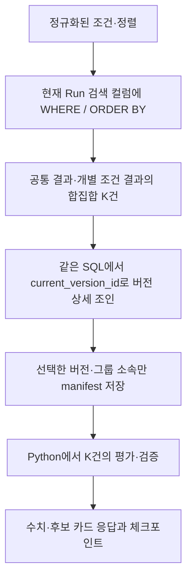

# 역방향 조회 성능 개선 계획서

## Goal Capsule

**DB가 조건에 맞는 현재 버전의 Run만 찾아 반환하고, Agent는 실제 결과에 필요한 Run만 전달·저장하도록 개선한다.** 검색 지표에는 B-tree 인덱스를 추가하고, 공통 조건에 맞는 Run이 없으면 근접 후보를 만들지 않고 0건으로 응답한다.

성능 비교는 **A: 현재 제품 → B: 조회·응답 구조 개선 → C: B에 검색 인덱스 추가**로 나눈다. 데이터는 현재 Run 수 기준 **150 / 1만 / 10만 / 100만 건**으로 구성한다. 순방향과 달리 현재 역방향은 이미 DB에서 일부 조건·정렬을 처리하므로, A를 “항상 전체 Run을 Python에서 필터링하는 방식”으로 설명하지 않는다.

이 문서는 구현·측정 계획이다. 새로운 제품 변경이나 성능 실험을 실행했다는 의미가 아니며, 개선율은 측정 후 작성한다.

## Product Contract

### 확정 요구사항

| ID | 요구사항 | 수용 기준 |
| --- | --- | --- |
| R1 | 전체 카탈로그의 ID·버전을 Agent에 전달하지 않는다. | manifest·HTTP·체크포인트에 실제 결과와 명시적 참조에 필요한 Run만 포함한다. |
| R2 | 조회 시점의 버전 일관성을 유지한다. | 조회 도중 같은 조건의 실험이 갱신돼도 한 답변에 신·구 버전이 섞이지 않는다. |
| R3 | 조건 검색과 주 정렬을 DB에서 처리한다. | 전체 Run을 가져와 Python에서 후보를 찾는 경로를 없앤다. |
| R4 | 검색에 B-tree를 적용한다. | 지표별 인덱스를 마이그레이션으로 관리하고 실제 사용 여부를 실행 계획으로 확인한다. |
| R5 | 공통 조건 일치 0건이면 근접 후보를 생성하지 않는다. | “해당 조건에 맞는 Run이 없습니다.”를 정상 결과로 표시한다. |
| R6 | 기존 단위·수치·품질 기준을 보존한다. | 0과 누락값을 구분하고 단위 변환·경계 포함 여부·결과 순서를 회귀 검증한다. |
| R7 | 불필요한 결과 중복과 원본 JSON 읽기를 줄인다. | 같은 Run 상세를 여러 결과 배열에 복제하지 않고, 파일 개수 때문에 그래프 JSON을 읽지 않는다. |
| R8 | 구조 개선과 인덱스 효과를 분리 측정한다. | A→B, B→C, A→C의 측정 범위·실패 건수·결과 동등성을 함께 기록한다. |

R1~R5는 사용자와 합의한 방향이다. R6~R8은 이를 구현하고 검증하기 위한 기준이다.

### 결과 범위와 화면 정책

- `N`: 전체 현재 Run 수. 같은 압력·소스·바이어스 등록은 현재 버전 갱신이며 별도 Run 증가로 세지 않는다.
- `K`: 공통 결과와 기존 개별 조건 탭 결과의 합집합에 포함된 고유 버전 수. 명시적으로 참조한 기준 Run은 별도로 더할 수 있다.
- 예를 들어 에너지 조건 결과 5개를 플럭스 높은 순으로 정렬하면 5개만 필요하다. 여러 조건의 개별 탭이 서로 다른 결과를 포함하면 K는 공통 결과 수보다 클 수 있다.
- **개별 조건 탭은 유지한다.** 공통 결과가 0건이어도 개별 조건 탭에는 해당 조건을 실제로 만족한 결과가 있을 수 있다. 이를 “모든 조건 충족”이나 “근접 추천”으로 표시하지 않는다.
- 단순히 “플럭스 높은 순”만 요청하거나 모든 Run이 조건을 만족하면 K=N일 수 있다. 임의의 3개 제한을 추가하지 않는다.
- 전체 데이터의 비가용 Run 목록을 결과마다 수집하지 않는다. 원본의 비가용 사유는 DB에 유지하고, 반환한 Run 및 명시적 참조에 해당하는 사유를 보존한다.
- 새 조회에서는 근접 후보를 제거한다. 기존 저장 답변은 원래 스냅샷대로 열리도록 읽기 호환성을 유지한다.

### 이번 범위 밖

LLM 모델·Tool Calling 프롬프트 개선, 순방향 재구현, 업로드 병렬화, 전역 캐시, 워크스페이스 저장 구조 전면 개편, 장애 복구 프레임워크, 결과 임의 축소는 포함하지 않는다. 결과가 매우 많은 조회의 페이지네이션은 별도 UX·계약 합의가 필요한 후속 범위다.

## Planning Contract

### 1. 현재 경로와 병목

현재 흐름은 다음과 같다.

```text
전체 현재 Run의 ID·버전 목록 구성·저장
  → 그 버전 목록을 UUID 배열로 검색 SQL에 전달
  → summary JSON에서 수치·단위를 추출하여 WHERE / ORDER BY
  → 공통 결과 + 개별 조건 결과 + 비가용 행 반환
     공통 결과 0건이면 전체 후보 반환
  → Python의 결과 평가·정렬·검증, 0건이면 근접 후보 3개 계산
  → 같은 Run이 포함된 여러 결과 배열과 실행 상태 저장
```

| 위치 | 확인한 내용 | 개선 방향 |
| --- | --- | --- |
| `AgentRequestService.context` | 전체 `catalogRunRefs`를 먼저 저장한다. | 조회 결과의 버전만 고정한다. |
| `ReverseContextQuery` | JSON 수치 변환과 전체 버전 배열에 의존한다. | 현재 Run의 정규화된 검색 컬럼에 직접 조건을 건다. |
| 같은 SQL | `NOT EXISTS(common_match)`일 때 전체 후보를 반환한다. | 해당 분기를 제거한다. |
| `scalarVersions`·역방향 SQL | 파일 개수 계산에 `full_run`을 접근한다. | 버전에 저장한 `source_file_count`를 읽는다. |
| Python `domain/reverse.py` | 후보 평가와 근접 후보 선정, Run 상세 중복 반환이 있다. | 선택된 K건의 평가·검증만 유지하고 중복을 제거한다. |
| 그래프·체크포인트 | manifest/source/result/answer에 데이터가 반복 포함될 수 있다. | 단계별 소유 데이터를 구분하고 직렬화 크기를 측정한다. |

사전 진단에서는 150건 환경의 선택적 조회가 5건을 반환해도 전체 150건의 ID·버전 목록을 구성했다. 실행 계획에는 150행 순차 검사와 정렬이 보였고, 별도의 결과 지표 검색 인덱스는 없었다. **150건에서 순차 검사를 선택했다는 사실만으로 성능 결함을 확정하지 않는다.** 큰 데이터와 다른 선택도에서도 비교한다.

현재 구현 근거: `backend/src/main/java/com/kplasma/analysisagent/agent/{AgentRequestService,ReverseContextQuery}.java`, `agent/python/src/kplasma_agent/{graphs/v1.py,domain/reverse.py,persistence/checkpointer.py}`.

### 2. 검색 컬럼을 어디에 둘 것인가

KTD1 — **현재 버전의 검색용 값은 `run` 테이블에 둔다.** 원본과 과거 버전은 기존 `run_version`에 남긴다. 역방향 기본 검색이 현재 버전 대상이므로, 검색 인덱스가 모든 과거 버전까지 커지는 것을 피한다.

| 테이블·컬럼 | 타입 | 값·역할 |
| --- | --- | --- |
| `run.pressure_mtorr` | double precision | 압력, mTorr |
| `run.source_power_w` | double precision | 소스 전력, W |
| `run.bias_power_w` | double precision | 바이어스 전력, W |
| `run.mean_ion_energy_ev` | double precision | 평균 이온 에너지, eV |
| `run.ion_flux_1e18` | double precision | 이온 플럭스, 10¹⁸ m⁻²s⁻¹ |
| `run.ied_width_ev` | double precision | IED 폭, eV |
| `run.searchable` | boolean | 기존 READY·VERIFIED·CONVERGED 품질 기준 충족 여부 |
| `run.search_projection_version` | integer | 정규화 규칙 적용 버전, 최초 1 |
| `run_version.source_file_count` | integer | 해당 버전의 원본 파일 수 |

수치 컬럼은 NULL을 허용한다. 품질 조건을 만족해도 특정 지표가 누락될 수 있으므로 `searchable=true`가 모든 지표의 존재를 뜻하지 않는다. 조회에 필요한 지표에만 `IS NOT NULL` 조건을 적용한다. 그룹별 필요 지표를 구분하여, 다른 조건 탭에만 필요한 값이 없다는 이유로 유효한 개별 탭 결과까지 제외하지 않는다. 0은 정상적인 값이며 NULL로 치환하지 않는다.

KTD2 — **등록·기존 데이터 변환이 같은 정규화 규칙을 사용한다.** 버전이 고정된 DB 정규화 함수로 canonical unit의 유한한 binary64 값을 생성하고, 신규 등록과 backfill에서 함께 사용한다. 현재 Python `metric_registry.py`와 단위 별칭·경계·반올림·overflow/underflow 동등성을 검증한다. 기존 SQL의 단순 NULL 처리 분기를 그대로 복사해 유효 후보를 빠뜨리지 않는다.

원본의 값·단위·비가용 사유는 수정하지 않는다. 지원하지 않는 단위, 실제 누락값과 유효 수치를 구분한다. 변환 불일치는 배포 전 검사 실패로 처리하고 조용히 후보에서 제외하지 않는다. 정규화는 등록·backfill 때 수행하며 검색 WHERE 안에서 JSON을 반복 변환하지 않는다.

### 3. B-tree 인덱스 설계

KTD3 — **결과 지표 3개의 단일 컬럼 인덱스와 공정 조건의 복합 인덱스 1개를 기본안으로 적용한다.** 모두 비고유 인덱스다. 서로 다른 공정 조건의 결과 값이 같을 수 있으므로 지표 값에 UNIQUE를 걸지 않는다.

| 인덱스 이름 | 키 컬럼 순서 | 인덱스에 포함하는 행 | 주요 용도 |
| --- | --- | --- | --- |
| `run_search_energy_idx` | `mean_ion_energy_ev` | `searchable AND mean_ion_energy_ev IS NOT NULL` | 에너지 범위·상하한 검색 |
| `run_search_flux_idx` | `ion_flux_1e18` | `searchable AND ion_flux_1e18 IS NOT NULL` | 플럭스 범위·상하한·높은/낮은 순 |
| `run_search_width_idx` | `ied_width_ev` | `searchable AND ied_width_ev IS NOT NULL` | 폭 범위·상하한·높은/낮은 순 |
| `run_search_conditions_idx` | `pressure_mtorr, source_power_w, bias_power_w` | `searchable` | 압력 또는 압력·소스·바이어스가 함께 붙는 역방향 검색 |

아래는 마이그레이션의 설계 예시다. 제품에 실행된 SQL이 아니다.

```sql
CREATE INDEX run_search_energy_idx
    ON run USING btree (mean_ion_energy_ev)
    WHERE searchable AND mean_ion_energy_ev IS NOT NULL;
CREATE INDEX run_search_flux_idx
    ON run USING btree (ion_flux_1e18)
    WHERE searchable AND ion_flux_1e18 IS NOT NULL;
CREATE INDEX run_search_width_idx
    ON run USING btree (ied_width_ev)
    WHERE searchable AND ied_width_ev IS NOT NULL;
CREATE INDEX run_search_conditions_idx
    ON run USING btree (pressure_mtorr, source_power_w, bias_power_w)
    WHERE searchable;
```

**작동 예: “에너지 150~160 eV 중 플럭스 높은 순”**

1. B-tree에는 에너지 값과 해당 행을 찾을 정보가 정렬된 형태로 들어간다.
2. DB는 트리의 경계를 따라 150 부근을 찾고, 160까지의 인덱스 구간을 읽을 수 있다.
3. 그 후보의 나머지 조건을 확인하고, 조건을 만족한 결과를 플럭스로 정렬한다.
4. 선택된 행의 `current_version_id`로 버전 상세를 가져온다. 전체 ID 목록을 Python에 전달할 필요가 없다.

이는 계획한 접근 방식이며 항상 Index Scan이 강제되는 것은 아니다. 범위가 넓거나 데이터가 작으면 순차 검사가 더 저렴할 수 있다. 복합 B-tree의 탐색 범위는 앞쪽 컬럼 조건의 영향을 받는다. `(에너지, 플럭스)` 하나를 만든다고 에너지 **범위** 검색과 전체 플럭스 정렬이 모두 자동 해결되지는 않는다. [PostgreSQL 다중 컬럼 인덱스](https://www.postgresql.org/docs/18/indexes-multicolumn.html)

여러 지표 조건은 단일 인덱스 또는 BitmapAnd/BitmapOr로 처리될 수 있다. Bitmap 경로에서는 인덱스 순서가 유지되지 않아 추가 Sort가 필요할 수 있다. **Sort가 있다는 이유만으로 최적화 실패로 판정하지 않고, 몇 행을 검사·정렬했는지 확인한다.** [PostgreSQL 인덱스 조합](https://www.postgresql.org/docs/18/indexes-bitmap-scans.html)

공정 조건 인덱스는 P→S→B 순서의 한 복합 키다. P 전용 트리 다음에 S 전용 트리를 따로 타는 구조가 아니다. 소스만·바이어스만 지정하는 조회가 이 인덱스로 충분히 빨라진다고 가정하지 않는다. 해당 시나리오를 측정하고, 별도 인덱스가 필요하면 크기·등록 비용과 함께 후속 설계 근거를 남긴다. 큰 summary/full_run JSON을 INCLUDE 컬럼에 넣지 않는다.

### 4. 인덱스 생성과 데이터 갱신 절차

KTD4 — **Flyway 마이그레이션 두 단계로 적용한다.** 현재 main의 마지막 버전은 V5이며, 구현 시 병합된 마이그레이션 번호를 확인해 다음 번호를 사용한다.

1. 검색 컬럼·정규화 함수·파일 수 메타데이터를 추가한다. 현재 기준 예상 파일은 `V6__run_search_projection.sql`이다.
2. 현재 버전의 summary로 검색 컬럼을 backfill하고, 각 버전의 파일 수를 한 번 계산한다. Run 수·현재 버전 연결·NULL/0·정규화 결과를 검증한다.
3. `RunRepository.save`가 새 버전 삽입, 현재 버전 포인터, 검색 컬럼을 **동일 트랜잭션**에서 갱신하도록 변경한다. 등록 실패 시 이 전체 변경이 롤백돼야 한다.
4. 다음 마이그레이션 `V7__run_search_indexes.sql`에서 4개 인덱스를 생성하고 `ANALYZE run`으로 통계를 갱신한다.
5. 전체 backfill 검증 후 새 검색 경로를 활성화한다. 동일 조건 재등록·삭제 시 DB가 인덱스 항목도 갱신하는지 검증한다.

현재 로컬 환경은 등록 쓰기를 멈춘 유지보수 구간에서 일반 `CREATE INDEX`를 적용하는 안이다. 이미 쓰기 중인 대규모 공용 DB에 그대로 실행하지 않는다. 무중단 인덱스 생성이 필요한 환경에서는 `CREATE INDEX CONCURRENTLY`를 트랜잭션 밖의 별도 배포 단계로 분리하고 유효성을 확인한다. 일반 생성의 쓰기 잠금과 concurrent 생성의 제약은 다르다. [PostgreSQL CREATE INDEX](https://www.postgresql.org/docs/18/sql-createindex.html)

롤백이 필요하면 새 조회 경로를 사용하지 않는 이전 애플리케이션으로 되돌리고, 추가한 컬럼·인덱스는 보존한다. 이전 코드가 검색 컬럼을 갱신하지 않은 기간이 있었다면 재진입 전에 backfill·일치 검사를 다시 수행한다. 새 결과 형식은 프론트 읽기 호환을 먼저 배포한 뒤 생산자가 사용하게 한다.

벤치마크 DB에는 대량 적재 후 인덱스를 생성해 읽기 비교를 준비한다. 인덱스 **생성 시간·크기·이후 등록/갱신 비용**은 조회 시간과 별도로 보고한다. 운영 마이그레이션을 벤치마크 때문에 임의 삭제·재작성하지 않는다.

### 5. 전체 목록 없이 버전 일관성 유지

KTD5 — **필터링과 버전 선택을 하나의 SQL 문에서 수행한다.** 현재 Run 검색 → 그룹 소속 계산 → 필요한 버전 summary 조인을 한 statement 안에서 처리한다. 검색 컬럼과 current_version_id가 원자적으로 갱신되므로 같은 조회 스냅샷에서 일관된 값을 읽는다.



PostgreSQL Read Committed에서는 한 SELECT가 하나의 조회 스냅샷을 사용하지만, 서로 다른 SELECT가 같은 시점을 본다는 보장은 없다. 따라서 “조건 조회 후 별도 SELECT로 최신 버전 다시 조회”하는 구현을 피한다. 전체 카탈로그 잠금이나 장시간 전역 트랜잭션을 새로 도입하지 않는다. [PostgreSQL 트랜잭션 격리](https://www.postgresql.org/docs/18/transaction-iso.html)

세부 규칙:

- 공통·개별 조건 쿼리는 검색 컬럼에 직접 조건을 걸고 결과를 UNION한다. SQL에는 부분 인덱스 조건과 일치하는 `searchable` 및 해당 지표의 `IS NOT NULL`을 명시하고, 값은 바인딩한다. 전체 summary를 먼저 materialize한 뒤 필터링하는 CTE를 만들지 않는다.
- manifest에는 고정한 Run·버전 참조, 정규화된 질의, 그룹 소속과 완료 여부를 저장한다. 전체 `catalogRunRefs`는 제거한다.
- 잘못된 지표·단위·범위, SQL 오류, 저장 실패는 기존 오류 경로로 반환한다. 오류를 0건으로 바꾸거나 전체 목록 재조회로 숨기지 않는다.
- 동일 요청의 재시도는 이미 확정한 manifest를 재사용한다. 0건도 `materialized=true` 등으로 구분해 “아직 조회 안 함”으로 오인하지 않는다.
- 기준 Run을 이용해 상대 조건을 계산할 때는 명시적 기준 버전만 먼저 읽는다. 실제 검색의 기준 시점은 **상대 조건이 확정된 후 후보 검색 SQL을 실행한 시점**이다. 기존의 전체 카탈로그 선고정 방식과 달라지는 계약을 문서화한다.
- 실제 후보 상세는 고정한 버전으로 읽는다. 이후 재등록으로 current_version_id가 바뀌어도 다시 최신 버전으로 바꾸지 않는다. 원본 버전이 삭제됐다면 기존 삭제/실패 정책을 적용한다.
- DB는 필터링과 목표별 주 정렬을 담당한다. Python에는 선택된 K건의 근접도 표시·기존 동률 처리·수치 검증을 남긴다. Python이 전체 N건을 다시 탐색하지 않는다.

### 6. 응답·체크포인트의 중복 제거

KTD6 — **역방향 결과 내부에 `searchResultVersion: 2`를 도입한다.** 비교 도구 등 다른 답변의 최상위 버전을 일괄 변경하지 않는다.

- Run 상세는 버전별 `runsByVersion`에 한 번 담는다.
- 공통 결과, 개별 조건 결과, 대표 표시 항목은 정렬된 버전 참조와 평가 값으로 표현한다.
- 현재 `allMatches`·`candidates`·`representativeCandidates`·그룹 내부의 Run 상세 중복을 제거한다.
- Python gather 상태에서 manifest는 참조·메타데이터를, source는 계산 입력을 소유하게 하여 같은 전체 객체를 이중 저장하지 않는다. 후속 단계는 필요한 참조를 재사용한다.
- 프론트는 새 결과를 읽는 어댑터를 두고 기존 카드 UI를 유지한다. 과거 결과의 읽기 어댑터도 유지하되 펼친 중복 형태를 서버에 다시 저장하지 않는다.
- 현재 DurableSaver는 이전 단계의 blob/writes도 저장한다. 현재 state에서 필드를 지웠다고 과거 체크포인트까지 없어졌다고 간주하지 않는다. 저장 횟수·누적 전송량·최종 크기를 모두 측정한다.
- 그래프 build ID를 변경하고, 실행 중인 이전 build 요청은 기존 버전 불일치 처리 규칙을 따른다. 별도의 장애 복구 체계는 추가하지 않는다.

KTD7 — **0건 처리는 결과 정책 변경으로 분리한다.** 전체 후보 재조회, `_violation` 기반 근접 후보 선정과 새 결과의 nearMatches/nearMisses 필드를 제거한다. 개별 탭까지 비었으면 빈 결과를 반환한다. 과거 저장 답변 표시용 코드는 새 검색 실행 경로와 구분한다.

## Implementation Units

경로는 저장소 상대 경로다. “신규” 파일은 구현 시 생성한다. 각 단계의 변경은 제품 코드·생산자/소비자 계약·검증 문서를 함께 갱신한다.

### U1. 재현 가능한 A 기준선과 인공 데이터 준비

- 파일: 신규 `scripts/performance/reverse-lookup/{seed.py,run.py,report.py,compose.yaml}`, `tests/{test_seed.py,test_report.py}`. 기존 순방향 PR의 격리 DB·보고서 방식을 참고한다.
- 작업: 현재 제품 commit·SQL·설정을 고정하고 A 실행 환경을 보존한다. 정확히 같은 질의를 A/B/C에 공급한다. 제품 코드를 바꾸기 전에 k6 기준선 수집 시점을 결정한다.
- 테스트: 규모별 현재 Run 개수·조건 키 고유성, 동일 seed 재현, 고정 5건/0건/동률 정답, 실패를 성공 통계에서 숨기지 않는 보고서.
- 산출: 익명화한 메타데이터·인공 데이터 생성기. 대량 데이터와 원시 결과는 Git 제외 경로에 보관한다.

### U2. 검색 컬럼·파일 수·B-tree 마이그레이션

- 파일: 신규 `backend/src/main/resources/db/migration/V6__run_search_projection.sql`, `V7__run_search_indexes.sql`; 수정 `backend/src/main/java/com/kplasma/analysisagent/run/RunRepository.java`.
- 테스트: 신규 `backend/src/test/java/com/kplasma/analysisagent/run/RunSearchProjectionTest.java`; 기존 `ingestion/ImportPipelineTest.java`, `ingestion/RunDeletionTest.java`.
- 검증: backfill와 신규 저장의 동일 정규화, 지원 단위와 극단값, 0/NULL, 현재 포인터와 검색 값의 원자성, 재등록 시 Run 수 유지, 삭제 시 검색 결과 소멸, 인덱스 정의·유효성.
- B는 벤치마크 전용 Flyway target을 projection 마이그레이션으로 고정한 격리 DB, C는 인덱스까지 적용한 동일 복제 DB로 구성한다. 두 DB 모두 적재 후 같은 방식으로 ANALYZE한다. 제품 배포에서는 필요한 전체 마이그레이션을 적용한다.

### U3. 후보 범위 조회·버전 고정·0건 정책

- 파일: `backend/src/main/java/com/kplasma/analysisagent/agent/{ReverseContextQuery,AgentRequestService}.java`; `agent/python/src/kplasma_agent/{graphs/v1.py,domain/reverse.py,domain/validation.py}`.
- 테스트: 기존 `backend/src/test/java/com/kplasma/analysisagent/workspace/ReverseQueryContextTest.java`, `AgentRequestPersistenceTest.java`; 신규 같은 폴더의 `ReverseQueryIndexedTest.java`; Python `agent/python/tests/test_reverse.py`, `test_reverse_gather.py`.
- 검증: 조건·정렬·개별 탭 동등성, 같은 Run의 여러 그룹 중복 제거, 0건의 정상 완료와 근접 후보 부재, 상대 조건의 참조 버전, 동시 재등록 중 일관성, 빈 manifest 재사용.
- 전체 인벤토리 생성과 `ANY(전체 UUID)` 의존을 제거한다. 요청당 SQL 수가 결과 건수에 비례해 늘어나는 새 N+1을 만들지 않는다.

### U4. 간결한 결과 계약과 화면 호환

- 파일: `agent/python/src/kplasma_agent/{answer_contracts.py,graphs/v1.py,domain/reverse.py}`; `backend/src/main/java/com/kplasma/analysisagent/agent/AnswerV2Validator.java`; `frontend/src/features/agent/{agent-contract.ts,v1-search-model.ts,v1-record-model.ts}`, 신규 `search-result-codec.ts`.
- 문서: `docs/contracts/agent-answer-v2.schemas.yaml`, `docs/contracts/agent-v1.openapi.yaml`, `docs/verification/reverse-query.md`.
- 테스트: 신규 `agent/python/tests/test_reverse_compact_result.py`; 기존 `test_checkpoint_adapter.py`, backend `agent/AnswerV2ValidatorTest.java`, frontend `v1-search-parity.test.tsx`, `v1-objective-groups.test.tsx`, `v1-run-versions.test.tsx`.
- 검증: 참조 무결성·버전 불일치 거부, 새 결과의 수치·순서, 과거 답변 열기, 조건 탭 전환·선택 즉시 반영, 0건 UI. 390/800/1008/1440px에서 관련 화면 넘침을 확인한다.

### U5. A/B/C·Agent 검증과 결과 문서

- 파일: U1의 벤치마크 도구, 신규 `docs/verification/reverse-lookup-performance.md`; HTTP 검증은 별도 `scripts/performance/reverse-lookup/k6/`에 둔다.
- 작업: 아래 Verification Contract를 실행하고 성공/실패를 포함한 결과표, 실행 계획, 데이터 반환량과 상태 저장량을 분석한다.
- 완료 후 DB 결과를 사용자에게 보고하며 **k6 후속 검증을 다시 제안한다.** 포트폴리오 기록은 검증 수치가 확정된 뒤 Git에서 제외한 `docs/folio/`에 작성한다.

## Verification Contract

### 1. 비교군과 해석 범위

| 비교군 | 검색·응답 방식 | 검색용 보조 인덱스 |
| --- | --- | --- |
| A | 현재 제품: 전체 버전 목록 + JSON 기반 검색 + 기존 결과 구조 | 기존 PK 등만 유지 |
| B | 현재 Run의 정규화 컬럼 검색 + 결과 범위 manifest + 파일 수 메타데이터 + 중복 제거 | 신규 검색 인덱스 없음 |
| C | B와 같은 코드·SQL·데이터·응답 구조 | 제안한 B-tree 4개 추가 |

- A→B: JSON 반복 처리, 전체 참조 목록, 반환·직렬화·저장 비용을 함께 줄인 **구조 변경의 합산 효과**다.
- B→C: 같은 구조에서 검색 인덱스만 추가한 효과다. 기존 기본 키를 제거하거나 Seq Scan을 강제해 B를 불리하게 만들지 않는다.
- A→C: 제품 개선의 종합 결과다. 구간별 관측 감소량과 독립적인 원인별 효과를 혼동하지 않는다.
- 0건에서 A는 근접 후보를 계산하고 B/C는 하지 않는다. 이 시나리오는 **기능 정책 변경을 포함한 결과**로 별도 보고하고, 동일 출력의 속도 개선율에 합산하지 않는다.
- 기존 일치 결과는 직렬화 JSON 전체의 동일성이 아니라 Run·버전·값·단위·그룹 소속·순서를 비교한다.

### 2. 데이터 규모와 분포

| 현재 Run 수 | 의미 | 주의점 |
| ---: | --- | --- |
| 150 | 현재 실제 Run 수와 같은 규모 | 공개·재현 가능한 실험은 인공 데이터로 수행한다. |
| 10,000 | 중간 규모 가정 | 실제 운영 규모라고 표현하지 않는다. |
| 100,000 | 큰 규모 가정 | 순방향 선행 실험과 비교 가능한 규모다. |
| 1,000,000 | 확장 한계 확인 | 실패·자원 한계도 결과로 기록한다. |

- 난수 seed를 고정하고 P/S/B 조합을 고유하게 만든다. Run ID를 현재 생성 규칙에 맞춘다. 동일 조건의 복제 100만 개로 부풀리지 않는다.
- 기본 시나리오는 현재 버전 1개씩, 보조 시나리오는 일부 Run을 재등록해 과거 버전이 더 많은 상황이다. N은 과거 버전을 포함한 row 수와 구분한다.
- 균등 분포와 값이 특정 범위에 몰린 분포를 별도로 생성한다. 조건과 결과 지표의 상관·동률도 넣는다. 인공 값이 물리 시뮬레이션 결과라고 주장하지 않는다.
- **고정 결과 5건**과 **고정 선택도 0.1%/1%/10%/100%**를 구분한다. 전자는 N 증가 시 불필요한 비용, 후자는 실제 결과 증가 비용을 확인한다.
- 조회 성능용 대규모 데이터는 계약을 만족하는 작은 인공 payload를 쓴다. 원본 JSON 접근 비용 검증은 별도 150/1만 건의 큰 인공 JSON 시나리오로 수행한다. 100만 건 모두에 큰 그래프를 넣어 디스크 실험으로 변질시키지 않는다.
- 기존 실제 150 Run 검증은 로컬 보조 확인으로만 진행한다. 실제 summary·그래프·스크린샷·UUID가 포함된 출력은 PR에 올리지 않는다.

### 3. 필수 질의 시나리오

| ID | 질의 유형 | 확인할 점 |
| --- | --- | --- |
| Q1 | 평균 에너지 범위 + 플럭스 높은 순, 고정 5건 | 에너지 인덱스 탐색, 좁힌 결과 정렬, payload의 N 독립성 |
| Q2 | 플럭스 하한 + 에너지 범위 + 폭 상한 | 인덱스 조합·추가 필터·개별 조건 탭의 정확성 |
| Q3 | 압력/소스/바이어스 조건 + 결과 지표 조건 | P/S/B 인덱스와 지표 인덱스의 선택 |
| Q4 | 소스만 또는 바이어스만 + 지표 조건 | 복합 인덱스의 한계를 실제 계획으로 확인 |
| Q5 | 공통 0건 / 모든 개별 탭도 0건 | 전체 목록·근접 후보 조회가 없는 정상 빈 응답 |
| Q6 | 공통 0건, 개별 조건 탭에는 결과 존재 | 공통 0건과 개별 일치 결과를 혼동하지 않음 |
| Q7 | 정렬만 / 넓은 범위 | K=N일 수 있는 정당한 전량 반환·직렬화 비용 |
| Q8 | 0, NULL, 단위 변환, 경계값, 동률, 비가용 Run | 숫자·단위·순서·제외 규칙 보존 |
| Q9 | 기준 Run의 상대 조건 + 조회 중 재등록 | 명시적 기준 버전과 검색 스냅샷 일관성 |

전체 인공 데이터에서 정답을 미리 생성하는 독립 검증기를 둔다. **조회해 온 K건만 Python에서 재계산하는 검증은 DB가 누락한 후보를 발견할 수 없다.** Q1~Q9의 기대 집합과 비교해 인덱스·정규화·SQL로 인한 누락을 확인한다.

### 4. 도구와 측정 구간

| 도구 | 측정 목적 | 포함하지 않는 것 |
| --- | --- | --- |
| PostgreSQL `EXPLAIN (ANALYZE, BUFFERS, FORMAT JSON)` | 접근 경로, 실제 행·루프, 필터 제거 행, 버퍼, 정렬·디스크 spill, DB 실행 시간 | HTTP·Python·LLM 시간 |
| `pgbench` custom SQL | 고정 SQL 반복 지연과 DB 처리량 | 사용자 전체 답변 처리량 |
| Java/Python 단조 시계 계측 + HTTP harness | API 요청·응답, 계산·검증, 크기·SQL 수 | 계측하지 않은 구간을 DB 시간으로 간주하지 않음 |
| LangGraph 단계 계측·체크포인트 계측 | 전체 실행, 각 노드, 저장 합계·횟수·누적/최종 바이트 | 실제 LLM을 고정 응답으로 대체한 경우 LLM 성능 |
| Phoenix | 대표 실행의 노드 흐름·도구 인자·병목 위치 확인 | 짧은 반복만으로 부하 용량 추정 |
| k6 | HTTP 기반 실제 요청 완료 시간·오류율·처리량 검증 | DB 단독 실행 계획 분석 |

M1 — **DB:** 실제 제품 SQL을 사용한다. 단일 연결을 기본으로 A/B/C 순서를 회전하며 워밍업 5회 후 시나리오별 200회(예: 40질의×5회)를 수집한다. mean/median/p95, 실패 수와 계획을 보고한다. `enable_seqscan=off`로 인덱스를 강제하지 않는다. EXPLAIN의 오버헤드가 포함된 시간을 일반 반복 지연과 구분한다.

M2 — **조회 도구 경로:** Java의 context 요청·상태 확인·검색·manifest 저장·응답과 Python의 수신·평가·검증을 각각 계측한다. HTTP 크기는 압축 전 JSON 바이트와 실제 wire 크기를 구분한다. SQL 실행 횟수, 결과 행 수, 프로세스 최대 RSS도 기록한다.

M3 — **Agent 전체:** LLM 도구 선택을 같은 고정 응답으로 대체하고 실제 Java API·Python 그래프·DB 체크포인트 경로를 실행한다. Q1의 규모별 전후 각 10회, 즉 C의 4규모 40회 정상 완료를 기본 목표로 삼는다. 10회 표본은 평균·분포와 실패를 보고하며 안정적인 p95/최대 처리량의 근거로 쓰지 않는다. Q5/Q6도 별도 회귀 실행한다. 실제 LLM 연결은 5~10회 기능 smoke로 분리하고 모델·설정·토큰 수를 기록한다.

M4 — **k6 후속:** DB 벤치마크 후 결과와 함께 사용자에게 제안한다. 제품 변경 전 A 기준선을 먼저 수집하거나 U1에서 보존한 A 서버를 별도 포트로 실행해 전후를 같은 조건에서 측정한다. 1 VU부터 시작하고, 비동기 요청의 접수 응답뿐 아니라 terminal 상태까지의 시간을 별도 Trend로 기록한다. polling 간격을 고정한다. p95가 필요하면 최소 200회 수준의 표본으로 시작해 분포 안정성을 확인한다. 실제 LLM 비용과 부하 검증은 별도로 정한다. **DB 100만 건은 LLM 100만 요청을 뜻하지 않는다.**

### 5. 측정 조건과 보고 방식

- 동일 PostgreSQL/JDK/Python 버전, 머신, 데이터 seed, payload, JVM 설정, 캐시 상태, 타임아웃을 사용한다. 서버를 시작한 직후와 충분히 워밍업한 결과를 섞지 않는다.
- B/C는 같은 코드 commit을 사용하고 인덱스 유무만 다르게 한다. 데이터·통계 갱신 절차·prepared statement 설정도 동일하게 유지한다. A의 현재 코드 commit과 출력 계약은 따로 보존한다.
- LLM을 고정한 반복 실험과 실제 LLM 응답 시간을 구분한다. 전체 시간에서 중첩된 span을 중복 합산하지 않는다.
- Phoenix export는 본 벤치마크에서는 양쪽 동일하게 끄고, 대표 진단 실행에서 켠다. 켠 상태 성능도 비교하려면 A/C 모두 같은 설정을 사용한다.
- 인덱스 생성·ANALYZE·데이터 적재 시간은 조회 지연에 넣지 않는다. 인덱스 저장 용량과 등록·갱신 비용은 별도 표로 남긴다.
- 체크포인트의 저장 횟수, 각 저장 시간, 합계 시간, 최대 크기, 누적 바이트를 수집한다. 현재 구현의 크기 제한이 문자 수 기준인지 바이트 기준인지 구분한다.
- 규모별 최대 실행 예산은 60분으로 시작하며, 요청 타임아웃·메모리/디스크 예산을 실행 설정에 고정한다. A가 실패하면 원인·단계·행 수를 남기고 C 결과와 함께 보고한다. 실패한 A를 성공 지연 평균으로 바꾸거나 무한대 개선율로 표시하지 않는다.
- 100% 선택도에서는 반환량 자체가 커진다. 100만 Run 전체를 한 답변에 정상 저장할 수 있다고 약속하지 않는다. 실패 시 페이지네이션 등 후속 범위를 제안한다. 고정 5건의 확장성 결과와 분리한다.
- 결과표는 `규모 / 시나리오 / A·B·C / 성공·실패 / DB / context / 계산·검증 / 체크포인트 / 전체 / 반환량`으로 구분한다. 감소율은 같은 출력·같은 측정 구간에만 `(전−후)/전`으로 계산한다.

### 6. 성능 판정 기준

선택도가 낮은 10만·100만 건에서 B→C의 DB 검사량·중앙값이 줄고, A→C의 조회 응답·저장량 및 Agent 평균 시간이 줄어드는지 확인한다. 150건에서 인덱스가 선택되지 않아도 정상일 수 있다. 개선이 없거나 150건의 전체 실행이 반복적으로 느려지면 원인을 분석해 인덱스·구조를 조정한 뒤 다시 비교한다. 사전에 특정 개선율을 약속하지 않는다.

## Definition of Done

- [ ] 새 검색 컬럼이 현재 버전과 일치하고, 동일 조건 재등록·삭제·롤백 테스트가 통과한다.
- [ ] 4개 B-tree 정의·유효성과 단위/숫자 정규화 동등성을 확인한다.
- [ ] 전체 catalogRunRefs와 전체 후보 재조회가 새 역방향 경로에서 제거된다.
- [ ] 결과·그룹·명시적 참조에 필요한 K건만 manifest/응답에 포함된다.
- [ ] 공통 0건에서 근접 후보를 만들지 않으며, 개별 조건 탭 정책을 지킨다.
- [ ] 독립 정답 검증으로 누락 후보·동률 순서·경계값을 확인한다.
- [ ] 새 응답·기존 저장 답변·관련 카드/탭 UI가 호환된다.
- [ ] A/B/C를 150→1만→10만→100만 건에서 비교하고 실패도 보고한다.
- [ ] 고정 5건 조회의 C Agent 흐름이 4규모 40회 정상 완료한다. 전체 반환 시나리오는 별도 보고한다.
- [ ] 성능은 실제 측정값으로만 보고하고, 병목이 이동했으면 다음 병목을 명시한다.
- [ ] DB 벤치마크 결과 보고 시 k6 후속 검증과 기준선 보존 여부를 사용자에게 안내한다.

## 참고와 실행 전 확인

순방향의 비교 방식·측정 경계는 [순방향 DB 벤치마크 PR #15](https://github.com/SJU-Capstone-2026/K-PLASMA-Analysis-Agent/pull/15)와 [순방향 제품 조회 개선 PR #16](https://github.com/SJU-Capstone-2026/K-PLASMA-Analysis-Agent/pull/16)을 참고한다. 당시 수치가 역방향의 예상 개선율이 되지는 않는다.

계획 작성 기준은 `origin/main`의 `bbe01beb`이며, 작성 당시 제품 분석 경로는 작업 중인 `fix/remove-comparison-answer`의 `1caa7f1`과 대조했다. 구현 전 main 및 관련 PR의 병합 상태를 확인하고, 공통 context 수집 코드에 이미 적용된 순방향 최적화를 보존한다. 마이그레이션 번호·실제 테스트 실행 명령은 해당 시점 저장소 구성을 따른다. 제품 변경은 별도 브랜치·PR로 제출하며 실제 데이터와 로컬 성능 원시 출력은 포함하지 않는다.
