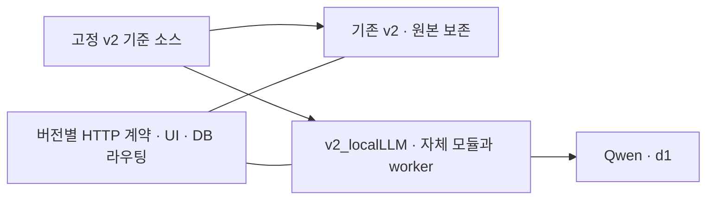
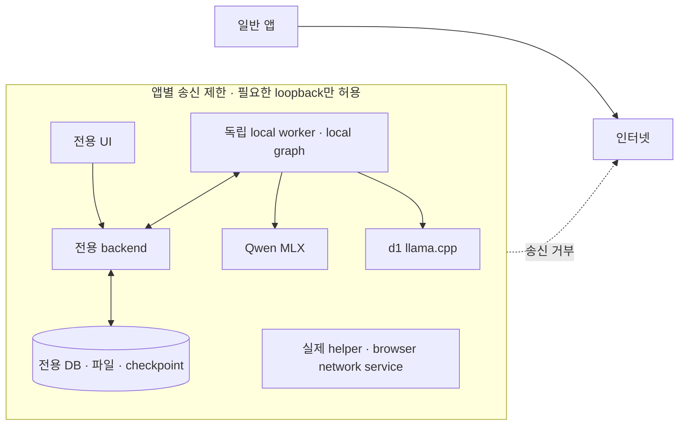
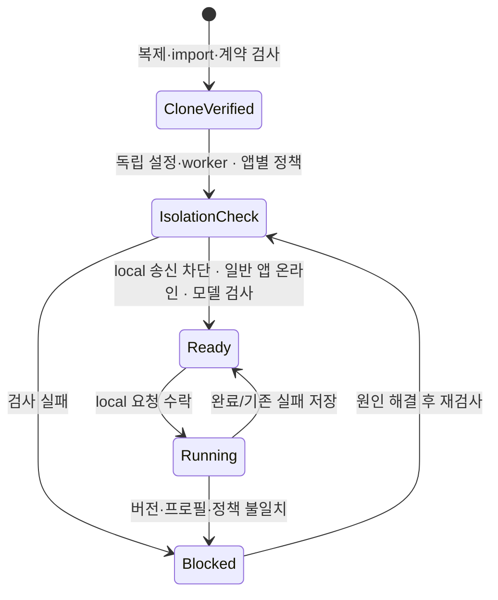
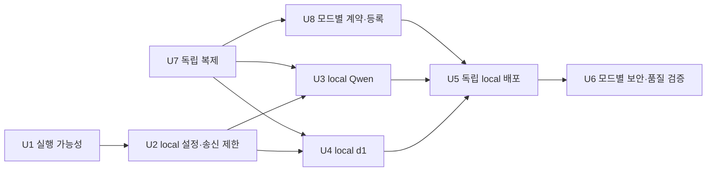

# v2_localLLM Independent Graph - Plan

> 2026-11-12 초기 설계 기록이다. 당시 모델 조합과 독립 배포 검증을 담았다. 현재 공용 웹과 모델 구성은 [LocalLLM 가이드](../development/agent-v2-local-llm.md)를 따른다.

## Goal Capsule

- **목표:** `v2`와 `v2_localLLM`을 서로 다른 소스·객체·설정·worker·복구 상태를 가진 두 독립 그래프로 운영한다. local은 Qwen3.5-9B 4비트와 d1-2B Q8_0를 사용한다.
- **보존:** 기존 표준 V2의 그래프 구현과 v2 기준의 구조·프롬프트·계산·근거 검증·응답 양식을 보존한다. 새 그래프 식별자와 로컬 전송 경계만 명시적으로 변경한다.
- **기준:** 고정한 v2 소스 `51d077c9878b635c96da709eb7eb2aefd36699e1`, 보존 태그 `agent-v2-baseline-20261111`에서 local을 별도로 복제한다.
- **운영:** M4 Pro 24GB, 동시 요청 1개를 기준으로 한다. 맥과 일반 앱의 인터넷은 유지하고 local의 데이터 취급 프로세스만 외부 송신을 제한한다.
- **권한과 범위:** 사용자 요구 → `AGENTS.md`·`CONTRIBUTING.md` → 이 계획 순으로 따른다. 구현은 `main`에서 분기하며 기준 표준 V2 소스의 선행 통합을 확인한다. 이 문서는 계획이며 복제·설치·평가를 실행한 결과가 아니다.
- **중단과 완료:** 독립성·계약·외부 전송 차단·24GB 실행 가능성 검증이 실패하면 완료로 표시하지 않는다. 기존 그래프 import·클라우드 fallback·기기 전체 인터넷 차단·검토 생략으로 우회하지 않는다. 구현 담당자는 Verification Contract와 Definition of Done을 충족하고 저장소 PR·팀 리뷰 규칙을 따른다.

---

## Product Contract

### Summary

고정 v2를 실제 파일로 복제해 독립 Python 패키지 `kplasma_agent.v2_local_llm`을 만든다.
제품·API의 정확한 버전 이름은 `v2_localLLM`이며 `v2`의 별칭이나 실행 프로필만으로 구현하지 않는다.
복제한 코드 안에서 계획·답변은 Qwen, 계획·답변 의미 검토는 d1에 연결한다.
두 그래프의 내부 구현은 독립시키고 외부 HTTP 플랫폼·화면은 버전별 계약으로 연결한다.

### Problem Frame

기존 재사용 계획은 v2 코드 변경이 local 동작에 영향을 줄 수 있었다.
이번 요구는 독립 복제를 통해 그래프별 개발과 설정·실행 상태를 분리하는 것이다.
상용 API로 전달되던 질문·이력·근거·답변은 local에서 기기 내부만 사용한다.

### Requirements

**동작과 응답 계약**

- R1. v2의 노드·분기·도구·수치 계산·근거 검증·HITL·저장 정책을 local 안에 복제하여 보존한다.
- R2. 계획 스키마 2·답변 스키마 1, 필드·문구 정책·오류 envelope·스트리밍 이벤트·화면 양식을 유지한다. `graphVersion`·`implementationId` 등 그래프 식별 값은 각 버전으로 구분한다.
- R3. 계획·재계획·답변·재작성은 Qwen3.5-9B 4비트, 계획·답변 의미 검토는 d1-2B Q8_0를 사용한다.
- R4. `plan_review_enabled=true`, 요청 전체 최대 2회 재계획, 필요한 답변 검토와 최대 1회 재작성을 유지한다. 기존 13회 모델 호출·600초 요청 예산과 90초 호출 timeout을 출발점으로 삼는다.

**개인정보와 상태 격리**

- R5. 질문·이력·Run·근거·계획·답변·판단·체크포인트·오류 및 관측 데이터를 실행 기기 밖으로 전송하지 않는다.
- R6. local 요청은 local worker만 처리한다. 두 그래프의 설정·객체·PASS·cache·복구 상태를 서로 재사용하지 않고, local DB·저장소·token·브라우저 환경은 cloud와 분리한다.
- R7. 모델 미설치·서버 장애·잘못된 응답·메모리 부족·입력 초과는 기존 실패·검토 불가 경로로 처리한다. 성공·PASS·확률·물리 수치를 만들어내지 않는다.

**성능과 검증**

- R8. M4 Pro 24GB에서 동시 요청 1개를 기준으로 전체 스택의 메모리·지연·정확도를 측정한다. 파일 크기로 실행 가능성이나 상용 v2와의 품질 동등성을 선언하지 않는다.
- R9. 코드·계약 회귀와 실제 모델 평가를 구분하고 최초 계획 통과·검토 지적·재계획 후 최종 결과를 따로 보고한다. 실데이터·원문은 로컬에만 보관한다.

**기기의 인터넷 연결 유지**

- R10. 맥·일반 브라우저·다른 앱의 인터넷 연결을 유지하고, `v2_localLLM`과 그 데이터 취급 helper에만 외부 송신 제한을 적용한다. 기기 전체 차단이나 다른 앱까지 막는 규칙으로 대체하지 않는다.

**독립 그래프**

- R11. local은 그래프·계약·계산·검증·모델 통신·설정·streaming·persistence·worker를 실제 복제한다. 표준 V2 내부 구현의 import·상속·함수 alias·전역 monkey patch·동일 mutable 객체 공유를 금지한다.
- R12. `v2`와 `v2_localLLM`을 고유 버전으로 서버·DB·worker·UI·평가기에 등록한다. 요청·답변·기록·복원에서 정확한 버전을 보존하고 다른 그래프로 묵시적으로 치환하지 않는다.

### Acceptance Examples

- AE1. 초기 복제 시점의 두 그래프에 동일한 인공 입력과 고정 모델 출력을 각각 독립 객체로 주입하면, 그래프 식별 값만 정규화한 최종 결과·분기·이벤트가 같다. 테스트 clock·UUID는 고정하며 usage·확률·digest·예산 결과를 비교에서 숨기지 않는다. Covers R1, R2, R11.
- AE2. local에 외부 주소·OpenAI 자격 증명·Phoenix·proxy 또는 다른 그래프 설정을 주입해도 cloud 호출로 연결되지 않는다. local 전용 키와 legacy v2 키를 정확히 구분한다. Covers R5, R7, R11.
- AE3. d1 장애·불완전 검토 응답은 기존 `UNAVAILABLE` 경로를 따른다. 계획 검토가 필요한 실행을 승인하지 않는다. Covers R4, R7.
- AE4. 동일 local 프로필의 HITL·재시작은 이어지지만 표준 V2 checkpoint·PASS·다른 graphVersion의 snapshot은 거부한다. 버전 변경은 새 대화에서만 허용한다. Covers R6, R12.
- AE5. 인터넷에 연결된 맥에서 local의 전체 질문·저장·복구가 동작하고 외부 송신은 차단된다. 일반 브라우저·다른 앱의 인터넷은 계속 성공한다. Covers R5, R9, R10.
- AE6. local 함수·중첩 설정·질문 registry를 테스트에서 수정해도 표준 V2의 객체·응답·설정이 변하지 않는다. 신규 버전 등록 뒤에도 기존 표준 V2 내부 파일과 보존 검사가 유지된다. Covers R11, R12.

### Scope Boundaries

독립 복제의 범위는 Python Agent 전체 실행 의존성과 각 그래프 전용 worker다.
공통 backend·frontend는 HTTP 계약·라우팅·표시 플랫폼으로 유지하며 두 앱의 전체 소스를 복사하지 않는다. 이 공통 플랫폼의 변경은 두 모드의 회귀로 검증한다.
초기 검증은 별도 백엔드·DB에서 로컬 모드만 실행한다. 운영에서 웹·백엔드·DB를 공유하는 방식은 [공용 웹 통합 계획](2026-11-13-002-feat-v2-local-llm-shared-web.md)에서 확정했다.
두 모드를 한 요청에서 자동 전환하거나 local 원문을 cloud로 전달하는 기능은 없다.

**Deferred to Follow-Up Work:** RAG·이미지·모델 학습, RTX 5060 최적화, 동시 사용자 확대, 모델 서버 단일 프로그램 통합은 후속 작업이다.
앱별 송신 필터와 다른 앱의 온라인 유지는 1차 범위이며, 자체 방화벽 개발·전역 DNS/VPN 변경·기기 전체 인터넷 차단은 포함하지 않는다.

---

## Planning Contract

### Existing Baseline

기준 v2의 계획·답변·Decisions 모델은 `gpt-6-luna`이며 수치 조회·개념 설명·결과 해석의 기존 분기를 보존한다.

기준 워커는 표준 V2를 처리하며 공용 모델 클라이언트를 사용한다.
신규 모드를 추가할 때 백엔드 배분, 프런트엔드 선택, DB 제약을 함께 확인한다.
실행 그래프 버전과 [비교 답변 스키마](../contracts/agent-comparison-answer.schemas.yaml)의 저장 형식을 분리한다.

### Key Technical Decisions

- KTD1. **선택 모델 유지:** Qwen은 `mlx-community/Qwen3.5-9B-4bit`, d1은 `LiquidAI/d1-2B-GGUF`의 `Q8_0`를 사용한다. (session-settled: user-approved — chosen over 상용 API 유지 및 다른 로컬 모델 재선정: 앞서 검토한 조합으로 사용자가 계획 작성을 요청했다.)
- KTD2. **V2에서 완전 독립 복제:** 로컬 구현은 `kplasma_agent.v2_local_llm` 안에 둔다. 표준 V2의 builder·gateway·worker 진입점을 직접 사용하지 않는다.
- KTD3. **서로 다른 식별과 상태:** wire ID는 정확히 `v2_localLLM`, Python builder는 `build_v2_local_llm_graph`, 전용 설정은 `AGENT_V2_LOCAL_LLM_`다. local은 별도 worker·DB·저장소·token·origin·checkpoint fingerprint를 갖는다. `v2`로 위장하거나 기존 기록을 새 ID로 덮어쓰지 않는다.
- KTD4. **네이티브 모델 실행 유지:** Qwen은 LM Studio MLX, d1은 지원 빌드를 고정한 llama.cpp로 시작한다. 초기 주소는 Qwen `127.0.0.1:1234`, d1 `127.0.0.1:8081`, local backend `127.0.0.1:8080`이다. 동시 배포에서는 모든 충돌 포트를 별도 지정하고 잘못된 서비스에 접속하지 않는다.
- KTD5. **복제한 전송 경계만 로컬화:** local 소유의 model client·gateway·설정·입력 예산·tracing을 수정한다. 계획·답변 프롬프트, 도구 제출 schema와 검증·계산 규칙은 복제 상태를 유지한다. SDK를 사용하더라도 고정한 loopback client만 생성한다.
- KTD6. **실제 typed decisions 보존:** d1의 `/v1/systemone` state/questions를 local의 복제된 검토 계약으로 변환한다. 실제 choice·전체 확률·confidence·usage를 보존하고 기존 PASS/ISSUE/UNAVAILABLE 규칙을 유지한다.
- KTD7. **인터넷 유지·local 송신 제한:** 실제 프로세스·서명·helper를 구분하는 앱별 정책을 검증한다. LuLu는 우선 후보이며 완전 차단을 가정하지 않는다. (session-settled: user-directed — chosen over 기기 전체 인터넷 차단: 사용자가 인터넷은 유지하고 v2_localLLM에서만 외부 전송을 막도록 수정했다.)
- KTD8. **모델별 입력·메모리 검증:** local tokenizer·template·스키마·질문을 포함해 계산한다. 원본의 입력 허용 범위를 조용히 줄이거나 근거·이력을 절단하지 않는다. 24GB·timeout·요청 예산을 만족하지 못하면 호환 완료로 판정하지 않는다.
- KTD9. **실행 모드 등록:** 백엔드·DB·계약·UI·평가기에서 각 모드를 지정한다. 워커는 자신이 처리하는 버전만 claim하고 해당 모드로 결과를 저장한다.

### Clone and Change Guards

먼저 기준의 36개 모듈을 복제하고 원본/대상 경로·module·source SHA-256·최초 clone SHA-256·허용 import/식별자 치환을 `agent/python/src/kplasma_agent/v2_local_llm/clone-manifest.json`에 기록한다.
원본 worker까지 그대로 의존성 추적하면 공통 registry 등 40개가 연결되므로, worker는 별도 복제 증거를 남긴 뒤 local builder에 직접 연결하는 의도 변경으로 관리한다.
local의 실행 의존성은 최종적으로 다시 추적하고 package `__init__`·새 파일·동적 import 경로도 감사한다.

최초 manifest는 초기 복제의 불변 기록이다. 로컬화 뒤 현재 hash를 그 값으로 덮어쓰지 않는다.
`agent/python/src/kplasma_agent/v2_local_llm/intentional-differences.json`에 로컬 전송·설정·token budget·worker·관측 변경의 함수/메서드 범위와 이유·검증을 기록한다.
그래프·계산·검증 모듈은 식별자/namespace 치환 외 AST를 유지하고, 변경 모듈도 허용 범위 밖 AST·프롬프트·스키마는 계속 대조한다. 파일 전체를 검사에서 제외하지 않는다.

고정 V2 원본 36개, 기존 워커와 복제 기준을 이번 변경에서 보존한다.
테스트 support·typed fixture도 local 소유로 복제한다. 초기 비교 driver에서만 두 namespace를 함께 import하고 각 실행에 별도 mutable 객체·clock·UUID를 제공한다.
local의 지속 검증은 고정 sourceCommit에서 기록한 AST·schema·출력 기준을 사용한다. 이후 표준 V2의 현재 출력을 local의 가변 정답으로 삼거나 변경 내용을 자동 동기화하지 않는다. 이번 변경에서 원본이 보존됐는지는 변경 전후 별도로 검사한다.

### High-Level Technical Design

세 구현의 출발점은 같고 이후 내부 소스는 서로 import하지 않는다.



local의 데이터 경계와 일반 앱의 인터넷 연결은 분리한다.



실데이터는 격리와 실행 준비 확인 뒤에만 사용한다.



U-ID는 기존 번호를 유지하고 독립 복제 U7·플랫폼 등록 U8을 추가한다.



### Runtime and Privacy Constraints

준비 단계에서 모델 snapshot revision·파일 SHA-256·라이선스·tokenizer·chat template·앱/runtime 버전을 기록한다.
모델 파일과 로컬 데이터는 Git 밖에 둔다. local checkpoint·PASS·cache·진행 기록은 동일 그래프·요청·프로필 안에서만 복구한다. digest가 같아도 표준 V2의 기록을 local로 가져오지 않는다. 실행에는 모델 ID의 원격 자동 검색 대신 검증한 로컬 경로를 사용한다.
모델·패키지 설치와 업데이트는 실데이터를 연결하지 않은 준비 환경에서 수행한다. 실행 중의 자동 갱신·원격 discovery·lazy download는 사용하지 않는다.
추가 다운로드는 실데이터·대화·로그에 접근하지 않는 별도 준비 도구로 수행한다. 기존 보호 대상의 차단 규칙을 풀어 다운로드·업데이트를 허용하지 않는다.
실험 데이터가 필요한 경우 기존 로컬 원본 파일을 기존 수집 기능으로 전용 DB·저장소에 등록한다. cloud DB·대화·판단 기록을 자동 복사하거나 과거 snapshot을 덮어쓰지 않는다.

**애플리케이션의 통신 제한**

local의 설정·통신·관측 모듈은 모두 `kplasma_agent.v2_local_llm` 내부에 둔다.
복제한 local 설정은 `AGENT_V2_LOCAL_LLM_`와 명시한 전용 파일만 읽고 루트 `.env`·`AGENT_V2_`의 값을 가져오지 않는다. 접두사 문자열이 겹치므로 자신의 local 키와 legacy v2 키를 정확히 구분한다.
실제 OpenAI 키·외부 base URL·Phoenix/OTEL exporter·HTTP(S)/ALL proxy·원격 MCP·LM Link·클라우드 fallback을 상속하면 시작을 거부한다.
모델 API 인증에는 별도 로컬 token을 사용한다. OpenAI 자격 증명과 혼용하거나 프런트에 모델·worker token을 전달하지 않는다.
worker·백엔드·DB·모델 서버·프런트는 loopback으로 bind하고, HTTP client는 필요한 host/port만 허용한다. 환경 proxy·redirect·임의 URL 해석을 허용하지 않는다.
전용 UI는 외부 폰트·분석 도구·원격 asset 없이 로컬 bundle을 사용한다. CSP로 해당 페이지의 연결·resource·form 경로를 제한하되 CSP만으로 브라우저 전체가 격리됐다고 판정하지 않는다.
전용 UI·모델의 입력이나 출력에서 원문을 포함한 URL·IPC를 일반 온라인 앱·시스템 네트워크 대행 서비스로 자동 전달하지 않는다. 외부 앱으로의 navigation·reporter 위임도 검증 범위에 넣는다.
로그·crash report·스크린샷·브라우저 프로필·DB backup은 외부 동기화 경로에 두지 않고 원문 관측 export·자동 reporter를 비활성화한다.

**macOS의 앱별 송신 필터**

실데이터를 넣기 전에 LuLu 같은 기존 송신 필터의 고정 버전으로 앱별 차단 가능성을 검증한다. 자체 NetworkExtension을 새로 개발하지 않는다.
보호 대상은 worker·평가기의 Python, 백엔드 Java, DB, 프런트·평가 bridge의 Node, Qwen·d1 서버, 전용 브라우저와 network service·업데이터·reporter·별도 daemon이다.
경로·해시·서명 식별자·실제 연결 주체를 함께 기록한다. 기존 일반 앱과 규칙이 충돌하면 전용 runtime/브라우저 실행 파일을 분리해 다시 검증하고, 다른 앱을 함께 막는 방식으로 통과 처리하지 않는다.
프로필·폴더만 분리한 일반 브라우저나 기존에 떠 있는 미보호 모델 daemon을 재사용하지 않는다.
필터는 보호 대상에 필요한 loopback 연결만 허용하고 그 외 IPv4/IPv6·TCP/UDP·DNS·DoH·QUIC 등 외부 송신을 거부해야 한다. 다른 loopback proxy·미승인 포트로의 중계도 허용하지 않는다.
필터의 서명 식별·helper 귀속·DNS 예외·전역 allowlist·미관측 트래픽 제한을 확인한다. 단순 도메인 차단 목록이나 일반 앱에도 적용되는 global block/profile 전환으로 대체하지 않는다.
설치에 필요한 macOS 시스템 확장·필터 승인은 운영 준비에 명시한다. 기존 사용자 규칙 전체를 import로 덮어쓰거나 전역 DNS·VPN·인터넷 설정을 변경하지 않는다.

launcher는 앱별 정책과 식별자 매핑을 검사하고, 인공 표식으로 필요한 loopback 성공·외부 송신 거부·일반 앱 인터넷 성공을 확인한 뒤에만 데이터 프로세스를 준비 상태로 전환한다.
규칙 만료·필터 비활성·extension 재시작·helper 생성 시의 정책을 검증한다. GUI 종료와 필터 엔진 종료를 구분하고, 상태를 확인할 수 없으면 로컬판의 접수와 데이터 처리를 중단한다.
감시 후 프로세스를 종료하는 반응만으로 전환 순간의 무전송을 보장하지 않는다. 필터 장애·정책 변경 중에도 송신이 차단되는지 U1/U6에서 검증하고, 입증하지 못하면 실데이터 모드의 완료 판정을 보류한다.
실패·취소·재시작 뒤에도 잔존 프로세스와 저장된 전송 대기 데이터를 보호한다. 데이터가 남은 전용 실행 파일의 차단 규칙을 종료 직후 해제하지 않는다.
정리는 launcher가 소유한 프로세스·파일에 한정한다. 일반 앱·OS의 인터넷은 시작·실행·실패·종료 전 과정에서 유지한다.

**온라인 브라우저를 통한 로컬 API 중계 방지**

외부 웹페이지가 loopback API를 데이터 중계점으로 쓰지 못하도록 local 배포에 Host·Origin·Fetch Metadata 검사와 로컬 세션 인증을 적용한다.
Origin이 없는 GET도 있으므로 Origin 검사나 CORS만으로 인증을 대신하지 않는다.
launcher가 전용 브라우저에만 전달한 일회용 bootstrap 자격을 로컬 세션으로 교환하고, 데이터 GET·파일·이벤트·SSE·변경 API를 모두 보호한다. 공개 bootstrap으로 세션 자격을 재발급하지 않는다.
추가 로그인 화면 없이 자동 연결하며 bootstrap은 URL query·로그·referrer·공유 localStorage에 남기지 않는다. 기존 worker token 인증과 모델 서버의 지원 인증도 각각 유지한다.
일반 온라인 브라우저·다른 origin·무자격 요청은 데이터에 접근하지 못해야 한다. 기존 cloud 배포의 접근 방식은 변경하지 않는다.
실데이터를 온라인 IDE·Codex·원격 평가기에 복사하거나 클라우드 백업에 포함하는 동작은 허용한 자동 경로가 아니다.

### Memory and Input Budget

공개 모델 파일 크기는 Qwen 약 5.95GB, d1 Q8_0 약 1.85GB다. 합계 약 7.8GB는 디스크상의 가중치 규모이며 전체 실행 메모리가 아니다.
KV/작업 버퍼·d1 batch·두 runtime·백엔드 JVM·DB·브라우저·macOS까지 함께 측정한다.
처음에는 Qwen 인스턴스 하나를 planner/writer가 순차 공유하고 모델 추론·요청 동시성은 1로 제한한다.

Qwen context 32K는 초기 측정값이며 보장값이 아니다.
현재 v2의 입력 추정 상한 24K와 출력 최대 6K를 참고하되, 실제 Qwen token 수와 template overhead를 더해 필요한 context를 결정한다.
d1은 전체 검토 state와 질문을 수용하도록 context·batch·microbatch를 함께 잡는다.
공식 예제의 `-b 8192 -ub 8192`를 그대로 적용해 긴 입력을 잘라서는 안 된다.
메모리 부족 시 근거·질문·이력을 조용히 줄이거나 검토를 끄지 않는다.

### Deferred Implementation Measurements

LM Studio·MLX engine의 실제 버전, Qwen의 generation/thinking 설정과 최대 context, d1의 batch/microbatch, warm/cold 지연과 peak 메모리는 U1에서 고정한다.
동일한 선행 단계에서 macOS·송신 필터 버전, 보호 대상 식별자·helper 매핑·규칙·승인 절차를 검증해 고정한다. LuLu는 우선 검증 후보이며 무조건 지원된다고 가정하지 않는다.
llama.cpp는 최소 `b11960` / `v0.8.0` 이후 d1 지원 빌드를 사용하되 태그/commit을 구체적으로 pin한다.
한국어 지원 표기는 한국어 K-PLASMA 검토 정확도의 증명이 아니므로 U6에서 따로 평가한다.
d1의 라이선스는 `lfm1.0`이며 Qwen과 같다고 가정하지 않는다. 모델 재배포가 필요해지면 배포 조건을 확인한다.

### Output Structure

기준과 같은 내부 계층을 만들되 local 소스와 worker는 자기 패키지만 의존한다. 아래는 주요 경로이며 전체 복제 목록은 manifest로 확정한다.

```text
agent/python/src/kplasma_agent/
  graphs/v2.py                  기존 v2 보존
  v2/                           기존 core 보존
  v2_local_llm/
    __init__.py
    graph.py
    clone-manifest.json
    intentional-differences.json
    core/                       계획·계약·검증·gateway·예산·실행
      decisions.py              d1 전송 adapter 추가
    domain/                     조회·비교·계산·근거 검증
    persistence/                독립 checkpointer
    config.py
    model_client.py
    backend_client.py
    answer_stream.py
    tracing.py
    worker.py
    network.py
agent/python/tests/v2_local_llm/
agent/python/pytest-v2-local-llm.ini
scripts/agent/local-llm.mjs
.env.local-llm.example
```

---

## Implementation Units

### U7. Make and characterize the independent clone

**Goal:** v2를 실제 복제하고 모델 변경 전에 독립성과 동작 동등성을 입증한다.

**Requirements:** R1, R2, R4, R11; KTD2, KTD3; AE1, AE6. **Dependencies:** 고정 V2 기준 확보.

**Files:** 새 `agent/python/src/kplasma_agent/v2_local_llm/`의 위 복제 모듈·`agent/python/src/kplasma_agent/v2_local_llm/clone-manifest.json`·`agent/python/src/kplasma_agent/v2_local_llm/intentional-differences.json`·`agent/python/src/kplasma_agent/v2_local_llm/worker.py`, `agent/python/tests/v2_local_llm/test_clone_boundary.py`, `agent/python/tests/v2_local_llm/test_clone_parity.py`, 독립 회귀·fixture·support, `agent/python/pytest-v2-local-llm.ini`, `docs/development/agent-v2-local-llm.md`.

**Approach:** 물리 복제·AST 비교로 36개 의존성부터 복제한다. import·builder·gateway/settings/port/snapshot 클래스와 그래프 식별자만 기계 치환한 초기 상태를 기록한다. worker는 별도 복제 후 공통 registry 분기를 제거하고 local builder·오류·설정·saver에 직접 연결한다. `v2ConfirmedInputs`, codec 이름·기존 `/v2/` API 경로·사용자 문구를 일괄 치환하지 않는다.


**Test scenarios:** Covers AE1, AE6. 두 namespace의 함수·클래스·스키마·nested registry가 서로 다른 객체인지 검사한다. local mutation·함수 교체가 표준 V2에 영향을 주지 않는다. local의 모든 production 파일에서 패키지 밖 내부 import·상속·alias를 거부하고, worker 포함 실제 의존성도 검사한다. 개념/조회/재계획/검토 불가/HITL/재작성의 고정 출력·호출 순서·직렬화를 대조한다. 원본 표준 V2 hash와 기존 보존 검사가 유지된다.

**Verification:** 모델을 호출하지 않는 복제·회귀 검사가 통과하고 local이 표준 V2 구현에 의존하지 않는다. 이후 허용 변경을 추가해도 초기 manifest와 불변 부분 검사를 약화하지 않는다.

### U1. Verify the selected runtimes on M4 Pro

**Goal:** 전체 연결 전에 모델 계약·24GB·앱별 송신 제한의 실행 가능성을 확인한다.

**Requirements:** R2–R5, R8, R10; KTD1, KTD4, KTD7, KTD8. **Dependencies:** 모델 준비; U7과 별도로 인공 입력 조사 가능.

**Files:** 새 `agent/python/tests/v2_local_llm/test_runtime_contract.py`, `agent/python/evals/local_llm_smoke.py`; `docs/development/agent-v2-local-llm.md`.

**Approach:** LM Studio/MLX·d1 runtime 버전과 실제 실행 파일·서명·helper 정책을 고정한다. 인공 입력으로 단일 `submit_plan`, 중첩 strict schema, writer JSON·SSE와 d1 named choices·확률·usage를 확인한다. 모델·앱 동시 상주, 짧은/중간/기존 한계 입력으로 peak 메모리와 90초/600초 예산을 측정한다.

**Test scenarios:** 정상 1개 도구 호출·JSON은 수락하고 0개/복수/다른 이름/잘린 JSON/중단 SSE는 실패한다. 한국어·유니코드 단위를 보존한다. local 프로세스의 외부 송신은 거부되고 일반 브라우저·별도 runtime의 인터넷은 성공한다. d1의 전체 state·질문이 batch/microbatch에 들어간다.

**Verification:** Responses schema가 지원되지 않으면 local 소유 client의 Chat Completions 경계를 검증해 같은 계약으로 정규화한다. 모델·메모리·필터를 입증하지 못하면 실데이터 사용을 차단하며 모델 교체·호스트 전체 차단으로 우회하지 않는다.

### U2. Configure only the independent local runtime

**Goal:** 복제한 local 설정·통신·관측을 외부 전송 없는 프로필로 바꾼다.

**Requirements:** R5–R8, R10, R11; KTD3, KTD7, KTD8; AE2, AE5. **Dependencies:** U7, U1.

**Files:** 복제본 `agent/python/src/kplasma_agent/v2_local_llm/config.py`, `agent/python/src/kplasma_agent/v2_local_llm/tracing.py`, `agent/python/src/kplasma_agent/v2_local_llm/backend_client.py`, `agent/python/src/kplasma_agent/v2_local_llm/core/budget.py`; 새 `agent/python/src/kplasma_agent/v2_local_llm/network.py`, `.env.local-llm.example`, `agent/python/tests/v2_local_llm/test_config.py`, `agent/python/tests/v2_local_llm/test_network.py`, `agent/python/tests/v2_local_llm/test_budget.py`; `.gitignore`, 개발 문서.

**Approach:** 다른 그래프 설정을 읽지 않고 local 키와 명시한 파일로만 client·backend·저장 경로를 구성한다. 원격 URL·자격 증명·proxy·관측 설정 오염은 거부한다. 앱별 정책은 U1에서 검증한 기존 필터를 사용하고, 준비 검사 뒤에만 원문에 접근한다. 변경 함수와 검증을 intentional differences에 기록한다.

**Test scenarios:** Covers AE2, AE5. 표준 V2 설정이 local 모델·검토 여부·목적지를 바꾸지 못하며 local 접두사를 legacy v2로 잘못 거부하지 않는다. cloud constructor·exporter가 생성되지 않는다. IPv4/IPv6·DNS/DoH·TCP/UDP·QUIC·proxy·redirect·미승인 loopback 중계·helper·규칙 만료·필터 장애를 검사하고 일반 앱 인터넷은 유지한다. 로그·crash·지연 전송에 원문·token이 남지 않는다.

**Verification:** 격리된 config와 정책이 private worker·모델·UI·평가기에 적용된다. 지원을 입증하지 못한 정책은 성공 처리하지 않는다. 원본 설정·tracing·backend client는 수정하지 않는다.

### U3. Connect Qwen inside the cloned implementation

**Goal:** local이 소유한 계획·답변 경계에 Qwen을 연결한다.

**Requirements:** R1–R3, R7, R11; KTD1, KTD2, KTD5; AE1. **Dependencies:** U7, U1, U2.

**Files:** `agent/python/src/kplasma_agent/v2_local_llm/model_client.py`, `agent/python/src/kplasma_agent/v2_local_llm/core/model_gateway.py`, `agent/python/src/kplasma_agent/v2_local_llm/core/budget.py`, `agent/python/src/kplasma_agent/v2_local_llm/intentional-differences.json`; `agent/python/tests/v2_local_llm/test_model_gateway.py`, `agent/python/tests/v2_local_llm/test_model_client.py`, `agent/python/tests/v2_local_llm/test_streaming_graph.py`, `agent/python/tests/v2_local_llm/test_budget.py`.

**Approach:** 복제한 concrete gateway/client 자체를 수정한다. 기존 gateway를 상속·import하거나 전역 patch하지 않는다. 프롬프트·PlanDraft 검증·숫자 참조·스트리밍 projector는 local 복제본 안에서 유지하고, local tokenizer·template를 포함해 입력을 계산한다.

**Patterns to follow:** local로 복제한 기존 gateway·client·streaming 테스트의 assertion.

**Test scenarios:** 고정 응답에서 v2와 같은 계획·답변 구조·이벤트를 반환한다. 여분 필드·잘못된 단위·근거 없는 숫자·잘림·thinking 혼입·timeout·입력 초과는 기존 실패 의미를 보존한다. 프롬프트·도구 schema와 local 미변경 AST가 기준과 같고 원본 모듈 객체를 사용하지 않는다.

**Verification:** 계획·답변·재작성은 Qwen에만 연결되고 원본 표준 V2 hash·동작은 유지된다.

### U4. Connect d1 inside the cloned review boundary

**Goal:** local 소유 계획·답변 검토를 d1 typed decisions로 연결한다.

**Requirements:** R3, R4, R7, R11; KTD1, KTD5, KTD6; AE3. **Dependencies:** U7, U1, U2.

**Files:** `agent/python/src/kplasma_agent/v2_local_llm/core/model_gateway.py`, 새 `agent/python/src/kplasma_agent/v2_local_llm/core/decisions.py`, `agent/python/src/kplasma_agent/v2_local_llm/intentional-differences.json`; `agent/python/tests/v2_local_llm/test_decisions.py`, `agent/python/tests/v2_local_llm/test_plan_review.py`, `agent/python/tests/v2_local_llm/test_plan_review_graph.py`, `agent/python/tests/v2_local_llm/test_model_gateway.py`.

**Approach:** 원래 payload·동적 질문·선택지 의미를 d1 state/questions에 전달한다. 결과를 복제한 기존 parser·ReviewDecision이 검사하는 형태로 정규화하며 원본 `agent/python/src/kplasma_agent/v2/plan_review.py`를 import하지 않는다. digest·거부 근거·확률·usage를 보존한다.

**Test scenarios:** Covers AE3. 질문/선택지 순서 변경은 값으로 매핑하고 누락·중복·unknown label·잘못된 choice·불완전/비유한 확률은 검토 불가다. 실제 분포·confidence를 보존하고 없는 값은 만들지 않는다. ISSUE/UNAVAILABLE이 PASS로 바뀌지 않고 기존 재계획·재작성 한도를 유지한다.

**Verification:** 두 검토 경로가 local d1에 연결되며 copied parser·조건/근거 검증의 의미가 유지된다. 동일 digest의 다른 그래프 PASS를 재사용하지 않는다.

### U8. Register and activate two distinct graph versions

**Goal:** 두 독립 구현을 서버·DB·계약·UI·worker에서 정확히 구분해 실행한다.

**Requirements:** R1, R2, R6, R11, R12; KTD2, KTD3, KTD9; AE4, AE6. **Dependencies:** U7.

**Files:** `agent/python/src/kplasma_agent/graphs/registry.py`, `agent/python/tests/test_graph_registry.py`; `backend/src/main/java/com/kplasma/analysisagent/agent/v2/GraphVersionPolicy.java`, `backend/src/main/java/com/kplasma/analysisagent/agent/v2/V2Contracts.java`, `backend/src/main/java/com/kplasma/analysisagent/agent/v2/V2StepOrigins.java`, `backend/src/main/java/com/kplasma/analysisagent/agent/AgentRequestService.java`, `backend/src/main/resources/application.yml`, 새 `backend/src/main/resources/db/migration/V19__agent_graph_version_variants.sql`; `backend/src/test/java/com/kplasma/analysisagent/workspace/AgentGraphVersionTest.java`, `backend/src/test/java/com/kplasma/analysisagent/agent/v2/V2ContractTest.java`; `agent/src/contracts/v2.ts`, `agent/src/contracts/index.ts`, `agent/tests/v2-contracts.test.ts`; `frontend/src/features/agent/AnswerView.tsx`, `frontend/src/features/agent/V2AnswerView.tsx`, `frontend/src/features/agent/AgentPage.tsx`, `frontend/src/features/agent/useConversation.ts`, `frontend/src/features/agent/RunSelectionPanel.tsx`, `frontend/src/features/agent/references.ts`와 대응 `frontend/src/features/agent/v2-answer.test.tsx`, `frontend/src/features/agent/conversation.test.tsx`, `frontend/src/features/agent/run-selection.test.tsx`, `frontend/src/features/agent/agent-page.test.tsx`; `docs/contracts/agent-v2.openapi.json`, `docs/contracts/agent-v2-local-llm.answer.schema.json`.

**Approach:** request·conversation·snapshot의 그래프와 답변 implementationId가 일치하는지 확인한다. 워커와 제품 화면에는 지원하는 두 모드만 등록하며, 과거 응답은 읽을 때 저장본을 사용한다.

새 마이그레이션은 기존 V12를 수정하지 않고 request/workspace/conversation 제약을 확장한다. 확인한 최신 번호는 V18이므로 구현 시 V19 가용성을 재확인한다. 기존 행·대화·snapshot의 버전은 바꾸지 않는다.

root registry는 외부 dispatch만 담당한다. 각 워커는 자기 모드만 수락하고 로컬 워커는 공유 registry를 import하지 않는다.

UI는 저장된 답변 형식을 유지하며 분석 시작 전 실행 모드를 지정한다. 이미 질문한 대화에서 모드를 전환할 때는 새 대화를 연다.

**Test scenarios:** 두 모드의 HTTP 저장·step·HITL·결과 조회·참조·finalize·replay를 검증한다. 요청과 워커 버전이 다르거나 출처가 다른 단계·기록을 주입하면 거부한다.

**Verification:** 인공 데이터와 고정 모델 응답으로 모드별 API·UI를 확인한다. 로컬 실모델은 U5의 실행 준비 이후 확인하고, DB와 과거 기록은 보존한다.

### U5. Deploy the independent local worker and private data plane

**Goal:** local의 자체 실행·저장·복구를 보호된 배포로 연결한다.

**Requirements:** R1, R2, R4–R7, R10–R12; KTD2, KTD3, KTD7, KTD9; AE4, AE5. **Dependencies:** U2–U4, U8.

**Files:** `agent/python/src/kplasma_agent/v2_local_llm/worker.py`, `agent/python/src/kplasma_agent/v2_local_llm/config.py`, `agent/python/src/kplasma_agent/v2_local_llm/backend_client.py`, `agent/python/src/kplasma_agent/v2_local_llm/persistence/checkpointer.py`, `agent/python/src/kplasma_agent/v2_local_llm/intentional-differences.json`, `agent/python/tests/v2_local_llm/test_worker.py`, `agent/python/tests/v2_local_llm/test_checkpoint_adapter.py`; 새 `scripts/agent/local-llm.mjs`, `scripts/agent/local-llm.test.mjs`, `frontend/src/api/local-session.ts`, `frontend/src/api/local-session.test.ts`, `backend/src/main/java/com/kplasma/analysisagent/agent/LocalRuntimeAccessFilter.java`, `backend/src/test/java/com/kplasma/analysisagent/agent/LocalRuntimeAccessTest.java`; `frontend/src/api/client.ts`, `frontend/src/api/agent.ts`, `.env.local-llm.example`, `package.json`, 개발 문서.

**Approach:** private worker는 local builder를 직접 생성하고 정확한 local ID만 claim한다. 공통 run_claim을 호출하지 않는다. 별도 DB·계정·file root·token·browser origin을 준비하고 기존 데이터를 덮어쓰지 않는다. source/manifest/prompt/schema·모델 revision/양자화/runtime fingerprint를 복구 전에 확인한다.

launcher는 실제 browser/helper/daemon을 식별하고 앱별 송신 제한을 유지한다. 전용 UI와 API 평가기에만 일회용 bootstrap을 전달하고 data GET·파일·SSE를 포함해 local session 인증과 Host/Origin/Fetch Metadata 검사를 적용한다. worker/model token은 UI에 전달하지 않는다. 종료 뒤 잔존 프로세스·대기 전송도 보호한다.

**Test scenarios:** Covers AE4, AE5. 동일 local 프로필의 HITL/재시작만 재개하고, 같은 UUID/digest라도 표준 V2의 checkpoint·PASS·cache는 거부한다. 잘못된 claim·누락 버전·포트 충돌·cloud endpoint·stale lease·취소/방 전환 뒤 늦은 SSE/finalize를 막는다. 무자격 online tab/GET/file/SSE와 bootstrap 재사용은 거부하고 인증된 UI/API는 정상 동작한다. 일반 앱의 인터넷은 유지한다.

**Verification:** local 그래프·worker·저장·복구가 모두 private namespace와 local data plane에서 완결되고 cloud worker/constructor나 공유 cache를 사용하지 않는다.

### U6. Prove independence, parity, privacy and measured quality

**Goal:** 두 그래프의 독립성·계약과 local의 실용성을 별도 증거로 판정한다.

**Requirements:** R1–R12; KTD1–KTD9; AE1–AE6. **Dependencies:** U5, U8.

**Files:** `agent/python/tests/v2_local_llm/`, `agent/python/pytest-v2-local-llm.ini`, 새 `agent/python/evals/test_local_llm_profile.py`; `agent/python/evals/run_plan_review.py`, `agent/python/evals/run_flow.py`, `agent/python/evals/run_v2.py`, `agent/python/evals/v2_harness.py`, `agent/python/evals/flow_grader.py`; `scripts/agent/runtime.mjs`, `scripts/agent/flow-browser.mjs`, `scripts/agent/flow-browser.test.mjs`, `scripts/agent/verify-v2.mjs`, `scripts/agent/restart-verification.mjs`, `frontend/e2e/agent-v2-live.spec.ts`; `agent/tests/v2-contracts.test.ts`, U8의 backend/UI 테스트, `package.json`, `.github/workflows/ci.yml`, `docs/validation/agent-v2-local-llm.md`.

**Approach:** 평가의 version·entrypoint·expected identity를 명시하고 local은 private worker/model/browser/helper/bootstrap을 사용한다. 비교 driver만 세 구현을 함께 참조한다. 고정 인공 fixture와 scripted model로 독립성·상태·직렬화를 먼저 비교하고 실제 모델 품질과 하드웨어 측정은 별도로 한다. cloud baseline은 기존 결과를 사용하고 신규 유료 실험을 임의 추가하지 않는다.

**Test scenarios:** Covers AE1–AE6. 수치 조회·조건 검색·비교/단위·개념 설명·근거 해석·의미 반려 재계획·과잉 해석 재작성·HITL/재시작·취소·방 전환을 각 identity에서 확인한다. web bridge는 검증된 browser를 사용하고 첫 data page 이동 전에 bootstrap하며 직접 API도 인증 context로 호출한다. 자격 증명·원문은 console/artifact에 남기지 않는다. local 변경 뒤에도 표준 V2 hash·설정·기존 응답은 유지되고 local 외부 송신은 실패하며 일반 앱의 인터넷은 성공한다.

**Verification:** 아래 게이트를 모두 만족하고 원시 자료는 Git 밖에 보관한다. 집계 결과는 모델·설정·회차·실패 원인을 구분하며 최초 통과와 복구 후 통과를 합치지 않는다.

---

## Verification Contract

이 문서 작성에서는 제품 테스트·복제·모델 실행을 하지 않았다. 아래는 구현 후 수행할 검증이다.

| Gate | 검증 범위 | 통과 조건 |
| --- | --- | --- |
| V1. Independent clone | 표준 V2 보존 검사, local manifest/AST/import/객체/mutation 검사, 각 namespace의 scripted 회귀 | 원본 hash 유지, local 내부 공유·상속·alias 없음, 허용 변경 밖 AST·프롬프트·스키마 보존 |
| V2. Static / contracts | Python Ruff·mypy, `npm run typecheck`, `npm test`, `npm run lint`, `npm run build`, `backend/gradlew -p backend test --console=plain`, `npm run verify:public-files` | 타입·버전 계약·DB migration 통과, 실데이터·키·가중치 공개 없음 |
| V3. Typed model smoke | local runtime와 Qwen/d1 adapter 검사 | 단일 도구·strict JSON·SSE·계획/답변 검토·확률 검증 통과 |
| V4. Three graph runtimes | 버전별 registry/worker/API/UI/참조/HITL/SSE/재시작, 390/800/1008/1440px 화면 비교 | 세 고유 ID가 end-to-end 유지, 교차 주입 거부, 기존 필드·수치·정렬·저장 의미 보존 |
| V5. Privacy / online coexistence | local의 cold start·실패·helper·필터/VPN 변경·재시작·종료 후 전송, 로컬 세션·web 평가 bridge | local 외부 송신/인공 표식 수신 0, 허용 loopback 성공, 일반 앱 인터넷 성공, 무자격 데이터 접근 거부 |
| V6. M4 Pro 24GB | 모델·backend·DB·브라우저 동시 실행, concurrency 1, 짧은/중간/한계 입력 | OOM·지속 memory pressure·swap 증가 없이 기존 예산 준수; 실패 범위는 호환 완료로 표시하지 않음 |
| V7. Quality | 동결한 핵심 정상·변조 문항과 기존 고정 평가 세트 | 정상 문항이 실제 모델로 oracle에 맞게 COMPLETED, 변조는 거부, 수치·단위·Run·근거 위반 0; 전체 성적·지연은 별도 보고 |

Python 검증은 기존 `npm run test:agent`, 새 `agent/python/pytest-v2-local-llm.ini`를 각각 사용한다.
`agent/python`에서 기존 잠금 의존성으로 Ruff·mypy를 수행하고 신규 local 회귀가 CI에서 자동 발견되도록 등록한다. source-only 복제·scripted 활성화·실모델 평가 결과는 구분한다.

실제 평가 직전 설정과 그래프 상태의 `plan_review_enabled=true`를 확인한다.
최초 계획 통과·Decisions 지적·재계획 후 최종 결과·잘못된 PASS·거짓 반려·형식 오류·지연을 각각 보고한다. 그래프 논리 호출 수와 runtime 추론/usage도 구분한다.
동일 문항·판정 기준·데이터 snapshot으로 비교하며 cloud 당시 설정과 고정 local 설정을 따로 기록한다.
실측 전 v2와 성능 동일을 선언하지 않는다. 기존 baseline이 없으면 상대 성능 판정을 보류한다.

---

## Definition of Done

- U7의 복제 기록과 지속 guard가 있고 local의 graph·gateway·도구·검증·worker·설정·persistence가 자기 namespace만 의존한다.
- 기존 V2 원본·워커와 복제 기준 manifest를 보존 검사로 확인한다.
- U8의 두 고유 graphVersion이 DB·HTTP·UI·평가기·각 worker에서 동작하고 과거에 저장한 대화도 보존된다. local을 v2로 alias하지 않는다.
- local DB·저장소·token·browser·PASS/cache/checkpoint가 cloud와 분리되고 복구 전에 버전·fingerprint를 확인한다.
- Qwen/d1·필수 검토·예산·응답 양식이 보존되고 맥·일반 앱의 인터넷을 유지하면서 local 송신 제한을 검증한다.
- V1–V7의 실제 명령·결과·실패·미검증 항목을 기록한다. 성적 보고만으로 핵심 정상 완료·변조 차단을 대체하지 않는다.
- 실데이터·원문·키·가중치가 커밋·CI 산출물에 없고, 포기한 실험·원격 fallback·공유 구현으로의 우회가 남지 않는다.

---

## Sources and Research

- v2 기준: `agent/python/src/kplasma_agent/graphs/v2.py`, `agent/python/src/kplasma_agent/v2/model_gateway.py`, `agent/python/src/kplasma_agent/v2/plan_review.py`, `agent/python/src/kplasma_agent/worker.py`, `agent/python/src/kplasma_agent/config.py`, `agent/python/src/kplasma_agent/model_client.py`, `agent/python/src/kplasma_agent/persistence/checkpointer.py`.
- 외부 계약: `backend/src/main/java/com/kplasma/analysisagent/agent/AgentRequestService.java`, `backend/src/main/java/com/kplasma/analysisagent/agent/v2/GraphVersionPolicy.java`, `backend/src/main/java/com/kplasma/analysisagent/agent/v2/V2Contracts.java`, `backend/src/main/java/com/kplasma/analysisagent/agent/v2/V2StepOrigins.java`, DB V12/V18, `agent/src/contracts/v2.ts`, `frontend/src/features/agent/references.ts`, `scripts/agent/flow-browser.mjs`.
- [Qwen3.5-9B](https://huggingface.co/Qwen/Qwen3.5-9B), [MLX 4비트 변환본](https://huggingface.co/mlx-community/Qwen3.5-9B-4bit), [LiquidAI d1-2B](https://huggingface.co/LiquidAI/d1-2B), [공식 GGUF](https://huggingface.co/LiquidAI/d1-2B-GGUF): 모델·runtime·batch 제약.
- [LM Studio Responses](https://lmstudio.ai/docs/developer/openai-compat/responses), [Structured Output](https://lmstudio.ai/docs/developer/openai-compat/structured-output), [Decisions](https://lmstudio.ai/docs/developer/openai-compat/decisions), [System One](https://lmstudio.ai/docs/developer/jev-compat/systemone), [인증](https://lmstudio.ai/docs/developer/core/authentication): 로컬 전송·schema·접근 통제.
- [LuLu 공식 안내](https://objective-see.org/products/lulu.html), [W3C CSP3](https://www.w3.org/TR/CSP3/#directive-connect-src), [Fetch Metadata](https://www.w3.org/TR/fetch-metadata/): 앱별 정책·helper/서명/DNS 제한·페이지/로컬 API 보호. 도구 지원은 U1/U6에서 실증하며 기기 전체 차단으로 우회하지 않는다.
- 공개 자료 확인일은 2026-11-12다. 실제 배포는 검증한 모델·runtime·필터 버전으로 고정한다.
