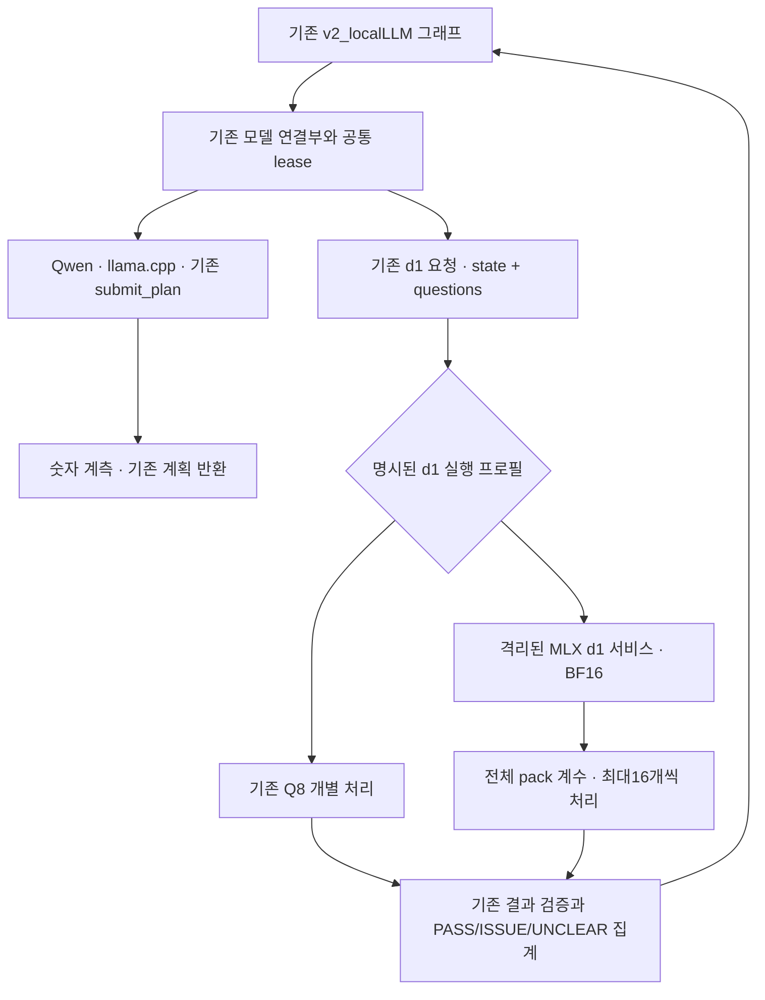
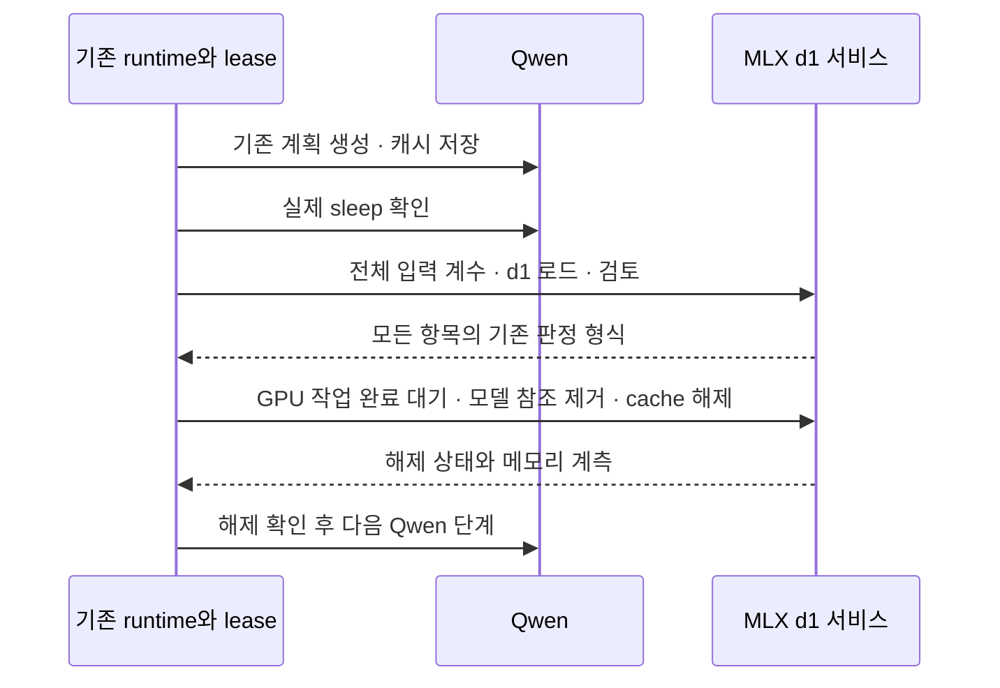

# LocalLLM_v2.3 구현 계획서

## Goal Capsule

Qwen이 계획을 만드는 시간이 어디에 쓰이는지 측정하고, d1이 같은 계획을 여러 번 읽는 비용을 묶음 처리로 줄일 수 있는지 구현·검증한다.
사용자 지시인 **Docker 2GiB·d1 검토 유지·기존 그래프와 응답 양식 유지**가 모든 기술 선택보다 우선한다.
이번 산출물은 계획서이며 제품 구현·설치·모델 다운로드·새 평가를 실행한 기록이 아니다.

쉽게 말하면 다음 순서다.

1. Qwen의 **생각 분량과 실제 계획 분량**을 구분해 시간을 분석한다.
2. d1에 전달하는 검토 항목은 그대로 두고, **공통 계획을 함께 읽는 엔진**을 시험한다.
3. 인공 입력으로 메모리와 오류 검출을 확인한 뒤, 기존 앞 5문항을 웹에서 비교한다.
4. 개선이 확인된 부분만 적용 후보로 보고하고, 실패하면 현재 검증된 d1 경로로 돌아간다.

Qwen은 이번에 관측·분석 기능을 구현한다.
생각 예산이나 지시서의 실제 변경은 분석 결과를 보고 다음 작업으로 결정한다.
d1은 묶음 처리까지 구현하되 정확도·메모리·시간 검증을 통과해야 적용 후보가 된다.

심각한 메모리 압력, 모델 해제 실패, 입력 잘림, 검토 누락, 잘못된 계획의 신규 승인이 발생하면 해당 단계에서 중단한다.
실행 중에는 각 단계의 결과·문제·다음 검증을 보고하고, 마지막에 구현 결과와 미검증 범위를 구분한다.
현재 작업 사본의 v2.2 미커밋 변경을 보존하며, commit/push·PR·공용 설정 전환은 이 계획의 자동 후속 작업에 포함하지 않는다.

---

## Product Contract

### Problem Frame

기존 캐시 ON 웹 5문항에서 Qwen 계획 단계는 평균 37.120초였고, 입력 처리는 0.478초, 생성은 33.327초였다.
현재 로그는 생각 출력의 존재만 기록하므로, 생성 시간이 긴 원인을 생각 분량과 계획 분량으로 나눌 수 없다.
Q02는 총 644토큰/19.059초, Q05는 1,620토큰/58.631초였지만, 작업 난도가 달라 긴 출력 자체를 불필요하다고 단정하지 않는다.

d1 검토는 평균 16.986초이며, 그중 개별 검토 연산이 약 15.093초를 차지했다.
한 HTTP 요청 안에 이미 5~6개 검토 항목이 들어가지만 현재 llama.cpp는 각 항목에 공통 상태를 다시 넣어 개별 연산한다.
이번 묶음 처리는 HTTP 요청을 합치는 작업이 아니라 **d1 엔진 내부에서 공통 상태와 여러 검토 항목을 함께 계산하는 작업**이다.

위 값은 과거 캐시 ON 소표본의 관측값이다.
현재 공용 실행은 캐시 OFF로 복원돼 있으므로, 과거 ON 기록을 현재 운영 속도나 새 비교의 기준 결과로 대신하지 않는다.
기준 문서는 [Docker2GiB 개발 검증 기록](../verification/2026-11-14-local-llm-development-memory.md)이며, 과거 3GiB·strict 기록과 구별한다.

### Requirements

| ID | 요구사항 | 완료 근거 |
|---|---|---|
| R1 | Docker Desktop VM 2048MiB와 현재 development 정책을 유지한다. | warning 2 허용·critical 4/미지 상태 차단, swap 변화·DB OOM·피크 기록 |
| R2 | 설정과 그래프 모두 `plan_review_enabled=true`이며 기존 검토·복구 규칙을 유지한다. | 전체 검토 항목 보존, 요청 전체 재계획 최대 2회·필요한 답변 재작성 최대 1회 |
| R3 | 기존 그래프·도구·계획/최종 응답·스트리밍 계약을 유지한다. | 그래프/계약 차이 확인과 동일 입력 회귀 검사 |
| R4 | Qwen 계획 생성의 입력 처리·생각 분량·계획 분량·생성 속도·부대 비용을 구분한다. | 실제 계수와 재계수 추정치를 구별한 문항별 분석표 |
| R5 | 같은 d1-2B의 묶음 처리를 정확한 전체 입력 계산과 함께 지원한다. | 검토 ID·선택지 보존, 항목별 결과 연결 완전성, 개별/묶음의 기대 정답 대조 |
| R6 | M4 Pro 24GB에서 Qwen↔d1 순차 상주와 새 엔진 준비 판정을 검증한다. | 새 프로필의 인공 메모리·해제·캐시 왕복 증거 |
| R7 | 질문·계획·실험 데이터는 로컬 추론 경로에서만 처리한다. | 인증된 loopback, 외부 모델 fallback/exporter 없음, 실행 시 로컬 모델만 로드 |
| R8 | 기존 데이터·기록을 보존하고, 정해진 소표본으로 성능·정확도를 구분해 보고한다. | 앞 5문항 전후 웹 비교·내용 검토, 150 Run/150 version·기존 대화 보존 |

### Scope Boundaries

Qwen3.5-9B GGUF Q4_K_M과 llama.cpp b12317, context 24576, batch/ubatch 256, 생각 ON·예산 2048, 계획 출력 6000, writer 생각 OFF·출력 3000, 호출 제한 90초를 분석 기준으로 유지한다.
`submit_plan`과 `required_prior_outputs`를 포함한 현재 계획 스키마, 지침, 샘플링 설정을 이 분석 중 바꾸지 않는다.
기존 Qwen 계획 캐시를 사용하며 새 캐시를 만들지 않고, d1 캐시도 추가하지 않는다.

보호 대상 그래프의 제품 코드·전체 평가, 새 프런트엔드·DB 스키마, 40문항 전체 평가, API 모드 평가, Laya 교체, Qwen 모델·엔진 교체, OS 인터넷 차단은 범위 밖이다.
업데이트와 모델 다운로드는 허용된 설치 단계에서 가능하며, 실제 추론 서비스는 로컬 파일만 읽도록 한다.
Qwen 설정 조정과 별도 유형 보완 평가는 이번 분석 결과를 근거로 정하는 후속 작업이다.

---

## Planning Contract

### Key Technical Decisions

- KTD1. **모델 연결부에서 변경한다.** (session-settled: user-directed — chosen over 그래프·응답 재설계: 기존 구조와 양식 유지 요청.) `core/model_gateway.py` 아래의 계측·d1 연결과 `runtime.py` 준비 검사만 확장한다. 계획 검토/도구 실행/답변 검토의 노드·간선·판정 규칙은 유지한다.
- KTD2. **Docker2GiB·development·d1 필수를 유지한다.** (session-settled: user-directed — chosen over Docker 증설·검토 생략: 현재 환경과 검토 유지 요청.) development는 pressure 1/2를 허용하고 swap 변화를 관측한다. swap 증가 0을 새 필수 조건으로 도입하지 않으며, 기본 strict의 기존 규칙은 유지한다.
- KTD3. **d1 후보는 MLX 전용 엔진을 격리한다.** 고정 llama.cpp의 LFM3 d1 경로는 항목의 batch 병합을 금지하므로 현재 batch/parallel 옵션 조정으로는 이 묶음 처리를 얻을 수 없다. 구현 제안은 `mlx-decision 1.3.0`의 고정 소스 `2527a733c97a3fd5e0de54ea19f74fd362ed1ad2`와 LiquidAI/d1-2B BF16이다. Qwen은 현재 엔진을 사용한다. 공용 Python 환경 대신 d1 전용 manifest/lock/환경을 둔다.
- KTD4. **정밀도·엔진 변경과 묶음 처리 효과를 대조한다.** A=기존 llama.cpp Q8 개별, B=MLX BF16 개별, C=같은 MLX BF16 묶음으로 비교한다. A→B에는 엔진과 정밀도 변화가 함께 있으므로 둘의 영향을 따로 입증했다고 표현하지 않는다. B→C로 묶음 처리의 영향을 확인한다.
- KTD5. **검토 내용·전체 입력을 보존한다.** 묶음당 최대 16항목과 실제 packed 입력 16000토큰을 모두 만족하도록 결정적으로 분할한다. 넘치면 더 작은 묶음으로 나누고, 상태+항목 하나도 안 들어가면 기존 입력 초과 오류로 중단한다. 요약·잘림·항목 생략·확률 임계값 추가로 통과시키지 않는다.
- KTD6. **기본 경로는 기존 d1로 남긴다.** 후보는 명시된 실험 프로필에서만 사용한다. 실행 도중 조용히 엔진을 바꾸지 않으며 오류는 기존 오류 경로로 전달한다. 적용·복귀는 프로필과 준비 증거를 함께 전환한다.

### High-Level Technical Design

아래 그림은 연결부와 엔진의 관계를 설명한다. 기존 LangGraph 노드 구성을 변경하는 그림이 아니다.

MLX는 새 그래프나 별도 웹·DB가 아니라 **d1 추론 프로세스 한 개의 대체 후보**다.
기존 `POST /v1/systemone`의 `state` 문자열·이름별 `questions` 입력과 이름별 판정/전체 확률 출력 경계를 유지한다.
전용 서비스는 upstream 계산·pack·tokenizer를 재사용하며, 공용 worker에 MLX를 import하지 않는다.

upstream HTTP 서버에는 모델 해제 API가 없으므로, 그대로 켜놓고 URL만 교체하지 않는다.
작은 서비스 진입점에 인증된 로컬 입력 계수·상태·해제 동작을 추가하고, 실제 엔진 종류·모델 revision·dtype·hash·분할 정책을 보고한다.
MLX가 llama.cpp라고 가장하거나, 해제하지 않은 상태를 `is_sleeping=true`로 보고하지 않는다.

서비스 프로세스는 유지할 수 있지만 d1 가중치·활성 계산 버퍼는 Qwen 실행 전에 해제해야 한다.
Qwen 답변 후 조건부 d1 답변 검토와 검토 오류·재계획·취소/종료 경로에도 같은 교대 규칙을 적용한다.
생성 중 작업이 남거나 해제 확인이 실패하면 다음 모델을 깨우지 않는다.
인증·공통 lease·기존 제한 시간을 유지하고, d1을 묶기 위해 Qwen과 동시에 상주시켜 메모리를 확보하지 않는다.

### Memory and Accuracy Assumptions

현재 d1 GGUF Q8 파일은 약 1.85GB이며 후보 BF16 가중치는 약 3.84GB다.
이 MLX backend는 d1-2B의 8비트·4비트 변환을 지원하지 않으므로 기존 GGUF 파일을 재사용할 수 없다.
공개된 BF16 프로세스 피크 약 5.3GB는 M5 Pro 64GB의 관측이며, 이 Mac의 피크나 적합 판정이 아니다.
따라서 M4 Pro 24GB에서 가능한지는 새 실제 측정으로 결정한다.

묶음 처리에서는 공통 상태의 계산이 함께 들어간 질문에 영향을 받는다.
같은 모델이어도 질문 구성·순서·BF16 변경으로 확률과 선택이 달라질 수 있으므로 정확도 유지가 자동으로 보장되지 않는다.
검토 지침·선택지·질문 ID·현재 정렬을 고정하고, 묶음 구성/순서도 프로필에 기록한다.
현재 정상 5건의 PASS만으로 오류 검출 정확도를 입증하지 않는다.

호스트 메모리의 기존 active+wired+physical compressor 지표, 프로세스 RSS/footprint, MLX active/cache, 모델 파일 크기는 다른 값이다.
24GiB에서 과거 19.xGiB를 빼서 가용 RAM이라고 계산하거나 이 값들을 합산하지 않는다.
GPU 동기화·참조 제거·allocator cache 해제 후 빈 서비스 기준으로 돌아오는지와 Qwen 재개 성공을 함께 확인한다.
`clear_cache()` 성공만으로 살아 있는 모델 가중치가 해제됐다고 판정하지 않는다.

---

## Implementation Units

### U1. Qwen numerical diagnostics

**목표·근거:** R3/R4/R7, KTD1. 기존 요청·응답을 유지하면서 계획 단계 관측을 보완한다.

**파일:** 기존 `agent/python/src/kplasma_agent/v2_local_llm/model_client.py`, `core/model_gateway.py`, 필요 시 `core/budget.py`의 인증된 tokenizer 연결을 재사용한다. 로컬 진단 집계는 새 `agent/python/evals/local_llm_qwen_analysis.py`에 둔다.

**동작:** 원래 총 입력/출력 토큰과 native 시간에 생각 문자열 길이·도구 인자 길이·작업 단계 수·완료 사유를 더한다. 제공되는 정확한 reasoning 토큰 계수가 있으면 출처와 함께 기록한다. 없으면 동일 엔진 tokenizer로 각각 재계수하되 `재계수 추정`으로 표시하고, 경계·특수 토큰 때문에 합계가 원래 출력 토큰과 다를 수 있음을 남긴다. 토큰 비율로 생각 시간을 계산해 정확한 실측처럼 보고하지 않는다.

진단용 토큰 계산은 캐시 저장을 늦추거나, sleep 뒤 Qwen을 다시 깨우거나, d1과 동시에 모델을 올리지 않게 한다. 같은 lease의 Qwen 구간에서만 수행하고 추가 비용을 따로 잰다. 가능한 숫자만 기록하며 계수가 불가능하면 unavailable로 남긴다. 계측 실패는 정상 `submit_plan` 결과를 오류로 바꾸지 않는다. 질문·생각·계획 원문을 새 공개 로그나 외부 tracing으로 보내지 않는다.

**검사:** `tests/v2_local_llm/test_model_client.py`, `test_native_token_counting.py`, `test_model_gateway.py`, `test_prompt_cache.py`와 새 `test_qwen_analysis.py`.
생각 있음/없음·한글/특수문자·여러 단계·정상/재계획/한도 종료·카운터 부재/실패를 검사한다. 필드별 재계수와 원래 총계의 차이를 허용하되 출처를 잃지 않으며, 동일 인자·도구 호출·캐시 fingerprint·오류 전달과 원문 비노출을 확인한다.

**완료:** 문항별로 입력 처리, 전체 생성, 생각/계획 분량, tokens/s, 캐시·로딩·추가 계측 비용을 구분할 수 있다. 정확한 생각 시간은 측정하지 않았다면 미측정으로 남긴다.

### U2. Isolated d1 MLX service and full-input guard

**의존·근거:** R2/R3/R5/R7, KTD3/KTD4/KTD5. 실제 모델보다 먼저 mock으로 HTTP 계약·분할·오류 행동을 고정한다.

**파일:** 새 `agent/python/runtimes/d1_mlx/pyproject.toml`, `uv.lock`, `service.py`, `tests/test_service.py`. 기존 `v2_local_llm/core/decisions.py`, `core/budget.py`, `core/model_gateway.py`, `config.py`에는 필요한 프로필 분기만 추가한다.

**동작:** 전용 환경은 Python 3.12와 pin한 mlx-decision 소스·MLX/Metal 의존성을 잠근다. BF16 모델·config·tokenizer의 immutable revision과 SHA-256 목록을 확보한 뒤 실행한다. 설치/다운로드와 추론을 나누고, 추론은 로컬 snapshot·offline 모드로 제한한다. 기존 Q8 파일·실행 환경은 복귀용으로 보존한다.

요청의 모든 항목을 현재 정렬로 pack하고 최대 16항목/16000토큰 안에서 분할한다. 개별 토큰 수의 합이나 예전 GGUF renderer를 묶음 길이로 쓰지 않는다. 계수 API와 실제 inference는 같은 pack·tokenizer·분할 정책을 사용한다. 한 항목도 안 들어가면 fail closed하며 upstream의 자동 state 자르기를 호출 전에 막는다. 반환 `truncated` 표시도 거부한다.

결과는 원래 검토 이름에 정확히 한 번씩 합친 뒤 기존 `normalize_response()`와 검토 파서를 통과시킨다. 답변 검토도 같은 엔진 계약을 사용하며 기존 호출 조건을 유지한다. usage의 개별 질문 합계와 묶음별 실제 입력을 구분하고, 없는 confidence/usage를 만들어 넣지 않는다.

**검사:** 기존 `test_decisions.py`, `test_budget.py`, `test_native_token_counting.py`, `test_model_gateway.py`, `test_plan_review.py`, `test_condition_review.py`, `test_explain_answer.py`와 전용 서비스 테스트.
1/5/6/16/17/400항목, 빈 입력·중복 이름, 경계와 1토큰 초과, 단일 항목 초과, 순서/묶음 분할, 잘림 표시, 결과 누락·추가·중복, 잘못된 선택·비정상 확률·timeout을 검사한다. 어떤 경우에도 검토 생략·확률 임계값 변경·가짜 PASS가 없어야 한다. 네트워크 거부·인증 부재·리다이렉트도 기존 경계에 맞춰 거부한다.

**완료:** B의 개별 실행과 C의 묶음 실행을 명시적으로 선택할 수 있고, 두 경로 모두 기존 요청/판정 계약과 전체 입력 한도를 지킨다. 이 단위의 통과는 실제 메모리·정확도 통과를 뜻하지 않는다.

### U3. Residency, provenance and memory readiness

**의존·근거:** U2, R1/R2/R6, KTD2/KTD3/KTD6. 기존 lifecycle·준비 검사의 보장을 MLX에 맞춰 확장한다.

**파일:** 기존 `v2_local_llm/runtime.py`, `worker.py`, `runtime-manifest.json`, `intentional-differences.json`, `config.py`, `.env.local-llm.example`, `scripts/agent/local-llm.mjs`, `scripts/agent/measure-local-llm.mjs`, `evals/local_llm_measure.py`, `evals/local_llm_cache_probe.py`와 U2 서비스.

시작 스크립트는 현재 추론 엔진을 자동 실행하지 않는다는 사실을 유지하고, d1 전용 서비스의 실행·종료·상태 확인 방법을 문서화한다. 소유한 실험 서비스만 정리하고 다른 앱은 종료하지 않는다. 기존 Q8와 후보 MLX를 동시에 상주시켜 비교하지 않는다.

GGUF/MLX 프로필별 실제 엔진·dtype·모델/라이브러리 hash·입력 계산·그룹 정책을 기록한다. 고정 Q8 문자열이나 llama.cpp argv 검증을 MLX 성공값으로 재사용하지 않는다. 메모리 증거는 version을 구분하고, 개별 질문과 packed 묶음 수치를 명시한다. 기존 Q8 증거는 복귀에만 쓰며 MLX 준비 증거로 인정하지 않는다.

먼저 Docker 설정 2048MiB·실행 VM 배정·DB OOM·현재 압력과 새 인스턴스 정보를 확인한다. 기존 7종 인공 검사와 계획/캐시 왕복을 각 프로필에 맞게 실행하고, 묶음 경계·여러 묶음·입력 거부·답변 검토·오류 후 해제를 추가 확인한다. 큰 상태에서는 16개를 강제하지 않고 U2 규칙에 따라 나눈다.

Qwen 전/중/후, d1 전/중/해제 후를 구분해 프로세스 메모리·MLX active/cache·호스트 지표·pressure 표본·swap 변화·DB OOM과 최대 피크를 기록한다. 전환/로드/해제 시간도 기록한다. warning을 실패로 바꾸거나 critical을 숨기지 않는다.

**검사:** `test_model_runtime.py`, `test_llamacpp_runtime.py`, `test_readiness.py`, `test_readiness_stability.py`, `test_runtime_contract.py`, `test_memory_policy.py`, `test_runtime_measurement.py`, `test_worker.py`, `test_cache_probe.py`, `scripts/agent/local-llm.test.mjs`, `scripts/agent/measure-local-llm.test.mjs`.
GPU 작업 대기·살아 있는 참조·해제 실패/timeout·lease 충돌·종료/재시작, 프로필 hash 불일치, 옛 증거 재사용 거부, warning 허용/critical 차단, Qwen 캐시 저장·d1 검토·해제·복원과 재계획/답변 검토 경로를 검사한다.

**완료:** 새 프로필과 일치하는 인공 메모리·실제 해제 증거가 있어야 한다. 못 맞추면 실제 웹 데이터로 넘어가지 않고 원인·피크·복귀 결과를 보고한다.

### U4. d1 controlled accuracy and latency comparison

**의존·근거:** U2/U3, R2/R5/R6/R8, KTD4/KTD5/KTD6.

**파일:** 새 `agent/python/evals/local_llm_d1_joint_probe.py`, `tests/v2_local_llm/test_d1_joint_probe.py`. 기존 인공 계획 생성·`plan_review_cases.py`·검토 파서를 재사용하며 실제 Run/사용자 계획을 fixture로 옮기지 않는다.

먼저 8개 고정 인공 상태를 만든다. 원문과 사람이 확인할 수 있는 기대 판정을 모델 실행 전에 고정한다.

| 상태 | 기대 검토 |
|---|---|
| 정상 단일 조회 | PASS |
| 정상 검색 후 전체 후보 비교 | PASS |
| 정상 후보 선택 확인 후 비교 | PASS |
| `이상`을 `초과`로 바꾼 계획 | ISSUE: 경계 변경 |
| 원문 수치와 단위 배율을 임의 변경한 계획 | ISSUE: 조건 변경 |
| 요청한 비교를 빠뜨린 계획 | ISSUE: 작업 누락 |
| 조회만 요청했는데 설명을 추가한 계획 | ISSUE: 작업 추가 |
| 선택이 필요한 후보를 임의로 고른 계획 | ISSUE: 사용자 확인 누락 |

각 상태를 A/B/C에 한 번씩 넣어 총 24회 고정 계획 검토를 비교한다. 추가로 상태 하나의 검토 항목 순서를 뒤집어 B/C 각 1회, 총 **26회**까지로 제한한다. 자기 의존·결측·모호/UNCLEAR·17항목 이상·답변 과장 검토의 계약 검사는 U2/U3의 인공 회귀에 포함한다.
순서 반전은 격리된 probe에서만 pack 순서를 지정하고, 실제 packed 항목 ID 순서가 기준과 반대로 바뀌었는지 확인한다. 서비스가 다시 정렬해 같은 순서로 계산했으면 순서 민감도 시험 통과로 인정하지 않는다. 운영 요청은 원래 정렬을 유지하며, 이 시험용 순서 지정 기능을 일반 요청 옵션으로 노출하지 않는다.

동일한 완전 입력·선택지·모델 snapshot으로 판정/확률·전체 처리 시간·묶음별 시간·로드/해제·전체 토큰·피크를 기록한다. 선택 결과와 수동 기대값의 불일치를 모두 확인하고, A가 틀린 경우도 별도 기록한다. 확률 변화 0.07을 정확도 7% 하락처럼 해석하지 않는다.

**채택 관문:** 기대 판정을 모두 만족하고 A가 잡던 오류를 C가 새로 PASS시키지 않아야 한다. B/C 순서 변경에서 최종 검토 상태가 바뀌면 채택을 보류한다. 소표본이므로 관문 통과를 전체 검토 정확도 동등성의 증명으로 확대하지 않는다.
시간 목표는 같은 고정 상태들의 **C 전체 검토 중앙값이 A보다 20% 이상 감소**하고 B보다 짧은 것이다. 목표는 예상 성능의 보증이 아니며, 로딩/해제 포함 비용을 뺀 연산 시간만으로 통과시키지 않는다.

**완료:** 각 프로필의 메모리·기대 정답·불일치·시간을 보고하고 후보 채택/보류를 명시한다. 실패한 조건을 그대로 다음 웹 평가에 넘기거나 자동으로 다른 모델을 시험하지 않는다.

### U5. Web five-case comparison and Qwen diagnosis report

**의존·근거:** U1/U3/U4, R1~R8, KTD1/KTD2/KTD6.

**파일:** 기존 `agent/python/evals/run_flow.py`, `v2_harness.py`, `test_flow_eval.py`의 browser/limit 경로를 재사용한다. 필요한 관측 전달만 추가하고 새 문항 선택기나 API 평가를 만들지 않는다. 문서 결과는 새 `docs/verification/2026-11-14-local-llm-v2.3-qwen-d1-joint.md`에 집계한다.

현재 공용 캐시 OFF 설정을 기록하고, 비교할 두 실험 프로필은 Qwen 캐시 ON으로 명시한다. 해당 프로필의 새 메모리·인공 캐시 증거를 먼저 확보한다. 캐시 첫 생성은 인공 입력으로 준비해 별도 비용으로 기록하며, 채점 대상 질문의 응답으로 미리 예열하지 않는다.

웹은 기존 5173 공용 웹·백엔드·DB에서 새 대화로 진행한다. 동결된 150 Run 기준 은행의 **앞 5문항을 기준 A와 후보 C에서 각 1회, 총 10개 웹 요청**으로 제한한다. 항상 browser 모드와 limit 5를 명시한다. 기본값인 40웹+40API를 실행하지 않는다.
기준 A 웹 5건은 U1/U3의 A 준비 통과 후 먼저 확보할 수 있고, 후보 C 5건은 U4 통과 뒤 실행한다. Qwen 지침·생성 설정·캐시 조건과 질문/문맥/선택·grader를 고정하고, 두 조건 사이에는 d1 프로필만 바꾼다.

웹 원시 출력은 기존 평가기 제약대로 **저장소와 입력 bundle 밖의 새 비공개 로컬 폴더**에 보관한다. 모델/메모리 진단은 Git 제외 `.local/runtime/v2.3-qwen-d1-joint/`에 보관한다. 사용자 원문·실험 수치·판단 원문·스크린샷은 공개 문서로 복사하지 않는다.

문항별 최초 계획 정답, 도구 호출 형식, d1 지적, 재계획/재작성 횟수, 자동 채점·UI·사람의 내용 검토를 구분한다. 기존 Q03의 추가 내용 검토를 이번에 명시적으로 수행하고, 조회에 요청하지 않은 해석을 덧붙인 경우도 범위 준수 오류로 기록한다. 과거의 자동 5/5를 내용 검토 완료값으로 복제하지 않는다.

Qwen 보고서는 U1 수치로 생각/계획 생성량·토큰 속도·단계 수·조건 누락/추가·연결 오류를 분석한다. 결과에 따라 추론 지시, 생각 예산, 불필요한 계획 서술, 엔진/메모리 중 **다음에 시험할 한 가지 가설**을 제안한다. 이번 비교에서 그 설정을 함께 바꾸지 않는다.

**완료:** 자동/UI·내용·최초 계획 성적에 새 회귀가 없고, d1 전체 시간과 웹 전체 중앙값이 기준보다 짧은지 보고한다. Qwen 자체가 빨라졌다는 주장은 Qwen 설정을 바꾸지 않은 이번 작업으로 하지 않는다. 5쌍 관측은 소표본이며 전체 40문항 동등성이나 p95 안정성으로 표현하지 않는다.
후보가 관문을 못 넘으면 C 웹은 0/5로 남기고 A의 Qwen 분석과 실패 원인을 보고한다. 실패 문항의 자동 재접수나 추가 평가를 하지 않는다.

---

## Verification Contract

표의 검증은 구현 단계에 수행할 예정이다. 이번 계획 작성에서는 실행하지 않았다.

| 관문 | 대상과 방법 | 통과·중단 기준 |
|---|---|---|
| V1: 계약·소프트웨어 | 로컬 pytest 설정 `pytest-v2-local-llm.ini`, U1~U5의 지정 테스트, 전용 서비스 테스트, 변경된 Node 스크립트 테스트, Ruff·mypy | 기존 strict·검토/복구·오류 경로와 새 분할/해제 검사 통과. 공용 보호 대상 그래프 모델 평가는 불필요 |
| V2: 불변 경계 | `graph.py`, `answer_contracts.py`, `answer_stream.py`, 계획/최종 JSON schema, 도구 정의·검토 지침/선택지·파서의 구현 전후 비교 | 변경이 없어야 하며 API/DB/UI 계약 변경 없이 계측과 엔진 어댑터만 추가 |
| V3: 메모리·준비 | Docker2048MiB/development, 프로필별 기존 7종 인공 검사·추가 묶음/교대·캐시 검사 | warning/swap 기록, critical/미지 상태·OOM·해제 실패 없음, 새 증거 일치. 실패 시 다음 실제 평가 차단 |
| V4: d1 의미·시간 | U4의 고정 인공 계획 24회와 순서 대조 2회 | 기대 판정 전부 충족·신규 오류 승인 없음, 시간 목표 충족. 비교 불일치나 해제 비용 악화 시 보류 |
| V5: 웹·Qwen 분석 | A/C 각 Q01~Q05 1회, 총10웹. 설정과 그래프의 검토ON을 실행 전 확인 | 최초/복구/자동/UI/내용 점수 분리, 새 회귀 없음, Qwen 분석과 d1/전체 시간·피크 보고 |
| V6: 보존·복귀 | 150 Run/150 version·기존 대화/스냅샷의 비교, 소유 실험 프로세스 정리·원래 프로필 복원 | 기존 데이터 불변, 원래 캐시 OFF·Q8 검토ON 설정과 준비 판정 복귀. 새 완료 대화는 보존 |

실제 호출량은 인공 메모리/캐시 검사, 고정 d1 검토 26회, 웹 최대10요청으로 나눠 기록한다.
웹 한 요청에 계획·검토·재계획·답변 등이 포함될 수 있으므로 웹10요청을 모델10호출로 보고하지 않는다.
모든 실제 Agent 검사에서 d1 검토ON을 확인하고, 인공 d1 대조는 이미 고정된 계획에 대한 검토만 수행한다.
공식 PyTorch/MPS 재현은 backend 불일치의 추가 원인 조사에 필요할 때 별도로 계획하며 자동 설치/추가 호출하지 않는다.

---

## Definition of Done

- Qwen의 기존 요청·계획 형식과 동작을 유지한 숫자 계측·집계 및 테스트가 있다.
- d1 후보 서비스의 버전·모델·dtype·전체 pack 계산·인증·실제 해제·준비 증거가 연결되어 있다.
- 같은 검토 항목과 기존 파서·집계·재계획/답변 검토 규칙이 보존되어 있다.
- 인공 메모리/의미 검사와 웹 관문의 결과를 실행/미실행·통과/보류로 명확히 보고한다.
- 성공한 후보만 적용 가능으로 표시하며, 실패했다면 기존 Q8 검토ON으로 복귀한 결과와 보류 원인을 남긴다. 실패 경로를 성능 개선 완료라고 보고하지 않는다.
- 문서에는 Qwen 원인 분석과 다음 단일 실험 제안, d1 A/B/C 정확도·시간·최대 피크·경고·swap·해제 비용, 소표본 한계가 있다.
- `docs/development/agent-v2-local-llm.md`와 예시 설정은 Docker2GiB 최신 기준·현재 기본값·후보 실행법·복귀법을 일관되게 설명한다.
- 버린 시도와 불필요한 실험 코드는 정리하고, 원시 결과·캐시·모델 파일·비밀값·실데이터는 Git 추적에서 제외한다.

---

## Appendix

### Sources

- 사용자 요청: “Qwen 분석이랑 d1 묶음 처리 둘 다 포함해서 v2.3 구현 계획서부터 작성해줘. Docker 2GiB랑 d1 검토는 유지하고, 기존 그래프랑 응답 양식은 바꾸지 말고.”
- [Docker2GiB 개발 메모리 계획](2026-11-14-003-local-llm-development-memory.md), [검증·공용 설정 복원 기록](../verification/2026-11-14-local-llm-development-memory.md).
- [Qwen 캐시 계획](2026-11-14-002-local-llm-v2.2-qwen-plan-cache.md). 과거3GiB 실패와 후속2GiB 결과를 구분해 읽는다.
- 기존 안전 집계: `.local/runtime/v2.2-memory-policy/comparison-summary.json`, `cloud-vs-local-web5-timing.json`, `d1-latency-diagnosis.json`. 원시 계획·실험 결과의 공개 출처로 사용하지 않는다.
- [LiquidAI d1-2B 공식 모델 카드](https://huggingface.co/LiquidAI/d1-2B): 동일 모델의 공식 실행과 묶음 처리 기준. 구현 시 immutable 모델 revision과 파일 hash를 고정한다.
- [mlx-decision 1.3.0](https://github.com/armbues/mlx-decision/releases/tag/v1.3.0), [고정 버전 d1 모델 설명](https://github.com/armbues/mlx-decision/blob/2527a733c97a3fd5e0de54ea19f74fd362ed1ad2/docs/MODELS.md): d1의 BF16 전용·16항목 묶음·상태 잘림·질문 간 영향. 공통 문맥의 요청 간 KV 캐시 지원으로 해석하지 않는다.
- [고정 서버 소스](https://github.com/armbues/mlx-decision/blob/2527a733c97a3fd5e0de54ea19f74fd362ed1ad2/src/mlx_decision/server.py), [모델 pool](https://github.com/armbues/mlx-decision/blob/2527a733c97a3fd5e0de54ea19f74fd362ed1ad2/src/mlx_decision/pool.py): 기본 서버의 해제 API 부재와 프로그램 방식 참조 해제 근거.
- [MLX 메모리 cache 해제](https://ml-explore.github.io/mlx/build/html/python/_autosummary/mlx.core.clear_cache.html), [활성 메모리 정의](https://ml-explore.github.io/mlx/build/html/python/_autosummary/mlx.core.get_active_memory.html): allocator 지표와 실제 모델 해제의 차이.
- [Qwen 공식 권장 설정](https://huggingface.co/Qwen/Qwen3.5-9B#best-practices): 현재 설정이 정밀 코딩용 권장값 중 하나임을 확인했다. 우리 계획 작성 작업의 최적 설정이라는 근거로 확대하지 않는다.

### Execution-time Unknowns

구현 전 제품 결정을 추가로 받아야 하는 질문은 없다.
M4의 실제 BF16 피크·GPU 해제 후 잔류량·전체 검토 시간·오류 검출 결과·Qwen 세부 토큰 계수의 가용성은 위 관문으로 확인할 실행 시 미확인 사항이다.
관문 실패는 입력 한도·메모리 정책·검토 정확도 기준을 낮추는 근거가 아니며, 해당 후보를 보류하고 관측값과 후속 선택을 보고한다.
