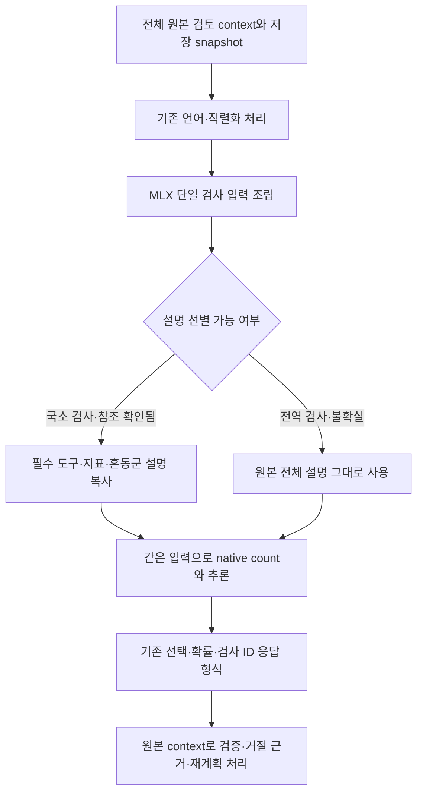

# LocalLLM v2.4: 코드 기반 검사별 도구·지표 설명 선별 계획

## Goal Capsule

**쉽게 읽는 요약:** d1의 각 검사에 필요한 도구·지표 설명을 코드로 고른다. 질문·원본 계획·핵심 검토 규칙은 유지한다. 누락을 찾는 검사에는 전체 설명을 남기고, 비슷한 지표는 함께 제공하며, 필요한 설명을 확실히 고르지 못하면 기존 전체 설명을 그대로 보낸다. 같은 정상 5개·오류 5개로 전체 설명과 선별 설명의 정확도·토큰·시간을 비교한다.

**이번 요청은 계획서 작성만이다.** 구현, 설정 변경, 모델 호출, 서버·워커 재시작, Git commit/push, 기본값 승격은 실행하지 않는다. 아래 실행 예산과 검증 절차도 이후 구현·테스트가 승인됐을 때의 계획이다.

- 범위: `v2_localLLM`의 계획 의미 검토에서 **모델에 읽히는 `tool_contracts` 부분만** 검사별로 선별한다.
- 고정: Q8+MLX, `group_size=1`, `independent_batch_size=1`, Docker VM 1536MiB, d1 계획 검토 ON, 기존 재계획 최대 2회·답변 재작성 최대 1회.
- 보호: 그래프 노드·분기·HITL·도구 실행·`submit_plan`·계획 schema·최종 응답·SSE·DB·원본 검토 snapshot·과거 대화.
- 비교: 같은 10개 사례 × 전체/선별 2구성 = **의미 검토 20회**, 구성별 1회. 메모리·프로토콜 준비 호출은 아래 표에서 별도로 제한한다.
- 배포: 기본은 전체 설명이다. 선별 후보가 빨라져도 자동으로 운영 기본값을 바꾸지 않는다.

이 계획은 [기존 v2.3 계획](2026-11-15-003-local-llm-v2.3-mlx8-single.md)의 모델·독립 검사·응답 계약을 유지하면서, 모든 검사에 전체 도구 설명을 반복하는 부분만 새 후보로 비교한다. 과거 계획·검증 기록은 덮어쓰지 않는다.

---

## Product Contract

### Problem Frame

현재 도구 계약은 7개 설명 묶음과 비교 지표 32개를 포함한다. `build_check_specs`에는 검사 종류·대상 단계·지표·계획 경로가 이미 있다. 이를 이용하면 별도 LLM, 임베딩 모델, 벡터 DB 없이 필요한 설명을 찾을 수 있다.

현재 MLX 서비스는 한 검토 요청을 단일 검사들로 나누면서 **같은 전체 state를 각 검사에 복사**한다. 따라서 검사별로 설명을 고르는 지점은 MLX 입력을 조립하는 부분이다. 검사마다 HTTP 요청을 새로 만들어 모델을 반복 로딩하는 방식은 사용하지 않는다.

기존 입력의 두 검사에서 설명 선별 시안을 로컬 tokenizer로만 계산했을 때, 비교 대상 검사는 4,301→2,641토큰, 압력 필터 검사는 3,840→1,950토큰이었다. 이는 **두 시안의 입력량 계산**이며 정확도·전체 요청 속도·모든 검사에서의 절감률을 입증하지 않는다.

[기존 10사례·50회 실험](../verification/2026-11-15-local-llm-d1-english-ablation-50.md)은 모든 언어 구성에서 의도한 오류 항목·사유의 검출이 0/5였다. 이 계획은 입력량과 관련성을 개선할 후보이며, d1의 기존 판단 실패를 해결했다고 전제하지 않는다. 기존과 같은 오답을 유지한 결과를 정확도 검증 성공으로 포장하지 않는다.

### Requirements

| ID | 요구사항 | 검증 위치 |
|---|---|---|
| R1 | 원본 질문·입력 이력·확정 문맥·계획·검사 목록·지침·선택지·정책·단위·수치·참조 출처를 보존한다. 선별로 바꿀 수 있는 본문은 `tool_contracts`뿐이다. | U1/U2, CPU 불변성 검증 |
| R2 | 검사 종류·정확한 도구/지표 ID·선행 단계 참조를 사용한다. 새 자연어 해석기나 LLM으로 계획을 재해석하지 않는다. | U1, 참조·단위 검증 |
| R3 | 혼동 가능한 지표를 한 묶음으로 확장하고, 요청한 지표가 계획에서 누락됐을 가능성을 보호한다. | U1, 혼동·누락 시나리오 |
| R4 | 불확실하거나 지원하지 않는 유효 입력에는 원본 전체 설명을 그대로 보낸다. 전체 전송으로 입력 한도를 넘으면 기존처럼 거부한다. | U1/U2/U3, fallback·한도 검증 |
| R5 | 검사 ID·개수·기존 순서·응답 완전성·선택지 ID·확률 응답 형식·상태 집계 규칙을 유지한다. 선택을 임의로 보정하거나 검사를 생략하지 않는다. 입력이 달라져 생기는 확률·판정 값의 차이는 비교 결과로 기록한다. | U2, pack·응답 계약 검증 |
| R6 | 토큰 계수와 실제 추론이 동일한 선별 결과를 사용하고, 모드·선별 규칙 버전·소스 hash를 준비/복구 identity에 연결한다. | U2/U3, fingerprint 검증 |
| R7 | Q8+MLX 단일 처리, Docker 1536MiB, 순차 모델 상주, d1 ON과 기존 복구 예산을 유지한다. | U3/U5, 실제 preflight |
| R8 | 같은 10개 사례·정답표로 판정, 오류 항목, 정확한 사유, 추가 오판, 토큰, 시간, 메모리를 분리 비교한다. | U4/U5 |
| R9 | 원시 입력·응답·실제 env·실데이터는 비공개 보관하고, 그래프·최종 응답 계약과 v2/v3를 변경하지 않는다. | U3/U5, 보존 hash·회귀 |

---

## Planning Contract

### KTD-1. 선별은 검토 판정과 분리한다

선별기는 필요한 설명을 **복사하는 역할**만 한다. 사용자 의도를 확정하거나 PASS/ISSUE를 판정하지 않는다. 본문 안의 검토 지시나 정답 선언을 해석해 선별 규칙을 바꾸지 않는다.

기존 구조화된 `check_specs`, `plan`, 도구·지표 registry를 사용한다. 질문의 키워드만으로 설명을 제외하지 않고, 잘못 작성됐을 수 있는 계획을 정답으로 취급하지 않는다. 새 RAG·임베딩·질문별 if/else 예외 목록은 범위 밖이다.

### KTD-2. 전체 원본을 보존하고 MLX 단일 검사 입력에서만 투영한다

방향은 다음과 같다. 이는 입력 흐름 설명이며 구현 코드는 아니다.

한 계획에 대한 기존 검토 HTTP 요청 하나 안에서 각 검사를 순서대로 처리하고, 모델 로딩·해제 횟수도 유지한다. `graph.py`, `core/plan_checks.py`, `core/plan_review.py`의 검사 의미·목록·상태 집계는 변경하지 않는다.

원본 `plan_digest`, `input_digest`, 검토 snapshot과 거절 근거는 기존 전체 context 기준이다. 선별된 본문으로 저장 기록을 덮어쓰거나 digest를 다시 만들지 않는다. 모델 입력에 이미 정리표가 없는 프로필이면 그 상태를 유지하며, 이번 변경에서 정리표를 추가·삭제하거나 번역을 바꾸지 않는다.

### KTD-3. 검사별 보수적인 제공 범위

| 검사 종류 | v1에서 제공할 설명 | 보호 이유 |
|---|---|---|
| `request.tasks` | 전체 `tool_contracts` 유지 | 계획에서 도구·작업 자체가 빠졌는지 확인해야 함 |
| `request.filter_coverage` | 전체 유지 | 계획에 없는 필터 지표가 질문에 있을 수 있음 |
| `request.confirmation_coverage` | 전체 유지 | 계획이 사용자 선택 단계를 누락했을 수 있음 |
| `outputs.<step>` | 전체 유지 | 계획이 요청한 지표 대신 다른 지표를 골랐거나 아예 빠뜨렸을 수 있음 |
| `filter.<step>.<metric>` | 해당 조회/검색 도구의 필터 계약, 연산자·범위·단위 규칙, 사용한 binding과 선행 참조 설명 | 수치만 남겨 경계·단위·참조 의미를 잃지 않음 |
| `ordering.<step>` | 검색 도구의 필터/정렬 구분, 등록 기본 지표 정보, binding·선행 참조 설명. 목표 지표를 확정할 수 없으면 전체 | 정렬 누락을 현재 `goals` 목록만으로 판단하지 않음 |
| `targets.<step>` | 비교 도구의 대상/범위 계약, binding/scope, 관련 선행 검색·확인 도구, 지표군 | 검색 전체와 선택 Run을 구분하고 결과 참조 의미를 유지 |
| `baseline.<step>` | 비교 기준·사용자 기준 선택 계약, binding, 선행 단계 계약, 관련 지표군 | `baseline:null`과 누락·임의 기준 추가를 구분 |
| `trend_axis.<step>` | 비교 경향축 계약, 공정 조건 지표군, binding·축 확인 단계 계약 | 단순 수치 비교와 경향축 요청을 구분 |
| `operation`, `selection_count`, `selection_targets`, `execution_guards` 및 미지원 kind | v1은 전체 유지 | 현재 10사례로 검증되지 않은 복합 참조·실행 조건까지 한 번에 축소하지 않음 |

공통 정책과 질문·전체 계획은 위 모든 검사에서 그대로 남는다. 일부 검사가 전체 설명을 유지하므로 두 국소 시안의 38~49% 감소를 전체 검토 요청의 예상 절감률로 사용하지 않는다.

### KTD-4. 혼동 지표와 선행 참조의 닫힌 묶음

선별은 지표 하나만 뽑는 방식이 아니다. 비교 단계에 파형 지표가 있으면 `FIELD_META`의 같은 `plotId`에 속한 지표군을 함께 포함한다. 기본 공정 조건의 압력·소스 전력·바이어스 전력과, 기본 출력의 플럭스·평균 에너지·IED 폭도 각각 연관 묶음으로 관리한다. 누락·출력 지표 검사는 위 원칙과 별개로 전체 설명을 유지한다.

| 혼동 예 | 함께 보존할 내용 |
|---|---|
| `current.peakToPeak` / `current.halfPeakToPeak` | current 지표군의 label·정의·단위·plotId. 최대−최소와 그 절반을 모두 제공 |
| 전위 최대/최소/첨두간/반진폭/위상 | potential 지표군 전체 |
| IED·IAD·IEAD의 최대 강도와 극값 좌표 | 해당 분포군 전체. 에너지와 각도 정의·단위 구분 유지 |
| density의 최대값·위상·거리 | density 지표군 전체 |
| residual의 최대/최종값 및 반복 위치 | residual 지표군 전체 |

요청이 첨두간 값인데 계획이 반진폭을 골랐더라도 출력 지표 검사는 전체 정의를 받는다. 선택되지 않았다는 이유로 올바른 대안 지표를 검토 입력에서 지우지 않는다.

`depends_on`과 `inputs`의 `result_ref`를 따라 필요한 선행 도구·출력 지표·단위·binding/scope 규칙을 포함한다. 확정 문맥의 `context_ref`도 기존 정보와 연결한다. 결과·사용자 선택 값이 실행 전 아직 없다는 이유로 오류 취급하지 않는다. 참조 대상 또는 필요한 계약을 완전하게 결정할 수 없으면 부분 자료를 보내지 않고 전체 설명으로 돌아간다.

기존 중복 축약 표현의 `definition_ref`를 만나는 경우 참조 정의까지 함께 복사한다. 등록 지표·정의·단위·plotId는 새로 생성·번역·요약하지 않는다. registry에 새 지표군이 추가됐는데 규칙이 아직 검증되지 않았다면 전체 전송을 유지한다.

### KTD-5. 불확실성과 실제 오류를 구분한다

| 상황 | 동작 |
|---|---|
| 전역 검사 또는 v1 미지원 검사 | 원본 전체 state를 변경 없이 사용하고 정책상 전체 유지로 기록 |
| 검사 ID와 spec을 안전하게 연결할 수 없음 | 전체 전송, `unresolved_check` 기록 |
| 필요한 지표·도구·선행 참조·혼동군을 확정할 수 없음 | 전체 전송, 해당 불확실성 기록 |
| 새 registry/표현 버전, 불완전한 `definition_ref` 등 선별 호환성 불명 | 전체 전송, `unsupported_context` 기록 |
| JSON이 아닌 일반 state, 답변 검토, 준비 검사의 인공 unit 입력 등 계획 검토가 아닌 유효 요청 | 기존 입력을 그대로 통과. 계획 검토 선별을 적용하지 않음 |
| 선별해도 도구 설명이 줄지 않음 | 원본 전체 사용, `no_reduction` 기록 |
| 기존 native 입력 자체가 잘못됨, provenance 불일치, 토큰 한도 초과, count/추론 불일치 | 기존 오류 처리·평가 중단. fallback으로 오류를 숨기지 않음 |

예상된 불확실성만 전체 전송으로 처리한다. 모든 예외를 잡아 가짜 성공으로 바꾸지 않는다. 전체 fallback은 원본 문자열을 그대로 돌려주므로 불필요한 재직렬화로 토큰이나 의미를 바꾸지 않는다.

### KTD-6. 계수·추론·준비 증거를 같은 정책으로 묶는다

`/v1/count`와 실제 추론은 같은 순수 선별 함수와 같은 입력 조립 경로를 사용한다. 요청마다 count를 위해 한 번, 추론을 위해 다른 규칙으로 고르지 않는다. 단일 검사별 실제 packed 입력 hash·토큰 수·질문 ID를 대조해 일치해야 한다.

선별 모드, 규칙 버전, 선별 모듈 SHA, registry/언어 투영 버전을 내부 runtime 사실과 준비·복구 fingerprint에 연결한다. 실행 중인 서비스가 옛 선별 코드를 쓰거나 설정이 다른 경우 준비 판정을 차단한다. 최종 사용자 응답에 구현용 필드를 추가하지 않는다.

내부 설정 후보는 `D1_CONTEXT_MODE=full|per_check`이며 기본은 `full`이다. 이는 기존 `D1_INPUT_PROFILE`의 언어·중복 축약 설정과 분리한다. 잘못된 설정값은 시작 오류이며 조용히 다른 모드로 바꾸지 않는다. 선택 모드에서도 네이티브 입력 한도 16,000토큰과 기존 모델 해제 검사를 그대로 지킨다.

추적에는 검사 ID·선별/전체 유지/fallback 구분·선택한 도구/지표 ID·규칙 버전·입력 hash·실제 토큰·시간만 남긴다. 원문이 필요한 원시 산출물은 기존 Git 제외 로컬 경로에 보관한다.

---

## Implementation Units

### U1. 순수 선별기와 보호 규칙

- 요구사항: R1–R4, KTD-1/3/4/5.
- 파일: `agent/python/src/kplasma_agent/v2_local_llm/core/d1_context.py`(신규), `agent/python/tests/v2_local_llm/test_d1_context.py`(신규).
- 기존 패턴: `comparison_catalog.FIELD_META`, `core/plan_checks.py`의 검사 metadata, `core/d1_input.py`의 비파괴 투영. 원본 registry 자체는 바꾸지 않는다.
- 실행 방향: 아래 불변성·fallback 검사를 CPU 테스트로 먼저 고정한 뒤 선별기를 연결한다.
- 검사 시나리오: 전역/출력 검사의 전체 문자열 동일성, pressure 필터의 연산자·단위 보존, 검색 전체 참조의 선행 검색·binding 포함, baseline/null 및 공정 조건 축 묶음, 모든 혼동 지표군 보존, 누락된 요청 지표의 전체 설명 유지, `definition_ref` 연결, 미지원 kind·새 지표·일반 unit 입력의 전체 fallback, 원본 객체 불변.

### U2. MLX 단일 검사 입력에 연결

- 요구사항: R1/R5/R6, KTD-2/6. U1 이후 진행한다.
- 파일: `agent/python/runtimes/d1_mlx/service.py`, `agent/python/tests/v2_local_llm/test_d1_mlx.py`, `agent/python/tests/v2_local_llm/test_d1_v23_gateway.py`.
- 범위: 기존 `pack_requests`/`Runtime.groups`에서 검사별 state 투영을 연결한다. 모델 loader·score·attention mask·readout·calibration·선택지 argmax는 바꾸지 않는다.
- 검사 시나리오: full 모드가 기존 pack과 같음, per_check의 count/추론 입력과 hash 일치, 검사 개수·정렬·ID·선택지 순서 불변, 한 요청의 단일 검사 순차 처리와 한 번의 load/unload 유지, 잘린 입력·누락 응답·초과 입력 차단, 원본 digest와 거절 근거 유지.

### U3. 설정·준비·복구 identity

- 요구사항: R6/R7/R9, KTD-6. U1/U2 이후 진행한다.
- 파일: `agent/python/src/kplasma_agent/v2_local_llm/config.py`, `runtime.py`, `intentional-differences.json`, `.env.local-llm.example`; `agent/python/tests/v2_local_llm/test_config.py`, `test_d1_mlx_integration.py`, `test_readiness.py`, `test_clone_boundary.py`.
- 범위: full 기본값, 모드/버전/소스 hash 일치 검증과 새 로컬 모듈의 의도된 차이만 등록한다. 과거 검토 기록을 다시 쓰지 않고, 다른 identity의 진행 중 요청을 강제 복구하지 않는다.
- 검사 시나리오: 잘못된 모드 거부, 서비스/worker 모드·선별 hash 불일치 차단, 이전 메모리 증거의 무단 재사용 차단, 현재 모드의 유효 증거 인정, 원본 답변·계획 계약 및 로컬 clone 경계 유지, full 모드로 정상 복귀.

### U4. 같은 10사례의 고정 A/B 평가기

- 요구사항: R8/R9. U1/U2 이후 U3과 연결한다.
- 파일: `agent/python/evals/local_llm_d1_context_probe.py`(신규), `agent/python/tests/v2_local_llm/test_d1_context_probe.py`(신규). 필요 시 같은 인공 사례 정의만 `agent/python/tests/v2_local_llm/d1_context_cases.py`(신규)로 추출한다.
- 기존 패턴: `evals/local_llm_d1_v23_probe.py`의 그래프 preflight·메모리 감시·원본 기반 결과 처리. 이전 원시 결과를 덮어쓰지 않는다.
- 검사 시나리오: 정상/오류 5쌍·정답표·62개 검사 동결, 전체 상태가 ISSUE여도 엉뚱한 항목이면 오류 검출 실패로 집계, 올바른 항목의 잘못된 사유와 추가 오판 구분, 누락 usage를 0으로 채우지 않음, 실패 시 수행 횟수·원시 결과 보존, 지정 예산을 넘는 재시도·warmup 금지.

### U5. 로컬 비교·보존·복구 보고

- 요구사항: R7–R9. U1–U4의 CPU 검증 이후, 구현·테스트 승인 시에만 실제 모델을 호출한다.
- 파일: `docs/development/agent-v2-local-llm.md`, 향후 `docs/verification/2026-11-15-local-llm-d1-per-check-context.md` 및 비공개 로컬 산출물. `evals/local_llm_measure.py`는 기존 측정 경로를 재사용하며 새 기능에 필요한 소비자 검증만 수정한다.
- 검증: 아래 관문에 따라 메모리·20회 A/B·운영 full 복귀를 수행한다. 기존 DB·공용 5173/8080·Qwen 서버를 새로 복제하지 않는다. 소유권이 확인된 유휴 로컬 워커/모델 서비스만 필요한 범위에서 중지·재기동한다.

---

## Verification Contract

### Frozen Corpus

기존 `.local/runtime/v2.3-d1-english-ablation-50/corpus.json`의 같은 10개 인공 사례를 사용한다. 확인한 SHA-256은 `c27853259c724b75e8851af094974b5b3b4ef0256c728f8182510e1136a98c87`다. 질문·계획·문맥·정답표를 결과에 맞춰 수정하지 않는다. 구현 시 현재 파일이 다르면 먼저 원본 일치 여부를 해결하고 자동으로 다른 사례를 만들지 않는다.

| 쌍 | 정상/오류 사례 | 오류 계획의 고정 정답 |
|---|---|---|
| P05 | `P05.good`, `P05.bad` | `filter.search.ionFlux=boundary_changed` |
| P06 | `P06.good`, `P06.bad` | `filter.search.pressure=value_changed` |
| P08 | `P08.good`, `P08.bad` | `targets.compare=target_changed` |
| P10 | `P10.good`, `P10.bad` | `ordering.search=direction_changed` |
| B01 | `B01.good`, `B01.bad` | `baseline.compare=target_changed` |

정상 계획은 전체 검사가 match여야 한다. 오류 계획은 지정 항목/사유를 맞히고 불필요한 추가 지적도 없어야 엄격 일치다. 단위가 그대로인 P06은 숫자 변경이므로 기존 정답 `value_changed`를 유지한다. 다른 사유를 사후에 정답으로 넓히지 않는다.

### Comparison Conditions

A는 `full`, B는 `per_check`다. 두 구성에서 모델·정밀도·라이브러리·언어·지침·선택지·정책·입력 표현을 같게 고정하고 **도구 설명 선별 모드만 바꾼다**.

현재 확인된 운영 `D1_INPUT_PROFILE`은 `en-compact-no-view`다. 이 설정을 양쪽에 동일하게 적용하고 입력 바이트와 버전을 평가 전에 동결한다. 이번에 한국어로 복구하거나 전체 영어로 바꾸는 실험을 섞지 않는다. 기존 50회 표의 `en-full`/한국어 수치는 참고이며 새 A/B의 직접 시간 기준이 아니다. 구현 시 운영 프로필이 달라졌다면 확인 없이 언어를 바꾸거나 결과를 섞지 않는다.

동일한 순서의 10개 사례를 A/B에서 각각 1회 실행한다. 모드는 서비스 설정에서 바꾸고, 중간에 언어·정답·규칙을 튜닝하지 않는다. 서비스 재기동·메모리 준비 시간은 의미 검토 시간에서 분리한다. 첫 요청의 로딩/커널 준비와 warning 구간을 별도로 표시하며, 불리한 사례를 평균에서 임의로 빼지 않는다.

### Gates and Call Budget

| 단계 | 실제 모델 추론 HTTP 요청 상한 | 실행 조건 |
|---|---:|---|
| 선별·원본 보존·누락/혼동·pack·집계 CPU 검증 | 0 | 구현 후 먼저 통과 |
| 새 full 모드 메모리 준비 | 7 | 기존 Qwen 4 + d1 3 고정 인공 검사 |
| 새 per_check 모드 메모리 준비 | 7 | 같은 경계 입력, 일반 unit 요청의 전체 fallback 포함 |
| 동일 10사례 A/B | **20** | 모드별 준비 증거·실제 그래프 검토 ON 확인 후 |
| 운영 full 모드 복귀의 프로토콜 준비 | 최대 4 | 필요 시 worker 시작의 Qwen 3 + d1 1 |
| 합계 | **최대 38** | 의미 검토 20회와 준비 최대 18회를 구분 |

이 표는 후속 실행의 상한이며 **현재 모델 호출을 승인하거나 실행하지 않는다**. `count` 호출은 추론과 별도로 기록한다. A/B는 각각 기존 62개 검사를 유지하므로 의미 검토 내부 단일 검사는 총 124개다. 메모리·프로토콜 준비의 내부 검사 수는 의미 검토 정확도 분모에 넣지 않는다.

기존 준비 증거는 새 선별 모드·소스 hash에 맞지 않을 수 있어 그대로 유효하다고 가정하지 않는다. 두 모드의 새 증거를 따로 검증한다. 마지막에는 같은 코드/모델/언어의 full 설정과 이번 full 증거를 사용해 복귀하고, 현재 인스턴스의 live 사실과 기존 준비 절차를 다시 확인한다. 유효한 증거가 재사용되지 않는 상황이면 표 밖 호출을 자동 추가하지 않고 수행 수·부족한 준비를 보고한다.

각 실제 평가 전 `plan_review_enabled=true`를 모델 설정과 실제 그래프 상태에서 확인한다. Docker 1536MiB와 기존 메모리 정책, Qwen sleep→d1 load/review/unload→Qwen 사용 순서를 유지한다. development warning은 기록하면서 기존대로 허용하고, critical·미확인 압력·모델 해제 실패·provenance/계수 불일치는 중단한다. 다른 앱을 임의로 종료하거나 입력을 잘라서 통과시키지 않는다.

### Metrics and Acceptance

- **전체 판정:** 정상 PASS/5, 오류 ISSUE/5, 전체 상태 일치/10, 정상 오반려·오류 오승인·UNCLEAR/UNAVAILABLE를 별도 표시한다.
- **오류 항목·사유:** 지정 항목 검출/5, 정확한 사유/5, 전체 선택 벡터의 엄격 일치/10을 각각 보고한다. 올바른 오류를 찾았어도 다른 항목을 부당하게 지적하면 엄격 일치에서 제외한다.
- **회귀:** A에서 맞힌 사례·검사항목을 B에서 새로 틀린 목록을 제시한다. 다른 오답을 고친 결과로 새 오승인·오반려를 상쇄하지 않는다. 기존에 틀린 항목이 그대로 틀리면 미해결로 남긴다.
- **입력량:** 같은 tokenizer의 실제 단일 검사별 전체 입력, 도구 설명 부분, 구성별 합/62 평균, A 대비 절감량을 보고한다. 부분 설명의 토큰 비율은 전체 합과 구분한다. 실제 count·packed hash·모델 usage가 같아야 한다.
- **시간:** 10개 의미 검토의 요청당 평균·중앙값·합계와 단일 검사 시간, backend 계산·load/release·계수 비용을 구분한다. 서비스 재시작·메모리 준비·대기 시간을 추론 속도에 섞지 않는다.
- **선별 품질:** 최적화된 검사/정책상 전체 유지/불확실성 fallback 수와 사유를 분리한다. fallback을 성공적인 선별로 세지 않는다. full보다 입력이 길어지는 후보는 사용하지 않는다.
- **환경:** MLX allocator·프로세스 RSS·OS 활성/wired/압축 메모리 피크, warning/critical 표본, swap 변화와 Docker/DB OOM을 함께 기록한다. 서로 다른 메모리 지표를 합산하지 않는다.

품질 목표는 정상 5개 통과와 오류 5개의 정확한 항목·사유 검출이다. 입력량 15%·의미 검토 시간 10% 감소는 **확인할 효율 목표**이며 보장값이 아니다. 목표를 못 맞춰도 기대 정답이나 검사 범위를 수정해 맞추지 않는다.

불완전 응답·새 정확도 회귀·입력 손상·준비 차단이 있으면 후보를 통과로 보고하지 않는다. 회귀가 없고 토큰이 줄었더라도 기존 오류 검출 실패가 남아 있으면 검토 모델의 운영 정확도를 검증한 것으로 결론 내리지 않는다. 구성별 1회·10사례 결과로 통계적 동등성이나 일반 성능을 주장하지 않는다.

현재 10개에는 첨두간/반진폭 등 모든 혼동 지표의 실제 모델 대조가 포함돼 있지 않다. CPU 검증으로 필요한 정의가 빠지지 않는지 확인할 뿐, 해당 지표의 모델 정확도까지 입증하지 않는다. 관련 출력 검사는 v1에서 전체 설명을 유지하고, 추가 실제 사례 평가는 별도 범위로 남긴다.

---

## Definition of Done

- 계획한 CPU 검증과 영향 범위의 로컬 회귀·공통 응답 계약 검증이 통과한다.
- `full`은 기존 입력과 같고, `per_check`는 허용된 설명 부분만 선별하며 불확실한 입력은 전체 전송한다.
- 누락 검사·출력 검사·혼동 지표·선행 참조·단위·정의 연결을 보호한다.
- 모드별 native count·실제 packed 입력·usage·검사 ID·원본 digest·모델 해제·준비 identity가 일치한다.
- 승인된 범위에서 20개 의미 검토 결과와 별도 준비 호출 수, 정확도/사유/토큰/시간/메모리/fallback을 모두 보고한다. 미실행·실패·기존 오답도 그대로 남긴다.
- 보호 소스·원본 DB·과거 기록의 불변을 확인하고 기존 공용 웹/백엔드와 운영 full 경로를 정상 상태로 복귀시킨다.
- 원시 산출물은 Git 제외 로컬 경로에 두고 공개 문서에는 인공 사례 집계와 실패 요약만 남긴다.
- 구현 완료나 벤치마크 개선을 기본값 승격·commit/push·PR·실데이터 웹 평가의 자동 승인으로 해석하지 않는다.

---

## Appendix

### Evidence and Limits

- `agent/python/src/kplasma_agent/v2_local_llm/core/plan_checks.py`: 검사 metadata와 기존 지침·선택지.
- `agent/python/src/kplasma_agent/v2_local_llm/core/plan_review.py`: 전체 context/snapshot·도구 계약·원본 기반 결과 집계.
- `agent/python/src/kplasma_agent/v2_local_llm/comparison_catalog.py`: 등록 지표·정의·단위·plotId.
- `agent/python/src/kplasma_agent/v2_local_llm/core/d1_input.py`: 기존 언어·중복 축약 투영.
- `agent/python/runtimes/d1_mlx/service.py`: 같은 state를 복사하는 단일 검사 pack과 모델 load/release.
- `agent/python/src/kplasma_agent/v2_local_llm/runtime.py`: provenance·메모리 증거·모델 lease·실제 준비 검사.
- [기존 입력 축약 계획](2026-11-15-002-local-llm-d1-review-input.md), [v2.3 계획](2026-11-15-003-local-llm-v2.3-mlx8-single.md), [10사례·50회 결과](../verification/2026-11-15-local-llm-d1-english-ablation-50.md).

본 문서는 저장소·고정 corpus·기존 결과의 읽기 전용 조사와 계획 자체 점검으로 작성했다. 실제 선별 구현·테스트·모델 평가는 실행하지 않았다. 보조 대화의 하위 에이전트 금지에 따라 별도 에이전트 검토는 수행하지 않았으며, 입력 경계·fallback·호출 예산·같은 10사례·미검증 범위를 직접 대조했다.
