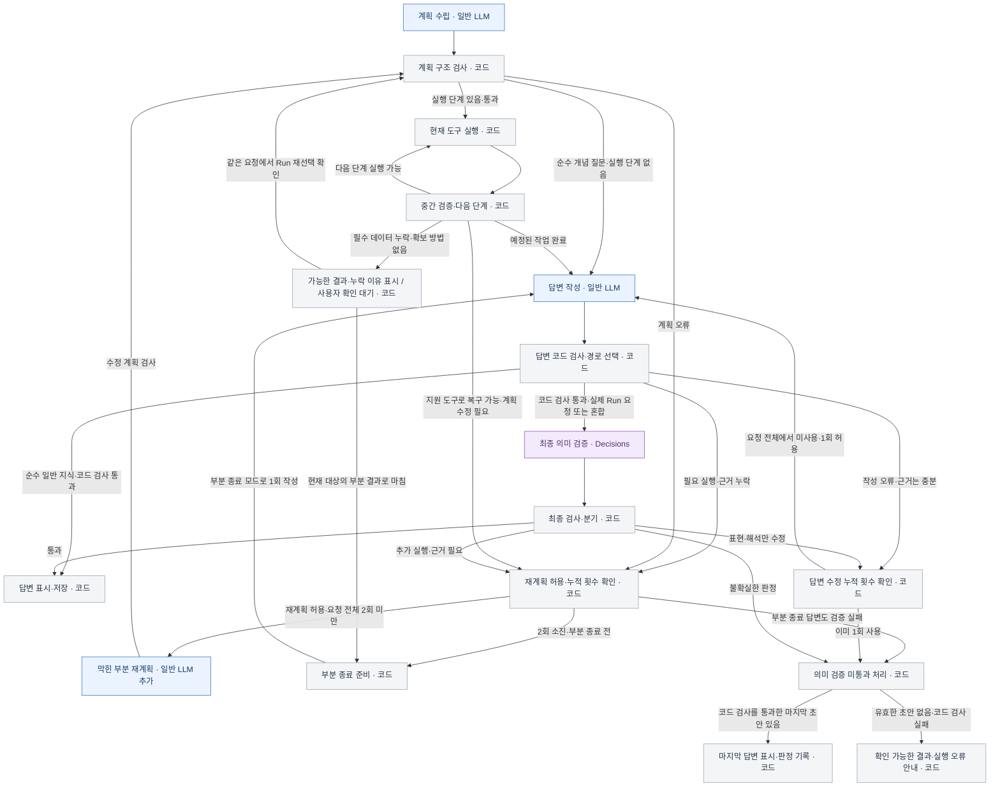

# K-PLASMA Agent Graph v2 설계서

> 사용자와 확정한 동작과 작성자가 구체화한 기술 계약을 분리한 설계 검토본이다. 이 문서는 제품 구현·테스트 통과·모델 정확도 또는 비용 절감의 달성을 의미하지 않는다. 아직 제품 구현은 시작하지 않았다.

### 빠르게 보는 결정

- v1이 기본이며 새 대화에서 v2를 선택한다. v2는 한 질문의 여러 도구를 순차 실행한다.
- 계획은 `submit_plan`으로 받고 코드가 단계·참조·입력을 검사한다. 2026-11-06 변경으로 데이터 계획은 실행 전 Decisions 의미 검토도 받는다. [구현 계약](../../development/agent-v2.md#실행-전-계획-의미-검토)을 따른다.
- 도구는 `forward_lookup`, `reverse_search`, `compare_runs`이며 계산은 코드, 해석은 답변 작성 노드가 맡는다.
- 필요한 출력이 없으면 다음 실행을 멈춘다. 확보 가능할 때만 요청 전체 최대 2회 재계획하고, 실제 데이터가 없으면 확인을 기다린다. 자동 도구 재시도는 없다.
- 현재 구현에서는 실험 답변의 수치·단위·순서를 코드가 검증하고, 화면에 표시할 정성적 해석이 있을 때만 Decisions로 해석 범위를 판정한다. 이 변경은 아래의 초기 D08-Q 세 항목 합의를 대체한다. 세부 동작은 [상세 계약 §7](2026-11-01-agent-v2-contracts.md#7-최종-답변과-decisions-계약)을 따른다.
- 근거가 충분한 답변 오류는 별도로 1회 수정한다. 끝내 의미 검증이 미통과해도 마지막 코드 검사 통과 답변을 표시하며 검토 상태는 상세정보에서만 보여준다.
- 최종 답변을 먼저, 주요 중간 검색·비교 결과는 접어서 제공한다. 결과별 Run과 불변 출처를 판단 기록에 남길 수 있다.
- 계획·답변 모델은 기존 v1 설정으로 시작한다. 구체 API·저장·실행 예산은 [상세 계약 초안](2026-11-01-agent-v2-contracts.md)의 작성자 제안을 함께 검토한다.

## 1. 목적과 범위

v2의 목적은 사용자 질문에 맞춰 여러 조회·비교 도구를 연결하고, 앞 단계의 검증된 결과를 후속 단계의 조건으로 사용할 수 있게 하는 것이다. 실행 중 문제가 생기면 검증된 결과를 보존하면서 막힌 부분의 계획을 수정하고, 답변이 질문과 실험 근거에 맞는지 최종 검사한다.

중요한 목표는 도구 호출 수 자체를 늘리는 것이 아니라 복합·중첩 질문의 요구를 빠뜨리지 않고 정확한 실제 데이터로 처리하는 것이다. 실행 시간·토큰 비용도 관리하지만, 근거가 없는 값을 생성하거나 조건을 몰래 바꾸어 성공처럼 처리하지 않는다.

### 이미 합의한 동작

- 일반 LLM이 계획을 수립하고 답변을 작성한다.
- 코드가 계획 구조, 실제 도구 실행, 수치·단위·Run 참조·버전, 중간 결과와 분기를 검사한다.
- 초기 합의의 ‘최초 Decisions 없음’은 2026-11-06 사용자가 요청한 계획 의미 검토로 대체한다. 일반 개념의 생략과 최종 해석 검토는 별도 경로다.
- 최종 Decisions는 질문·사용자 후속 선택·실행 근거·답변을 대조하는 의미 검증에 사용한다.
- 예정된 다음 단계를 실행할 수 있으면 코드가 진행한다. 작업이 막히거나 추가 근거가 필요할 때만 일반 LLM으로 재계획한다.
- 답변에 필요한 근거가 있는데 표현·해석만 잘못되면 재계획 대신 답변 재작성으로 돌아간다.
- 사용자가 비교 대상을 지정하거나 확인한 경우에만 비교한다. 검색 결과 전체를 비교하라고 명시하면 저장된 전체 일치 결과를 대상으로 사용한다. 특정 Run을 기준으로 임의 지정하지 않는다.
- 자동 실행을 멈추고 확인을 받은 뒤의 입력·선택 변경은 후속 계획과 검증 입력에 반영한다. 자동 실행 도중 대상이 바뀐다고 가정하지 않는다.
- 없는 지표·결과·실험 곡선·인과관계를 만들어내지 않는다.

### 구현 범위와 도입 정책

- v1 기본값과 과거 결과를 보존하고 새 대화의 v1·v2 선택을 추가한다. v2는 명시적으로 선택해 평가하며 기본 버전을 v2로 바꾸는 출시는 포함하지 않는다.
- 기존 v1·fallback과 과거 대화의 의미를 보존한다. 구체 API·저장·마이그레이션은 상세 계약 §9의 작성자 제안을 기준으로 구현 계획에서 생산자·소비자를 함께 변경한다.
- RAG, 외부 물리 문헌 수집, 새 실험 생성, 예측·보간의 도입은 이 대화에서 합의하지 않았다.
- v2 계획·재계획 모델은 `gpt-6-luna`의 `low`로 시작하고 답변 작성은 v1 설정을 상속한다. 재계획은 최대 2회, 답변 수정은 별도 1회다. 나머지 설정·시간·토큰 예산은 상세 계약 §10의 초기 제안을 평가하며 조정한다.

## 2. 조사한 현재 구조

### 소스 기준

- 설계 문서 작업 브랜치는 원격 `main`의 `5c5e82f`에서 분기했다.
- 설계 논의를 시작할 때의 사용자 체크아웃은 `feat/run-selection-pagination`의 `bfa352e`였다.
- 두 참조 사이에는 v1 그래프, 실험 선택 UI, 선택 계약 등의 차이가 있다. v2 구현을 시작할 때 해당 변경의 병합 상태를 확인하고 기준을 다시 고정해야 한다.
- 본 문서에서는 코드가 확인해 주는 사실과 아직 선택하지 않은 v2 설계를 구분한다.

### 현재 확인한 사실

- `agent/python/src/kplasma_agent/model_client.py`의 `select_tool`은 native function calling을 사용하고, 등록된 도구 호출이 정확히 하나인지 검사한다.
- `agent/python/src/kplasma_agent/tools.py`에는 `forward_lookup`, `reverse_search`, `compare_runs`, `generate_answer`가 등록돼 있다.
- v1의 조회·비교 경로는 선택, 입력·사용자 확인, 조회·계산, 결과 검증, 표시로 구성된다. 일반 질문은 별도 답변 경로를 사용한다.
- `agent/python/src/kplasma_agent/worker.py`는 현재 v1의 `build_graph`를 직접 가져온다. v2를 도입하려면 진입·버전 선택 경계를 설계해야 한다.
- 사용자 선택은 중단과 재개, 실제 Run 참조, 요청 버전과 함께 관리된다. 기존 과거 기록과 스냅샷을 새 결과로 덮어쓰면 안 된다.
- `agent-answer-v2` 같은 기존 답변 wire 스키마의 버전명은 이번 `Graph v2`와 의미가 다르다. 두 버전을 혼동하지 않는다.

### 참고 문서와 코드

- [저장소 규칙](../../../AGENTS.md), [협업 가이드](../../../CONTRIBUTING.md)
- [기존 이관 설계](2026-10-03-v12.3.1-implementation-design.md)
- [기존 Graph v1 계획](../plans/2026-10-04-agent-graph-v1-plan.md)
- [v1 Tool Calling·답변 설계](../plans/2026-10-07-agent-v1-tool-calling-and-answer-design.md)
- `agent/python/src/kplasma_agent/graphs/v1.py`
- `agent/python/src/kplasma_agent/model_client.py`
- `agent/python/src/kplasma_agent/tools.py`
- `agent/python/src/kplasma_agent/worker.py`
- `docs/contracts/agent-v1.openapi.yaml`

## 3. 결정 기록

| ID | 상태 | 결정과 근거 |
|---|---|---|
| D01 | 사용자 확정 | 일반 LLM은 `submit_plan` 함수 호출의 인자로 계획을 제출한다. 기존 native tool calling 패턴을 이어가고, 실행 전 코드 검사를 유지한다. |
| D02 | 사용자 확정 | v2의 실행 도구는 `forward_lookup`, `reverse_search`, `compare_runs` 세 가지다. 일반 개념 설명과 결과 해석은 최종 답변 작성 노드에서 처리한다. `generate_answer`를 v2의 중간 실행 도구로 중복 노출하지 않는다. |
| D03 | 역할 설명 확정 | 세 도구의 역할 설명문을 사용자 답변으로 확정했다. 공통 계획 지침·상세 파라미터 설명과의 정합성은 계획 계약을 정리하며 점검한다. |
| D03-R | 사용자 확정 | `reverse_search` 설명문을 확정했다. 기존 범위·단위·정렬 규칙은 변경하지 않고 상세 파라미터 설명에 유지한다. |
| D03-C | 사용자 확정 | `compare_runs`는 검증된 관측·계산 근거를 반환하고, 해석문과 원인 설명은 최종 답변 노드가 담당하는 설명문을 확정했다. |
| D03-F | 사용자 확정 | `forward_lookup` 설명문과 기존 단위 처리·명시적 선택 Run 조건 이어쓰기 정책의 유지를 확정했다. |
| D04 | 방식 확정·상세 제안 | 결과 참조 방식은 D04-R로 확정했다. 계획 필드·단계·입력 참조·조건 전제는 상세 계약 §1~3·§9.1에 작성자 제안으로 구체화했다. |
| D04-R | 사용자 확정 | 명시적·타입 있는 결과 참조를 사용한다. LLM은 필요한 값과 출처를 지정하고, 코드가 등록된 연결 규칙으로 실제 결과의 값을 찾아 검사한다. 모델이 실제 결과 JSON의 경로를 직접 작성하는 방식은 채택하지 않는다. |
| D05 | 범위 확정·상세 제안 | 내부 연산의 초기 범위는 D05-O로 확정했다. 자료형·단위·누락과 계산 범위는 상세 계약 §4의 작성자 제안으로 구체화했다. |
| D05-O | 사용자 확정 | 최솟값·최댓값·차이·배수·비율·평균을 등록하고, 코드가 계산한 결과를 후속 도구의 조건으로 사용할 수 있게 한다. |
| D06 | 원칙 확정·상세 제안 | 확인 절차는 D06-B, 재계획 한도는 D06-L, 수정 범위는 D06-R로 확정했다. 피드백·재개·오류 종료의 상세는 계약 §2·§6~7의 작성자 제안으로 구체화했다. |
| D06-B | 사용자 확정 | 필요한 실제 데이터가 없고 지원 도구로도 확보할 수 없으면 가능한 결과와 누락 이유를 보여준 뒤 사용자에게 다음 행동을 확인한다. 다른 Run을 직접 선택해 계속하거나 현재 대상의 부분 결과로 마칠 수 있게 한다. |
| D06-L | 사용자 확정 | 자동 도구 재시도는 두지 않는다. 재계획은 도구별이 아니라 하나의 요청 전체에서 합계 최대 2회이며, 최초 계획은 이 횟수에 포함하지 않는다. |
| D06-R | 사용자 확인 후 진행 | 자동 실행 중 다음 단계에 필요한 출력이 없거나 유효하지 않은 상황을 재계획의 기준 예시로 삼는다. 대상·조건·Run 버전을 유지하고, 복구 가능한 경우 필요한 출력 확보 단계와 영향을 받는 후속 부분을 수정한다. 확보 불가능한 실제 데이터는 D06-B로 분기한다. 사용자의 정정 후 설명과 진행 요청을 반영했다. |
| D07 | 부분 확정 | 내용별 근거 연결은 D07-E, 순수 일반 지식 답변의 Decisions 생략은 D07-G로 확정했다. 구체적인 답변 스키마와 근거 표시 형식은 추가 검토한다. |
| D07-E | 사용자 확정 | 답변의 주요 수치·비교·해석 등 내용마다 근거를 따로 연결한다. 문단 전체에 근거를 묶는 방식을 기본 단위로 사용하지 않는다. 사용자용 본문과 내부 검증용 연결 정보는 답변 작성 단계에서 함께 만든다. |
| D07-G | 사용자 확정 | 일반 지식만으로 답하는 순수 개념 질문에는 Decisions를 호출하지 않는다. 실제 Run 정보가 필요한 요청과 개념·실험 정보가 섞인 답변은 기존 검증 경로를 유지한다. |
| D08 | 부분 확정 | 답변 수정 별도 1회는 D08-W, 미통과 뒤 마지막 답변 표시는 D08-F, 세 항목별 판정은 D08-Q, 초기 판정값 우선 처리는 D08-C로 확정했다. 반환 선택지의 정확한 계약과 평가 자료 등은 추가 검토한다. |
| D08-W | 사용자 확정 | 요청 전체의 재계획 최대 2회는 유지하고, 근거가 충분한 답변 오류의 재작성은 요청 전체에서 별도로 최대 1회 허용한다. 수정된 답변은 다시 검증한다. |
| D08-F | 사용자 확정 | 최종 의미 검증을 끝내 통과하지 못해도 마지막 작성 답변을 표시한다. 의미 검증의 부정·불확실 판정만으로 답변을 숨기지 않으며, 판정은 실제 상태로 기록한다. 기존 코드의 수치·단위·Run 참조 검사는 유지한다. |
| D08-Q | 사용자 확정 | 질문 요구 반영·실행 근거와 내용 일치·해석 범위의 세 항목을 각각 판정한다. 같은 Decisions 요청 한 번에 담고 문제 종류별로 수정·재계획과 평가에 활용한다. |
| D08-C | 사용자 확정 | 초기 v2는 선택된 판정값과 코드 검사 결과로 처리한다. probabilities·confidence는 기록만 하며 자동 수정 조건에 숫자 임계값을 추가하지 않는다. |
| D09 | 부분 확정 | 계획·답변의 초기 설정은 D09-M의 역할별 기본값을 따른다. 역할별 세부 설정, 비용·토큰·시간 한도와 관측 항목은 추가 검토한다. |
| D09-M | 사용자 확정 | v2 계획·재계획은 `gpt-6-luna`의 `low`를 기본으로 사용한다. 답변 작성은 기존 v1 설정을 상속하고 평가에서는 기존 모델을 대조군으로 둔다. |
| D10 | 부분 확정 | 기본값은 D10-R, 새 대화의 버전 선택은 D10-S, 중간 결과의 표시·기록은 D10-O, 검토 상태의 상세정보 표시는 D10-V로 확정했다. API·저장과 버전 고정의 상세 계약은 작성자 제안으로 검토한다. |
| D10-R | 사용자 확정 | v1을 기본으로 유지하고 v2는 별도로 선택해 시험·평가한다. v1 코드와 과거 결과를 보존하고 기존 대화를 자동으로 v2로 전환하지 않는다. |
| D10-S | 사용자 확정 | 새 대화 화면에 v1·v2 선택을 추가해 사용자가 v2를 직접 선택하고 시험할 수 있게 한다. 처리 중인 요청의 버전을 중간에 바꾸지 않는다. |
| D10-O | 사용자 확정 | 최종 답변을 먼저 표시하고 주요 중간 검색·비교 결과를 접어서 제공한다. 펼쳐 재열람하고 각 결과의 Run을 판단 기록 대상으로 선택할 수 있게 한다. |
| D10-V | 사용자 확정 | Decisions 검토 상태는 상세정보에서만 표시한다. 답변 옆에는 별도 판정 표시를 붙이지 않는다. 실제 상태·항목별 판정은 상세에서 확인할 수 있게 한다. |
| D11 | 사용자 확정 | 초기 v2는 실행 준비가 된 도구 작업을 하나씩 실행·검증한다. 독립 작업도 순차 실행하며, 계획의 데이터 의존 관계는 유지한다. |

확정하지 않은 제안을 구현 결정으로 간주하지 않는다. 사용자의 후속 답변을 받은 뒤 해당 행과 관련 본문을 갱신한다.

## 4. 계획을 전달하는 방식 — D01 확정

### 선택한 방식

1. LangGraph의 실행 그래프는 코드가 정의한다.
2. 일반 LLM은 `submit_plan`을 호출해 작업·도구·의존성·입력 출처를 담은 계획 데이터를 제출한다.
3. 코드는 반환 형식과 계획 구조를 검사하고, 실행 가능한 단계의 실제 입력을 확정한다.
4. 등록된 실행 도구를 코드가 호출한다. 계획한 각 도구를 실행하기 위해 LLM을 매번 다시 호출하지 않는다.

`submit_plan`은 계획 제출용 인터페이스다. 실제 Run 조회·검색·비교를 수행하는 새 업무 도구나 미리 정의한 복합 도구 조합을 의미하지 않는다.

### 검토한 대안

| 방식 | 특성 | 선택 |
|---|---|---|
| 계획 제출용 function calling | 현재 native tool calling의 요청·검증·관측 패턴을 이어가며 계획을 함수 인자로 받는다. | 사용자 선택 |
| Structured Outputs JSON 응답 | 같은 계획을 엄격한 JSON 스키마의 응답으로 받는다. | 이번 설계에서 선택하지 않음 |

두 방식 모두 스키마를 제약할 수 있다. 출력 형식이 맞다는 사실만으로 질문의 의미나 계획의 정확성이 보장되지는 않는다.

## 5. 실행 도구와 설명문 — D02·도구별 역할 설명 확정

### 책임 경계

| 구성 요소 | 책임 |
|---|---|
| `forward_lookup` | 저장된 실제 Run을 공정 조건으로 조회한다. |
| `reverse_search` | 출력 지표·공정 조건의 조건 검색과 목표 정렬을 수행한다. |
| `compare_runs` | 사용자가 확인한 Run 참조와 고정 버전으로 요청한 값·차이·조건·지원되는 특징값을 비교한다. |
| 답변 작성 노드 | 일반 개념 설명과 조회·비교 결과의 설명·해석을 작성한다. |

v1의 `generate_answer`와 관련 동작은 이번 D02 결정으로 수정하지 않는다. 이 결정은 새 v2 계획에 노출하는 도구의 경계에 관한 것이다.

### `reverse_search` 설명문 — D03-R 사용자 확정

> 저장된 실제 Run에서 출력 지표 또는 공정 조건의 수치 조건에 맞는 후보를 검색하고, 요청한 목표와 우선순위로 정렬한다. 검색 결과는 후보이며 비교 대상으로 자동 확정하지 않는다. 원문에 없는 범위 완화·조건 삭제·후보 개수 제한을 추가하지 않는다. 앞 단계 결과가 필요한 입력은 계획에서 결과 참조로 연결하고, 실행 전 코드가 검증된 값으로 확정한다. 결과 없음과 데이터 부재 상태를 보존하며 조건을 바꾸어 대체하지 않는다.

2026-10-31 사용자가 위 설명문을 확정했다. 기존 역방향 검색의 범위 해석·정렬·목표 우선순위·단위 정책은 변경하지 않고 상세 파라미터 설명에 유지한다. 이 결정은 v2 설계의 설명문에 관한 것이며, 제품 프롬프트·도구 구현을 수정한 것은 아니다.

### `compare_runs` 설명문 — D03-C 사용자 확정

> 사용자가 명시적으로 참조하거나 확인한 실제 Run의 고정 버전을 대상으로, 요청한 값·차이·조건·경향과 지원되는 그래프 근거를 비교한다. 비교 대상·기준·축을 대화나 조건만으로 임의 추정하지 않는다. 필요한 참조가 없거나 모호하면 사용자 확인 단계를 계획하고, 기준 없이 가능한 값·절대 차이·범위 비교는 그대로 수행한다. 누락값·단위 불일치·지원하지 않는 특징값은 상태와 이유를 보존하며 다른 값으로 대체하지 않는다. 결과는 검증된 관측·계산 근거이며, 해석문과 원인 설명은 최종 답변 노드에서 작성한다.

2026-10-31 사용자가 위 설명문을 확정했다. v1 설명의 ‘가능한 이유를 비교 설명’하는 역할을 새 v2에서는 비교 근거 반환과 최종 답변 작성으로 구분한다. v1 제품 코드의 역할을 변경하는 결정은 아니다.

명시 참조 별칭·고정 버전, 선택·기준·축의 확인 조건, `comparison_fields`·`plot_ids`, 파형 특징의 의미와 미지원 상태는 기존 계약을 기준으로 상세 파라미터 설명과 실행 전 검사에 기록한다. 기준이 없다는 이유만으로 모든 비교를 중단하지 않고, 요청한 계산에 기준이 실제로 필요한 경우를 구분한다.

### `forward_lookup` 설명문 — D03-F 사용자 확정

> 저장된 실제 Run을 압력·소스 전력·바이어스 전력 조건으로 조회한다. 원문 수치와 단위를 보존하고 단위의 언어·철자 표기만 정규화하며, 숫자나 단위 배율은 임의로 바꾸지 않는다. 단위가 명시되지 않으면 null로 전달하고 코드의 기존 단위 정책을 따른다. 사용자가 선택 Run의 조건을 이어 쓰겠다고 요청한 경우에만 해당 조건을 입력 출처로 사용한다. 입력 부족·데이터 비가용·일치 상태를 보존하고 조회하지 않은 결과를 생성하지 않는다.

2026-10-31 사용자가 위 설명문을 확정했다. 기존 `ForwardInputs.conditions`와 명시적 `selected_run_conditions` 정책을 유지한다. 단위 미명시를 곧바로 추가 질문으로 처리하거나 모델이 기본 단위를 임의 선택하도록 바꾸지 않는다. 조건의 유효성 검사, 필요한 확인 절차, 단위 변환과 조회 결과 판정은 코드의 역할이다. 이 결정은 v2 설계의 설명문에 관한 것이며 제품 코드를 변경한 것은 아니다.

### 상세 파라미터 설명과 공통 지침

- 세 도구의 역할 설명과 별개로 실제 입력 계약, 누락·비가용 상태, 단위·필터·정렬 규칙을 함께 제공하는 구성을 정한다. 모델이 이름만 보고 도구의 정책을 추정하게 하지 않는다.
- 현재 v1의 비교 입력에서 `metrics`는 과거 호환 경로이고, 설명문은 `comparison_fields` 사용 정책을 포함한다. v2 설계가 오래된 비교 예시를 그대로 새 계약으로 복제하지 않게 한다.
- 공통 계획 지침과 도구별 파라미터 설명의 중복·우선순위는 계획 스키마와 실행 입력 계약을 정리하며 검토한다.

## 6. 그래프 책임과 경로

아래는 대화에서 합의한 실행 흐름이다. 노드의 정확한 함수명·상태 타입·분기 코드는 후속 계약 결정에서 확정한다.

확인 대기에서는 실행·재계획을 반복하지 않고 상태를 보존한다. 같은 요청에서 Run만 다시 선택하면 참조·버전과 계획을 재검사하고, 변경에 의존하는 결과를 무효화해 다시 계산한다. 사용자가 요청의 의미나 조건을 변경하면 확인된 변경을 반영한 재계획이 필요하다. 부분 종료 경로도 답변 작성·최종 검증을 거치며, 미완료 요청을 모두 완료한 것처럼 표시하지 않는다. 자동 도구 재시도 없이,재계획 경로는 모두 요청 전체의 누적 한도 2회를 검사하고,답변만 고치는 경로는 별도 1회를 검사한다. 최종 의미 검증이 끝내 미통과해도 D08-F에 따라 코드 검사를 통과한 마지막 답변을 표시하고 실제 판정 상태를 기록한다.

종료 상태의 상세 제안: 부분 종료 모드는 한 요청에서 한 번만 진입하고, 더 이상 도구 실행·재계획으로 돌아가지 않는다. 사용자 요청의 완료 여부와 부분 답변의 정확성은 구분한다. 부분 답변은 완료한 작업·확보한 근거·미완료 요구·이유를 정직하게 설명하는지 검증한다. 부분 답변에서도 해석 오류가 발견되면 남아 있는 답변 수정 기회를 사용할 수 있지만, 그 수정도 실패하거나 추가 실행이 필요하다는 판정이 남으면 D08-F의 마지막 답변 표시로 종료한다. 이로써 ‘한도 소진 → 부분 답변 → 검증 실패 → 한도 소진’을 반복하지 않게 한다. 코드 검사 실패나 작성 오류로 표시할 수 있는 유효한 초안이 없으면 확인 가능한 결과와 실행 오류를 안내한다.

### 의미 검사와 구조 검사의 구분

- 계획 구조 검사는 도구 존재 여부, 인자 구조, 의존성, 참조 범위와 실행 전제를 검사한다.
- 원문 요구를 빠뜨렸는지 또는 잘못 해석했는지는 구조 검사만으로 완전히 판단하지 못한다.
- 초기 Decisions를 제외했으므로 의미 누락은 최종 검증에서 발견될 수 있다. 발견한 경우 필요한 작업으로 되돌아가는 경로와 평가 사례가 필요하다.
- 구조·수치 검사를 실패한 결과를 높은 모델 판정 점수로 통과시키지 않는다.

순수 일반 지식 답변은 Decisions를 건너뛰고 코드 검사를 거쳐 표시한다. 이때 의미 검증 상태는 ‘생략’으로 기록하며 ‘통과’로 저장하지 않는다. 실제 Run 정보를 요청했거나 실험 결과가 섞인 답변은 조회 성공 여부와 무관하게 데이터 검증 경로를 사용한다. 원문 요청과 실행 기록을 함께 보아, 도구를 실행하지 않았다는 이유만으로 일반 지식 경로를 선택하지 않도록 상세 계약을 정리한다.

## 7. 계획 데이터와 중첩 조건 — D04 일부 확정·D05 연산 범위 확정

아래는 개념 계약이다. 결과 참조 방식과 지원 연산 범위는 확정했으나, 필드명과 전체 JSON 스키마는 검토할 초안이다.

계획·입력 참조·계산·중간 상태·판정·저장의 연결은 [상세 계약 초안](2026-11-01-agent-v2-contracts.md)에 작성자 제안으로 구체화했다. 사용자 확정 사항과 아직 검토할 정확한 스키마·API 계약을 구분한다.

| 개념 | 보존해야 할 내용 |
|---|---|
| 원문 요구 | 사용자 원문과 후속 확인·변경, 각 요구를 처리하는 작업의 연결 |
| 작업 단계 | 실행 도구 또는 제어 작업, 선행 단계, 입력 출처와 결과의 사용처 |
| 입력 출처 | 원문의 리터럴, 사용자가 확인한 선택, 앞 단계의 검증된 결과를 구분 |
| Run 참조 | 서버가 확인한 실제 참조·버전·선택 범위. 모델이 ID·버전을 창작하지 않음 |
| 완료 상태 | 전체 완료, 부분 완료, 결과 없음, 누락값, 사용자 확인 대기, 실행 오류를 구분. 의미 검증의 통과·미통과·미완료는 별도 기록 |
| 파생 조건 | 어떤 결과·연산·단위로 새 조건을 만들었는지 추적 가능하게 보존 |

중첩 질문 예시는 다음과 같다.

> 평균 이온 에너지가 30~40 eV인 후보를 검색한다. 사용자가 두 Run을 선택하면 비교하고, 같은 에너지 범위에서 두 Run 모두보다 flux가 높고 두 Run 모두보다 IED 폭이 좁은 후보를 다시 검색한다.

이 예시에서 flux 기준은 두 검증값의 최댓값, 폭 기준은 최솟값이다. 원래 에너지 조건과 엄격한 초과·미만 관계도 유지한다. 하나의 폭 값이 없으면 최솟값을 만들지 않는다. 반올림한 표시값을 계산 원본으로 재사용하지 않는다.

계획의 결과 참조를 기존 실행 도구의 숫자 입력에 그대로 넣는 것은 허용하지 않는다. 실행 전에 코드가 값과 단위를 확정하고 해당 도구의 실행 입력 계약으로 검사하는 경계를 설계한다.

### D11 독립 도구 작업의 실행 방식 — 사용자 확정

사용자 답변으로 초기 v2는 순차 실행하기로 확정했다. 한 질문에서 여러 도구를 사용하는 것과, 여러 호출을 동시에 보내는 것은 구분한다. 순차 실행에서도 유동적인 다단계 계획과 중간 검증·재계획을 지원한다. 앞 단계 결과가 필요한 작업은 해당 결과 검증과 입력 확정이 끝나야 실행할 수 있다.

예를 들어 ‘30~40 eV 후보와 50~60 eV 후보를 각각 찾아줘’라는 질문의 두 검색은 입력이 서로 의존하지 않는다. 반면 ‘비교 결과로 기준을 계산하고 다시 검색’하는 작업은 기준 계산·검색을 동시에 실행할 수 없다.

| 대안 | 동작 | 특성 |
|---|---|---|
| 초기 v2는 순차 실행 — 채택 | 준비된 작업 중 하나를 실행·검증한 뒤 다음 작업으로 진행한다. | 체크포인트와 실패 처리를 단순하게 시작할 수 있다. 독립 작업도 앞 작업 완료를 기다린다. |
| 독립 작업은 제한된 병렬 실행 — 초기 범위에서 미채택 | 의존성과 입력이 유효한 독립 도구 작업을 동시 실행하고 각각 검증한다. | 독립 조회의 대기 시간을 줄일 수 있지만 동시성 제한과 실행 중인 이전 계획의 결과 처리 규칙이 추가로 필요하다. |

계획은 D01의 `submit_plan`으로 제출한다. 코드 실행기는 선행 작업·입력이 유효한 단계 중 계획의 안정적인 순서를 기준으로 하나씩 실행한다. 독립 작업의 세부 정렬 기준은 계획 스키마에서 구체화하되, 결과를 임의의 도착 순서로 재정렬하지 않는다. 작업 의존성은 계획에 유지하며, LLMCompiler의 병렬 실행 전체를 구현했다고 표현하지 않는다.

독립 도구의 병렬 실행은 초기 v2 구현 범위에서 제외한다. 추후 확장 시 동시 실행 제한·실패 취합·이전 계획의 늦은 결과 차단을 별도로 설계한다. 순차 실행에서도 각 결과는 단계 ID·입력·Run 버전에 연결하고, 요청 전체의 재계획 한도 2회를 유지한다.

### 계획 제출·갱신 계약의 구체화 — 작성자 제안

D01의 `submit_plan`을 초기 계획과 재계획의 공통 제출 함수로 사용한다. 재계획 때는 수정된 전체 계획을 제출하되, 코드가 이전 계획과 비교해 재사용 가능한 결과와 다시 처리할 작업을 구분하는 방식을 제안한다. 전체 계획을 제출하는 형식과 전체 작업을 다시 실행하는 것은 구분한다. 별도의 계획 패치 언어를 도입하지 않아도 수정 후 전체 의존 관계를 한 번에 검사할 수 있는 것이 선택 이유다. 이 제출·갱신 방식과 아래 필드명은 아직 사용자가 개별 확정한 항목이 아니다.

| 계획 요소의 제안 이름 | 의미와 코드 검사 |
|---|---|
| `plan_version` | 서버가 관리하는 원문·확인 문맥과 별개로 계획 수정본을 식별한다. 이전 계획과 실행 기록은 덮어쓰지 않는다. |
| `requirements` | 원문 요구별 ID와 해당 요구를 처리할 단계 또는 답변 역할을 연결한다. 이 목록 자체도 모델이 누락할 수 있으므로 최종 검증에는 원문 전체를 별도로 제공한다. |
| `steps` | 고유 단계 ID, 도구 실행 또는 내부 연산·확인 대기의 종류, 선행 단계, 입력 출처와 필요한 출력을 기술한다. 확인 대기는 비교 대상 확인이 필요한 경우에 두며 모든 검색에 일괄 적용하지 않는다. |
| 단계별 입력 참조 | 원문 리터럴, 확인된 문맥, 앞 단계의 등록된 결과 필드를 D04-R 방식으로 구분한다. 사용자 선택과 Run 버전은 서버의 확인된 참조로 해석한다. |
| 단계별 필요 출력 | 다음 단계가 요구하는 필드·자료형·개수·단위·상태를 선언한다. 최초 검사에서 확인 가능한 요청 항목 누락을 잡고, 실행 뒤 실제 결과가 요구를 충족하는지 다시 검사한다. |

모델이 완료 상태나 검증 성공 여부를 직접 확정하지 않는다. 상태·근거 ID·실제 Run 버전·실행 카운터는 코드가 관리한다. 계획을 받은 뒤 등록된 도구·연산, 단계 ID 중복, 순환 의존, 입력 참조와 도구별 요청 항목을 검사하고, 실행 직전에는 참조를 실제 값으로 바인딩해 기존 도구 입력 계약을 다시 검사한다. 조건 분기와 각 도구 입력 템플릿의 정확한 JSON 스키마는 추가로 구체화한다.

### D04-R 결과 참조 방식 — 사용자 확정

2026-10-31 사용자 답변으로 명시적·타입 있는 결과 참조를 확정했다. LLM은 ‘어느 단계에서 어떤 대상의 어떤 값이 필요한지’를 지정하고, 코드는 개발자가 등록한 연결 규칙으로 실제 결과에서 값을 찾는다. 실제 필드명·전체 JSON 스키마는 별도 검토한다. 다음 표는 검토한 대안과 선택 근거다.

| 방식 | 표현과 검사 | 특성 |
|---|---|---|
| 명시적·타입 있는 결과 참조 | 어느 단계의 어떤 등록 필드·지표를 어떤 Run 범위에서 읽는지 구조적으로 지정한다. 코드가 출처·자료형·단위·개수·완료 상태를 확인한다. | 채택. 실제 결과 JSON의 내부 배치와 계획의 의미를 분리한다. 도구별 결과를 해석하는 참조 규칙은 코드에서 관리한다. |
| JSON 경로식 참조 | 모델이 실제 결과 JSON을 읽을 경로식을 작성한다. 코드가 경로의 허용 범위·존재 여부·자료형·단위 등을 검사한다. | 미채택. 다양한 구조를 직접 참조할 수 있지만, 모델이 잘못된 경로를 작성하는 경우와 결과 구조 변경의 영향을 관리해야 한다. |

계획 입력은 다음 출처를 구분하는 방향으로 상세 계약을 정리한다.

- 사용자 원문의 리터럴 값과 명시된 단위.
- 사용자가 확인한 선택·기준·축 등 요청 문맥의 값.
- 앞 단계의 검증된 결과에서 추출하는 값 또는 Run 참조.

예를 들어 ‘비교 단계의 `ionFlux`에서 선택된 두 Run의 값’을 참조하고, 최댓값 계산은 별도 내부 연산이 담당하는 형태다. 참조 자체에 임의의 계산 코드를 포함하지 않는다. 내부 연산의 범위와 정확한 표현은 D05에서 검토한다.

참조 규칙을 정해도 도구 조합과 작업 순서를 미리 고정하는 것은 아니다. 모델이 생성하는 계획은 등록된 도구와 참조 계약 안에서 새로운 연결을 표현할 수 있어야 한다.

참조 검사의 제안 항목은 다음과 같다.

- 생산 단계가 존재하고 실행 의존성이 유효하며 필요한 결과가 검증 완료 상태인지 확인한다.
- 등록된 필드·지표와 허용된 결과 범위만 읽는다. 자유로운 대화 문장을 실험 수치 출처로 사용하지 않는다.
- 필요한 자료형·단위·개수와 실제 Run 버전을 확인한다. 누락값을 0이나 다른 후보의 값으로 대체하지 않는다.
- 비교 도구의 Run 입력에는 명시 참조·사용자 확인 정책을 적용한다. 검색 후보 중 일부를 비교하되 대상이 불분명하면 사용자에게 확인한다. 검색 결과 전체를 비교하라는 명시 지시는 전체 일치 결과에 적용한다.
- 출처 값과 참조 연결을 기록해, 선택·입력이 바뀌면 어떤 후속 결과를 재계산할지 추적한다.

### D05-O 파생 조건 계산의 초기 범위 — 사용자 확정

2026-10-31 사용자 답변으로 최솟값·최댓값·차이·배수·비율·평균의 기본 연산 지원을 확정했다. 실행 도구 세 가지와 별개로, 검증된 결과를 다음 도구의 조건으로 바꾸는 내부 코드 연산을 둔다. 모델은 허용된 연산과 입력 참조를 계획에 지정하고, 실제 계산과 실행 전 검사는 코드가 담당한다. 임의의 실행 코드나 자유 형식 수식을 제출하는 방식은 사용하지 않는다.

검토한 초기 범위와 선택 근거는 다음과 같다. 기존 `compare_runs`가 제공하는 계산 기능은 축소하지 않으며, 여기서는 후속 도구 입력을 만드는 공통 연산의 범위를 정한다.

| 대안 | 후속 조건을 만드는 내부 연산 | 예시 |
|---|---|---|
| 기본 연산을 함께 등록 — 채택 | 최솟값·최댓값·차이·배수·비율·평균. | ‘선택한 두 Run 모두보다 flux 높게’는 최댓값, ‘두 Run의 평균보다 높게’는 평균, ‘선택 Run의 두 배 이상’은 배수 계산으로 연결한다. |
| 최솟값·최댓값부터 시작 — 미채택 | 두 연산을 먼저 등록하고 나머지는 이후 확장한다. | 현재 중첩 예시는 처리할 수 있지만, 평균·배수 등을 후속 조건으로 쓰는 질문의 지원이 뒤로 미뤄진다. |

확정한 연산 범위를 바탕으로 다음 실행 계약을 구체화했다. 입력·단위·누락 정책은 상세 계약 §4, 계획 형태는 §9.1의 작성자 제안으로 검토한다.

- 등록된 연산마다 입력 개수·자료형·출력 단위를 검사한다. 서로 다른 단위의 값은 코드의 검증된 단위 변환 정책을 적용할 수 있는 경우에만 계산한다.
- 값 누락, 비교 불가능한 물리량, 비율의 0 분모 등은 계산 불가 상태로 반환한다. 임의의 값으로 대체하지 않는다.
- 차이의 방향, 비율의 분자·분모, 평균의 대상 집합은 계획에서 명시한다. 사용자 요청이 모호하면 임의로 기준을 정하지 않는다.
- 반올림 전 원본 값, 계산 입력의 출처·Run 버전, 연산과 결과 단위를 보존한다. 연산 종류를 정해도 단위가 없는 새 실험 수치를 모델이 만들어 넣을 수 있게 하지 않는다.
- 미등록 연산은 그대로 실행하지 않는다. 재계획·지원 한계·사용자 확인으로 처리하는 세부 분기는 D06에서 정한다.

## 8. 중간 피드백과 부분 재계획 — D06 일부 확정

### 합의한 원칙

- 예정된 다음 단계의 입력이 유효하면 코드로 이어서 실행한다.
- 정상적인 검색 0건, 실제 값 누락, 일시적인 도구 오류, 계획 구조 오류를 구분한다.
- 누락값을 추정하거나 필터를 삭제해서 후속 작업을 성공 처리하지 않는다.
- 새 전략이 필요하면 실패 단계·원인·검증된 완료 결과·유지할 조건·영향 범위를 계획기에 전달한다.
- 복구 수단이 없는 데이터를 재계획만으로 생성하지 않는다. 사용자 확인, 부분 결과, 한계 안내를 처리 경로로 둔다.
- 사용자가 비교 대상을 바꾸면 변경을 승인한 문맥을 보존한다. 과거 결과는 기록으로 남기고, 새 선택에 의존하는 비교·파생 조건·검색 결과를 새 계획에서 다시 계산한다.

### 추가로 결정할 사항

- 자동 도구 재시도 없이 처리할 오류 분류, 재계획 한도에 도달한 뒤의 처리, 토큰·시간 제한.
- 같은 입력·같은 실패 원인의 반복을 검출하는 기준.
- 재사용 가능한 완료 결과의 범위와 무효화 규칙.
- D06-B 외에 사용자에게 확인을 요청할 조건과 확인 UI의 상세 계약.
- 오류나 중단 뒤 실제 성공처럼 표시하지 않는 부분 결과 계약.

### D06-B 복구할 수 없는 중간 데이터 누락 — 사용자 확정

2026-10-31 사용자 답변으로 ‘가능한 결과를 보여주고 다음 행동 확인’을 확정했다. 같은 비교 대상과 사용자 조건을 유지하면서, 지원되는 도구로도 필요한 실제 근거를 확보할 수 없는 경우에 적용한다. 조건을 유지한 다른 지원 도구로 실제 근거를 얻을 수 있는 경우와 일시적인 실행 오류는 별도의 복구 경로로 구분한다. 누락된 데이터를 재계획 자체로 생성하거나 조건·비교 대상을 몰래 바꾸지 않는다.

설명용 상황: 사용자가 확인한 A·B를 비교한 뒤 ‘두 Run 모두보다 flux가 높고 IED 폭이 좁은 후보’를 찾으려 한다. B의 IED 폭이 없고 지원 도구로도 확보할 수 없다. flux 비교는 가능하지만, 폭의 상한을 만들 수 없어 후속 검색을 완료할 수 없다.

| 대안 | 기본 동작 |
|---|---|
| 가능한 결과를 보여주고 다음 행동 확인 — 채택 | 검증된 flux 비교와 폭 누락 이유를 보여주고, 사용자가 다른 Run을 직접 선택해 계속할지 또는 현재 대상의 부분 결과로 마칠지 확인한다. 확인 대기 상태를 보존하며, 응답을 받으면 영향을 받는 단계부터 검사·재개한다. |
| 부분 답변으로 자동 종료 — 기본 동작으로 미채택 | 가능한 비교 결과와 후속 검색을 수행하지 못한 이유를 최종 답변에 담고 부분 완료로 종료한다. 사용자가 후속 요청을 보내면 이어서 처리한다. |

부분 답변을 최종 제공할 때는 수행한 범위·미수행 범위·이유를 포함해 답변 작성과 최종 검증 경로를 거친다. 사용자 선택에 따른 Run 변경은 확인된 문맥으로 기록하고 의존 결과를 다시 계산한다. 대기 상태의 표시는 검증된 수치·누락 상태·선택 안내를 중심으로 하며, 최종 검증 전의 자유로운 해석문을 최종 답변처럼 표시하지 않는다. 일시 오류 재시도와 재계획 횟수 등 반복 한도는 별도로 확정한다.

### D06-L 자동 도구 재시도 제외·재계획 한도 — 사용자 확정

사용자 답변으로 이전의 ‘도구 재시도 1회’ 제안을 채택하지 않고, 자동 도구 재시도 없이 요청 전체의 재계획을 최대 2회로 제한하기로 확정했다. 도구별 2회가 아니며 계획 오류·중간 피드백·최종 검증에서 발생하는 재계획을 모두 합산한다. 최초 계획 1회에 추가 수정 기회를 최대 2회 주는 의미다. 정상 경로는 재계획 0회다.

이 횟수는 초기 운영 한도이며 정확도나 복구 성공을 보장하는 값은 아니다. 실제 오류 사례와 비용을 관측해 조정할 수 있게 한다.

- 도구 호출이 실패해도 실행기가 같은 호출을 자동으로 다시 시도하지 않는다. 재계획이 의미 있는 전략·입력·의존성 수정 없이 동일 실패 호출을 반복하는 우회 경로가 되지 않게 한다.
- 원문의 조건과 확인된 비교 대상을 유지한 채 지원 도구로 실제 근거를 얻을 수 있는 경우에 재계획을 검토한다. 정상 검색 0건이나 복구할 수 없는 데이터 누락 때문에 남은 두 번을 소진하지 않는다. 데이터 누락은 D06-B로 바로 분기한다.
- 계획 구조 검사 실패와 중간 실행·최종 검증에서 요구하는 재계획을 동일한 요청의 횟수에 누적한다. 한도 확인·증가 상태를 보존하고, 사용자 확인 대기·재개나 프로세스 재시작만으로 자동 초기화하지 않는 방향으로 상세 계약을 정리한다.
- 완료 결과는 참조·Run 버전과 의존 입력이 유효한 경우 재사용한다. 재계획했다는 이유로 모든 도구를 처음부터 실행하지 않는다.
- 한도 소진 시 더 이상 자동 재계획을 호출하지 않는다. 부분 종료 답변을 준비하고, 의미 검증의 미통과가 남더라도 D08-F에 따라 마지막 답변과 실제 판정 상태를 보존한다. 데이터 부족으로 사용자의 선택이 필요한 경우는 D06-B의 확인 대기와 구분한다.
- 이 결정의 자동 재시도 제외 범위는 실행 도구 호출이다. 모델 API 자체의 전송 재시도 여부, 최종 답변의 재작성 횟수, 전체 도구 수·토큰·시간 상한은 D08·D09와 함께 별도로 확정한다. 재계획 한도만으로 모든 모델 호출과 반복 비용이 제한된다고 간주하지 않는다.

### D06-R 재계획의 수정·재실행 범위 — 원칙 확인·상세 계약 제안

여기서 다루는 재계획은 하나의 질문을 자동 처리하는 중, 도구 실행 결과를 코드가 검사하고 다음 도구의 입력으로 넘기기 전에 진행 불가를 발견하는 상황이다. 이 자동 실행 구간에서는 사용자에게 확인받은 대상·Run 버전·원문 조건을 유지한다. 사용자가 도중에 비교 대상을 바꾸는 상황을 재계획의 예시나 전제로 삼지 않는다.

흐름은 ‘도구 실행 → 코드의 출력·다음 입력 검사 → 진행 불가 원인 분류 → 필요한 경우 재계획 → 수정 계획 검사 → 실행 재개’다. 다음 단계 입력이 충족되지 않으면 해당 도구를 먼저 실행하거나 누락값을 만들어 넣지 않는다. 계획에서 미리 판별할 수 있는 잘못된 참조·요청 항목 누락은 최초 계획 검사에서 잡고, 실행 후에만 드러나는 누락·타입·상태 문제는 중간 검사에서 잡는다.

재계획기에는 원래 질문·고정된 대상과 조건·전체 계획·검증된 완료 결과·실패 단계·다음 단계에 필요한 입력·구체적 검증 오류를 전달한다. 결과가 부족한 이유에 따라 다음과 같이 처리하는 방식을 제안한다.

| 자동 실행 중 발견한 상황 | 수정·재실행 범위 |
|---|---|
| 필요한 값은 실제 출력에 있지만 다음 단계의 입력 참조가 잘못됨 | 유효한 출력은 재사용하고 등록된 참조 계약에 맞게 연결을 수정한다. 수정한 입력을 검사한 뒤 막힌 단계부터 실행한다. |
| 필요한 값이 출력에 없지만, 동일한 Run과 원문 조건을 유지한 채 지원 도구로 실제 값을 확보할 수 있음 | 지원되는 조회·비교 항목을 추가하거나 근거 확보 단계를 삽입한다. 필요한 출력을 얻는 단계와 그 결과에 의존하는 계산·후속 도구를 수정·실행한다. 실제 도구가 지원하고 원본 근거가 있는 경우에만 가능하다. |
| 필요한 실제 값이 원본에도 없고 지원 도구로도 확보할 수 없음 | 재계획으로 해결하지 않는다. D06-B의 확인 대기로 전환하고 가능한 결과·누락 이유를 제시한다. |
| 앞선 단계의 계획 오류 때문에 현재 입력이 잘못됨 | 원인이 있는 앞선 단계까지 수정하고, 그 변경에 의존하는 후속 결과를 무효화해 다시 처리한다. |
| 수정 내용과 무관한 독립 작업이 이미 검증됨 | 입력·출처·Run 버전과 검증 상태가 유효하면 해당 결과를 재사용한다. |

따라서 시간상 현재 단계 뒤를 무조건 전부 바꾸는 방식이 아니라, 원인과 의존 관계를 기준으로 필요한 범위를 수정한다. 전체 전략이 잘못된 경우에는 남은 계획 전체를 고칠 수 있지만, 원문 조건·확인된 대상과 버전을 임의 변경해서 문제를 회피하지 않는다.

계획 수정 횟수와 도구 재실행 횟수는 구분한다. 수정된 계획에 따라 필요한 항목·입력·작업이 바뀐 도구를 실행하는 것은 동일 호출을 반복하는 자동 재시도와 다르다. 요청 전체의 재계획 합계 최대 2회는 그대로 적용한다. 계획 갱신은 §7의 전체 계획 재제출 방식으로 제안하며, 무효화·재사용 판정의 정확한 스키마는 D04와 함께 추가 검토한다.

D06-B에서 자동 실행을 명시적으로 멈추고 사용자 확인을 기다린 뒤 응답을 받아 재개하는 것은 별도의 상호작용 경로다. 그때 확인된 변경을 반영하는 절차와, 이 절의 자동 실행 중 출력 검증 실패에 대한 재계획을 구분한다.

## 9. 답변 작성과 최종 Decisions — D07·D08 일부 확정

### 역할

- 일반 LLM은 검증된 실제 결과에 근거해 설명과 해석을 작성한다.
- 일반 개념 질문도 같은 답변 작성 노드에서 처리하되, 순수 일반 지식 답변에는 D07-G에 따라 Decisions 검토를 생략한다. 실제 Run 정보가 필요한 요청과 혼합 답변은 기존 검증 경로를 유지한다.
- 실제 수치·조건과 해석·가설·판단 한계를 구분한다. 관측 차이를 곧바로 인과관계로 단정하지 않는다.
- Decisions는 전달받은 입력과 검증 질문에 대해 항목별 판정값을 반환한다. 스스로 도구 등록부·DB·현재 Run을 확인하는 시스템으로 간주하지 않는다.
- 코드는 판정 응답의 형식·거절·누락·허용 값과 수치·근거 참조를 검사하고, 통과·재작성·재계획·미통과 답변 표시·실행 오류 안내를 분기한다.

### 검증 입력에 포함할 근거

- 계획기의 요약만이 아닌 원래 질문과 사용자 후속 확인·변경.
- 필요한 실제 Run 참조·버전과 도구 실행 상태.
- 주장과 관련된 검증 결과, 누락값, 데이터 비가용 이유와 한계.
- 답변 전체와 검토할 주장·근거의 연결.

### D07-E 답변과 근거의 연결 단위 — 사용자 확정

사용자 답변으로 ‘내용마다 근거를 따로 연결하는 방식’을 확정했다. 기존 `answer_contracts.py`에는 관측 ID를 연결하는 `ComparisonAnswerDraft.observationIds`와 `AnswerInterpretation.observationIds`가 있다. v2에서는 서로 다른 도구 실행과 내부 연산의 결과를 한 답변에 통합하므로, 이 출처 연결을 복합 답변 전체로 확장한다. 기존 답변 wire schema나 UI를 이 결정만으로 변경하지 않는다.

| 대안 | 내부 검증용 출력 | 특성 |
|---|---|---|
| 주요 주장별 근거 연결 — 채택 | 사용자용 답변과 함께 주요 수치·비교·해석별로 근거 ID, 주장 종류와 필요한 전제를 연결한다. | 어느 단계의 어떤 근거로 해당 말을 했는지 추적하고 잘못된 부분만 찾아 재작성하기 쉽다. 연결할 주요 주장을 구조화하는 부담과 출력 토큰 증가 가능성이 있다. |
| 문단별 근거 연결 — 기본 단위로 미채택 | 각 문단에 관련 근거 ID를 묶어 연결한다. | 관리 항목을 줄일 수 있지만 한 문단에 여러 수치와 해석이 섞이면 어떤 근거가 어떤 표현을 뒷받침하는지 확인하기 어렵다. |

예를 들어 ‘A의 flux가 B보다 높다’는 비교 관측에, ‘이 범위에서 일치하는 후보는 없다’는 실제 검색 조건·검색 완료 상태에 연결한다. ‘필요한 값이 없어 후속 검색을 실행하지 못했다’는 누락 상태·의존 작업의 미실행 상태에 연결하며 검색 0건과 구분한다. 실험 수치가 없는 일반 개념 설명에는 가짜 Run 근거를 붙이지 않는다. 검증 경로는 D07-G를 따르고 일반 지식의 출처를 실제 Run 근거와 구분한다.

답변 작성 LLM이 근거 선택·정성적 해석과 연결 정보를 같은 응답에서 제출하므로 별도의 근거 연결 LLM 호출을 추가하지 않는다. 실험 수치 표와 관찰 문장은 기존 v1의 코드 결과로 렌더링하고, 자유 해석·가정·한계에는 실험 수치를 재서술하지 않는 기존 정책을 유지하는 안으로 구체화했다. Decisions에는 원문·수치가 렌더링된 본문 전체·검증된 근거와 연결 정보를 함께 전달한다. 연결 목록에 없는 주장이나 관측을 넘어선 인과 단정도 본문 전체에서 검토해야 한다. 근거 ID가 있다는 이유만으로 해석이 옳다고 확정하지 않는다. 사용자에게 표시할 근거의 형태와 내부 검증 표현은 구분하며 UI의 표시 방식은 D10에서 확정한다.

내부 연결 레코드는 상세 계약 §7·§9.1의 사실 ID·해석·한계 구조로 구체화했다. 사용자 개별 확정 사항과 구분한 작성자 제안이며 실제 JSON Schema는 이 계약을 기준으로 구현 계획에서 작성한다. 실험 사실·계산·검색 상태·해석·한계를 구분하고, 근거 ID는 실행·검증 코드가 발급한 실제 결과에서만 참조한다. 검증된 근거를 고친 답변에 임의로 맞추어 변경하지 않는다.

### D07-G 일반 개념 질문의 검증 경로 — 사용자 확정

사용자 답변으로 일반 지식만 사용하는 경우 Decisions 검토를 생략하기로 확정했다. ‘IED 폭이 무엇인가?’처럼 실제 Run을 조회하지 않고 개념을 설명하는 질문도 D02에 따라 최종 답변 작성 노드가 처리한다. 실행 도구를 쓰지 않는 계획을 허용하고 답변 작성·코드 검사·표시로 연결한다. 일반 개념 경로에서 실제 Run 수치나 조회 결과를 근거 없이 답하는 것은 허용하지 않는다.

| 대안 | 경로와 확인 범위 | 현재 계획 노드를 유지할 때의 정상 호출 수 |
|---|---|---|
| 일반 개념 답변도 Decisions 검토 — 미채택 | 답변 작성 뒤 질문에 답했는지와 과도한 해석·단정이 있는지 검토한다. 실제 Run 근거 항목은 적용 대상이 아님을 코드가 기록한다. | 일반 LLM 2회 + Decisions 1회 |
| 일반 개념 답변은 Decisions 생략 — 채택 | 계획·답변 작성과 코드의 형식 검사를 거쳐 표시한다. 실제 Run 조회·비교가 포함된 답변에는 기존 Decisions 경로를 적용한다. | 일반 LLM 2회 |

일반 개념 설명의 지식 출처는 모델의 일반 지식으로 구분하며 가짜 Run 근거를 붙이지 않는다. 외부 문헌 대조나 최종 의미 검증을 수행했다고 표시하지 않는다. 문헌 검색 도구의 추가는 현재 세 실행 도구의 범위에 포함하지 않는다. 실제 Run 근거가 필요한 질문을 일반 개념으로 오분류해 검사를 우회하지 않도록 원문·요청 참조·실행 기록·답변의 실제 수치 주장을 함께 검사하는 방향으로 계약을 구체화한다. 혼합 답변은 실험 사실과 일반 지식 설명의 출처를 나누고 기존 Decisions 경로를 유지한다.

### 최종 검증 결과에 따른 수정 범위 — 상세 제안

| 검증에서 발견한 문제 | 처리 방향 |
|---|---|
| 실행 결과와 필요한 근거는 충분한데 답변이 수치·비교 방향을 잘못 쓰거나 근거보다 강하게 해석함 | 유효한 도구 결과를 재사용하고 답변 작성 단계로 돌아가 본문과 내용별 근거 연결을 함께 수정한다. 수정본은 코드 검사와 최종 의미 검증을 다시 거친다. |
| 질문에 필요한 실행·비교·검색이 빠졌고 지원 도구로 보완 가능함 | 요청 전체의 재계획 한도 2회를 검사하고 계획을 고친다. 필요한 실행·검증을 거친 새 근거로 답변을 다시 작성한다. |
| 필요한 실제 데이터가 없고 지원 도구로도 확보할 수 없음 | 데이터 부족을 문장 수정으로 해결하지 않는다. D06-B의 가능한 결과·누락 이유 표시와 사용자 확인 경로를 적용한다. |
| 판정 응답이 거절·누락·형식 오류이거나 수용 기준을 충족하지 못함 | 판정 실패·미완료를 통과로 바꾸지 않고 기록한다. 코드 검사를 통과한 마지막 작성 답변이 있으면 D08-F에 따라 표시한다. |

코드가 필수 실행 누락이나 유효하지 않은 근거를 확인했다면 모델의 긍정 판정만으로 통과시키거나 답변만 고치는 경로에 보내지 않는다. 반대로 검증된 근거가 충분한 표현 오류 때문에 도구를 다시 실행할 필요는 없다. 의미상 충분성이나 해석의 타당성에 대한 모델 판정 자체도 틀릴 수 있으므로, 이 분류는 코드의 실행 상태 검사와 서비스 평가를 함께 적용한다.

### D08-W 답변만 고치는 반복 한도 — 사용자 확정

사용자 답변으로 기존 재계획 최대 2회는 유지하고, 근거가 충분한 상태에서 답변만 수정하는 기회는 요청 전체에서 별도로 최대 1회 허용하기로 확정했다. 정상 경로에는 추가 호출이 없다. 실패 후에는 답변 작성과 최종 검증을 다시 거치므로 재작성 시 일반 LLM과 최종 검증 호출이 추가된다.

설명용 가상 상황: `compare_runs`의 검증된 관측은 A의 flux가 높고 B의 IED 폭이 좁다는 것인데, 답변이 ‘A가 모든 면에서 더 좋다’고 과장했다. 최종 검증에서 발견하면 같은 비교를 다시 실행하지 않고 기존 근거로 해석을 수정한다. 비교 수치 자체의 오류보다 해석이 근거를 넘어서는 상황을 대표 예시로 삼는다.

| 대안 | 한도 | 특성 |
|---|---|---|
| 답변 수정은 별도 1회 — 채택 | 기존 재계획 최대 2회를 유지하고, 근거가 충분한 답변 오류에 대한 재작성은 요청 전체에서 추가 1회까지 허용한다. | 앞선 계획 복구로 두 번을 모두 사용했더라도 마지막 표현 오류를 한 번 수정할 수 있다. 재작성 후 코드 검사·최종 검증 호출이 추가된다. |
| 계획 수정과 답변 수정의 합계를 2회로 제한 — 미채택 | 두 종류의 수정을 공통 한도에서 차감하는 대안이다. | 자동 수정 횟수의 상한이 더 작다. 계획 복구에 두 번을 모두 사용했다면 답변만 수정하는 추가 기회도 없다. |

한도 소진 뒤 의미 검증의 미통과가 남아도 D08-F에 따라 마지막 답변을 표시한다. 검증 미통과 상태를 통과로 변경하지 않는다. 계획 수정 후 처음 답변을 다시 작성하는 것은 별도의 ‘답변 오류 수정’으로 중복 계산하지 않으며, 같은 요청의 대기·재개만으로 한도를 초기화하지 않는 방향으로 계약을 정리한다.

### D08-F 최종 의미 검증 미통과 뒤 표시 — 사용자 확정

사용자가 ‘그냥 보여주도록 하자’고 선택한 것을 반영해, 기존의 답변 차단 제안을 채택하지 않고 마지막 작성 답변을 표시하기로 확정했다. 답변 수정 기회를 사용한 뒤 의미 검증의 부정 판정이 남거나 판정이 불확실·미완료여도, 그 이유만으로 답변을 숨기지 않는다. 최초 의미 검증에서 복구 가능한 문제가 발견되면 합의한 재계획·답변 수정 경로를 사용하고, 한도 소진 뒤에는 반복하지 않고 표시한다.

| 대안 | 사용자에게 보여줄 정보 | 특성 |
|---|---|---|
| 마지막 작성 답변 표시 — 사용자 선택으로 채택 | 기존 코드 검사를 통과한 마지막 작성 답변을 표시하고, 의미 검증의 실제 결과를 함께 저장한다. | 의미 검증이 끝내 통과하지 못한 답변도 사용자에게 제공될 수 있다. 표시 여부와 검증 통과 여부를 별도 상태로 관리한다. |
| 검증된 실행 결과와 보류 이유 — 미채택 | 코드가 검증한 수치·조건·실행 상태만 보여주고 LLM 해석문은 표시하지 않는다. | 유효한 실행 결과만 제공하는 기존 제안이다. |
| 보류 안내만 표시 — 미채택 | 최종 답변의 검증을 완료하지 못했다는 안내만 보여준다. | 답변과 결과를 모두 숨기는 기존 제안이다. |

이 결정은 최종 의미 검증의 결과를 답변 표시의 필수 통과 조건으로 삼지 않는다는 의미다. 앞서 정한 수치·단위·근거 ID·Run 버전의 코드 검사는 유지한다. 코드 검사를 통과한 작성 답변이 하나도 없거나 모델 작성 자체가 실패했다면 확인 가능한 실행 결과와 오류를 정해진 형식으로 안내하는 방향으로 상세 계약을 정리한다. 의미 검증 실패를 통과로 바꾸거나, 실제로 실행하지 않은 작업을 완료했다고 기록하지 않는다. 검증 결과를 UI에서 어떻게 표시할지는 D10에서 확정한다. 데이터가 없어 사용자 응답을 기다리는 D06-B는 기존 확인 대기 정책을 유지한다.

### D08-Q Decisions 확인 항목 — 사용자 확정

사용자 답변으로 아래 세 항목을 각각 판정하는 방식을 확정했다. 같은 원문·검증된 실행 결과·답변과 내용별 근거 연결을 입력으로 두고 한 번의 Decisions 요청에 담는다. 도구 이름을 아는 것만으로 검증할 수 있다고 가정하지 않고 결과 필드·단위·상태의 정의도 필요한 만큼 제공한다. 표의 세 기준은 확정한 방향이며, 정확한 API 질문 문구와 반환 선택지는 추가로 구체화한다.

| 확인 항목 | 검증 질문의 초안 | 프로젝트 예시 |
|---|---|---|
| 질문 요구 반영 | 원래 질문의 대상·조건·비교 기준·요구 작업을 빠뜨리거나 바꾸지 않았으며, 실제 수행 상태를 정확히 반영했는가? | 두 번째 검색에서도 원래 에너지 범위를 유지했는지, 실행하지 못한 검색을 ‘결과 없음’으로 설명하지 않았는지 확인한다. |
| 실행 근거와 내용 일치 | 답변의 사실·계산·검색 상태가 연결된 검증 결과로 뒷받침되며 다른 Run·버전·누락값을 섞지 않았는가? | 비교 결과와 검색 결과의 출처가 각각 맞는지 확인한다. 수치의 확정은 기존 코드 검사와 함께 적용한다. |
| 해석의 범위 | 관측된 차이보다 강한 우열·일반화·인과 결론을 내리지 않고, 가정과 한계를 구분했는가? | A의 flux가 높고 B의 폭이 좁은 결과에서 ‘A가 모든 면에서 좋다’고 말하지 않았는지 확인한다. |

검토한 대안인 ‘전체적으로 적절한 답변인가’라는 종합 판정 하나만 받는 방식은 채택하지 않았다. 항목별 판정은 어떤 종류의 문제인지 구분해 수정·재계획과 평가에 활용하기 쉽다는 이유로 선택했다. [공식 Decisions 가이드](https://developers.openai.com/api/docs/guides/decisions)의 공유 입력에 대한 복수 질문 방식을 사용한다. 세 번 호출하는 설계가 아니다. D07-G의 순수 일반 지식 답변에는 Decisions를 호출하지 않는다.

세 판정이 각 내용의 구체적인 오류 위치나 수정 문장을 직접 반환한다고 가정하지 않는다. 반환 유형과 선택지·확률 수용 기준은 별도 확정한다. 답변을 표시했는지와 각 항목을 통과했는지는 D08-F에 따라 별도로 평가한다. 부분 종료 답변에는 완료한 작업과 미완료 요구의 설명을 포함해 평가하며, 미완료 요청을 전체 성공으로 바꾸지 않는다.

### D08-C 판정값과 확률의 초기 활용 — 사용자 확정

사용자 답변으로 초기 v2는 선택된 판정값과 코드 검사 결과로 처리하고 확률은 기록만 하기로 확정했다. `choice`, 선택지별 `probabilities`, 별도 `confidence`는 구분해 수집하며 확률·confidence를 자동 수정의 추가 조건으로 사용하지 않는다. 최종 답변을 끝내 표시하는 D08-F와 기존 수정 횟수 한도를 유지한다.

| 대안 | 초기 처리 기준 | 특성 |
|---|---|---|
| 선택된 판정값으로 처리·확률은 기록 — 채택 | Decisions가 선택한 판정과 코드의 실행 상태를 기준으로 기존 수정·재계획 경로를 적용한다. 확률·confidence는 기록해 평가한다. | 임의의 숫자 기준을 정하지 않고 초기 사례를 모을 수 있다. 애매한 판정 때문에 불필요한 수정을 시도할 수 있다. |
| 평가로 정한 확률 기준도 함께 적용 — 초기 범위에서 미채택 | 우리 서비스의 정답·오답 사례로 어떤 확률 기준을 사용할지 먼저 정하고 판정과 함께 적용한다. | 이후 평가에서 검토할 수 있는 대안이다. 초기 v2의 필수 조건으로 두지 않는다. |

세 질문의 반환 선택지는 아래처럼 오류 종류를 구분하며, 상세 계약 §7에 구체적인 문자열을 작성자 제안으로 정의했다. 질문 이름·반환 형식의 스키마는 같은 계약을 기준으로 구현 계획에서 작성한다.

| 질문 | 반환 선택지의 의미 |
|---|---|
| 질문 요구 반영 | 요구 반영됨 / 실행 결과는 있으나 답변에서 빠짐 / 필요한 실행이 빠짐 / 판단 불가 |
| 실행 근거와 내용 일치 | 근거와 일치 / 답변이 근거와 다름 / 필요한 근거가 없음 / 판단 불가 |
| 해석의 범위 | 근거 범위 안의 설명 / 과장·단정 / 판단 불가 |

코드는 유효한 선택지인지와 실행 상태를 확인한다. 추가 실행이 필요한 판정은 데이터 확보 가능성과 요청 전체 재계획 2회 한도를 확인하고, 근거가 충분한 답변 오류는 별도 수정 1회 한도를 적용한다. 판단 불가나 한도 소진 뒤에는 D08-F의 마지막 답변 표시로 종료한다. 모델의 선택만으로 원문 조건·대상·버전을 바꾸거나 코드 검사 실패를 무시하지 않는다.

공식 반환 필드가 실제 정답률을 보장한다고 해석하지 않는다. 우리 서비스의 라벨된 정상·오류 사례로 잘못된 판정·불필요한 수정·최종 제공 답변의 오류를 따로 평가한다. 향후 확률 기준을 도입하려면 어떤 필드·선택지의 값을 기준으로 하는지와 기준값을 별도로 검증한다. 초기 v2에는 공통 숫자 임계값을 두지 않는다.

## 10. 비용·관측·저장 — D09·D10 일부 확정

- 재계획·재작성·repair가 없는 실험 조회·비교의 기본 경로는 계획 1회, 답변 작성 1회, 최종 Decisions 1회를 기준으로 논의했다.
- 순수 일반 지식 답변의 정상 경로는 계획 1회·답변 작성 1회이며 Decisions를 생략한다. 입력 형식 repair, 예외 복구와 의미 검증 미통과 답변 표시의 추가 호출은 구분해 기록한다. 모든 질문의 호출 수를 일률적으로 보장하지 않는다.
- 도구 실행 횟수와 모델 호출 횟수를 구분해 기록한다.
- 모델별 입력·출력·캐시 사용량, 추가 호출·재계획·재작성 이유와 결과를 관측한다는 제안은 상세 계약 §8~10에 구체화했다. 실제 데이터·대화·판정 원문은 기존 로컬 저장 범위에서 관리하며 새 외부 수집기를 도입하지 않는다. 사용자 결과와 판단 기록은 기존 명시적 삭제·초기화 정책을 따른다.
- 요청·추가 입력·체크포인트·완료 결과의 버전과 스냅샷을 유지하고 오래된 재개·중복 실행을 검사한다.
- 실제 실험 결과와 대화·판단 기록, 비밀값을 코드 저장소나 공개 검증 산출물에 넣지 않는다.

### D10-R v1·v2 공존과 초기 기본값 — 사용자 확정

현재 `worker.py`는 v1의 `build_graph`를 직접 가져오고, 답변 스냅샷의 구현·그래프 버전도 v1을 명시한다. 따라서 v2를 추가하려면 실행 진입점의 버전 선택과 저장 계약의 명시적인 확장이 필요하다. 그래프 v2와 기존 답변 스키마의 버전 숫자는 서로 다른 버전 축으로 유지한다.

| 대안 | 새 대화의 기본값 | 특성 |
|---|---|---|
| v1 기본 유지·v2는 명시적으로 선택 — 채택 | 기존 v1. v2를 선택한 새 대화에서 v2를 실행한다. | 기존 사용 흐름을 유지하면서 v2를 평가할 수 있다. v2를 사용하려면 별도 선택이 필요하다. |
| 새 대화부터 v2 기본 — 미채택 | v2. v1 구현은 별도로 보존한다. | 새 기본 흐름에서 복합 질문을 처리한다. 초기 v2의 검증 상태와 오류 처리까지 기본 사용자 경험에 반영된다. |

사용자 답변으로 v1을 기본으로 유지하고 v2는 명시적으로 선택해 시험·평가하는 방식을 확정했다. 기존 대화·과거 결과·진행 중인 확인 대기를 새로운 그래프로 자동 변환하지 않는다. 대화의 실행 버전을 첫 요청 수락 시 확정하고 재개 시에도 유지하며, 기본값 변경이 기존 체크포인트를 다른 그래프로 실행하게 하지 않는 방향으로 상세 계약을 제안한다. 이 대화 단위 고정 방식과 실제 선택 UI·설정·API 필드의 정확한 계약은 아직 개별 확정되지 않았다. v2 실패를 숨기기 위해 자동으로 v1을 실행하고 성공으로 대체하는 fallback은 제안하지 않는다.

### D09-M 초기 모델 선택 — 사용자 확정

2026-11-01 확인한 `config.py`는 `OPENAI_MODEL`을 읽고 소스 기본값을 `gpt-5.6-luna`로 둔다. 이는 소스의 기본값이며 실제 실행 환경의 모델을 확인했다는 뜻이 아니다. 실제 `.env`와 비밀값은 읽지 않았다. `model_client.py`는 현재 하나의 모델 설정을 사용하고 클라이언트 자동 전송 재시도는 `max_retries=0`으로 둔다. 출력 토큰·시간 제한은 기존 값이 있다는 이유로 v2에 확정 적용하지 않는다.

2026-11-03 사용자 요청을 반영해 v2의 계획·재계획 기본값을 `gpt-6-luna`, 추론 수준을 `low`로 정했다. 답변 작성 모델과 추론 수준은 v1 설정을 상속한다. 계획·답변·Decisions 설정을 각각 관리하며, 모델 평가에서는 v2 그래프를 고정하고 계획 설정만 바꾼다. 그래프 자체의 효과는 계획 모델 설정을 맞춘 v1·v2 비교에서 별도로 본다.

Decisions는 2026-11-01의 [공식 가이드](https://developers.openai.com/api/docs/guides/decisions) 기준 `gpt-6-luna`만 지원하므로 이를 별도 기본 모델로 제안한다. 계획·답변 모델의 설정값을 Decisions에 그대로 전달하지 않는다. 소스 기본 모델인 [GPT-5.6 Luna](https://developers.openai.com/api/docs/models/gpt-5.6-luna)는 공식 모델 문서에서 function calling과 structured outputs 지원을 확인했으며, API 기능 지원과 우리 프로젝트의 계획 정확도는 구분한다. 계획·재계획 기본값을 시작점으로 평가하고 토큰·시간 한도는 측정 결과로 조정한다.

### D10-S v2를 선택하는 위치 — 사용자 확정

사용자 답변으로 새 대화 화면에 v1·v2 선택을 추가하기로 확정했다. D10-R에 따라 기본 선택은 v1이며 v2는 사용자가 직접 선택해 시험한다. 개발 설정으로만 선택하는 안은 채택하지 않았다.

| 대안 | 선택 방식 | 특성 |
|---|---|---|
| 초기에는 개발 설정·평가 요청에서 선택 — 미채택 | 일반 화면의 기본값은 v1으로 두고, 개발 환경의 명시적인 설정 또는 평가 요청에서 v2를 선택한다. | 화면에서 바로 바꾸는 편의는 없다. |
| 새 대화 화면에 v1·v2 선택 추가 — 채택 | 새 대화를 만들 때 사용자가 v2를 명시적으로 선택할 수 있게 한다. | 같은 환경에서 비교·시험하기 편하며 선택 UI와 대화 버전 표시를 추가한다. |

구체적인 동작은 다음과 같이 제안한다. 새 대화 생성 단계에서 기본 v1·선택 v2를 표시하고, 실제 요청이 시작된 대화에서는 실행 버전을 읽기 전용으로 표시한다. 다른 버전을 사용하려면 새 대화를 만든다. 첫 진입의 빈 화면에서도 첫 요청 전에 버전을 선택할 수 있어야 한다. 선택 필드의 정확한 배치는 기존 화면에 맞춰 구현 계획에서 정한다.

활성 요청이나 확인 대기의 그래프를 선택 조작으로 중간에 바꾸지 않는다. 서버는 대화의 첫 요청을 수락할 때 선택한 버전을 고정하고 재개 시에도 사용하며, 클라이언트의 다른 버전 요청을 조용히 대체 실행하지 않는 방식으로 제안한다. 기존 새 대화·초기화의 데이터 범위는 기존 정책을 따르며 버전 선택을 위해 과거 결과를 덮어쓰지 않는다. 실제 API 필드·설정 우선순위·저장 계약은 최종 문서 검토에서 함께 확정한다.

### D10-O 복합 결과의 화면·판단 기록 범위 — 사용자 확정

사용자 답변으로 주요 중간 검색·비교 결과도 완료 뒤에 재열람하고 판단 기록 대상으로 선택할 수 있게 하기로 확정했다. 최종 답변을 먼저 표시하고 중간 결과는 접어서 제공한다. 질문이 직접 요구한 내용은 최종 답변에 반영하며 내부 실행·검증 기록도 보존한다. 내부 계산 단계나 모델 프롬프트를 일반 사용자에게 모두 노출하는 선택은 아니다.

| 대안 | 완료 후 표시·기록 대상 |
|---|---|
| 주요 중간 결과도 제공 — 채택 | 최종 답변을 먼저 보여주고, 앞선 후보 검색·Run 비교 결과도 접어서 제공한다. 펼쳐 재열람하고 각 결과의 Run을 판단 기록 대상으로 명시적으로 선택할 수 있다. |
| 최종 결과만 별도 표시·기록 — 미채택 | 최종 답변과 최종 결과를 카드·기록 대상으로 제공한다. 준비에 사용한 중간 도구 결과는 내부 실행 근거로만 보존하고 별도의 사용자 기록 대상으로 노출하지 않는다. |

출처 단계·실행·후보 그룹을 함께 보존하고, 같은 Run이 여러 검색에 나타나도 서로 다른 검색의 조건·순서·역할을 섞지 않는다. 결과별 기존 후보·비교 카드를 활용하는 방향으로 구체화하며, 기록 동작은 해당 실행 결과에서 고른 실제 Run 버전에 연결한다. 재계획으로 무효화한 결과는 현재 기준을 충족한 결과처럼 쓰지 않고 이전 실행 기록으로 구분한다. 화면의 접기 상태와 분석 원본·과거 판단 스냅샷은 분리한다.

### D10-V 의미 검증 상태의 화면 표시 — 사용자 확정

사용자 답변으로 Decisions의 실제 검토 상태는 상세정보에서만 표시하기로 확정했다. 일반 답변 옆에는 별도 판정 표시를 붙이지 않는다. 최종 의미 검증 미통과 뒤에도 마지막 답변을 표시하는 D08-F는 유지하며, 이 선택으로 답변을 차단하거나 추가 확인을 요구하지 않는다.

| 대안 | 표시 방식 |
|---|---|
| 답변 옆 작은 상태 표시·상세 보기 — 미채택 | 자동 검토 통과·일부 항목 미통과·검토 미완료·일반 지식 검토 생략을 답변 옆에 구분해 표시하는 기존 제안이다. |
| 상세정보에서만 표시 — 채택 | 일반 답변 화면에는 별도 판정 표시를 붙이지 않는다. 사용자가 기존 상세정보를 열면 실제 판정 상태와 항목별 결과를 확인할 수 있다. |

판정 기록은 실제 상태로 보존한다. 상세에서는 통과·일부 항목 미통과·검토 미완료·일반 지식 검토 생략을 구분하고 항목별 선택값을 표시하는 방향으로 구체화한다. 확률·confidence는 초기 평가 로그에 보존하되 일반 답변 화면에 노출하지 않는다. 자동 검토 통과를 물리적 진실이나 외부 문헌으로 검증된 정답이라는 뜻으로 표시하지 않는다.

## 11. 검증할 시나리오

다음은 구현 시 평가·테스트로 구체화할 필수 시나리오다. 검수와 실제 모델 평가의 완료 기준은 상세 계약 §10의 작성자 제안을 따른다. 테스트 파일·실행 단위는 구현 계획에서 정하며, 아래 목록은 실제 검증을 수행한 결과가 아니다.

| 시나리오 | 확인할 동작 |
|---|---|
| 단일 도구 질문 | 불필요한 중간 모델 호출과 의미 변경 없이 처리 |
| 검색 → 선택 → 비교 | 후보를 자동 확정하지 않고 확인한 참조·버전만 비교 |
| 비교 → 조건 계산 → 재검색 | 원문 필터·정렬·연산자·단위·입력 출처 유지 |
| 필요한 지표 누락 | 해당 작업과 의존 작업을 중단하고, 없는 값을 만들지 않음 |
| 검색 결과 0건 | 자동 조건 완화나 가짜 후보 생성 없이 결과 없음 처리 |
| 비교 대상 변경 승인 | 과거 기록 보존, 새 선택에 의존하는 결과 재계산 |
| 수치는 맞지만 요구 누락 | 최종 검증이 누락을 드러내고 필요한 작업으로 복귀 |
| 근거 없는 원인 단정 | 자료 범위에 맞게 재작성하거나 필요한 추가 근거를 요구 |
| 판정 불확실·거절·응답 형식 오류 | 판정 상태를 통과로 바꾸지 않고 기록한다. 코드 검사를 통과한 마지막 답변은 D08-F에 따라 표시하며, 유효한 답변이 없으면 결과·오류 안내를 제공한다. |
| 같은 실패 반복·비용 한도 | 무한 반복을 막고 확인된 상태와 한계를 보고 |
| 새로고침·중단·재개·버전 변경 | 오래된 입력·다른 요청의 선택·현재 값으로 과거 기록 덮어쓰기 방지 |
| 일반 개념·일반 설명과 실험 사실의 결합 | 실제 수치 조회·비교를 생략한 일반 지식 우회를 방지 |

평가에는 Git에 관리 가능한 소량의 인공 데이터를 사용하고 실제 물리 결과로 표시하지 않는다. 실제 데이터 회귀는 별도 공급된 기준 데이터와 저장소 밖의 기록으로 수행한다.

## 12. 논문·공식 문서와 적용 경계

- [LLMCompiler, ICML 2024](https://proceedings.mlr.press/v235/kim24y.html): 도구 단계의 데이터 의존성과 실행 연결 아이디어를 참고한다. 모든 작업이 병렬 실행 가능하다고 가정하지 않는다.
- [FLAP, NAACL 2024](https://aclanthology.org/2024.naacl-long.29/): 흐름·API 의존성 제약의 아이디어를 참고한다. 생성 후 코드 검사는 원논문의 lookahead constrained decoding 구현과 다르다.
- [ADaPT, NAACL 2024](https://aclanthology.org/2024.findings-naacl.264/): 필요할 때 어려운 작업을 더 분해하는 아이디어를 참고한다. 미존재 실험값을 분해·재계획으로 복구할 수 있다고 주장하지 않는다.
- [OpenAI Structured Outputs](https://developers.openai.com/api/docs/guides/structured-outputs): function calling과 응답 스키마 제약의 구분. D01은 사용자가 function calling을 선택한 결정이다.
- [OpenAI Decisions](https://developers.openai.com/api/docs/guides/decisions): 제공한 근거에 대한 항목별 판정과 반환 형식, 앱별 라벨 자료에 따른 기준 설정을 확인한다.

논문 결과나 API 제공 사실만으로 K-PLASMA의 정확도·비용 개선을 보장하지 않는다. 재현할 알고리즘과 원리를 응용한 설계를 구분하고 실제 효과는 서비스 평가로 확인한다.

## 13. 작성·검토 기록

- 2026-10-31: 기존 코드·문서 조사, 합의한 외부 그래프와 안전한 실행 원칙 기록.
- 2026-10-31: D01 `submit_plan` native tool calling을 사용자 답변으로 확정.
- 2026-10-31: D02 `generate_answer`를 v2 실행 도구에서 분리하고 답변 작성 노드에 통합하는 역할을 사용자 답변으로 확정.
- 2026-10-31: D03-R `reverse_search` 설명문과 기존 범위·단위·정렬 규칙의 상세 파라미터 설명 유지를 사용자 답변으로 확정.
- 2026-10-31: D03-C `compare_runs`의 비교 근거 반환·사용자 확인·미지원 상태 보존과 최종 답변 노드의 해석 작성 경계를 사용자 답변으로 확정.
- 2026-10-31: D03-F `forward_lookup` 설명문과 기존 단위 처리·명시적 선택 Run 조건 이어쓰기 정책의 유지를 사용자 답변으로 확정. 세 도구의 역할 설명문 검토 완료.
- 2026-10-31: D04-R 명시적·타입 있는 결과 참조를 사용자 답변으로 확정. 모델은 필요한 값과 출처를 지정하고, 코드가 등록 규칙으로 실제 결과에서 값을 찾고 검사한다. 전체 계획 스키마는 미확정 상태를 유지한다.
- 2026-10-31: D05-O 후속 도구 조건에 사용할 최솟값·최댓값·차이·배수·비율·평균의 기본 코드 연산 지원을 사용자 답변으로 확정.
- 2026-10-31: D06-B 복구할 수 없는 중간 데이터 누락 시 가능한 결과·누락 이유를 표시하고 사용자 확인을 기다리는 기본 동작을 확정. 그래프에 확인 대기·재선택 후 검사·부분 종료 경로를 반영.
- 2026-10-31: D06-L 자동 도구 재시도 제안을 제외하고, 도구별이 아닌 요청 전체의 재계획 합계 최대 2회를 사용자 답변으로 확정. 의존 관계에 따라 영향받는 단계만 수정·재실행하는 상세 방식을 제안으로 기록.
- 2026-10-31: 사용자 지적을 반영해 자동 실행 중 다음 도구 입력에 필요한 출력이 없거나 유효하지 않은 상황을 중심으로 재계획 예시를 수정. 사용자 확인 대기 후 재개와 구분하고, 자동 실행 중에는 확인된 대상·조건·버전을 유지함을 명시.
- 2026-10-31: 사용자의 설명 확인·진행 요청을 반영해 D06-R 원칙을 기록하고, 계획 갱신에는 전체 계획 재제출·영향 부분 실행 방식을 작성자 제안으로 구체화. D07-E의 답변별 근거 연결 단위 대안을 추가.
- 2026-10-31: D07-E 내용마다 근거를 따로 연결하는 방식을 사용자 답변으로 확정. 최종 검증 후 답변 수정·실행 보완·데이터 부족·판정 불확실의 분기를 구체화하고, D08-W 답변 수정 한도의 대안을 추가.
- 2026-10-31: D08-W 요청 전체의 재계획 최대 2회와 별도로 답변 수정 최대 1회를 사용자 답변으로 확정. 그래프의 답변 수정 한도 검사와 반복 없이 끝나는 부분 종료·보류 분기를 구체화하고 D08-F 표시 대안을 추가.
- 2026-10-31: D08-F 사용자가 기존 차단 제안 대신 마지막 답변 표시를 선택. 의미 검증 미통과가 남아도 마지막 답변을 표시하고 실제 판정을 기록하는 정책으로 그래프·평가 기대를 갱신했다. 기존 수치·단위·Run 참조의 코드 검사는 유지한다.
- 2026-11-01: D08-Q 질문 요구 반영·실행 근거와 내용 일치·해석 범위를 각각 판정하는 방식을 사용자 답변으로 확정. D07-G 일반 개념 질문의 검증 경로 대안을 추가.
- 2026-11-01: D07-G 순수 일반 지식 답변의 Decisions 생략을 사용자 답변으로 확정. 그래프의 일반 지식 표시 경로·검토 생략 기록·혼합 답변의 검증 유지와 호출 수를 반영하고 D11 독립 작업 실행 대안을 추가.
- 2026-11-01: D11 초기 v2의 순차 도구 실행을 사용자 답변으로 확정. 독립 작업도 하나씩 실행·검증하며 계획의 의존 관계는 유지한다. D10-R v1·v2 공존과 새 대화 기본값 대안을 추가.
- 2026-11-01: D10-R v1 기본 유지·v2 명시 선택을 사용자 답변으로 확정. 기존 대화와 결과를 자동 전환하지 않는 원칙을 기록하고, D09-M 초기 모델 선택 대안을 추가했다.
- 2026-11-01: D09-M 계획·답변은 기존 v1 모델 설정으로 시작해 그래프 변경 효과부터 평가하는 방식을 사용자 답변으로 확정. 역할별 설정 분리와 실제 환경 값의 상속을 명시하고 D08-C 초기 판정 기준의 대안을 추가했다.
- 2026-11-01: D08-C 초기 v2는 판정값과 코드 검사 결과로 처리하고 probabilities·confidence는 기록만 하는 것으로 확정. D10-S 버전 선택 위치의 대안과 별도 계획·실행·저장 계약 초안을 추가했다.
- 2026-11-01: D10-S 새 대화 화면에서 v1·v2를 선택하는 방식을 사용자 답변으로 확정. 기본 v1·첫 요청 전 선택·처리 중 변경 금지의 동작을 구체화했다.
- 2026-11-01: fresh builder-check로 여섯 쟁점을 확인했다. 기존 코드의 수치 렌더링 정책 유지, 선택 외 입력 확인, 실패·형식 오류의 한도 내 처리와 복수 판정 분기 우선순위를 상세 계약의 작성자 제안으로 보완했다. 제품 선택으로 D10-O 복합 결과의 표시·기록 범위를 추가했다.
- 2026-11-01: D10-O 최종 답변 우선·주요 중간 결과 접기·결과별 Run의 판단 기록 제공을 사용자 답변으로 확정. 출처 실행·단계·후보 그룹의 보존을 구체화하고 D10-V 실제 의미 판정 상태의 UI 위치 대안을 추가했다.
- 2026-11-01: D10-V 의미 검증 상태를 상세정보에서만 보여주는 방식을 사용자 답변으로 확정. 일반 답변 옆에 판정 표시를 붙이지 않고 실제 상태·항목별 결과는 상세에 보존한다.
- 2026-11-01: 단계별 실행 API·버전 고정·worker 배분·새 답변 계열·기록 출처·마이그레이션과 실행 예산·평가 기준을 상세 계약 §9~10의 작성자 제안으로 완성했다. 사용자 확정 수치와 기술 초기값의 구분을 유지한다.
- 2026-11-01: 보완본을 같은 builder-check 기준으로 재검토한 결과 ‘nothing important left’를 받았다. 사용자에게 추가로 물어야 할 중요한 제품 선택은 남기지 않고, 기술 초기값·계약은 작성자 제안으로 구분했다.
- 검토본 제공 당시에는 별도 기술 제안까지 포함한 문서 전체의 사용자 검토가 남아 있었다. 이후 아래 요청을 통해 두 문서를 구현 계획의 기준으로 사용하게 됐다.
- 2026-11-01: 사용자가 이 설계서와 상세 계약을 기준으로 구현 계획 작성을 요청했다. 계획 수립의 기준으로 수락한 상태이며 제품 코드 구현은 아직 요청하지 않았다. [구현 계획](../plans/2026-11-01-agent-v2-implementation-plan.md)에 작업·인터페이스·검증 순서를 정리한다.
- 2026-11-03: D09-M을 갱신했다. v2의 계획·재계획 기본값은 `gpt-6-luna`의 `low`다. 기존 `gpt-5.6-luna`의 `none`을 평가 대조군으로 둔다.
- 구현·제품 테스트·실제 모델 호출·성능 평가·커밋·push·PR 생성은 수행하지 않았다.

요청된 설계 검토본과 [구현 계획](../plans/2026-11-01-agent-v2-implementation-plan.md)을 작성했다. 사용자 확정 동작과 기술 초기값의 구분은 유지한다. 제품 구현과 실제 모델 평가는 이후 별도 구현 요청에 따라 진행한다.
