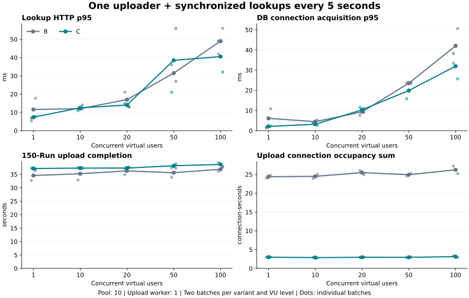

# 동시 사용자 조회와 업로드 트랜잭션 B/C 비교

## 결론

**동시 조회가 몰릴 때 DB 연결 대기는 재현됐지만, C의 조회 응답 개선이 모든 조건·반복에서 일관되지는 않았다.** 100 VU에서 두 배치 평균 HTTP 시간은 **24.780 → 21.714ms(12.4% 감소)**, 연결 획득 시간은 **17.762 → 15.643ms(11.9% 감소)**, HTTP p95의 배치 평균은 **49.000 → 40.525ms(17.3% 감소)**였다. active는 B/C 모두 최대 10개, pending은 각각 최대 86 / 66개가 관측됐다.

다만 100 VU의 첫 반복은 HTTP 평균 **23.229 → 24.126ms로 악화**, 두 번째는 **26.331 → 19.303ms로 감소**했다. 1~50 VU에서는 C의 HTTP 평균이 B보다 1.2~7.1% 길었다. 각 조건 두 번만 측정했으므로 100 VU 평균 감소를 안정적인 실서비스 개선율로 확정하지 않는다.

**일관되게 확인한 이득은 업로드의 DB 연결 점유 합계 감소(87.8~88.4%)**다. 반면 150 Run 업로드 완료 시간은 모든 VU 단계에서 2.9~7.6% 늘었고, 100 VU에서는 **36.881 → 38.686초(4.9% 증가)**였다. 이번 결과는 작업자 1개에서 자원 점유 감소와 HTTP 응답 단축이 같은 비율로 나타나지 않음을 보여준다. 관리자·작업자를 함께 늘리는 조건은 후속 검토로 남긴다.

## 실험 조건

[확정 계획](../plans/2026-10-15-동시-사용자-조회와-업로드-트랜잭션-비교-계획.md)에 따라 **한 클라이언트가 150 Run을 업로드하는 동안** VU 1 / 10 / 20 / 50 / 100명이 5초마다 함께 조회했다. DB 연결 최대·최소 유휴 10개, 업로드 worker 1개를 유지했다. 조회만 하는 실험은 사용자 요청으로 제외했다.

B는 연속 업로드 처리 상태에서 파일 파싱 중에도 연결을 유지하고, C는 준비·게시 구간만 트랜잭션으로 묶고 파싱 중 연결을 반환한다. 업로드 병렬화나 사용자 계정별 워크스페이스를 검증한 실험은 아니다. 같은 조회 API에 여러 VU가 접근했다.

| VU | 묶음당 조회 | 평균 목표 요청률 | 50초 배치당 예정 조회 |
| ---: | ---: | ---: | ---: |
| 1 | 1건 | 0.2건/초 | 10건 |
| 10 | 10건 | 2건/초 | 100건 |
| 20 | 20건 | 4건/초 | 200건 |
| 50 | 50건 | 10건/초 | 500건 |
| 100 | 100건 | 20건/초 | 1,000건 |

실제 트래픽 자료에 근거한 운영 부하가 아닌 **여러 사람이 함께 새로고침하는 가정**이다. 100 VU도 평균 20건/초지만 순간적으로 100건이 몰린다. 이전 400건/초 분산 요청 실험과 동일한 부하가 아니므로 수치를 직접 전후 개선율로 비교하지 않는다.

- Java 21.0.12, Python 3.13.7, k6 v2.3.0, PostgreSQL 18.6. DB 컨테이너 2 CPU·3 GiB, JVM 256 MiB~2 GiB. 동일 로컬 호스트에서 부하 발생기와 Java·DB 실행.
- 인공 150 Run·2,175파일·1,545,005,295바이트. 매 배치 seed 복원 후 147건 신규·3건 갱신, 완료 시 current Run 150개·불변 버전 153개.
- 조회 API `GET /api/run-versions/{id}`는 seed 불변 버전 3개를 순환. 응답 크기 2,673 / 36,894 / 37,421바이트, 매 응답 SHA-256 검증. 전체 업로드 golden parity 검증.
- VU별 B/C 각각 2회. B1 오름차순 → C1 오름차순 → C2 내림차순 → B2 내림차순. JVM마다 업로드 워밍업 1회, 총 3회.
- 조회 부하 50초, 시작 5초 뒤 업로드, 업로드 관측 제한 40초. 완료 폴링 1초. 클라이언트 완료 시간과 서버 마지막 job commit 시간을 별도 기록.
- 각 배치 집계 대상은 서버 업로드 진입~마지막 terminal commit 구간에 **시작된 조회**. 그 뒤 완료되는 요청도 포함한다.

## 조회 응답

단위 ms. 각 셀은 B → C. **각 배치 평균/p95를 구한 뒤 두 배치 값의 평균**을 제시한다. 감소율은 `(B−C)/B×100`이며 음수는 악화다. 요청 수를 반복 횟수로 간주하지 않는다.

| VU | HTTP 평균 | 평균 감소율 | HTTP p95 | p95 감소율 |
| ---: | ---: | ---: | ---: | ---: |
| 1 | 5.143 → 5.464 | -6.2% | 11.600 → 7.350 | +36.6% |
| 10 | 6.942 → 7.437 | -7.1% | 12.025 → 12.500 | -4.0% |
| 20 | 8.827 → 8.936 | -1.2% | 17.025 → 14.025 | +17.6% |
| 50 | 16.727 → 17.277 | -3.3% | 31.500 → 38.500 | -22.2% |
| 100 | 24.780 → 21.714 | +12.4% | 49.000 → 40.525 | +17.3% |

## 연결 획득과 대기

연결 획득 시간에는 큐 대기 외에 연결 확인 비용도 포함된다. pending은 Hikari MXBean의 100ms 표본에서 관측한 값으로, 짧은 대기는 놓칠 수 있다. 아래 최대치는 각 조건의 두 배치 중 최대다.

| VU | 획득 평균 ms | 획득 p95 ms | pending 최대 B / C | active 최대 B / C |
| ---: | ---: | ---: | ---: | ---: |
| 1 | 1.650 → 1.460 | 6.113 → 2.099 | 0 / 0 | 2 / 1 |
| 10 | 2.040 → 2.053 | 4.457 → 3.171 | 0 / 0 | 2 / 10 |
| 20 | 3.489 → 4.246 | 9.322 → 10.323 | 0 / 7 | 2 / 10 |
| 50 | 10.626 → 9.229 | 23.530 → 19.899 | 37 / 39 | 10 / 10 |
| 100 | 17.762 → 15.643 | 42.050 → 31.963 | 86 / 66 | 10 / 10 |

### 파싱 도중 시작된 조회

파일 파싱과 겹친 조회만 따로 묶은 배치별 평균의 평균이다. B는 파싱 중에도 연결을 유지하고 C는 반환한다. 파싱 구간의 길이·조회 시작 시점에 따라 포함되는 요청 수가 다르므로 아래 결과를 동일 요청의 직접 비교나 독립적인 인과 효과로 해석하지 않는다.

| VU | 표본 수 B / C | HTTP 평균 B → C(ms) | 연결 획득 평균 B → C(ms) |
| ---: | ---: | ---: | ---: |
| 1 | 10 / 8 | 3.400 → 5.125 | 0.410 → 1.326 |
| 10 | 100 / 100 | 6.370 → 7.090 | 1.880 → 2.118 |
| 20 | 140 / 160 | 7.185 → 8.256 | 3.519 → 3.842 |
| 50 | 450 / 500 | 17.703 → 17.990 | 11.343 → 8.649 |
| 100 | 900 / 963 | 24.458 → 21.334 | 16.817 → 15.050 |

## 업로드 영향

단위 초. 연결 점유는 **업로드가 연결을 보유한 구간의 합계**이며 전체 풀 10개를 동시에 점유한 시간이나 업로드 완료 시간과 같지 않다.

| VU | 클라이언트 완료 B → C | 완료 시간 감소율 | 서버 완료 B → C | 연결 점유 합계 B → C | 점유 감소율 |
| ---: | ---: | ---: | ---: | ---: | ---: |
| 1 | 34.551 → 37.164 | -7.6% | 34.190 → 36.442 | 24.393 → 2.988 | +87.8% |
| 10 | 35.227 → 37.308 | -5.9% | 34.539 → 36.481 | 24.488 → 2.875 | +88.3% |
| 20 | 36.265 → 37.328 | -2.9% | 35.537 → 36.593 | 25.491 → 2.961 | +88.4% |
| 50 | 35.603 → 38.196 | -7.3% | 35.256 → 37.441 | 24.931 → 2.948 | +88.2% |
| 100 | 36.881 → 38.686 | -4.9% | 36.485 → 38.317 | 26.246 → 3.136 | +88.1% |

서버 구간별 두 반복 평균(ms). 연결 점유는 아래 구간과 겹치므로 합산하지 않는다.

| VU | 대기 B → C | 파일 복사·해시·이동 B → C | 파싱 B → C | DB 획득·실행·커밋 B → C | 나머지 B → C |
| ---: | ---: | ---: | ---: | ---: | ---: |
| 1 | 253.6 → 325.5 | 6,058.4 → 7,640.9 | 21,635.4 → 22,008.7 | 2,333.4 → 2,557.4 | 3,909.5 → 3,909.5 |
| 10 | 376.9 → 326.8 | 6,044.2 → 7,738.8 | 21,646.5 → 22,014.1 | 2,429.3 → 2,466.1 | 4,042.4 → 3,935.6 |
| 20 | 335.4 → 237.3 | 5,998.2 → 7,684.1 | 22,616.0 → 22,094.4 | 2,449.5 → 2,557.3 | 4,137.5 → 4,020.2 |
| 50 | 310.6 → 406.0 | 6,210.3 → 7,903.4 | 22,027.3 → 22,446.8 | 2,467.5 → 2,542.2 | 4,240.6 → 4,142.8 |
| 100 | 460.6 → 259.6 | 6,167.9 → 7,814.0 | 23,112.8 → 23,318.2 | 2,676.5 → 2,698.6 | 4,066.9 → 4,226.2 |

## 실제 동시 요청과 결과 검증

워밍업 포함 업로드 **23회**, 비교 배치 **20회**, 총 조회 **7,240건**, 업로드 중 시작된 조회 **5,249건**이다. HTTP 오류 0건·응답 해시 불일치 0건, 연결 획득 오류 0건, 요청 ID 미결합 0건이다. 예정 조회 누락 0건·초과 0건이다.

| VU | 실제 VU 수 | 배치당 조회 수 | 묶음 내 요청 시작 편차 최대 B / C(ms) | 서버 조회 동시 실행 최대 B / C |
| ---: | ---: | ---: | ---: | ---: |
| 1 | 1~1 | 10~10 | 0 / 0 | 1 / 1 |
| 10 | 10~10 | 100~100 | 1 / 1 | 10 / 10 |
| 20 | 20~20 | 200~200 | 2 / 2 | 20 / 20 |
| 50 | 50~50 | 500~500 | 3 / 5 | 50 / 50 |
| 100 | 100~100 | 1000~1000 | 6 / 4 | 100 / 100 |

서버 조회 동시 실행 수에는 DB 연결을 기다리거나 응답을 구성하는 요청도 포함되므로 DB 연결 수와 다르다. 연결 반환 직후 계측 종료 시각이 약간 겹칠 수 있어 JDBC 연결 점유 span의 겹침 수를 실제 풀 점유 개수로 사용하지 않았다.

## 반복별 원자료 요약

HTTP·연결 획득은 ms, 업로드·점유는 초. 전체 목록과 개별 요청·SQL·단계 로그는 Git에서 제외한 로컬 원시 자료에 보관한다.

| VU | 버전·회차 | 업로드 중 조회 수 | HTTP 평균 / p95 | 획득 평균 / p95 | 업로드 완료 | 연결 점유 |
| ---: | --- | ---: | ---: | ---: | ---: | ---: |
| 1 | B1 | 7 | 3.143 / 5.400 | 0.448 / 1.342 | 32.709 | 24.030 |
| 1 | B2 | 7 | 7.143 / 17.800 | 2.852 / 10.883 | 36.393 | 24.757 |
| 1 | C1 | 8 | 5.500 / 7.000 | 1.352 / 1.926 | 37.271 | 2.963 |
| 1 | C2 | 7 | 5.429 / 7.700 | 1.568 / 2.272 | 37.057 | 3.013 |
| 10 | B1 | 60 | 5.483 / 12.050 | 1.382 / 3.691 | 32.888 | 23.953 |
| 10 | B2 | 70 | 8.400 / 12.000 | 2.697 / 5.224 | 37.565 | 25.022 |
| 10 | C1 | 80 | 7.487 / 11.000 | 2.018 / 3.590 | 37.466 | 2.942 |
| 10 | C2 | 70 | 7.386 / 14.000 | 2.088 / 2.752 | 37.151 | 2.808 |
| 20 | B1 | 120 | 9.183 / 21.050 | 2.777 / 7.549 | 34.881 | 26.018 |
| 20 | B2 | 140 | 8.471 / 13.000 | 4.201 / 11.094 | 37.650 | 24.963 |
| 20 | C1 | 140 | 9.271 / 15.000 | 4.515 / 11.563 | 37.126 | 2.925 |
| 20 | C2 | 140 | 8.600 / 13.050 | 3.976 / 9.083 | 37.529 | 2.998 |
| 50 | B1 | 350 | 18.223 / 36.000 | 11.425 / 23.638 | 33.900 | 24.623 |
| 50 | B2 | 350 | 15.231 / 27.000 | 9.826 / 23.423 | 37.306 | 25.238 |
| 50 | C1 | 350 | 12.506 / 21.000 | 8.221 / 15.793 | 37.526 | 2.858 |
| 50 | C2 | 350 | 22.049 / 56.000 | 10.236 / 24.006 | 38.866 | 3.037 |
| 100 | B1 | 800 | 23.229 / 42.000 | 17.064 / 33.534 | 36.163 | 27.233 |
| 100 | B2 | 800 | 26.331 / 56.000 | 18.460 / 50.567 | 37.600 | 25.259 |
| 100 | C1 | 700 | 24.126 / 49.000 | 16.417 / 38.245 | 39.443 | 3.338 |
| 100 | C2 | 700 | 19.303 / 32.050 | 14.869 / 25.680 | 37.928 | 2.933 |

## 도구·재현·해석 범위

| 도구 | 용도 |
| --- | --- |
| k6 `constant-vus` | VU 수 고정, 공통 5초 시각에 조회, 요청별 HTTP 시간·상태·해시와 실제 시작 시각 기록 |
| Python 실행·분석 도구 | seed 복원, 업로드 150건, 순서·시간 제한, golden 검증, 요청 ID로 클라이언트/서버 지표 결합 |
| JDBC 계측 | `DataSource.getConnection()` 시간, SQL 실행, 연결 보유 구간, 업로드 단계별 비용 |
| Hikari MXBean | 최대/최소 유휴 10개 확인, active/idle/pending 100ms 표본 |
| PostgreSQL | `pg_stat_statements` SQL 집계와 `pg_stat_activity` 대기 종류 |
| OS/Docker | Java/k6 CPU·RSS, DB CPU·메모리·I/O, 메모리 압박 표본 |
| Matplotlib | 합성 시간 집계 시각화. 제품 실험 결과를 사용하지 않음 |

실행 시간은 워밍업·복원·재기동 포함 **19.29분**이다. 도구 준비·문서 작성 시간은 제외했다.

재현 명령은 [성능 도구 README](../../scripts/performance/README.md#관리자-1명-업로드-중-동시-조회-사용자-비교)에 있다. 원시 자료는 `.local/performance/upload-query-users-20261015/`의 `schedule.json`, `state.json`, `results/*/{result,analysis}.json`, `timing.jsonl`, `lookup.jsonl`, `resources.jsonl`, `sql.json`, `k6-summary.json`에 보존했다. 동일 폴더의 `measured-harness/`는 측정 시작 시 사용한 코드 사본이다. 로컬 `summarize.py`와 `plot.py`로 최종 집계와 그래프를 생성했다.

- B JAR SHA-256: `3570164bede4c955b1f8b190a4c2f43669c77e6aeff06bc112a8f8605d2e6f38`
- C JAR SHA-256: `b3e06de0a0b6948cba22f3f1ab49b864279254a278147f8a74bcc0721a880b92`
- 동일 계측을 B/C에 적용했으며 제품 JAR·SQL·인덱스·업로드 worker·풀 수를 변경하지 않았다. 요청별 로그 및 계측 자체의 비용을 포함하는 결과다. 특히 동시 요청에서 로깅 경합이 추가될 수 있으므로 무계측 제품의 최대 처리량이나 실서비스 지연으로 일반화하지 않는다.
- 조회만 하는 대조군이 없어 업로드가 추가한 지연을 독립적으로 산출하지 않았다. B/C에서 관측한 차이와 연결 대기 증거를 구분해 해석한다.
- 각 조건 2회로 반복 수가 작다. 특히 1 VU는 업로드 중 조회 표본도 적어 p95·미세한 차이가 불안정하다. 유의성이나 실제 사용자 수용 한도를 주장하지 않는다.
- 풀 상태 100ms·OS/DB 자원 약 2초 표본은 짧은 순간의 포화와 대기를 놓칠 수 있다. `ClientRead`는 DB가 클라이언트의 다음 명령을 기다리는 상태로 DB 잠금 대기와 다르다.
- 실행 전 실제 k6로 10 VU·6초 로컬 테스트를 수행해 0초/5초 각 10건, 총 20건의 성공과 묶음 내 시작 편차 1ms/0ms를 확인했다. 이는 부하 도구 검증이며 제품 성능 결과에 섞지 않았다.
- `python3 -m unittest discover -s scripts/performance -p 'test_*upload*py'`: 29개 통과. 제품 로직 변경이 없어 제품 전체 테스트를 재실행하지 않았으며 실제 계측 JAR로 위 통합 실험을 수행했다.

## 후속 검토 범위

사용자 합의에 따라 **관리자·업로드 작업자를 함께 1 → 2 → 4 → 8로 확대**하고 DB 풀 10개·전체 업로드 150 Run을 고정하는 조건을 [계획서 후속 범위](../plans/2026-10-15-동시-사용자-조회와-업로드-트랜잭션-비교-계획.md#후속-검토--여러-관리자의-업로드와-서버-병렬-처리)에 기록했다. 단계 안에서는 동일 조회 부하로 B/C를 비교한다. 병렬 worker 구현·중복 및 버전 갱신의 동시성 검증이 선행되어야 하며, 이번 실험에서 구현·실행하지 않았다.
