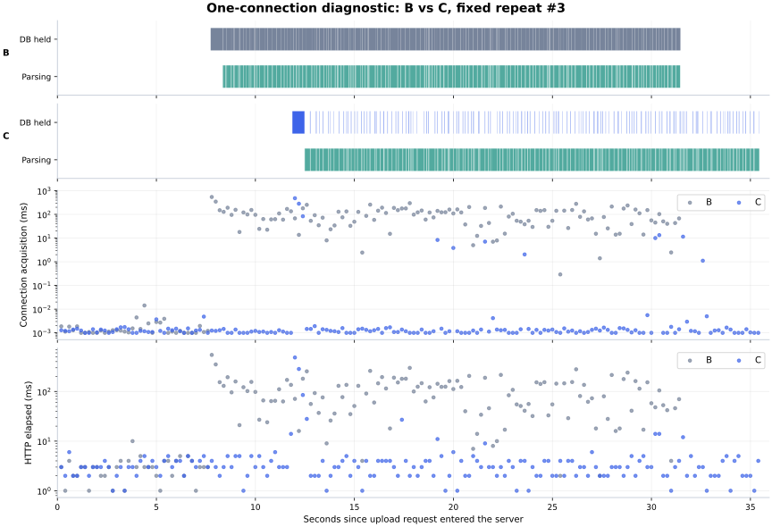

# 업로드 중 조회 대기·응답 성능 B/C 비교

측정일: 2026-10-15. [승인된 계획](../plans/2026-10-15-업로드-중-조회-대기와-응답-성능-비교-계획.md) · [선행 업로드 개선](2026-10-15-파일-업로드-성능-개선.md).

## 결과 요약

**C는 연결을 약 88% 덜 점유하지만, 현재 부하의 기본 풀에서는 조회가 빨라지지 않았다. 연결이 부족할 때 파싱으로 인한 조회 대기를 크게 줄이는 효과가 확인됐다.**

- **제품 기본 연결 10개:** 조회 평균 3.192→3.291ms로 개선을 확인하지 못했다. 배치 p95 평균은 5.100→5.435ms로 소폭 증가했다. 업로드 완료도 33.965→35.593초로 1.629초(4.79%) 늘었다. 연결 점유 합계는 23.976→2.913초로 87.85% 감소했다.
- **연결 2개:** 조회 평균 3.249→3.211ms와 업로드 33.769→33.298초의 차이는 bootstrap 구간이 0을 포함해 명확한 개선으로 판단하지 않았다. 연결 획득은 0.006→0.081ms로 늘었지만 절대 차이는 0.075ms다.
- **연결 1개 진단:** 연결 획득 평균 74.658→4.895ms(93.44%), 조회 평균 76.901→7.960ms(89.65%), 배치 p95 평균 211.610→7.460ms(96.47%)로 감소했다. 업로드는 32.156→34.756초로 2.600초(8.09%) 늘었다. 이 개선율은 제품 기본 설정의 결과가 아니다.
- 본 측정·기준선·워밍업·계측 대조를 포함한 **110배치와 조회 32,444건**을 완료했다. HTTP 오류·payload 불일치·조회 상관관계 누락·k6 발행 누락은 모두 0건이다.

연결 1개에서 파싱 중 시작한 조회의 획득 시간은 **100.256→0.006ms**로 줄었다. B는 파일을 읽고 계산하는 동안에도 DB 연결을 쥐고 있어 조회가 기다렸고, C는 그 구간에 연결을 반환해 조회가 진행될 수 있었다. 다만 접수·게시 때는 연결을 사용하므로 C도 대기가 완전히 사라지지는 않았다. C의 최대 조회는 487ms였으며, 소수의 긴 요청 때문에 평균이 배치 p95 평균보다 높을 수 있다.

따라서 이번 변경의 확인된 장점은 **DB 연결 점유 감소와 연결 부족 시 조회 간섭 완화**다. 업로드 자체의 추가 가속이나 기본 설정의 조회 개선으로 표현하지 않는다. 업로드 시간의 증가는 이번 환경에서 관측한 결과이며, 파싱 시간 편차·재확인 및 commit 비용·연결 경쟁을 개별 원인으로 분리해 측정한 결과는 아니다.

아래 값은 **업로드와 실제로 겹친 조회**의 배치별 통계를 평균한 값이다. B는 파싱을 등록 트랜잭션 안에서 수행하고, C는 준비·게시만 짧은 트랜잭션으로 처리한다. HTTP 응답은 실험 상세 API이며 LLM·Agent 전체 실행·화면 렌더링을 포함하지 않는다.

## 연결 10개 — 제품 기본 설정, B/C 각 10배치

| 지표 | B | C | B−C | 감소율 | 감소량 bootstrap 95% 구간 |
| --- | --- | --- | --- | --- | --- |
| 연결 획득 평균 (ms) | 0.070 | 0.053 | 0.017 | 23.71% | -0.021 ~ 0.061 |
| 연결 획득 배치 p95 평균 (ms) | 0.533 | 0.271 | 0.262 | 49.18% | -0.052 ~ 0.630 |
| 조회 HTTP 평균 (ms) | 3.192 | 3.291 | -0.098 | -3.08% | -0.277 ~ 0.055 |
| 조회 HTTP 배치 p95 평균 (ms) | 5.100 | 5.435 | -0.335 | -6.57% | -0.605 ~ -0.070 |
| 업로드 클라이언트 완료 (ms) | 33,964.541 | 35,593.135 | -1,628.594 | -4.79% | -2,573.110 ~ -677.617 |
| 업로드 서버 완료 (ms) | 33,354.402 | 34,947.286 | -1,592.885 | -4.78% | -2,357.252 ~ -876.768 |
| 업로드 DB 연결 점유 합계 (ms) | 23,976.385 | 2,913.149 | 21,063.236 | 87.85% | 20,894.336 ~ 21,209.905 |

| 조회 검증 | B | C |
| --- | --- | --- |
| 업로드 중 조회 수 | 1666 | 1743 |
| HTTP 오류 | 0 | 0 |
| 연결 획득 실패 | 0 | 0 |
| 조회 SQL 호출 수 | 1666 | 1743 |
| 관측된 최대 pending | 0 | 0 |

| 분포 보조 지표 | B | C |
| --- | --- | --- |
| 조회 배치 중앙값 평균 ms | 3.000 | 3.000 |
| 조회 최댓값 ms | 18.000 | 29.000 |
| 획득 배치 중앙값 평균 ms | 0.002 | 0.002 |
| 획득 최댓값 ms | 2.541 | 3.082 |

### 업로드 없는 기준선과 병행 부하

| 비교군 | 조회만 평균 ms | 업로드 중 조회 평균 ms | 업로드만 초 | 업로드+조회 초 | 업로드 시간 증가 초 | 증가율 |
| --- | --- | --- | --- | --- | --- | --- |
| B | 8.684 | 3.192 | 32.121 | 33.965 | 1.844 | 5.74% |
| C | 8.722 | 3.291 | 34.034 | 35.593 | 1.559 | 4.58% |

조회만·업로드만 기준선은 각각 3회다. 기준선과 병행 측정은 서로 다른 시점이므로 차이를 순수 DB 대기로 해석하지 않는다. HTTP의 핵심 비교는 같은 병행 부하에서 B/C를 비교한 첫 표다.

### 단계별 연결 획득

| 조회 시작 단계 | B 표본 수 | C 표본 수 | B 획득 평균 ms | C 획득 평균 ms |
| --- | --- | --- | --- | --- |
| 접수 단계 | 480 | 504 | 0.068 | 0.039 |
| worker 단계 | 1186 | 1239 | 0.070 | 0.059 |
| 파싱과 겹쳐 시작한 조회 | 1060 | 1102 | 0.073 | 0.058 |

파싱 그룹은 worker 그룹의 부분집합이므로 표본 수를 더하지 않는다. 접수와 worker 경계는 `queue.ready`이며, 마지막 job의 terminal commit까지 관측했다.

## 연결 2개 — 선행 벤치마크 설정, B/C 각 10배치

| 지표 | B | C | B−C | 감소율 | 감소량 bootstrap 95% 구간 |
| --- | --- | --- | --- | --- | --- |
| 연결 획득 평균 (ms) | 0.006 | 0.081 | -0.075 | -1,263.80% | -0.096 ~ -0.053 |
| 연결 획득 배치 p95 평균 (ms) | 0.004 | 0.505 | -0.501 | -12,669.79% | -0.749 ~ -0.256 |
| 조회 HTTP 평균 (ms) | 3.249 | 3.211 | 0.039 | 1.18% | -0.134 ~ 0.234 |
| 조회 HTTP 배치 p95 평균 (ms) | 5.440 | 5.300 | 0.140 | 2.57% | -0.260 ~ 0.540 |
| 업로드 클라이언트 완료 (ms) | 33,769.313 | 33,297.580 | 471.733 | 1.40% | -404.457 ~ 1,577.766 |
| 업로드 서버 완료 (ms) | 33,284.156 | 32,834.961 | 449.195 | 1.35% | -410.075 ~ 1,569.013 |
| 업로드 DB 연결 점유 합계 (ms) | 23,767.164 | 2,845.623 | 20,921.541 | 88.03% | 20,720.917 ~ 21,124.000 |

| 조회 검증 | B | C |
| --- | --- | --- |
| 업로드 중 조회 수 | 1663 | 1641 |
| HTTP 오류 | 0 | 0 |
| 연결 획득 실패 | 0 | 0 |
| 조회 SQL 호출 수 | 1663 | 1641 |
| 관측된 최대 pending | 0 | 0 |

| 분포 보조 지표 | B | C |
| --- | --- | --- |
| 조회 배치 중앙값 평균 ms | 3.100 | 3.000 |
| 조회 최댓값 ms | 30.000 | 20.000 |
| 획득 배치 중앙값 평균 ms | 0.003 | 0.002 |
| 획득 최댓값 ms | 2.058 | 5.488 |

### 업로드 없는 기준선과 병행 부하

| 비교군 | 조회만 평균 ms | 업로드 중 조회 평균 ms | 업로드만 초 | 업로드+조회 초 | 업로드 시간 증가 초 | 증가율 |
| --- | --- | --- | --- | --- | --- | --- |
| B | 8.782 | 3.249 | 34.373 | 33.769 | -0.604 | -1.76% |
| C | 8.933 | 3.211 | 31.573 | 33.298 | 1.725 | 5.46% |

조회만·업로드만 기준선은 각각 3회다. 기준선과 병행 측정은 서로 다른 시점이므로 차이를 순수 DB 대기로 해석하지 않는다. HTTP의 핵심 비교는 같은 병행 부하에서 B/C를 비교한 첫 표다.

### 단계별 연결 획득

| 조회 시작 단계 | B 표본 수 | C 표본 수 | B 획득 평균 ms | C 획득 평균 ms |
| --- | --- | --- | --- | --- |
| 접수 단계 | 487 | 465 | 0.003 | 0.074 |
| worker 단계 | 1176 | 1176 | 0.007 | 0.083 |
| 파싱과 겹쳐 시작한 조회 | 1054 | 1053 | 0.008 | 0.073 |

파싱 그룹은 worker 그룹의 부분집합이므로 표본 수를 더하지 않는다. 접수와 worker 경계는 `queue.ready`이며, 마지막 job의 terminal commit까지 관측했다.

## 연결 1개 — 연결 부족 진단용, B/C 각 5배치

| 지표 | B | C | B−C | 감소율 | 감소량 bootstrap 95% 구간 |
| --- | --- | --- | --- | --- | --- |
| 연결 획득 평균 (ms) | 74.658 | 4.895 | 69.764 | 93.44% | 67.908 ~ 71.131 |
| 연결 획득 배치 p95 평균 (ms) | 209.562 | 3.032 | 206.530 | 98.55% | 194.660 ~ 214.901 |
| 조회 HTTP 평균 (ms) | 76.901 | 7.960 | 68.941 | 89.65% | 67.042 ~ 70.295 |
| 조회 HTTP 배치 p95 평균 (ms) | 211.610 | 7.460 | 204.150 | 96.47% | 193.230 ~ 212.140 |
| 업로드 클라이언트 완료 (ms) | 32,156.413 | 34,756.259 | -2,599.846 | -8.09% | -3,734.551 ~ -1,041.623 |
| 업로드 서버 완료 (ms) | 31,589.003 | 34,137.823 | -2,548.820 | -8.07% | -3,606.064 ~ -1,124.580 |
| 업로드 DB 연결 점유 합계 (ms) | 23,659.815 | 2,864.469 | 20,795.346 | 87.89% | 20,583.680 ~ 21,040.791 |

| 조회 검증 | B | C |
| --- | --- | --- |
| 업로드 중 조회 수 | 790 | 853 |
| HTTP 오류 | 0 | 0 |
| 연결 획득 실패 | 0 | 0 |
| 조회 SQL 호출 수 | 790 | 853 |
| 관측된 최대 pending | 4 | 4 |

| 분포 보조 지표 | B | C |
| --- | --- | --- |
| 조회 배치 중앙값 평균 ms | 61.900 | 3.000 |
| 조회 최댓값 ms | 565.000 | 487.000 |
| 획득 배치 중앙값 평균 ms | 60.171 | 0.001 |
| 획득 최댓값 ms | 563.595 | 484.410 |

### 업로드 없는 기준선과 병행 부하

| 비교군 | 조회만 평균 ms | 업로드 중 조회 평균 ms | 업로드만 초 | 업로드+조회 초 | 업로드 시간 증가 초 | 증가율 |
| --- | --- | --- | --- | --- | --- | --- |
| B | 7.629 | 76.901 | 32.219 | 32.156 | -0.063 | -0.19% |
| C | 8.545 | 7.960 | 34.909 | 34.756 | -0.153 | -0.44% |

조회만·업로드만 기준선은 각각 3회다. 기준선과 병행 측정은 서로 다른 시점이므로 차이를 순수 DB 대기로 해석하지 않는다. HTTP의 핵심 비교는 같은 병행 부하에서 B/C를 비교한 첫 표다.

### 단계별 연결 획득

| 조회 시작 단계 | B 표본 수 | C 표본 수 | B 획득 평균 ms | C 획득 평균 ms |
| --- | --- | --- | --- | --- |
| 접수 단계 | 208 | 282 | 22.124 | 14.035 |
| worker 단계 | 582 | 571 | 93.431 | 0.549 |
| 파싱과 겹쳐 시작한 조회 | 533 | 511 | 100.256 | 0.006 |

파싱 그룹은 worker 그룹의 부분집합이므로 표본 수를 더하지 않는다. 접수와 worker 경계는 `queue.ready`이며, 마지막 job의 terminal commit까지 관측했다.

## 대기가 발생한 시점



인공 150 Run 입력의 실행 시간만 시각화했다. 실제 실험의 물리 수치·원본·응답 payload는 포함하지 않는다. 원시 계측은 로컬에 보관한다.

결과를 보기 전에 고정한 풀 1개·3번째 반복의 타임라인이다. 각 비교군의 업로드 진입을 0초로 맞췄으며 서로 다른 시점에 실행했다. 점은 개별 조회이고 아래 두 축은 로그 눈금이다. 풀 1개는 원리 확인용이며 제품 기본 설정의 성능으로 발표하지 않는다.

## 계측 영향 확인

| 풀 2·각 3배치 | 계측 off 평균 ms | 계측 on 평균 ms | off 배치 p95 평균 ms | on 배치 p95 평균 ms |
| --- | --- | --- | --- | --- |
| B-query | 8.192 | 8.782 | 12.000 | 12.667 |
| B-combined | 3.273 | 3.187 | 5.283 | 5.083 |
| C-query | 7.599 | 8.933 | 13.000 | 13.333 |
| C-combined | 3.045 | 3.161 | 5.000 | 5.667 |

off/on 모두 동일한 클라이언트 시간 창으로 비교했다. on은 사전 지정한 본 측정 1~3번이며 좋은 결과를 골라 대체하지 않았다. 일부 평균 차이가 5%를 넘어서 계측 영향 검토를 실시했다. 병행 조회의 평균 차이는 B 약 −0.085ms, C 약 +0.116ms이고, 업로드 완료 시간은 B와 C에서 반대 방향으로 움직였다. 순차 실행의 JVM·OS 상태 변화와 계측 비용을 이 표만으로 분리할 수 없어, 계측 비용이 0이라고 주장하지 않으며 수 ms 이하의 작은 차이를 확정적 개선으로 강조하지 않는다.

## 실험 조건과 측정 경계

- 인공 150조건·2,175파일·1,545,005,295바이트를 실제 HTTP multipart·파서·PostgreSQL 경로로 등록했다. 업로드 파일·응답·SQL·인덱스는 B/C에서 같다.
- 조회는 `GET /api/run-versions/{id}`의 고정 3버전(응답 2,673 / 36,894 / 37,421바이트)을 순환한다. `select full_run from run_version where id=?` 한 번을 수행하며 목록·LLM API가 아니다.
- 계획의 독립 seed 3개+신규 150개는 파서의 고정 150조건 범위 때문에 변경했다. 먼저 다른 인공 원본의 3개 버전을 만들고 과거 버전을 조회한다. 본 업로드는 **147개 신규+3개 갱신**, 종료 후 **150개 현재 Run·153개 버전**이다. 두 비교군에 동일하게 적용했고 원래 업로드 데이터는 바꾸지 않았다.
- k6 `constant-arrival-rate` 5req/s, VU 60, HTTP timeout 10초. 병행 부하는 90초이며 10초 후 업로드를 시작한다. 업로드 서버 진입~마지막 terminal commit 사이에 시작한 조회만 핵심 지표에 포함하고, 창 이후 완료된 요청도 포함한다.
- JVM 재시작마다 전체 볼륨 워밍업 1회를 제외했다. 본 측정은 5배치 블록으로 C→B, B→C 순서를 균형 배치했고 풀 1은 C→B 각 5회다. 난수 seed는 20261015다.
- 평균·p95의 실험 단위는 개별 요청이 아닌 배치다. 같은 번호의 B/C 배치를 짝지어 5,000회 bootstrap을 수행했다. CI가 0을 포함하면 명확한 감소로 판정하지 않았다. 감소량은 B−C이며 음수는 증가다.
- `db.acquire`는 `DataSource.getConnection()` 호출 전체 시간이다. 풀 대기 외 연결 검사 비용도 포함한다. `http_req_blocked`나 DB `wait_event`로 Java 풀 대기를 대신하지 않았다.
- SQL 호출·연결 점유·HTTP 시간은 중첩되므로 더하지 않는다. 연결 점유 합계는 업로드 trace의 획득 성공부터 close까지 합계이며 벽시계 완료 시간과 다르다.
- 원시 JSONL에는 전체 조회·서버 상관관계·버전별 통계·오류가 남아 있다. 서버 상관관계가 없는 요청도 별도로 보존하며 실패를 0ms 성공으로 대체하지 않는다.

## 환경·재현·검증

macOS 15.7.9 / Mac16,8 / 12 CPU / RAM 24GiB, Java 21.0.12, PostgreSQL 18.6-alpine3.24(2 CPU·3GiB), k6 2.3.0. Java heap 256MiB~2GiB, 작업자 1개, drain 32, idle 500ms, polling 1초, Hikari maximum=minimumIdle(10/2/1), 연결 획득 timeout 3,000ms. 로컬 warm-cache 환경이며 냉시작·최대 처리량 시험이 아니다.

| 항목 | 수량 |
| --- | --- |
| trials | 110 |
| measured | 98 |
| warmups | 12 |
| upload_batches | 86 |
| all_lookup_requests | 32444 |
| verified | 110 |
| invalid_payloads | 0 |
| dropped | 0 |
| unmatched | 0 |
| overlap_errors | 0 |
| poll_errors | 0 |
| all_http_errors | 0 |
| all_invalid_payloads | 0 |

환경과 원시 파일은 `.local/performance/upload-query/`에 보관했다. 서비스 DB·원본은 사용하지 않았다. 실제 물리 결과·DB·키·원시 로그는 Git에 포함하지 않는다.

B 제품 기준은 `ddf0e07584127d7b2ad68fc674c97ffd5eb12ad3`, C 기능 기준은 `1b1bcf49f756bf6cea7ce8ab5d397bc03736c82a`다. 실제 C 빌드는 `015455043c50d240ad1c3098c2b98f1f7c072a8a`에서 공통 계측을 적용했으며 기능 기준 이후 차이는 공백과 import qualification뿐이었다. 두 JAR에 같은 네 계측 파일을 사용했다.

| JAR | SHA-256 |
| --- | --- |
| B | 3570164bede4c955b1f8b190a4c2f43669c77e6aeff06bc112a8f8605d2e6f38 |
| C | b3e06de0a0b6948cba22f3f1ab49b864279254a278147f8a74bcc0721a880b92 |

계측 변경은 기본 비활성이다. 요청 ID의 길이·문자를 제한하며 별도 Hikari 관측 스레드는 DB 연결을 빌리지 않는다. 제품의 풀 크기를 변경하지 않았다.

```sh
python3 scripts/performance/analyze_upload_query_benchmark.py .local/performance/upload-query
python3 -m unittest discover -s scripts/performance -p 'test_*upload*py'
backend/gradlew -p backend test --console=plain
```

실행 환경 준비·seed·한 배치 명령은 [재현 절차](../../scripts/performance/README.md#업로드-중-조회-bc-비교)를 따른다. 스케줄·실행 JAR·원본 계측 및 harness SHA-256은 로컬 `environment.json`, `instrumentation-files.json`, `schedule.json`에 보관했다. 최종 통계는 `report-data.json`과 각 배치 `analysis.json`으로 재검산할 수 있다.

검증 결과: `backend/gradlew -p backend test --console=plain`의 JUnit/Testcontainers **164개, 실패·오류 0개**(계측 코드 확정 후 측정 전 실행), Python 업로드 harness 검증 **15개 통과**, `npm run verify:public-files` 및 `git diff --check` 통과. 측정 후 실패·불완전 배치를 집계에서 조용히 누락하지 않도록 분석기를 보완하고, 미사용 보조 함수와 문자열 길이의 부정확한 `bytes` 명칭을 정리했다. 이 정리는 제품 JAR과 측정값을 바꾸지 않았으며, 측정 당시 harness 사본·해시는 로컬 `measured-harness/`에 보존했다.

## 실행 중 환경 오류와 계획 조정

풀 2·10의 86회 실행을 마친 뒤 풀 1의 첫 서버 시작에서 Flyway `Database.getMigrationConnection()`이 추가 연결을 얻지 못해 3,005ms 후 실패했다. 업로드·조회 측정이 시작되기 전의 오류이며 실패 로그와 원래 스케줄을 보존했다. 전용 DB의 5개 마이그레이션이 모두 적용된 것을 확인하고, **풀 1의 B/C 모두 `--spring.flyway.enabled=false`**로 시작해 원래 마지막 두 블록만 이어갔다. 제품 JAR·SQL·스키마·부하는 바꾸지 않았으며 완료된 86회는 재측정하거나 대체하지 않았다. 이 설정 차이도 풀 1을 진단 결과로만 해석하는 이유다.

## 해석의 한계

- 같은 머신에서 순차 실행한 작은 배치 표본의 bootstrap 구간이며, 실행 순서·JVM·OS 편차를 모두 제거하는 것은 아니다. 특히 풀 1은 C→B 한 순서로 실행했다.
- 조회 부하는 실제 사용자 수가 아닌 고정 실험 부하다. 풀 1의 개선율을 기본 설정이나 Agent 전체 응답에 적용하지 않는다.
- 조회만 기준선과 업로드 중 조회는 JVM·OS 실행 상태가 다르며, 조회만 수치가 더 크더라도 업로드가 조회를 빠르게 한다는 뜻이 아니다.
- Java CPU/RSS, DB cgroup CPU·메모리·I/O 및 `pg_stat_activity`를 2초마다 관측했다. 계획에 있던 전용 k6 CPU 및 GC pause의 개별 분해는 수집하지 못했다. 발행 누락은 별도로 검사했지만 CPU·GC의 독립 효과를 확정하지 않는다.
- Hikari pending은 100ms 표본이므로 짧은 대기를 놓칠 수 있다. 정확한 요청별 획득 시간을 함께 사용한다.
- 정수 ms인 k6 호출 경과와 고해상도 `http_req_duration`을 모두 보관했다. 미세한 차이와 순차 off/on 변화는 계측·실행 편차의 영향을 받는다.
- 파서·파일 복사·쿼리·인덱스는 이번 비교에서 최적화하지 않았다. 트랜잭션 분리로 연결 점유를 줄이는 변경의 효과만 평가했다.
