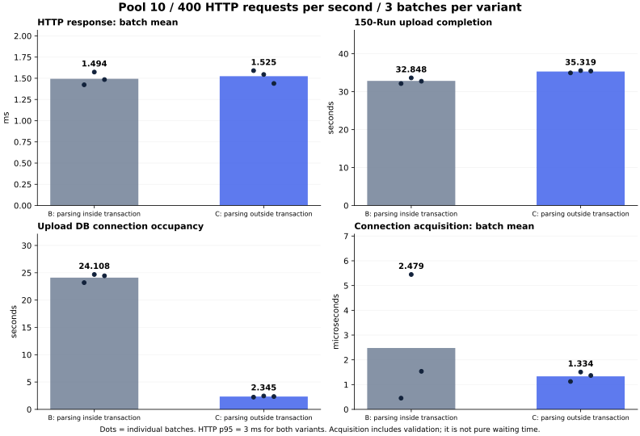

# 연결 10개 고정 · 업로드 중 조회 부하 B/C 검증

측정일: 2026-10-15. [승인된 계획](../plans/2026-10-15-연결-10개-고정-업로드-중-조회-단계별-부하-비교-계획.md) · [선행 실험](2026-10-15-업로드-중-조회-대기와-응답-성능-비교.md) · [도구 재현 방법](../../scripts/performance/README.md).

## 결론

**연결 10개를 유지하고 조회를 400건/초까지 늘렸지만, 이번 상세 조회에서는 지속적인 DB 연결 경쟁이나 조회 성능 개선이 확인되지 않았다.**
C는 업로드의 DB 연결 점유 합계를 **24.108→2.345초로 90.3% 줄였지만**, 조회 평균은 **1.494→1.525ms**, p95는 **3→3ms**였다. 150 Run 업로드 완료는 **32.848→35.319초로 2.471초(7.5%) 증가**했다.
따라서 이번 결과를 “기본 연결 설정에서 조회가 빨라졌다” 또는 “업로드가 더 빨라졌다”로 표현하지 않는다. 확인된 이득은 연결 점유 감소이며, 현재 요청량에서는 그 여유가 조회 지연 감소로 이어지지 않았다.

워밍업·서버 교체·seed 복원·종료 정리까지 **860.68초(14분 21초)**에 완료했다. 도구 보완·문서 작성 시간은 이 측정 시간과 별개다. 30분 상한을 넘기거나 병목을 만들려고 부하 상한을 늘리지 않았다.

## 무엇을 어떻게 실행했나

- **B:** 작업 간 고정 대기를 제거했지만 파일 읽기·파싱을 DB 연결을 보유한 트랜잭션에서 수행한다.
- **C:** 같은 단일 worker가 준비·게시만 트랜잭션으로 처리하고, 파일 읽기·파싱 중에는 연결을 반환한다. 제품 조회 SQL·인덱스·응답은 B/C에서 같다.
- Hikari `maximumPoolSize=10`, `minimumIdle=10`, 연결 획득 제한 3초. **모든 배치의 MXBean 계측으로 10/10을 확인**했다. 업로드 worker 1개, drain 32, idle 500ms, 상태 폴링 1초를 유지했다.
- 기존 인공 **150 Run·2,175파일·1,545,005,295바이트**를 재사용했다. 배치마다 seed 3건으로 복원해 **147건 신규 + 3건 갱신**, 현재 Run 150개·불변 버전 153개를 검증했다.
- 조회는 고정된 불변 버전 3개에 대한 `GET /api/run-versions/{id}`다. 응답 크기는 2,673 / 36,894 / 37,421바이트이며, 모든 HTTP 응답 SHA-256을 기준과 대조했다. 목록·Agent 전체·LLM·화면 렌더링은 포함하지 않았다.
- 먼저 B에서 **20→50→100→200→400건/초**, 단계당 업로드 1회로 탐색했다. 계획의 연결 획득 p95 5ms+pending 관측, HTTP p95 50ms, 오류·발행 누락 기준에 해당하지 않아 **400건/초 하나만 본 비교**로 확정했다. C를 실행하기 전에 `selection.json`에 고정했다.
- 본 비교는 **B1 → C1·C2·C3 → B2·B3**, 각 3회다. JVM마다 전체 업로드 워밍업 1회, B/C 조회 단독 진단 각 30초 1회도 수행했다. 탐색·진단·워밍업 수치를 본 비교 평균에 섞지 않았다.
- 병행 배치는 k6 조회 60초, 시작 5초 후 업로드다. 요청률은 초당 요청 시작 수이며 동시 사용자 400명이나 DB 연결 400개를 뜻하지 않는다. k6 VU는 60개로 고정했다.

총 **16배치(탐색 5 + 본 비교 6 + 조회 단독 2 + 워밍업 3)**, 업로드 14회, 조회 **214,209건**을 실행했다. 이 중 업로드와 겹친 조회는 **104,952건**이며 HTTP 오류·payload 불일치·상관관계 누락·연결 획득 실패·발행 누락은 모두 0건이다. 관측 중단·제외 배치도 없다.

## 1. 탐색 결과 — B만 단계당 1회

| 조회 요청률 | HTTP 평균 | HTTP p95 | 연결 획득 평균 | 관측 최대 active / 10 | 관측 pending | 업로드 완료 |
| ---: | ---: | ---: | ---: | ---: | ---: | ---: |
| 20건/초 | 3.199ms | 5.000ms | 0.003797ms | 2 | 0 | 30.689초 |
| 50건/초 | 2.608ms | 4.000ms | 0.003112ms | 2 | 0 | 31.570초 |
| 100건/초 | 2.134ms | 4.000ms | 0.000834ms | 2 | 0 | 31.626초 |
| 200건/초 | 1.620ms | 3.000ms | 0.001248ms | 3 | 0 | 31.749초 |
| 400건/초 | 1.457ms | 3.000ms | 0.000547ms | 7 | 0 | 31.839초 |

각 단계는 독립된 업로드 배치다. 요청률이 높아질수록 평균 응답이 작아진 것을 부하 증가의 이득으로 해석하지 않는다. 순차 탐색에는 JVM·연결·캐시 상태의 변화가 섞이며, 이 단계는 비교할 요청률을 고르는 용도다. 모든 단계에서 목표 요청률을 달성했고 발행 누락이 없었다.

## 2. 본 비교 — 400건/초, B/C 각 3회

아래 평균과 p95는 **업로드 서버 진입부터 마지막 job terminal commit 사이에 시작된 조회의 배치별 통계**를 3회 평균한 값이다. 종료 뒤 응답한 요청도 포함했다. p95는 전체 요청을 합친 p95가 아니다.

| 지표 | B | C | C−B | B 대비 변화 |
| --- | ---: | ---: | ---: | ---: |
| HTTP 평균 | 1.494ms | 1.525ms | +0.031ms | 2.06% 증가 |
| HTTP 배치 p95 평균 | 3.000ms | 3.000ms | +0.000ms | 0.00% 동일 |
| 연결 획득 평균 | 0.002479ms | 0.001334ms | -0.001145ms | 46.19% 감소 |
| 연결 획득 배치 p95 평균 | 0.001313ms | 0.000986ms | -0.000327ms | 24.92% 감소 |
| 조회 JDBC 실행 평균 | 0.840ms | 0.852ms | +0.013ms | 1.52% 증가 |
| 업로드 클라이언트 완료 | 32.848초 | 35.319초 | +2.471초 | 7.52% 증가 |
| 업로드 서버 완료 | 32.240초 | 35.229초 | +2.989초 | 9.27% 증가 |
| 업로드 DB 연결 점유 합계 | 24.108초 | 2.345초 | -21.763초 | 90.27% 감소 |

연결 획득 평균의 감소는 **약 0.001145ms(1.15μs)**다. B의 반복 평균은 0.000452 / 0.005447 / 0.001536ms로 편차가 있고, 2번째 반복의 최대 16.114ms 같은 소수 긴 획득이 평균에 영향을 준다. 감소율 46.2%만 떼어 “대기 성능 개선”으로 강조하지 않는다. `getConnection()`은 검증과 스케줄링 시간도 포함한다.

본 비교의 최대 active는 B 6개, C 8개였고, 100ms 간격 pending 표본은 양쪽 모두 0이었다. **지속적인 연결 부족의 증거가 없다는 뜻**이며 표본 간의 아주 짧은 대기까지 없었다고 보장하지 않는다. HTTP 최댓값은 B 45ms, C 94ms였다.

### 반복별 값

| 비교군·회차 | HTTP 평균 | HTTP p95 | 연결 획득 평균 | 업로드 완료 | 업로드 연결 점유 |
| --- | ---: | ---: | ---: | ---: | ---: |
| B1 | 1.423ms | 3.000ms | 0.000452ms | 32.140초 | 23.196초 |
| B2 | 1.574ms | 3.000ms | 0.005447ms | 33.640초 | 24.685초 |
| B3 | 1.485ms | 3.000ms | 0.001536ms | 32.763초 | 24.444초 |
| C1 | 1.590ms | 3.000ms | 0.001126ms | 34.956초 | 2.239초 |
| C2 | 1.545ms | 3.000ms | 0.001508ms | 35.554초 | 2.449초 |
| C3 | 1.439ms | 3.000ms | 0.001368ms | 35.447초 | 2.348초 |

HTTP 평균의 범위가 B **1.423~1.574ms**, C **1.439~1.590ms**로 겹친다. 같은 반복 번호의 차이도 한 방향으로 유지되지 않아 조회 가속을 주장하지 않는다. C 업로드 완료는 이번 3회 모두 B의 범위보다 길었다. 반복 3회의 짧은 확인 실험이므로 운영 환경의 고정된 증가율로 일반화하지 않는다.

점은 각 배치의 값이며 막대는 3회 평균이다. 실제 플라즈마 수치가 아닌 **인공 입력의 실행 시간만** 시각화했다.

## 3. 업로드 완료가 길어진 구간

| 서버 구간 | B 평균 | C 평균 | C−B |
| --- | ---: | ---: | ---: |
| 작업 대기 | 0.239초 | 0.350초 | +0.111초 |
| 파일 복사·해시·이동 | 4.201초 | 4.385초 | +0.184초 |
| 파싱 | 21.944초 | 24.201초 | +2.258초 |
| DB 획득·SQL·commit | 1.749초 | 1.916초 | +0.168초 |
| 나머지 처리 | 4.108초 | 4.377초 | +0.269초 |
| 서버 전체 | 32.240초 | 35.229초 | +2.989초 |

서버 전체 증가 2.989초 중 **파싱 구간에서 2.258초 증가**가 관측됐다. 파싱 시간 편차·CPU 스케줄링·추가 트랜잭션 경계의 효과를 분리한 실험은 아니므로 증가 원인을 단정하지 않는다. 연결 점유 시간은 위 구간들과 겹치는 자원 점유 지표로, 서버 시간에 더하지 않는다.

클라이언트 완료는 1초 간격 상태 폴링으로 감지하므로 서버 commit과 최대 약 1초 차이가 날 수 있다. 실제 최종 commit으로 잰 서버 시간도 함께 제시했다.

## 4. 다른 병목과 측정 한계

본 비교의 PostgreSQL 조회 1회 엔진 실행 평균은 B 약 **0.314ms**, C 약 **0.309ms**다(`pg_stat_statements`, 전체 부하 창). JDBC 평균 약 0.84~0.85ms에는 DB 왕복 등 애플리케이션 측 비용이 더 포함된다. SQL 잠금 대기는 수집한 `pg_stat_activity` 표본에서 관측되지 않았다. `ClientRead`는 DB가 클라이언트 명령을 기다리는 상태이며 잠금 대기가 아니다.

| 자원 관측 — 본 비교 전체 부하 창 | B 평균 / 최대 | C 평균 / 최대 |
| --- | ---: | ---: |
| Java CPU, 100%=코어 1개 | 75.2% / 142.6% | 75.5% / 128.7% |
| k6 CPU, 100%=코어 1개 | 17.8% / 28.7% | 17.6% / 28.7% |
| DB CPU, 2 CPU 제한 대비 | 8.50% / 9.70% | 8.43% / 10.30% |

호스트는 12코어이며 위 Java·k6 숫자는 호스트 전체 사용률이 아니다. k6의 요청 발행 누락도 없어 이번 범위에서 부하 발생기나 DB CPU 포화의 증거는 보이지 않았다. 자원은 약 2초 간격, 풀은 100ms 간격으로 관측하므로 짧은 스파이크는 놓칠 수 있다. k6 프로세스 생성 전 첫 자원 표본은 각 배치에서 비어 있으며 CPU 평균에서 제외했다.

조회 단독 진단의 평균은 B 1.951ms, C 1.814ms, p95는 둘 다 3ms였다(각 1회). 다른 시점의 진단이므로 병행 조회보다 높다는 이유로 업로드가 조회를 빠르게 한다고 해석하지 않는다.

**세 개의 동일 불변 버전을 반복 조회한 warm-cache 테스트**다. 실제 요청 종류·데이터 다양성·동시 업로드가 달라지면 결과도 달라질 수 있다. 400건/초는 이번 탐색 상한이며 서비스의 최대 처리량으로 측정한 값이 아니다. 제품 기본값으로 B/C를 비교했지만 모든 운영 트래픽을 재현한 시험은 아니다.

## 5. 사용한 도구와 용도

| 도구 | 이번에 한 일 | 이 도구만으로 알 수 없는 것 |
| --- | --- | --- |
| **k6 2.3.0** | `constant-arrival-rate`로 초당 요청량을 고정하고 HTTP 시간·오류·발행 누락 수집. 응답 SHA-256 검증 | HTTP 지연이 DB 대기인지 파싱인지 원인 분리 |
| **Python 3.13.7** | 인공 파일 업로드·seed 복원·순서/시간 제한·상태 폴링·요청 ID 상관분석·배치 평균과 p95 계산 | LLM 응답이나 운영 사용자 행동 재현 |
| **JDBC 구간 계측** | `getConnection`, SQL 실행, commit, connection 반환까지 실제 구간 기록 | 연결 획득 시간에서 검증·스케줄링을 뺀 순수 대기만 분리 |
| **HikariCP MXBean** | active·idle·pending 및 최대/최소 연결 설정을 100ms 간격으로 확인 | 표본 사이 짧은 대기의 완전한 검출 |
| **PostgreSQL 18.6** | `pg_stat_statements`로 SQL 횟수·엔진 시간, `pg_stat_activity`로 상태·대기 확인 | HTTP 전송·Java 응답 구성 시간 |
| **Docker** | 서비스와 분리한 전용 DB, 2 CPU·3GiB 제한과 같은 초기 상태 유지 | 운영 서버의 성능 보장 |
| **ps·cgroup·memory_pressure** | Java/k6 CPU·RSS, DB CPU·메모리·I/O, 호스트 메모리 상태 수집 | 모든 순간의 CPU 스파이크나 정확한 원인 귀속 |
| **Matplotlib 3.11.2** | 검증한 합성 실행 시간으로 비교 그래프 생성 | 추가 성능 측정은 하지 않음 |

진단용 `psql` 접속은 Hikari 풀 바깥의 별도 관리 연결이며, 제품 요청이 사용할 수 있는 연결은 끝까지 10개였다. Phoenix·LLM은 사용하지 않았고 LLM 호출 비용도 발생하지 않았다. Java 21.0.12, macOS 15.7.9, JVM 256MiB~2GiB를 사용했다. JAR은 [선행 보고서](2026-10-15-업로드-중-조회-대기와-응답-성능-비교.md)의 B/C SHA-256과 일치한다.

## 검증·보관

- `python3 -m unittest discover -s scripts/performance -p 'test_*upload_query*.py'`: 측정 시작 전 13개, 종료 후 타임아웃 구분·단계별 집계 검증 보완까지 **16개 통과**.
- CI와 같은 `python3 -m unittest discover -s scripts/performance -p 'test_*upload*py'`: **24개 통과**.
- `k6 inspect --include-system-env-vars scripts/performance/upload_query_load.js`: 환경변수 전달 후 400건/초·60초·VU 60 확인. 실제 배치에서도 발행량·누락 검증.
- 16배치 모두 정상 완료, 업로드 14회 전체 수치·원본 해시·Run/버전 수와 불변 조회 응답 검증. 214,209개 조회 모두 응답 일치.
- 원시 입력·응답·DB·요청별 로그는 Git 제외 경로 `.local/performance/upload-query-ramp-20261015/`와 기존 fixture 경로에 보관한다. `schedule.json`, `selection.json`, `state.json`, `results/`, `final-summary.json`, `measured-harness/`로 재검산할 수 있다.
- 성공 측정이 끝난 뒤 타임아웃 종류·입력 검증·시작 실패 시 DB 정리 범위 검증을 보강했다. 측정 당시 도구 사본은 `measured-harness/`에 그대로 보존했다. 성공 요청 경로·제품 JAR은 바뀌지 않았으며 실패가 없었던 이번 결과를 재측정한 것으로 표현하지 않는다.
- 테스트 Java·k6·전용 DB를 종료하고 전용 DB/보관소는 seed로 복원했다. 제품 코드·설정·사용자 데이터는 변경하지 않았다.
