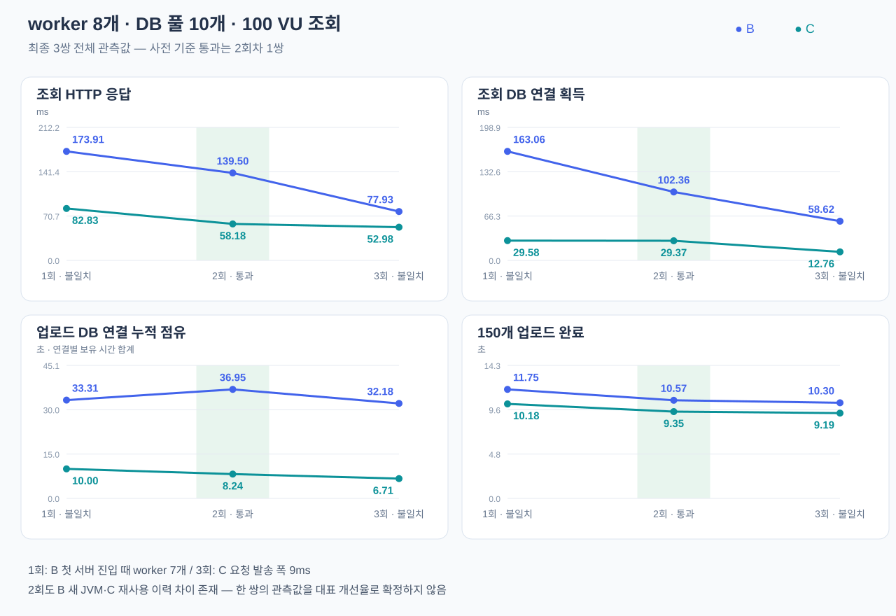

# worker 8개 처리 시점 동기화 B/C 재측정 — 2026-10-16

## 결론과 적용 범위

고정 시간 대신 **worker 8개의 파일 처리 신호에 맞춰 k6 조회100건을 발송**했다. 최종 B/C 각3회 모두 등록·조회 정합성은 통과했다. 다만 사전 정의한 **실제 서버 진입 시 worker8개 + 동시 발송 폭** 기준을 함께 통과한 것은 **2회차1쌍(조회200건)**이다. 이 결과를3회 재현된 개선이나 일반적인 서비스 개선율로 표현하지 않는다.

- 최종3쌍 전체 관측 평균: HTTP130.447→64.663ms(50.4% 감소), 업로드 누적 점유34.147→8.318초(75.6% 감소).
- 조건 통과1쌍: HTTP139.500→58.180ms(58.3% 감소), 업로드 누적 점유36.945→8.241초(77.7% 감소).
- **기존 서버 정책의 한계:** B/C 각각 새 JVM2회·재사용1회를 유지했다. 조건 통과2회차는 B가 새 JVM+예열, C가 재사용이므로 그1쌍만으로 트랜잭션 변경의 독립 효과를 확정하지 않는다. 전체3쌍 집계는 fresh/reuse 개수가 같지만 처리 단계·발송 조건 불일치가 섞인다.

## 무엇을 그대로 두고 무엇을 바꿨는가

| 항목 | 조건 |
| --- | --- |
| 제품 | 기존 B.jar/C.jar 그대로. 파서·조회 SQL·인덱스·JVM/DB 설정 변경 없음 |
| B/C 차이 | B는 파일 파싱까지 tx.process 안에서 수행, C는 tx.prepare → 트랜잭션 밖 파싱 → tx.publish 및 중복 재확인 |
| 입력 | 같은 인공150 Run, 2175파일, 1,545,005,295바이트. 동일 partition/seed/조회 대상3개 |
| 동시 작업 | 관리자8·worker8, Hikari max/minIdle10, k6 v2.3.0의100 VU |
| 초기 부하 | cohort0 조회100건, 5초 뒤 cohort1 조회100건과 업로드 시작 |
| 바뀐 시점 | cohort2는 업로드 후5초 대신 worker 처리 신호를 기다림. 이후 cohort는 새 기준+5초 주기 |
| 실행 순서 | B1,C1,C2,B2,B3,C3. 기존 새 JVM·예열·재사용 정책 유지 |
| 종료 | 업로드 이후 조회 묶음까지 수집 후 종료. 전용DB seed 복원, Java·테스트 컨테이너 종료 |

Python은 제품 밖에서 기존 로그를 증분으로 읽는다. `job.claimed`부터 `job` 완료 사이를 활성 작업으로, `source.load` 후 `parse.graph` 완료 전을 파싱 추정 구간으로 판단한다. 100 VU가 준비되고 이 작업8개를 감지하면 공통 출발 시각(감지+100ms)을 전달한다. **100ms는 클라이언트가 출발 시각을 공유할 준비 시간이다. worker를 멈추거나 DB 연결을 강제로 보유하지 않는다.** 로컬 신호 HTTP 요청은 제품 조회 시간에 포함하지 않는다.

기존 로그는 버퍼링되므로 실제 완료된 Java 구간을 사후 대조했다. 신호를 감지한 시점에는6회 모두 실제 작업8개·파싱8개였다. 다만 출발 준비 및 서버 전달 사이에 작업이 끝나거나 교대할 수 있다. 따라서 감지 시각과 실제 조회 진입 시각을 구분한다. 활성 작업은 읽기·계산·결과 저장 전체이며, 모든 순간8개가 순수 파싱만 한다는 뜻은 아니다.

## 최종 전체3쌍 — 처리 단계 불일치 포함, 참고 관측값

| 지표 | B | C | 변화 |
| --- | ---: | ---: | ---: |
| 조회 HTTP 응답 평균(ms) | 130.447 | 64.663 | 50.4% 감소 |
| 조회 DB 연결 획득 평균(ms) | 108.011 | 23.904 | 77.9% 감소 |
| 업로드 DB 연결 누적 점유(초) | 34.147 | 8.318 | 75.6% 감소 |
| 150개 업로드 완료(초) | 10.873 | 9.574 | 11.9% 감소 |

각 시행의 cohort2 전체100건 평균을 먼저 계산한 뒤 B/C 각3회 평균을 비교했다. 개별 요청을 골라 제외하지 않았다. 업로드 점유·완료는 동일 시행의 전체150개 처리 구간이다. HTTP 시간은 클라이언트 호출부터 응답 완료까지, 연결 획득은 이 안의 `getConnection` 시간이다. 이번 조회는 요청마다 SQL1회·연결 획득1회이며 두 시간을 더하지 않는다. 누적 점유는 업로드가 각 연결을 빌린 시간을 합친 값으로 실제 업로드 경과시간과 다르다.

| 반복 | HTTP B→C(ms) | 연결 획득 B→C(ms) | 업로드 누적 점유 B→C(초) | 업로드 완료 B→C(초) |
| --- | ---: | ---: | ---: | ---: |
| 1 | 173.91→82.83 | 163.06→29.58 | 33.315→10.005 | 11.745→10.181 |
| 2 | 139.50→58.18 | 102.36→29.37 | 36.945→8.241 | 10.571→9.351 |
| 3 | 77.93→52.98 | 58.62→12.76 | 32.180→6.707 | 10.302→9.191 |

## 실제 단계와 동시성 검증

사전 기준: 양쪽 첫 조회의 서버 진입 때 활성 작업8개, 각 묶음 발송 폭5ms 이하, B/C 발송 폭 차3ms 이하. 기준은 최종 측정 전에 고정했다. 응답이 빠르거나 느리다는 이유로 반복을 선택하지 않는다. 서버 진입은 Java 필터 시작 시각이며 네트워크 패킷 도착 시각을 직접 계측한 것은 아니다.

| 반복 | 첫 조회 활성 작업 B/C | 전체100건 활성 작업 평균 B/C | 8개였던 요청 B/C | 발송 폭 B/C(ms) | 판정 |
| --- | ---: | ---: | ---: | ---: | --- |
| 1 | 7 / 8 | 7.00 / 7.21 | 0/100 · 21/100 | 2 / 3 | B 첫 조회 진입 시7개 |
| 2 | 8 / 8 | 6.88 / 7.26 | 18/100 · 37/100 | 4 / 2 | 통과 |
| 3 | 8 / 8 | 7.52 / 7.16 | 52/100 · 29/100 | 2 / 9 | C 발송9ms, 쌍간 차7ms |

100건을 보내는 동안에도 worker가 다음 작업으로 교대하고, 조회의 DB 경합이 진행 중인 작업에 영향을 준다. **조건 통과2회차도100건 전부가 끝날 때까지 작업8개를 고정한 실험은 아니다.** 모든 worker를 강제로 대기시켜 연결을 붙잡는 인위적인 장치는 사용하지 않았다.

## 사전 조건 통과 — 2회차1쌍만 별도 표시

| 지표 | B | C | 변화 |
| --- | ---: | ---: | ---: |
| 조회 HTTP 응답 평균(ms) | 139.500 | 58.180 | 58.3% 감소 |
| 조회 DB 연결 획득 평균(ms) | 102.362 | 29.370 | 71.3% 감소 |
| 업로드 DB 연결 누적 점유(초) | 36.945 | 8.241 | 77.7% 감소 |
| 150개 업로드 완료(초) | 10.571 | 9.351 | 11.5% 감소 |

이 묶음에서 조회 진입 시 worker가 보유한 DB 연결 수는 평균 **B7.08개→C2.74개**였다. C는 파일을 처리하면서도 DB 연결을 반환하므로 작업 수와 연결 점유 수가 다르다. 조회 연결 획득 감소와 HTTP 감소가 함께 관측됐지만 표본1쌍·서버 재사용 이력 차이를 고려하면 확정적인 포폴 대표 수치로 삼기에는 부족하다.



## 측정 도구 보완 이력 — 결과를 합치지 않음

1. `experiment/`: 최초 B 시행은 신호100개를 스레드로 전달하면서 발송 폭44ms가 발생했다. 소수점 예약 시각에 일찍 깬 VU가 이후 조회를 건너뛰어 최종 묶음도 누락됐다. 실패 원자료를 보존하고 성능 비교에서 제외했다.
2. `measured/`: 단일 비동기 이벤트 루프와 예약 시각까지 대기로 수정했다.6시행을 완료했지만 첫 쌍의 발송 폭 B2ms/C17ms가 사전 기준을 벗어났다. 처리 단계 확인용 기록으로 보존했다.
3. `synchronized/`: 공통 정수 밀리초 출발 시각을 지정해 최종6시행을 수행했다. 이 문서의 수치는 이6시행만 사용한다. 최종 조건을 충족하지 못한 반복도 모두 공개하며, 결과가 유리해질 때까지 추가 반복하지 않았다.

## 정확성·재현성·도구

- 최종6시행 모두150 Run·153버전(147신규+3갱신) 검증 성공. 총900 Run 등록 결과 정합성 확인.
- 전체 조회2400건, HTTP·응답 해시 오류0, 예정 조회 누락0. 대표 cohort2는600건, 조건 통과 쌍은200건이다.
- pool max/minIdle10, worker 상한8 확인. 시행 내 wall/monotonic 시계 offset 변동 최대0.299ms로5ms 이상 시계 이상 없음.
- B/C JAR해시가 이전과 일치하며 ZIP 내용 차이는 `ImportWorker.class` 및 내부 클래스2개뿐이다.
- **k6**: 같은 제품 GET,100 VU 동시 호출·HTTP duration·응답 해시. 전역 k6 HTTP 집계에는 로컬 신호 요청도 섞이므로 제품 조회별 원시 기록을 집계했다.
- **Python**: 병렬 업로드/서버·DB 초기화, 파일 로그를 읽는 단계 감지, 비동기 출발 신호, 요청별 분석.
- **기존 Java/JDBC/Hikari 계측**: job/parse/연결 획득·보유 구간과 pool 상태. **PostgreSQL**: 결과·과거 버전 정합성 검증. **SVG**: 반복별 관측값과 기준 통과 여부 시각화.
- 제품 코드 변경 없음. LLM·Phoenix 호출 없음. 테스트 후 seed 복원, 포트18552 종료 및 전용 컨테이너 종료 확인.
- 도구 회귀 검증: `python3 -m unittest discover -s scripts/performance -p 'test_*.py'` — **40개 통과**.100개 신호 수신자에게 동일한 미래 출발 시각이 전달되는 통합 검증 포함.

```sh
python3 scripts/performance/upload_worker_benchmark.py \
  --builds <기존-B-C-JAR-보관경로> --seed-artifacts <조회-seed> \
  --fixture <인공-업로드-fixture> --output <새-결과경로> \
  --container <전용-upload-benchmark-container> \
  --workers 8 --repeats 3 --phase-gate --load-engine k6
python3 scripts/performance/analyze_upload_phase.py <이번-원시자료-상위경로>
```

시계 관측을 포함한 실제 런처·원시 로그·집계는 Git 제외 `.local/performance/upload-phase-gated-20261016/`에 보관한다. `pre-registered-plan.md`, `synchronized-launch.py`, `synchronized-clock.jsonl`, `synchronized-analysis.json`과 각 시행의 `phase-gate.json`을 통해 검증할 수 있다. 이전 [고정5초 재측정](2026-10-16-기존-업로드-실험-조건-복원-B-C-재측정.md)의27.4%와 이번50.4%/58.3%는 서로 다른 조건·표본이며 하나의 개선율로 섞지 않는다.
