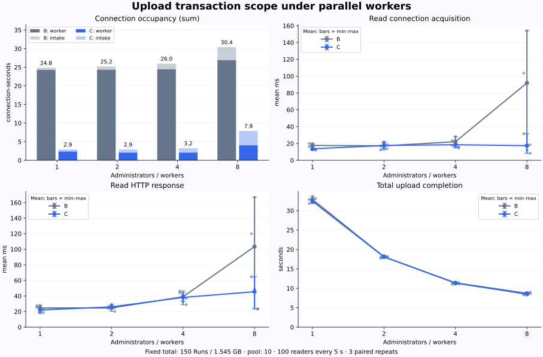

# 관리자·worker 확대에 따른 업로드 트랜잭션 B→C 비교

총 **150 Run·2,175파일·1,545,005,295바이트**를 고정하고, 관리자/worker를 **1/1 → 2/2 → 4/4 → 8/8**로 늘렸다. 단일 백엔드의 Hikari 풀은 계속 **10개**, 조회는 **100 VU가 5초마다 함께 요청**했다. B는 파싱 중 트랜잭션을 유지하고 C는 파싱 전후에만 연결을 사용한다. 아래 감소율은 `(B−C)/B`; 음수는 C가 더 오래 걸렸다는 뜻이다.

## 핵심 결과

**모든 worker 단계의 조회 통계는 B의 업로드 worker가 실제로 DB 연결을 점유하던 시점에 들어온 요청만 선택**하고, C의 같은 예약 회차·VU 요청과 짝지어 비교했다. 업로드 처리 전·종료 후 조회와 접수 작업만 연결을 점유한 조회는 제외했다. 지연이 큰 요청만 선택하거나 C의 빠른 구간을 따로 고르지 않았다. 관리자·worker **1·2·4개는 B/C 각 3회**, **8개는 1·2회차의 B/C 각 2회 배치 통계 평균**이다. 8개 worker의 3회차는 앞서 확인한 목표 동시 처리 조건 미충족으로 계속 제외한다.

연결 점유 합계·업로드 완료 시간은 같은 포함 배치의 **전체 업로드 구간** 값이며, 조회 통계만 실제 점유 시점으로 제한했다. 연결 획득에는 순수 대기 외 풀의 연결 검사 비용도 포함된다. HTTP 응답 시간에 연결 획득 시간이 이미 포함되므로 두 값을 더하지 않는다.

| 관리자 / worker | 업로드 연결 점유 합계(연결·초) | 조회 연결 획득 평균(ms) | 조회 HTTP 평균(ms) | 150개 업로드 완료(초) |
| --- | ---: | ---: | ---: | ---: |
| 1 / 1 | 24.837 → 2.910 (+88.3%) | 16.228 → 14.122 (+13.0%) | 23.029 → 22.273 (+3.3%) | 32.884 → 32.435 (+1.4%) |
| 2 / 2 | 25.187 → 2.898 (+88.5%) | 19.761 → 16.659 (+15.7%) | 26.297 → 25.503 (+3.0%) | 18.111 → 18.089 (+0.1%) |
| 4 / 4 | 25.964 → 3.223 (+87.6%) | 24.471 → 25.087 (-2.5%) | 41.115 → 39.850 (+3.1%) | 11.323 → 11.402 (-0.7%) |
| 8 / 8 | 30.563 → 8.191 (+73.2%) | 128.838 → 21.858 (+83.0%) | 143.470 → 56.580 (+60.6%) | 8.393 → 8.552 (-1.9%) |

**연결·초**는 모든 업로드 연결의 보유 시간을 더한 자원 사용량이다. 여러 연결이 동시에 사용되면 실제 경과시간보다 클 수 있다. 업로드 완료는 공통 전송 시작부터 모든 batch의 성공 확인까지이며, 아래 서버 창은 첫 업로드 요청 진입부터 마지막 job commit까지다.



**판정:** 연결 점유 감소는 모든 worker 단계의 포함 표본에서 확인했다. B의 실제 worker 점유 시점에 한정한 조회 HTTP 평균 감소율은 **1개 3.3%, 2개 3.0%, 4개 3.1%, 8개 60.6%**다. 1·2·4개에서는 반복마다 방향이 달라 안정적인 지연 개선으로 확정하지 않는다. worker 8개에서는 조회 획득 평균 **128.84→21.86ms(83.0% 감소)**, HTTP 평균 **143.47→56.58ms(60.6% 감소)**를 관측했다. 업로드 연결 점유 합계는 **30.563→8.191연결·초(73.2% 감소)**지만, 완료 시간은 **8.393→8.552초(1.9% 증가)**로 추가 단축되지 않았다. 이는 선택한 업로드 경합 구간의 관측이며 일반적인 서비스 전체 개선율은 아니다.

### 모든 worker에 적용한 조회 구간 선택

1. B의 성공한 `claim`·`job`과 해당 batch를 연결하고, `db.connection_held`의 시작·종료 시각을 수집한다. 업로드 접수(request)의 연결 점유만으로는 선택하지 않는다.
2. B 조회의 서버 진입 시각이 worker 연결 보유 구간 안에 있는지 확인한다. **연결 획득 시간이 길었는지, B→C가 개선됐는지는 선택 조건에 사용하지 않는다.**
3. 선택한 B 조회와 같은 `(반복, 예약 회차 cohort, VU)`의 C 조회를 짝짓는다. 서로 다른 실행의 절대 시각을 맞추는 것이 아니라 공통 5초 예약 순서를 맞춘다. C에서 연결을 반환해 점유가 없더라도 대응 요청을 그대로 포함한다.
4. 선택 요청으로 각 배치의 평균·p95를 다시 계산하고, 대표 값은 배치 평균의 평균을 사용한다. 조회가 늦게 끝났다는 이유로 제외하지 않는다. 연결 점유 합계와 업로드 완료 시간은 전체 업로드 구간을 유지한다.

이 규칙은 **B의 업로드 작업이 조회와 경합할 수 있는 구간**을 고르는 규칙이다. worker의 연결 점유만으로 실제 병목이나 지연의 단일 원인을 확정하지 않는다. 연결 획득 시간·실제 보유 연결 수·풀 상태를 함께 본다.

| worker | 각 반복의 조회 선택 | 3회차 처리 |
| --- | --- | --- |
| 1 | 매 반복 첫 묶음 제외, 이후 5묶음·500건/변형 포함 | 유효한 처리 중 조회가 있어 반복 유지 |
| 2 | 매 반복 첫 묶음 제외, 이후 2묶음·200건/변형 포함 | 유효한 처리 중 조회가 있어 반복 유지 |
| 4 | 1회차는 2묶음·200건, 2·3회차는 첫 묶음을 제외한 1묶음·100건/변형 포함 | 처리 중 마지막 묶음을 포함해 반복 유지 |
| 8 | 1·2회차 각 1묶음·100건/변형 포함 | 목표 동시 처리 조건 미충족으로 반복 전체 제외 유지 |

**1·2·4개 worker에도 처리 전 조회가 섞여 있었다.** 그러나 8개 worker의 3회차와 달리 이후 실제 처리 중 조회가 남으므로, 3회차를 통째로 제거하지 않고 같은 시점 선택 규칙을 적용했다. 실제 worker 점유 시점의 B/C 조회 **5,400건**을 대표 조회 집계에 포함했다.

4개 worker의 1회차 첫 묶음은 B가 4개 worker를 처리하고 연결 4개를 보유했지만 C는 worker 시작 전이었다. B 기준 시점 비교이므로 대응 C 요청도 유지했다. 따라서 결과에는 C의 처리 단계 차이·접수 경합·CPU 영향도 남아 있으며, 트랜잭션 분리만의 독립 인과 효과로 해석하지 않는다.

### worker 8개 표본 선택과 3회차 제외 사유

8개 worker의 각 배치에서 업로드와 겹친 조회는 **100건 한 묶음**이었다. 조회 시작 시 실제 처리 중이던 worker 수를 trace로 다시 확인했다.

| 반복 | B 활성 worker 평균 | C 활성 worker 평균 | 조회 HTTP B→C(ms) | 집계 여부 |
| --- | ---: | ---: | ---: | --- |
| 1 | 7.86 | 7.20 | 120.04 → 64.72 | 포함 |
| 2 | 8.00 | 8.00 | 166.90 → 48.44 | 포함 |
| 3 | 1.00 | 0.00 | 23.38 → 23.38 | **제외 — 업로드 경합 조건 미충족** |

첫 두 반복에서는 실제 활성 worker가 약 7~8개인 시점에 조회가 들어왔다. 세 번째는 B 평균 1개·C 평균 0개로, 다수 업로드 worker가 실제로 처리하며 조회와 경합하는 조건을 충족하지 못했다. 따라서 **8개 worker의 B3·C3 쌍을 대표 집계와 그래프에서 함께 제외**했다. 조회뿐 아니라 연결 점유·업로드 완료·구간별 비용·보조 관측도 같은 1·2회차 표본으로 다시 계산했다. 제외 이유는 개선율 크기가 아니라 **업로드 경합 조건 미충족**이다.

이 제외는 사전 자동 제외 규칙에 따른 처리가 아니라 **실행 후 trace를 확인하고 사용자와 합의한 사후 재집계**다. 3회차 원시 로그·측정값·정확성 검증 결과는 그대로 보존했다. 같은 평균 20req/s라도 실제 업로드 단계와 조회 시점이 얼마나 겹치는지가 중요하다. 포함된 8-worker 조회도 마지막 관리자의 접수 commit 이전에 시작했으므로, “모든 접수 완료 후 worker만 동작하는 구간”의 조회 비교는 할 수 없다.

## 같은 예약 조회를 짝지은 결과의 반복 일관성

| worker | 조회 획득 감소 반복 / 포함 반복 | HTTP 감소 반복 / 포함 반복 | B worker 점유 시점의 획득 평균 B→C(ms) | 대응 조회 HTTP 평균 B→C(ms) |
| --- | ---: | ---: | ---: | ---: |
| 1 | 1 / 3 | 1 / 3 | 16.228 → 14.122 (+13.0%) | 23.029 → 22.273 (+3.3%) |
| 2 | 2 / 3 | 2 / 3 | 19.761 → 16.659 (+15.7%) | 26.297 → 25.503 (+3.0%) |
| 4 | 2 / 3 | 2 / 3 | 24.471 → 25.087 (-2.5%) | 41.115 → 39.850 (+3.1%) |
| 8 | 2 / 2 | 2 / 2 | 128.838 → 21.858 (+83.0%) | 143.470 → 56.580 (+60.6%) |

모든 단계에 동일한 B worker 연결 점유 시점 선택 규칙을 적용하고, 같은 예약 회차·VU의 B/C 요청을 짝지었다. 포함 반복 수는 1·2·4개 worker에서 3회, 8개에서 2회다. 반복 번호를 같게 만들기 위해 유효한 3회차를 버리지 않았다. 개별 HTTP 요청 수를 독립 실험 횟수로 보거나 통계적 유의성을 주장하지 않는다.

## 연결 점유의 위치와 실제 풀 상태

이 절의 점유 합계·Hikari 표본은 포함 배치의 **전체 업로드 구간** 기준이다. 위의 실제 worker 점유 시점 조회와 관측 범위가 다르며, 순간 표본만으로 조회 지연 원인을 단정하지 않는다.

| worker | 접수 점유 B→C(연결·초) | worker 점유 B→C(연결·초) | Run당 전체 점유 B→C(ms) | 활성 worker 실제 최대 B/C | Hikari active 최대 B/C | pending 최대 B/C |
| --- | ---: | ---: | ---: | ---: | ---: | ---: |
| 1 | 0.564 → 0.559 (+0.9%) | 24.273 → 2.351 (+90.3%) | 165.58 → 19.40 | 1/1 | 10/10 | 65/90 |
| 2 | 0.846 → 0.833 (+1.5%) | 24.341 → 2.065 (+91.5%) | 167.91 → 19.32 | 2/2 | 10/10 | 92/90 |
| 4 | 1.508 → 1.159 (+23.2%) | 24.455 → 2.064 (+91.6%) | 173.09 → 21.48 | 4/4 | 10/10 | 42/72 |
| 8 | 3.334 → 3.988 (-19.6%) | 27.228 → 4.203 (+84.6%) | 203.75 → 54.61 | 8/8 | 10/10 | 102/73 |

접수에는 원본 보관·메타데이터 게시와 기존 전역 advisory lock이 포함된다. 이 잠금은 제거하지 않았다. worker 점유는 성공 claim과 준비·게시 또는 B의 전체 처리 트랜잭션을 포함한다. 빈 큐 polling 연결·상태 조회·일반 조회의 점유는 업로드 점유 합계에서 제외했다. pending은 조회뿐 아니라 worker·접수·상태 확인을 포함한 전체 연결 대기 요청 수다. 실제 풀 상태는 Hikari MXBean 100ms 표본이다. 짧은 순간을 놓칠 수 있어 pending 최대치 하나만으로 성능을 판정하지 않는다.

| worker | pending>0 표본 비율 B/C | 파싱 동시 실행 최대 B/C | 활성 worker 평균 B/C | 접수 완료 후 조회 획득 B→C(ms) | 접수 완료 후 HTTP B→C(ms) |
| --- | ---: | ---: | ---: | ---: | ---: |
| 1 | 0.42% / 0.53% | 1/1 | 0.73/0.73 | 16.228 → 14.122 (+13.0%) | 23.029 → 22.273 (+3.3%) |
| 2 | 0.59% / 1.38% | 2/2 | 1.33/1.33 | 19.761 → 16.659 (+15.7%) | 26.297 → 25.503 (+3.0%) |
| 4 | 1.26% / 1.22% | 4/4 | 2.14/2.18 | 27.771 → 21.647 (+22.1%) | 42.263 → 36.787 (+13.0%) |
| 8 | 6.88% / 1.23% | 8/8 | 3.27/3.29 | N/A · 해당 구간 조회 0건 | N/A · 해당 구간 조회 0건 |

## 실제 worker 점유 시점의 반복별 조회 재집계

| worker | 반복 | 포함 조회/변형 | 예약 회차 | 연결 획득 평균 B→C(ms) | HTTP 평균 B→C(ms) |
| --- | --- | ---: | --- | ---: | ---: |
| 1 | 1 | 500 | 3, 4, 5, 6, 7 | 16.596 → 16.922 | 23.470 → 26.040 |
| 1 | 2 | 500 | 3, 4, 5, 6, 7 | 19.078 → 12.267 | 27.230 → 18.508 |
| 1 | 3 | 500 | 3, 4, 5, 6, 7 | 13.009 → 13.178 | 18.386 → 22.272 |
| 2 | 1 | 200 | 3, 4 | 21.581 → 12.829 | 27.370 → 25.490 |
| 2 | 2 | 200 | 3, 4 | 23.854 → 16.759 | 30.110 → 24.010 |
| 2 | 3 | 200 | 3, 4 | 13.849 → 20.389 | 21.410 → 27.010 |
| 4 | 1 | 200 | 2, 3 | 23.428 → 17.856 | 46.435 → 44.190 |
| 4 | 2 | 100 | 3 | 24.938 → 36.515 | 42.030 → 46.460 |
| 4 | 3 | 100 | 3 | 25.046 → 20.890 | 34.880 → 28.900 |
| 8 | 1 | 100 | 2 | 103.597 → 31.544 | 120.040 → 64.720 |
| 8 | 2 | 100 | 2 | 154.079 → 12.171 | 166.900 → 48.440 |
| 8 | 3 · 집계 제외 | 0 | 목표 동시 처리 조건 미충족 | — | — |

cohort는 부하 발생기가 붙인 예약 회차 번호다. 1개 worker의 3회차에서도 B가 연결 1개를 보유한 조회 500건, 2개에서는 연결 2개를 보유한 조회 200건, 4개에서는 연결 4개를 보유한 조회 100건이 있어 각각 유지했다. 8개 worker의 3회차는 앞서 확인한 B 활성 worker 평균 1개·C 0개로, 8개 worker가 동작하는 경합 비교에서 제외한다.

## 전체 업로드 창의 반복별 원시 집계

아래는 **처리 전 조회와 제외 시행까지 포함한 최초 전체 업로드 창의 실행 기록**이다. 이 표의 조회 값은 원시 기록 보존용이며, 위에서 다시 계산한 실제 worker 점유 시점 조회 평균과 다를 수 있다. 8개 worker의 B3·C3는 업로드 경합 조건 미충족으로 대표 평균·최댓값·그래프 계산에서 제외했지만, 측정값 자체는 변경하지 않았다.

| worker | 변형/반복 | 점유 합계(연결·초) | 획득 평균 / p95(ms) | HTTP 평균 / p95(ms) | 업로드 완료(초) | 겹친 조회 / 묶음 |
| --- | --- | ---: | ---: | ---: | ---: | ---: |
| 1 | B1 | 23.559 | 19.982 / 46.375 | 27.518 / 57.000 | 31.840 | 600 / 6 |
| 1 | C1 | 2.944 | 16.406 / 35.197 | 25.450 / 45.000 | 32.890 | 600 / 6 |
| 1 | B2 | 25.479 | 19.911 / 53.890 | 28.038 / 59.000 | 33.681 | 600 / 6 |
| 1 | C2 | 2.890 | 12.426 / 27.343 | 18.368 / 33.000 | 32.422 | 600 / 6 |
| 1 | B3 | 25.472 | 13.143 / 26.599 | 18.357 / 33.000 | 33.132 | 600 / 6 |
| 1 | C3 | 2.895 | 12.014 / 31.070 | 22.107 / 46.000 | 31.994 | 600 / 6 |
| 2 | B1 | 24.945 | 16.956 / 38.528 | 26.313 / 46.200 | 17.708 | 300 / 3 |
| 2 | C1 | 2.812 | 12.513 / 31.516 | 23.967 / 41.050 | 18.032 | 300 / 3 |
| 2 | B2 | 25.338 | 20.597 / 43.275 | 27.193 / 48.050 | 18.479 | 300 / 3 |
| 2 | C2 | 2.818 | 21.873 / 43.685 | 29.120 / 51.000 | 18.186 | 300 / 3 |
| 2 | B3 | 25.278 | 13.908 / 28.855 | 20.283 / 35.050 | 18.146 | 300 / 3 |
| 2 | C3 | 3.065 | 18.457 / 40.480 | 25.037 / 49.000 | 18.049 | 300 / 3 |
| 4 | B1 | 26.230 | 23.428 / 83.788 | 46.435 / 92.050 | 10.996 | 200 / 2 |
| 4 | C1 | 2.973 | 17.856 / 43.044 | 44.190 / 76.000 | 11.510 | 200 / 2 |
| 4 | B2 | 26.237 | 28.184 / 60.333 | 41.855 / 76.000 | 11.475 | 200 / 2 |
| 4 | C2 | 3.432 | 21.898 / 59.844 | 33.045 / 67.000 | 11.608 | 200 / 2 |
| 4 | B3 | 25.424 | 14.633 / 58.346 | 28.755 / 67.050 | 11.498 | 200 / 2 |
| 4 | C3 | 3.262 | 15.657 / 43.065 | 37.230 / 78.000 | 11.089 | 200 / 2 |
| 8 | B1 | 29.874 | 103.597 / 151.558 | 120.040 / 180.050 | 8.333 | 100 / 1 |
| 8 | C1 | 9.298 | 31.544 / 66.507 | 64.720 / 105.050 | 8.503 | 100 / 1 |
| 8 | B2 | 31.251 | 154.079 / 180.319 | 166.900 / 201.000 | 8.452 | 100 / 1 |
| 8 | C2 | 7.084 | 12.171 / 43.918 | 48.440 / 82.000 | 8.602 | 100 / 1 |
| 8 | B3 · **집계 제외** | 30.036 | 18.313 / 40.480 | 23.380 / 48.000 | 8.600 | 100 / 1 |
| 8 | C3 · **집계 제외** | 7.252 | 8.360 / 29.163 | 23.380 / 47.050 | 8.986 | 100 / 1 |

worker 4·8개에서는 업로드와 겹치는 조회 묶음이 3개 미만인 배치가 있다. 해당 구간의 p95와 반복 평균은 제한된 순간 동시 요청 관측으로 해석해야 한다. 특히 8개 worker의 대표 값은 포함된 두 반복에서 각각 동시 조회 한 묶음씩 관측한 평균이다. p95는 각 배치에서 산출했다. 본문 평균 p95는 배치 p95의 평균이며 전체 요청을 합친 p95가 아니다. 업로드와 겹쳐 시작한 조회는 늦게 완료되더라도 집계에 남겼다.

## 대기·파싱·저장 구간

아래 합계는 병렬 작업의 누적 처리 시간이다. 전체 업로드 완료 시간과 더하거나 빼서 원인별 기여도를 계산할 수 없다.

| worker | 개별 job 대기 평균 B→C(ms) | 파일 복사·해시 합계 B→C(ms) | 파싱 합계 B→C(ms) | worker DB execute 합계 B→C(ms) | 서버 업로드 창 B→C(초) |
| --- | ---: | ---: | ---: | ---: | ---: |
| 1 | 12414.694 → 12102.684 (+2.5%) | 3663.5 → 3660.4 | 22090.9 → 21537.5 | 1813.3 → 1916.7 | 32.811 → 32.324 (+1.5%) |
| 2 | 6121.621 → 5970.616 (+2.5%) | 5429.7 → 5666.6 | 22375.0 → 22247.8 | 1615.2 → 1650.7 | 17.996 → 17.975 (+0.1%) |
| 4 | 3021.745 → 2873.722 (+4.9%) | 9762.4 → 10213.5 | 22601.3 → 22969.1 | 1482.0 → 1569.1 | 11.224 → 11.295 (-0.6%) |
| 8 | 1397.851 → 1411.966 (-1.0%) | 16516.4 → 15989.7 | 24270.5 → 24985.5 | 2268.0 → 3275.3 | 8.313 → 8.468 (-1.9%) |

job 대기는 각 관리자 batch의 QUEUED commit부터 해당 job의 성공 claim 완료까지다. 직전 job 종료와 다음 job 시작의 차이를 사용하지 않았다. 파일·파싱 알고리즘은 B/C가 같으므로 이 구간 변화 자체를 별도 최적화 효과로 주장하지 않는다.

### 접수·worker 연결 획득과 게시 비용

| worker | 접수 getConnection 평균 B/C(ms) | worker getConnection 평균 B/C(ms) | worker SQL 호출 B/C | worker commit 횟수 B/C | worker commit 누적 B/C(ms) |
| --- | ---: | ---: | ---: | ---: | ---: |
| 1 | 0.74 / 1.05 | 0.01 / 0.06 | 2550.00 / 2850.00 | 300.00 / 450.00 | 201.43 / 263.91 |
| 2 | 0.01 / 0.01 | 0.00 / 0.04 | 2550.00 / 2850.00 | 300.00 / 450.00 | 192.73 / 248.89 |
| 4 | 0.17 / 0.18 | 0.01 / 0.03 | 2550.00 / 2850.00 | 300.00 / 450.00 | 194.68 / 309.89 |
| 8 | 20.64 / 0.07 | 4.01 / 0.23 | 2550.00 / 2850.00 | 300.00 / 450.00 | 344.91 / 588.11 |

C는 파싱 중 연결을 반환하는 대신 준비·게시 트랜잭션과 게시 전 중복 확인이 추가된다. 연결 점유를 줄이는 효과와 SQL/commit 비용 증가는 함께 존재한다. 이 표는 성공한 150개 job의 claim과 처리만 포함하며 빈 큐 polling을 제외한다.

## 접수 잠금·CPU 등 보조 관측

| worker | 접수 advisory lock SQL 합계 평균 B/C(ms) | idle in transaction 표본 최대 B/C | Java CPU 표본 최대 B/C(%) | Java RSS 최대 B/C(MiB) |
| --- | ---: | ---: | ---: | ---: |
| 1 | 0.09 / 0.04 | 1.00 / 1.00 | 144.90 / 106.80 | 698.73 / 778.02 |
| 2 | 189.13 / 157.96 | 2.00 / 1.00 | 225.20 / 208.10 | 768.95 / 872.28 |
| 4 | 668.11 / 391.32 | 4.00 / 1.00 | 406.80 / 441.30 | 1010.09 / 986.20 |
| 8 | 1988.02 / 2579.19 | 8.00 / 2.00 | 765.30 / 732.70 | 1172.78 / 1148.11 |

접수 advisory lock SQL 시간은 PostgreSQL이 측정한 실행 시간이며, lock 획득 후 전체 보유 시간은 아니다. `idle in transaction`은 애플리케이션이 트랜잭션을 연 채 다음 명령을 보내지 않는 상태의 표본이다. B의 파싱 구간에서 최대 8개가 관측됐으며, DB가 8개 SQL을 동시에 실행했다는 뜻은 아니다.
Java CPU는 OS 표본 값으로 100%가 논리 코어 하나에 해당한다. 병렬 파싱은 CPU도 사용하므로 HTTP 지연을 전부 DB 풀 대기만의 효과로 분해할 수 없다. 약 2초 간격 표본의 순간 최대이며 CPU 전용 프로파일링 결과가 아니다. JVM 오류·DB 데드락·OOM은 실행 로그에서 별도로 확인했다.

### 고정 입력 분할

| 관리자 | 관리자별 Run 수 | 관리자별 원본 바이트 |
| --- | --- | --- |
| 1 | 150 | 1545005295 |
| 2 | 75, 75 | 773266969, 771738326 |
| 4 | 38, 38, 37, 37 | 386814546, 386702051, 386552540, 384936158 |
| 8 | 19, 19, 19, 19, 19, 19, 18, 18 | 193614345, 191864969, 193083260, 193688733, 193038676, 193577377, 192983008, 193154927 |

각 단계의 분할표는 B/C와 모든 반복에서 동일하게 사용했다. 전체 150개를 나눴으며 관리자마다 150개를 업로드한 실험이 아니다.

## 정확성·실험 구성

- 변경 전 테스트를 먼저 추가해 병렬 실행 기능 부재를 확인한 뒤 구현했다. 최초 인공 단위 테스트는 허용 조건 격자를 벗어난 값을 사용해 실패했으며, 허용된 압력·소스 조합으로 수정했다. 제품의 검증 규칙은 완화하지 않았다.
- 제품 C 백엔드 전체 JUnit/Testcontainers **172개**, B 병렬·스케줄링·파이프라인 **21개**, Python 기존/신규 harness **32개**를 통과했다.
- 실제 PostgreSQL에서 2·4·8개 동시 파싱, 각 job 1회 처리, 같은 job 중복 진입, 같은 원본 중복 게시, 같은 조건의 다른 원본 갱신, 실패 격리, 현재 포인터·버전 rollback을 확인했다. B는 파싱 시 트랜잭션 활성, C는 비활성도 검사했다.
- 각 worker가 독립적으로 연속 처리를 예약하며 `FOR UPDATE SKIP LOCKED`로 작업 선택과 PROCESSING 점유를 한 트랜잭션에 묶는다. 제품 기본 worker는 1개다. 실험에서만 1·2·4·8로 설정했다.
- B/C 소스 차이는 `ImportWorker.processClaimed`의 파싱 트랜잭션 범위뿐이다. 병렬 스케줄러·원자적 claim·계측은 동일하다. 따라서 과거 단일 worker 빌드의 측정값과 섞지 않았다.
- 여기서 관리자는 로그인 계정이 아닌 독립된 동시 업로드 HTTP 클라이언트다. worker는 관리자별 전용이 아니라 공유 큐에서 작업을 가져온다.
- 관리자별로 Run 파일 묶음을 통째로 분할했다. 파일 바이트 크기를 파싱 비용의 대리값으로 균형화했고, Run 수 차이는 최대 1개다. 실제 파싱 비용을 정확히 같게 맞췄다는 뜻은 아니다. 부속 파일을 포함해 전체 입력은 한 번씩만 전달했다.
- 각 반복 전에 전용 DB·보관소를 3개 과거 버전 seed로 복원했다. 147개 신규·3개 갱신으로 current 150·version 153을 검증했다. 조회는 고정 과거 3개 버전이며 전체 응답 SHA-256을 확인한다.
- 각 단계 순서는 B1→C1→C2→B2→B3→C3. 변형/worker가 바뀌면 JVM 재기동 후 같은 8개 Run으로 워밍업했다. 연속 같은 변형의 반복은 JVM을 재사용했고 초기 데이터는 매번 복원했다.
- k6 첫 조회 시점으로부터 5초 후 관리자 업로드를 동시에 시작했다. 모든 job 최종 commit·batch 성공 이후 다음 조회 묶음 완료까지 수집하고 종료했다. 업로드 관측 상한 60초, k6 최대 70초, 새 배치 시작 30분/전체 35분 상한을 적용했다.

### 측정 도구 사전 실행에서 발견한 문제

최초 B-w1 실행에서 제품 요청은 정상 완료됐지만 k6 SIGINT가 다음 5초 sleep을 깨우면서 미래 요청 13개를 즉시 시도해 status 0으로 기록했다. 이 실행은 본 비교에 포함하지 않고 `setup-stop-diagnostic/`에 보존했다. 예정 시각 전에는 요청을 발행하지 않도록 guard를 추가하고 B1부터 다시 시작했다. 유효한 조회 실패를 통계에서 제거한 것이 아니라 부하 발생기의 종료 동작을 수정한 것이다.

## 사용 도구와 측정 범위

| 도구 | 용도 |
| --- | --- |
| k6 2.3.0 · constant-vus | 100명 공통 5초 조회, 요청 예정/실제 시각·HTTP 시간·상태·응답 해시 |
| Python 3.13.7 | 150개 입력 분할, 관리자 동시 multipart 업로드, 반복·시간 상한 제어, 원본/전체 샘플 검증·통계 |
| JUnit / Testcontainers | 실제 PostgreSQL에서 병렬 처리·중복·버전·롤백 정확성 |
| Java/JDBC 구간 계측 | request/batch/job 연계, 연결 획득·보유, 파일 복사·파싱·SQL·commit |
| Hikari MXBean | 100ms마다 실제 active·idle·pending과 풀 크기 확인 |
| PostgreSQL 18.6 | pg_stat_statements SQL 횟수/실행 시간, pg_stat_activity 잠금·I/O 대기 |
| OS / Docker | 약 2초 간격 Java/k6 CPU·RSS, DB CPU·메모리·I/O·대기, 호스트 메모리 압박 |
| Matplotlib | 인공 성능 집계의 비교 그래프 |

LLM·Phoenix·pgbench는 사용하지 않았다. 실제 HTTP 업로드와 조회·파서·DB 경로를 측정하며 LLM 비용은 발생하지 않는다. JFR/GC 상세 프로파일링은 이번 비교에 포함하지 않았다.

## 실행 환경·재현

- macOS 15.7.9, Mac16,8, 논리 CPU 12개·메모리 24GiB. OpenJDK 21.0.12, JVM Xms256m/Xmx2g.
- Docker PostgreSQL 18.6-alpine3.24, CPU 2개·메모리 3GiB 제한. 단일 JVM/단일 Hikari 풀 max/minIdle=10. 로컬 loopback HTTP.
- 전용 DB와 보관소를 사용했다. 다른 로컬 서비스 컨테이너는 그대로 실행 중이므로 전용 하드웨어 실험은 아니다.
- 인공 입력·원시 trace·개별 조회·DB·JAR는 `.local/performance/upload-worker-contention-20261016/`에 Git 제외 보관. 실험은 제품 DB를 수정하지 않는다.
- B JAR SHA-256: `9c1b75a5aabfeefe418541bb09bf1a7fc544663d48a82fc899a4f0e6eea83a15`.
- C JAR SHA-256: `cd8b07aa72d93e03b9861c138f3946890b273bcfd51c9f5229c707ddf18c276d`.
- [테스트 계획](../plans/2026-10-16-업로드-worker-확대와-DB-연결-점유-B-C-비교-테스트-계획.md), [실행 도구](../../scripts/performance/upload_worker_benchmark.py), [병렬 집계](../../scripts/performance/analyze_upload_workers.py), [B 기준선 패치](../../scripts/performance/upload-worker-b-baseline.patch).

```sh
# 인공 fixture·과거 버전 seed 준비는 scripts/performance/README.md의 기존 절차를 사용
# C: backend/gradlew -p backend test bootJar
# B: backend를 Git 제외 별도 폴더에 복사(build/.gradle 제외)한 뒤
# patch -d <B-source> -p1 < scripts/performance/upload-worker-b-baseline.patch
# BENCHMARK_PARSING_TRANSACTION=true <B-source>/gradlew -p <B-source> test \
#   --tests '*ImportParallelWorkerTest' --tests '*ImportWorkerSchedulingTest' --tests '*ImportPipelineTest' bootJar
# 각각의 JAR를 <builds>/B.jar, <builds>/C.jar로 보관
python3 scripts/performance/upload_worker_benchmark.py \
  --builds <builds> --seed-artifacts <seed와queries.json경로> \
  --fixture <인공upload경로> --output <새결과경로> \
  --container kplasma-upload-benchmark-<전용이름>
python3 scripts/performance/analyze_upload_workers.py <새결과경로>
```

## 완료·한계

본 측정 실행·정확성 검증은 **24/24회** 완료했고, 대표 성능 집계에는 **22회**를 포함했다(1·2·4개 worker 각 6회, 8개 worker 4회). 8개 worker의 3회차 B/C 2회는 업로드 경합 조건 미충족으로 제외했다. 실행 상태 `complete`, 본 측정 묶음 경과 **12.1분**(준비·코드 검증·결과 문서 작성 제외). 업로드 **3,600개** 정합성 검증, 조회 **14,400건**을 기록했다. HTTP/응답 해시 오류 **0건**, 예정 조회 누락 **0건**이다.

관리자·worker를 함께 변경했으므로 worker 증가만의 독립 효과와 관리자의 접수 경합 효과를 완전히 분리한 실험은 아니다. 조회 단독 대조군·지속 업로드·최대 처리량·실제 사용자 수용 한도·Agent 전체 응답 개선을 검증하지 않았다. 계측은 양쪽에서 동일하게 활성화했으며 로그 기록 비용도 포함된다. 개선 방향이 반복마다 다르면 평균 관측값을 안정적인 성능 개선율로 확대하지 않는다.

## 이번 보고서 수정 검증

원시 `aggregate.json`과 24개 실행 기록은 변경하지 않고 기존 원시 정밀도로 재집계했다. 모든 worker의 조회 평균·p95·반복점·그래프 범위에는 B 실제 worker 연결 점유 시점과 대응 C 요청을 사용했다. 1·2·4개 worker의 유효한 3회차는 유지했고, 8개 worker의 3회차만 기존 제외 결정을 유지했다. 새 집계는 로컬 `contention-aggregate.json`, 시점 대조는 `query-overlap-audit.json`으로 보관한다. 문서·그래프 수정이므로 부하 테스트와 제품 테스트는 다시 실행하지 않았다.
