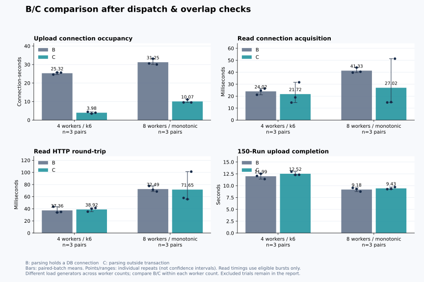

# 조회 발송 시각 감사와 B/C 통제 재검증

최신 결과: [worker 8개 처리 시점 동기화 재측정](2026-10-16-worker-8개-처리-시점-동기화-B-C-재측정.md) — 최종 3쌍 전체 평균: 조회 응답 50.4%, 업로드 DB 연결 누적 점유 75.6% 감소. 아래는 이전 실험 이력이다.

> 후속 [기존 k6·5초 조회·서버 재사용 조건 복원 실험](2026-10-16-기존-업로드-실험-조건-복원-B-C-재측정.md)을 별도로 기록했다. 설정을 복원했지만 조회 시점에 양쪽 여러 worker가 실행 중인 쌍이 없었으므로, 새로운 고정 시점 평균을 경합 개선율로 확정하지 않는다. 각 실험 수치를 합산하지 않는다.

## 결론

**발송 조건을 통제한 뒤에도 안정적인 HTTP 응답 개선은 재현되지 않았다.** worker4는 연결 획득 24.024→21.723ms(9.6% 감소), HTTP 37.360→38.920ms(4.2% 증가)였다. worker8은 연결 획득 41.329→27.022ms(34.6% 감소), HTTP 72.487→71.646ms(1.2% 감소)였다. 각각 유효3쌍 평균이며, worker8에서도 두 쌍은 HTTP가 줄고 한 쌍은 늘었다. 업로드 연결 점유 감소와 사용자 응답 개선을 구분해야 한다.

기존 worker 4개 2회차의 조회 100건은 B/C 모두 약 1ms 안에 호출했다. B의 서버 진입이 29.193ms에 걸쳐 발생한 것을 클라이언트가 29ms에 걸쳐 발송한 것으로 해석하면 안 된다. 발송 이후 네트워크·서버 진입 전 스케줄링은 이 로그로 분리하지 못한다.

worker 8개에서는 실제 예약 시각을 검증할 때 벽시계 변화가 혼입됐다. 기존 C1의 Python 벽시계 경과와 단조 경과시간 차이는 +53.687ms였고, 당시 k6 예약 지연은 54~56ms였다. 이를 순수한 부하 발생기 지연으로 확정할 수 없다. 첫 재측정 C1에서는 -4,959.471ms 차이와 cohort3의 100건 전체 누락이 발생해 실행 검증이 실패했다. 이 시행은 성능 대표값에 넣지 않았다. 시계 변화의 원인(NTP 등)은 확인하지 못했다.

아래는 기존 결과와 합산하지 않는 별도 재검증이다. worker4는 시계가 안정적인 k6 재측정 3쌍, worker8은 단조 경과시간 기반 Node.js 발생기로 재측정했다. 각 행 내부의 B/C는 같은 도구·발송 일정·요청을 사용한다. worker4/8 사이의 차이를 worker 확대만의 효과로 해석하지 않는다.

## 기존 요청 시각 확인

`startEpochMs`는 실제 네트워크 패킷 시각이 아니라 k6 `http.get` 호출 직전 시각이다. 해상도는 1ms이므로 0ms 폭은 같은 ms에 기록됐다는 뜻이다. 서버 진입은 가장 앞쪽 Servlet filter의 단조 시각이며 커널 수신 시각이 아니다.

| worker4 반복 | B/C HTTP 호출 폭(ms) | B/C 서버 filter 진입 폭(ms) | 요청 구성 |
| --- | ---: | ---: | --- |
| 1 · cohort3 | 1 / 1 | 26.401 / 38.865 | 각100건, 대상별 개수 동일 |
| 2 · cohort3 | 1 / 0 | 29.193 / 1.950 | 각100건, 대상별 개수 동일 |
| 3 · cohort3 | 2 / 0 | 7.817 / 6.512 | 각100건, 대상별 개수 동일 |

문제가 된 2회차의 예약 대비 호출 지연은 B 0~1ms, C 1ms다. 클라이언트 연결 준비 시간(blocked)도 평균 B 약0.001ms, C 약0.003ms였다. “C에만 조회를 훨씬 몰아서 보냈기 때문에 연결 획득이 늘었다”는 설명은 이 관측으로 지지되지 않는다. CPU·GC·네트워크·서버 스케줄링 중 어느 것이 filter 진입 폭 차이를 만들었는지는 별도 프로파일링 없이 단정하지 않는다.

## 재측정 조건

- 단일 JVM, pool max/minIdle=10, 150 Run·2,175파일·1,545,005,295바이트의 동일 인공 입력. 147개 신규+3개 갱신, 최종150 Run/153버전 검증.
- B/C JAR는 기존과 동일. 제품 코드 변경 없이 모든 시행에서 JVM 재시작 및 동일8Run 예열. B1,C1,C2,B2,B3,C3 순서로 비교.
- 동일 VU·예약 회차에는 동일 Run 버전을 조회하도록 대상 결정 규칙을 고정했다. 100개 연결/사용자가 5초마다 한 번씩 동시에 조회한다.
- 사전 발송 기준: 호출 폭<=5ms, 예약 지연0~5ms, B/C 호출 폭 차이<=3ms, 평균 예약 지연 차이<=3ms. 통계적으로 완전히 동일한 wire 부하를 보장하는 수치가 아니라 운용 허용오차다.
- 양쪽 평균 활성 worker가 설정치75% 이상이고 B의 업로드 연결 점유가75% 이상인 동일 예약 묶음을 선택한다. C의 연결 점유나 지연 개선 여부는 선택 조건에 쓰지 않는다. HTTP오류/해시불일치/누락도 별도로 검증한다.
- worker4는 업로드 시작 약10초 뒤의 cohort3이 조건을 충족했다. worker8은 실패 시행의 job 구간을 근거로 추가 측정 전에 업로드 시작을 부하 발생+3초로 고정했다. 조회cohort2는 업로드 시작 약7초 뒤다. worker를 인위적으로 대기시키지 않았다.
- worker8의 추가4회차까지 포함한 유효표본은 1·2·4회차다. 3회차는 사전 동시 처리 조건 미충족으로 아래에 별도 보존했다.

- worker8의 Node.js `performance.now()`는 예약·호출·쓰기 완료·응답 완료 계측에 사용한다. wall clock은 진단용으로만 남긴다. 쓰기 완료는 Node가 요청 데이터를 전송 계층에 넘긴 시점이며 패킷 캡처는 아니다.

[측정 전 계획과 변경 근거](../plans/2026-10-16-조회-발송-시각-통제-재검증.md)를 보존했다. 새 기준을 기존 보고서에 소급 적용해 유리한 결과를 재작성하지 않았다.

## 조건을 통과한 비교

| worker | 유효 B/C쌍 | 연결 획득 평균 B→C(ms) | HTTP 평균 B→C(ms) | 업로드 연결 점유 B→C(연결·초) | 업로드 완료 B→C(초) |
| --- | ---: | ---: | ---: | ---: | ---: |
| 4 | 3 | 24.024 → 21.723 (+9.6%) | 37.360 → 38.920 (-4.2%) | 25.317 → 3.975 (+84.3%) | 11.987 → 12.516 (-4.4%) |
| 8 | 3 | 41.329 → 27.022 (+34.6%) | 72.487 → 71.646 (+1.2%) | 31.249 → 10.065 (+67.8%) | 9.183 → 9.430 (-2.7%) |

감소율은 `(B−C)/B`다. 음수는 C가 더 오래 걸린 것이다. 각 시행의 선택 요청 평균을 먼저 계산하고, 시행 평균의 평균을 사용한다. 업로드 점유와 완료 시간은 유효 쌍의 전체 업로드 구간이며 조회 선정 구간과 측정 범위가 다르다.

| worker / 반복 | 선정 cohort | B/C 호출 폭 최대(ms) | B/C 예약 지연 최대(ms) | 연결 획득 B→C(ms) | HTTP B→C(ms) |
| --- | --- | ---: | ---: | ---: | ---: |
| 4 / 1 | 3 | 1.000 / 0.000 | 2.000 / 1.000 | 21.145 → 14.624 | 43.480 → 35.240 |
| 4 / 2 | 3 | 1.000 / 0.000 | 1.000 / 1.000 | 24.626 → 18.947 | 33.850 → 40.170 |
| 4 / 3 | 3 | 1.000 / 0.000 | 1.000 / 1.000 | 26.302 → 31.599 | 34.750 → 41.350 |
| 8 / 1 | 2 | 2.649 / 3.376 | 3.920 / 4.220 | 39.690 → 14.731 | 77.599 → 57.872 |
| 8 / 2 | 2 | 3.481 / 2.998 | 4.149 / 4.118 | 43.908 → 15.016 | 71.392 → 55.814 |
| 8 / 3 | 조건 미충족 | — | — | — | — |
| 8 / 4 | 2 | 1.778 / 2.744 | 3.181 / 2.770 | 40.389 → 51.320 | 68.472 → 101.251 |



## 해석

worker4는 발송 기준을 통과한 뒤에도 반복별 HTTP 개선 방향이 엇갈렸다. 연결 획득만 빨라져도 전체 HTTP 응답이 반드시 빨라지는 것은 아니다. 클라이언트 왕복시간에는 filter 진입 전 처리·통신·응답 반환도 포함되며, 이 구간의 변동과 서버 내 다른 처리 비용이 남아 있다. 연결 점유 감소는 자원 사용량의 개선으로 해석하고, 소수 반복의 평균 차이를 안정적인 사용자 응답 개선율로 확대하지 않는다.

worker8도 동시 조회 한 묶음씩의 제한된 표본이다. 기존 보고서의83.0%/60.6%를 새로운 조건에서도 재현된 보편적 개선율로 유지하지 않는다. 새 결과는 위에 명시한 발송·업로드 동시 처리 조건에 한정한다. 조회 단독 대조군, 최대 처리량, 실제 사용자 수용 한도는 이번에 측정하지 않았다.

## 도구·검증·보관

최종 검증: 측정 도구 테스트 **36/36 통과**, Node 문법 검사·Git diff 공백 검사 통과. 첫 재측정에서 7시행 정합성 검증 후 1시행은 시각 오류에 따른 조회 누락으로 중단했고, Node 후속 8시행은 모두 정합성 검증을 완료했다. 총15시행에서150개씩, **2,250 Run 등록을 검증**했다. 기록된 HTTP7,200건은 응답/해시 오류0건이며, 실패 시행의 예정 조회100건 누락은 별도로 남겼다. 대표 비교는 유효6쌍의 조회 **1,200건**이다. 마지막 측정 뒤 전용DB의seed복구와 테스트서버·DB종료를 완료했다.


- **k6**: 기존 로그 감사와 시계가 안정적인 worker4 재측정. HTTP호출 직전 시각·응답·해시를 수집했다.
- **Node.js 기본 HTTP/perf_hooks**: worker8의 단조 시각 기반 동시 발송. 외부 의존성이나 제품 mock 없이 실제 백엔드를 호출했다. 서버 시작 시각을 강제로 맞추지는 않았다.
- **Python**: 동일파일 병렬업로드, JVM/전용DB 제어, 예정/호출/서버/JDBC 시각 연결, 선정 기준 감사·집계.
- **Java/JDBC/Hikari 계측**: 기존 계측으로 worker·연결 획득·점유·pool 상태 확인. **PostgreSQL**: 버전·결과 정합성 검증. LLM/Phoenix 호출 없음.
- 벽시각을5초 되돌리는 로컬HTTP 회귀시험: 100사용자×2묶음=200요청, 누락0건. 이 시험은 실제 OS시계를 바꾸지 않고 발생기 프로세스의Date.now만 모의 변경한다.
- `python3 -m unittest discover -s scripts/performance -p 'test_*upload*.py'` 및 `node --check scripts/performance/upload_query_monotonic.mjs`로 측정 도구를 검증했다. 제품 Java코드는 바꾸거나 재빌드하지 않았다.

원시자료와 정확성 검증은 Git 제외 `.local/performance/upload-dispatch-control-20261016/`에 보관한다. `original-dispatch-audit.json`은 과거24시행 감사, `experiment/`는 첫 재측정(시계 오류 시행 보존), `monotonic-worker8/`와 `monotonic-worker8-extra/`는 worker8후속측정, `controlled-summary.json`은 통과표본 집계다. 기존 원시 실험을 덮어쓰지 않았다.

[k6 공식 execution API](https://grafana.com/docs/k6/latest/javascript-api/k6-execution/)의currentTestRunDuration은 실행시간 표시 기능이다. [공식 구현](https://github.com/grafana/k6/blob/master/lib/execution.go)은 UnixNano 시각차이를 사용하며 동기화용 사용을 권하지 않으므로 단조 예약 시계의 대체재로 쓰지 않았다.

재현 예시:

```sh
python3 scripts/performance/upload_worker_benchmark.py \
  --builds <기존B-C-JAR> --seed-artifacts <seed와queries> --fixture <인공입력> \
  --output <새경로> --container kplasma-upload-benchmark-<전용DB> \
  --workers 8 --repeats 3 --restart-each-trial \
  --load-engine node-monotonic --upload-offset-ms 3000
python3 scripts/performance/analyze_upload_dispatch.py <새경로> \
  --workers 8 --same-vu --output <감사JSON>
```

## 제외 시행과 전체 관측 보존

worker8 3회차의 cohort2는 발송 기준을 통과했지만 C의 활성 worker가0개였다. 업로드가 끝난 것이 아니라 파일 접수가 아직 진행 중이었다. B/C가 같은 처리 단계인 경합 비교에는 넣지 않았으며, 실제 업로드 완료 지연 자체를 없던 일로 보지는 않는다. 추가4회차는 이 사전 조건 미충족 때문에 실행했다.

| worker8 반복 | cohort2 선정 사유 | 연결 획득 B→C(ms) | HTTP B→C(ms) | 업로드 전체 B→C(초) |
| --- | --- | ---: | ---: | ---: |
| 1 | 통과 | 39.690 → 14.731 | 77.599 → 57.872 | 9.532 → 9.266 |
| 2 | 통과 | 43.908 → 15.016 | 71.392 → 55.814 | 9.269 → 9.317 |
| 3 | C: insufficient active upload workers | 37.886 → 40.295 | 62.716 → 81.575 | 9.486 → 12.450 |
| 4 | 통과 | 40.389 → 51.320 | 68.472 → 101.251 | 8.749 → 9.708 |

제외 시행까지 포함한 전체 업로드 완료 평균은 B 9.259초, C 10.185초다. 이는 같은 처리 단계로 제한한 본문 표와 다른 범위이며, C의 파일 접수 지연을 포함한다. 이번 조건부 수치를 일반적인 업로드 완료 개선율로 주장하지 않는다.
