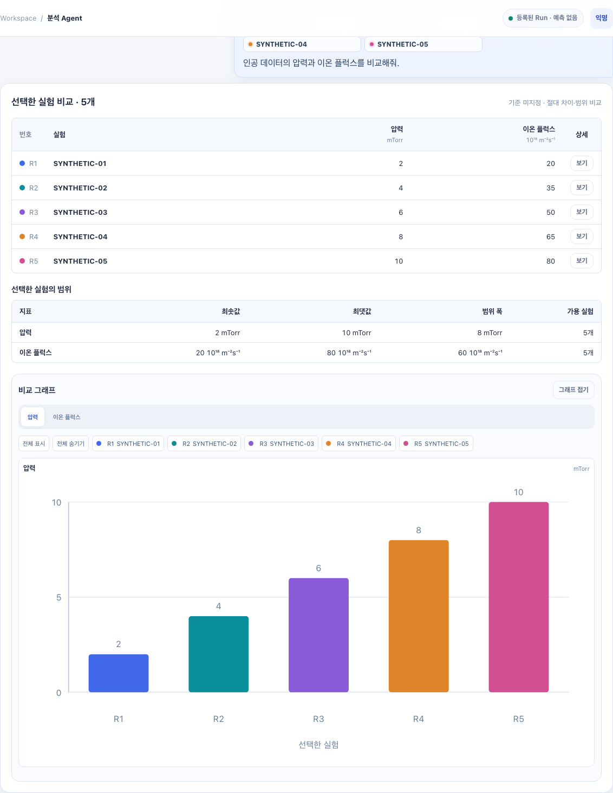
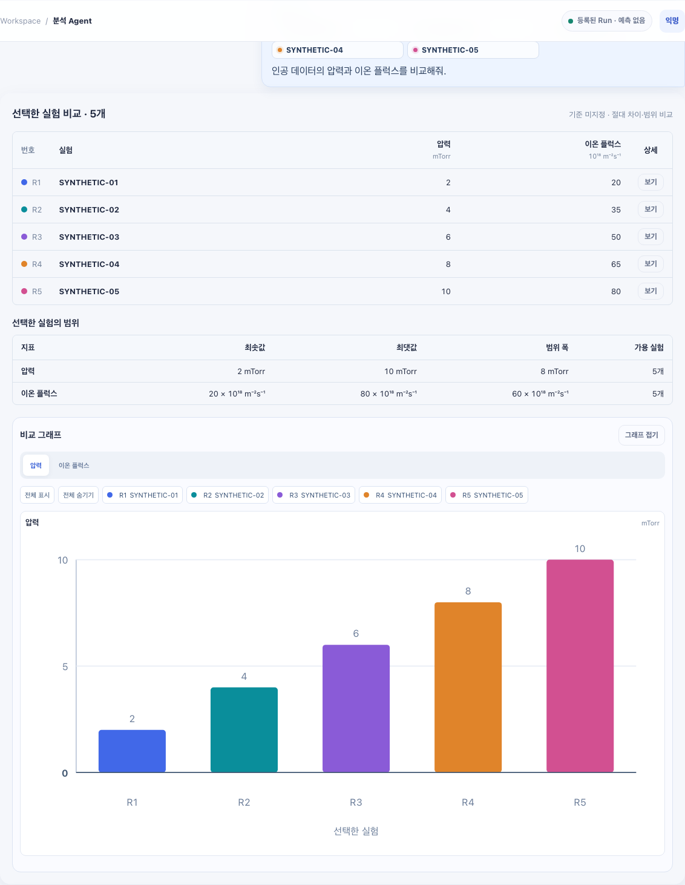

# 실험 분석 UI PR 화면 확인

모든 값과 실험 식별자는 소량의 인공 테스트 데이터다. 실제 실험 데이터·사용자 대화·외부 모델 응답을 사용하지 않았다.

- 이전: `feat/agent-v2-runtime`의 `7f98068`.
- 이후: `feat/agent-v2-analysis-ui`의 결과 렌더링.
- 동일한 인공 Run 5개와 압력·플럭스 비교 응답을 브라우저 API 라우팅으로 제공했다.
- Chromium, 한국어, Asia/Seoul, 1440×1000, 배율 1에서 촬영했다.
- 390 / 800 / 1008 / 1440px에서 비교 결과·진행 화면에 페이지 가로 넘침과 JavaScript 오류가 없음을 확인했다.
- 첨부 이미지는 비교 결과 영역의 실제 브라우저 캡처다. LLM의 계획·물리적 해석 정확도를 입증하는 자료가 아니다.
- 화면 전체의 채팅 폭·폰트·진행 기록 스타일은 후속 채팅 UX PR에 포함된다.

| 이전 | 이후 |
|---|---|
|  |  |
