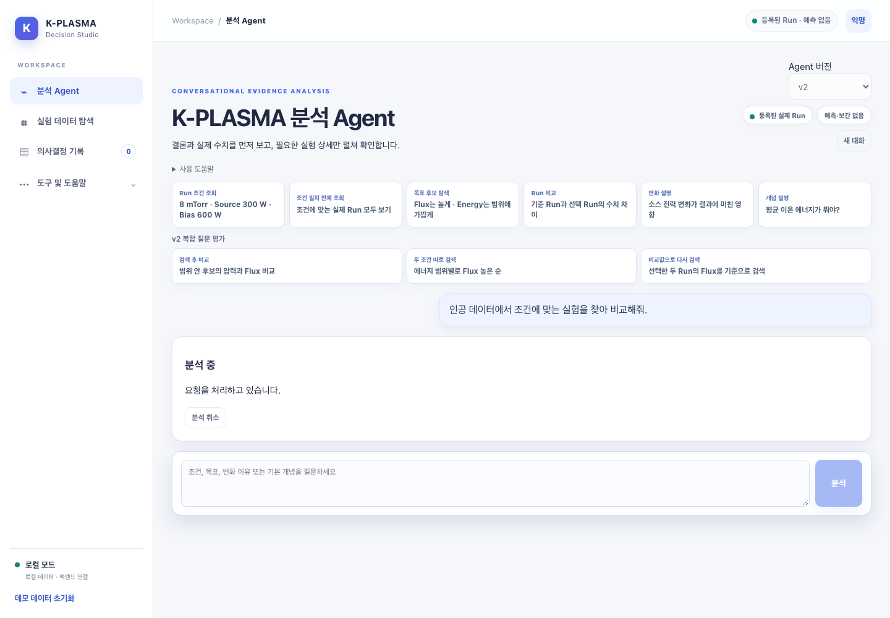
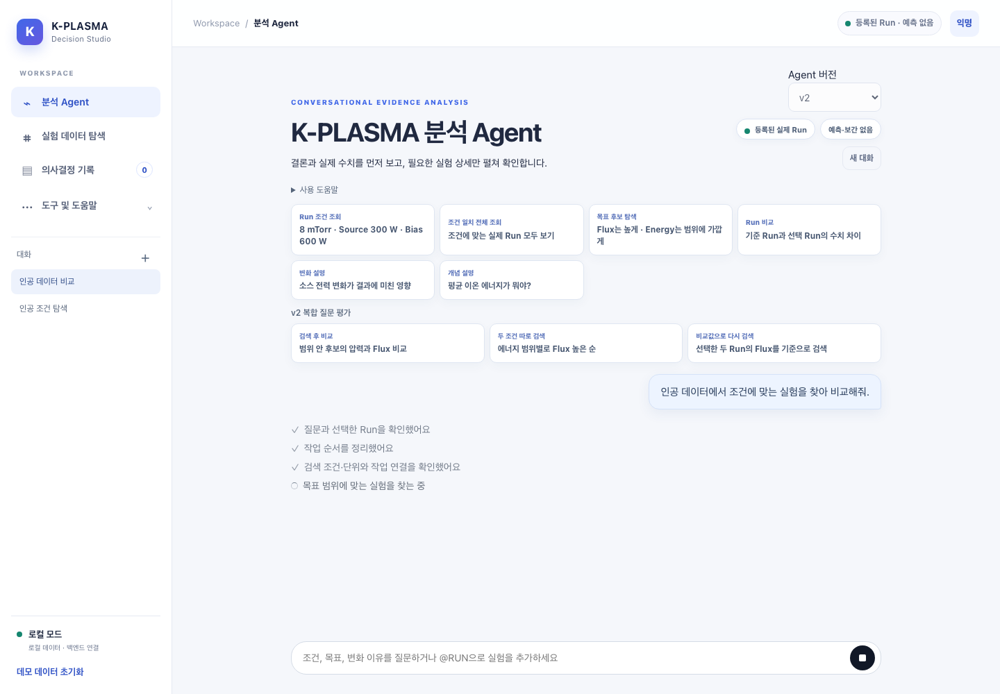

# 채팅 UX PR 화면 확인

실제 Run·사용자 기록 대신 인공 질문·작업 이벤트와 두 개의 인공 대화방만 사용했다. 외부 LLM은 호출하지 않았다.

- 이전: 분석 결과 UI PR의 화면.
- 이후: 채팅 UX PR의 화면.
- 두 화면에 같은 RUNNING 요청과 같은 질문·계획·검증·검색 활동을 제공했다.
- Chromium, 한국어, Asia/Seoul, 1440×1000, 배율 1에서 촬영했다.
- 390 / 800 / 1008 / 1440px에서 비교 결과·진행 화면을 검증했다. 페이지 가로 넘침과 JavaScript 오류는 없었다.
- 새 화면은 대화방 목록·850px 채팅 영역·회색 실제 활동 기록·입력창 중지 버튼을 표시한다.
- UI 증거는 API 라우팅으로 주입한 인공 이벤트의 실제 브라우저 렌더링이다. 실제 모델 처리 시간이나 최종 답변 정확도를 입증하지 않는다.
- 별도로 실제 HTTP·DB·인공 워커·브라우저를 잇는 `npm run test:e2e:v2`가 통과했다.

| 이전 | 이후 |
|---|---|
|  |  |
