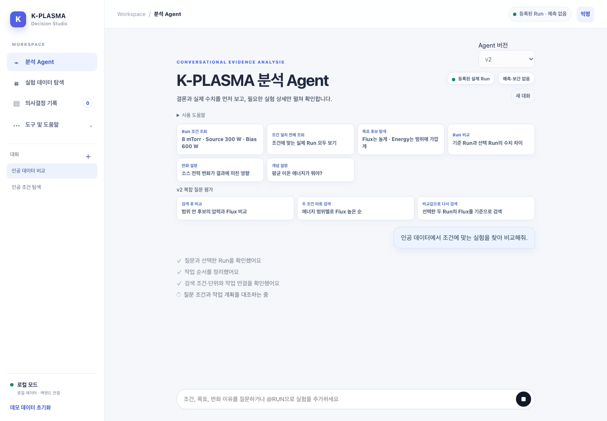

# 계획 의미 검토 진행 UI

동일한 인공 질문·활동 목록에 `PLAN_REVIEW` started 이벤트를 넣어 표시를 비교했다. 실제 질문·실험 수치·사용자 대화·외부 Decisions 응답은 사용하지 않았다.

- 이전: 채팅 UX PR. 이후: Decisions 계획 검토 PR.
- Chromium·한국어·Asia/Seoul·배율 1, 1440×1000에서 실제 화면을 촬영했다.
- 390 / 800 / 1008 / 1440px에서 페이지 가로 넘침과 JavaScript 오류가 없음을 확인했다.
- 이전의 일반적인 작업 진행 문구 대신 질문 조건·작업 계획 대조 중임을 표시한다.
- 이 UI 증거는 실제 Decisions 호출이나 판정 정확도의 증거가 아니다. 판정 품질과 한계는 별도 고정 평가 보고서를 따른다.

| 이전 | 이후 |
|---|---|
|  |  |
