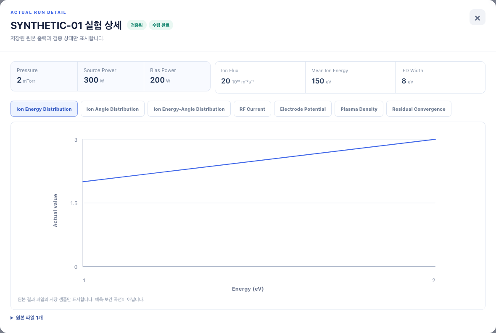

# 원본 해상도 API와 상세 그래프 소비자

모든 스크린샷은 인공 `SYNTHETIC-01`의 2×2 IEAD를 사용했다. 실제 Run 데이터와 사용자 대화는 포함하지 않는다.

원본 해상도 출력 API만 먼저 배포하면 기존 SVG가 대용량 격자를 모두 DOM 셀로 만들 수 있다. 따라서 원본 좌표를 보존하는 상세 그래프 렌더러와 인공 대용량 테스트를 실행 기반 PR에 함께 배치했다. 작은 격자는 기존 SVG 경로를 유지하고, 큰 격자는 Canvas를 사용한다.

- 이전: 렌더러 이동 전 실행 기반 PR `7f98068`. 이후: 같은 PR에 상세 그래프 소비자를 함께 배치한 화면.
- 같은 Chromium·한국어·Asia/Seoul·배율 1, 1440×1000에서 실제 브라우저로 촬영했다. 같은 인공 입력과 선택 탭을 사용했다.
- 390 / 800 / 1008 / 1440px에서 상세 모달 가로 넘침·JavaScript 오류가 없음을 확인했다.
- 브라우저 캡처는 작은 격자의 기존 표시 유지 증거다. 201×2136 인공 격자의 Canvas 경로는 컴포넌트 테스트로 검증했으며, 실제 대용량 데이터의 브라우저 지연 시간을 측정한 자료는 아니다.

| 이전 | 이후 |
|---|---|
|  |  |
